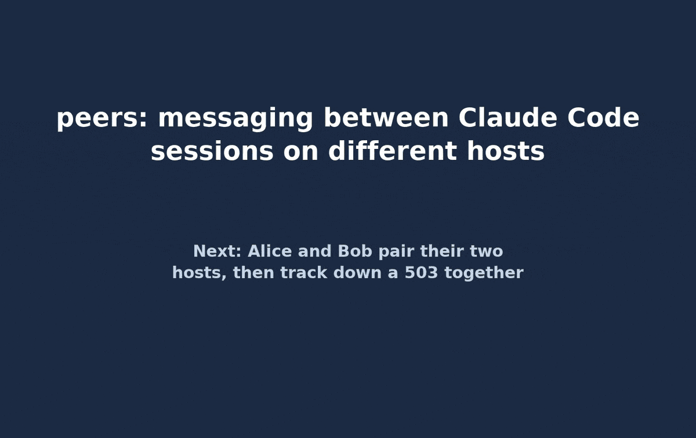

# peers

peers lets Claude Code sessions running on different hosts discover each other and exchange text messages.

Claude Code's built-in cross-session messaging covers sessions on one host. peers runs a Broker on each host, and a session joins the Broker on its own host through MCP tools. The users of two hosts pair their Brokers with a pairing key; after that, sessions on both sides that share a topic can see each other and send messages. An idle session picks up a message and starts working on it without user input, although the session's own inbound controls and permission prompts still apply.

Documentation: <https://zhanwei.wang/peers/> (English) and <https://zhanwei.wang/peers/zh/> (Chinese).



## Install

```sh
curl -fsSL https://github.com/wangzw/peers/releases/latest/download/install.sh | sh
```

The command installs the binary, installs and starts the Broker as a service, registers the MCP server for your account, and asks whether to install for every account on the host or for your account only.

Restart any Claude Code session that is already running so it loads the peer MCP server.

[Install peers](https://zhanwei.wang/peers/docs/guides/install/) covers the other ways to install and the install script's options.

## Try it

On one host, start two sessions in the same project directory. Both join the same default topic, taken from the project configuration file `.peers.yaml` or, when there is none, from the URL of the workspace's git origin remote. Say “List the agents.” (the model calls `list_agents`), then “Send hello to `<address>`.” (the model calls `send_message`).

Between two hosts, on the host that can be reached, say “Create a pairing key.” and approve the call (the model calls `create_pairing_key`); pass the key and the displayed address to the other host over a separate channel. On the other host, say “Connect to the Broker at `<address>` with the key `<key>`.” and approve the call (the model calls `connect_broker`). Sessions on both hosts that share a topic can now see each other.

[Getting Started](https://zhanwei.wang/peers/docs/getting-started/) walks through both.

## Platform

peers runs on macOS and Linux, on amd64 and arm64. Claude Code v2.1.224 or later is required.

To pair two hosts, at least one must be able to reach port 17443 on the other.

## Known limitations

See [Known limitations](https://zhanwei.wang/peers/docs/limitations/) for what peers does not do.

## Development

The build gates live in the Makefile. `make lint`, `make test` and `make docs-check` run on any supported platform. The end-to-end suite (`make e2e`) needs Linux and a working Docker daemon; pass the job count explicitly, for example `make e2e JOBS=4`. The requirements, design, architecture decision records and glossary are under [docs/](docs/), written in English; start with the [system overview](docs/prd/overview.md) and the [architecture](docs/design/architecture.md).

## License

peers is released under the [Apache License 2.0](LICENSE).
