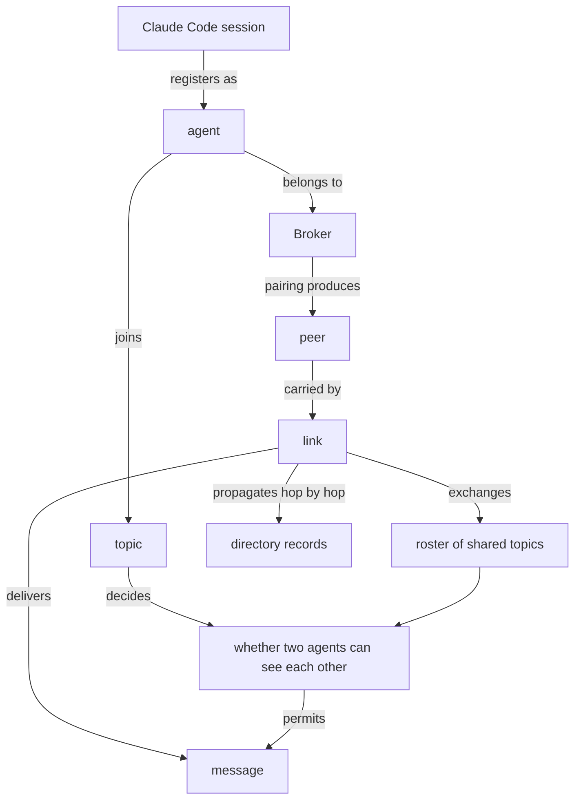
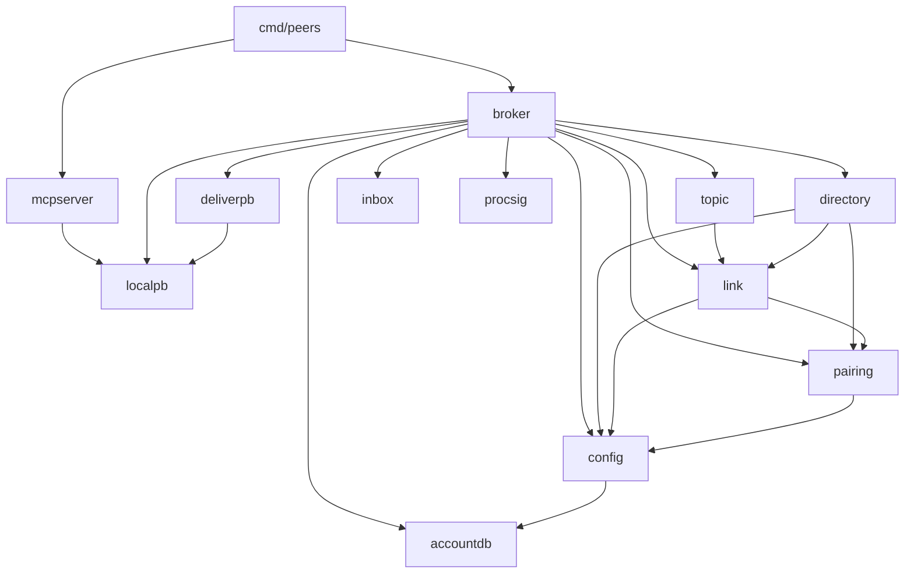
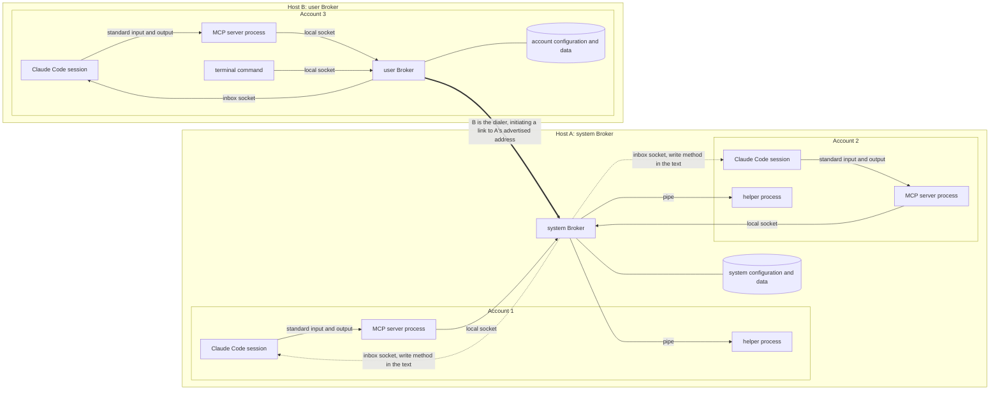
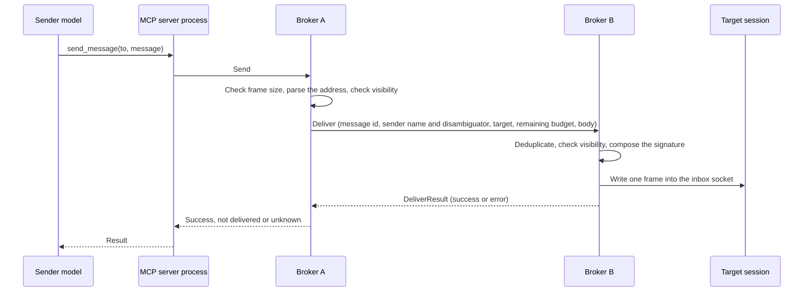

# Architecture

## Overview

peers is a Go program compiled into a single binary `peers`, which runs by subcommand as a long-lived [Broker](../glossary.md) process, one MCP server process per session, and commands a user runs in a terminal. The MCP server process forwards the model's calls to a Broker on the local host, and the Broker does all the rest: registering agents, maintaining topic membership, keeping links with peers, exchanging directory records and rosters, and writing messages into sessions' inbox sockets. A Broker has two deployment forms, system and user ([ADR-broker-deployment-modes](../adr/adr-broker-deployment-modes.md)); both run the same code, and differ in the identity they start under, the range of accounts they serve and the locations of their files.

### Core Concepts

The concepts below are ordered by dependency; their definitions are in the [glossary](../glossary.md).

| Concept | Relationship to other concepts | Lifecycle and scope |
|---|---|---|
| Broker | Identified by its fingerprint; holds all agents under the accounts it serves and all its own peers; several Broker instances on one host are independent of each other | The identity key is generated and written to disk on first start and never changes; the process may restart; at most one instance per account |
| agent | Belongs to one Broker and one system account, corresponds to one Claude Code session, is identified by the session's inbox socket path, takes its name from the session name ([ADR-agent-identity-by-inbox-socket](../adr/adr-agent-identity-by-inbox-socket.md)), and may join several topics | Established when the session's MCP server process registers while the session name is usable, deregistered when the last registration connection of that session disconnects or the session record disappears; renaming the session or clearing its conversation does not affect it; not written to disk |
| agent address | Made up of the agent's name, an optional disambiguator, and the alias the Broker seeing the address uses for the Broker hosting it | Assembled from the current name and alias each time it is used, not stored |
| topic | Associates agents on several Brokers by name and decides visibility | Membership lasts with the agent and is not written to disk; a public declaration is a record in the directory |
| peer | Produced by a pairing, keyed by the other side's fingerprint, carrying the alias the other side self-reports, an optional local alias, and this side's role in the pair; when this side is the dialer it also has the other side's candidate addresses, which this side tries in order when dialing | Written to disk, kept across Broker restarts, deleted on unpairing |
| link | One per peer pair, established by the dialer, carrying rosters, directory records and messages | Exists only in memory; after a disconnect the dialer re-establishes it ([ADR-initiator-redials](../adr/adr-initiator-redials.md)) |
| directory | The broker cards and public topic declarations this Broker holds, each signed by its publisher | Written to disk; deleted when a record expires or is withdrawn |
| message | From one agent to another, over at most one link | Exists in memory only for the duration of one send call |

The diagram cannot show the propagation scope of each kind of data: a roster reaches only the other end of a link, and only for topics both sides have members in; a directory record is passed on by each Broker that accepts it to its own other peers; a message travels only on the one link between sender and receiver, and fails without a link.

An agent address is relative to the Broker that sees it. The same agent can have different addresses on two Brokers, because each Broker may use a different alias for the same peer. A message's signature is therefore produced by the receiver's Broker, so that when the receiver replies to the signature the address resolves.

Only the identity key, the peer table, the configuration, the directory and the audit log are written to disk; a pre-provisioned static key is an item in the configuration. Agents, topic membership, links and messages are not written to disk; after a Broker restart they are restored by the MCP server processes registering again and by the links exchanging again.

### Design Mainline

| Problem | Mechanism | Where it is specified |
|---|---|---|
| Deliver a message into a Claude Code session that does not know this system exists, and let an idle session start processing on its own | The local Broker writes one cross-session message frame, carrying a signature and no authentication line, into the session's inbox socket ([ADR-inbox-delivery-without-auth-token](../adr/adr-inbox-delivery-without-auth-token.md)) | [inbox](modules/design-inbox.md) |
| Know which local sessions participate without scanning all sessions | The MCP server process registers its session with the Broker over the local socket after it starts, reporting the inbox socket path from its environment; the Broker takes the session name and status from that session's record in the session registry and watches it for changes, and deregisters when the last registration connection disconnects ([ADR-register-through-mcp-server-process](../adr/adr-register-through-mcp-server-process.md)) | [mcpserver](modules/design-mcpserver.md), [broker](modules/design-broker.md), [inbox](modules/design-inbox.md) |
| Limit who can see whom without leaking topic names to unrelated peers | Use topics as the scope of visibility ([ADR-topic-scoped-visibility](../adr/adr-topic-scoped-visibility.md)); the two ends of a link exchange salted digests of topic names and exchange rosters only for topics whose digests match ([ADR-salted-topic-digest](../adr/adr-salted-topic-digest.md)) | [topic](modules/design-topic.md) |
| Confirm the other side's identity without a certificate authority | Self-signed certificates; on first connection each side proves its certificate fingerprint to the other with the pairing key, and afterwards only saved fingerprints are trusted ([ADR-pairing-key-trust](../adr/adr-pairing-key-trust.md)) | [pairing](modules/design-pairing.md) |
| Keep two-way communication when only one side is reachable | One bidirectional stream, established by the side that initiated pairing and re-established after a disconnect, with both directions equal once established ([ADR-grpc-stream-links](../adr/adr-grpc-stream-links.md), [ADR-initiator-redials](../adr/adr-initiator-redials.md)) | [link](modules/design-link.md), [pairing](modules/design-pairing.md) |
| Make a public Broker known to the whole connected network without letting a propagator forge it | Records signed by the publisher, with a version and an expiry time, reconciled hop by hop over links ([ADR-signed-directory-reconciliation](../adr/adr-signed-directory-reconciliation.md)) | [directory](modules/design-directory.md) |
| Give the final result when a send call returns, leaving no follow-up state | Sending is synchronous throughout, and the result is success, not delivered or unknown; the receiver deduplicates by message id; the system itself queues no messages ([ADR-synchronous-delivery](../adr/adr-synchronous-delivery.md)) | [broker](modules/design-broker.md) |
| Make an address in a reply always resolve, and stop a peer from using another peer's alias | An agent address is relative to the Broker that sees it, and the signature is composed by the receiver's Broker from its own effective alias for the sender's Broker (the local alias set for it, or the self-reported alias when there is none); alias conflicts are checked each time the other side's alias becomes known | [broker](modules/design-broker.md), [pairing](modules/design-pairing.md) |
| Provide both an administrator-supplied Broker and self-service for unprivileged accounts on one host | Two forms, system and user; at most one instance per account, guaranteed by a lock that depends only on the account ([ADR-broker-deployment-modes](../adr/adr-broker-deployment-modes.md)) | [broker](modules/design-broker.md), [config](modules/design-config.md) |
| Let two hosts pair by default without several Brokers on one host displacing each other | Listen on all local addresses under the default configuration; when the listen address cannot be bound, do not switch automatically, a foreground run fails to start and a service run enters a degraded run with local features working ([ADR-listen-by-default](../adr/adr-listen-by-default.md), [ADR-degraded-run](../adr/adr-degraded-run.md)) | [broker](modules/design-broker.md), [link](modules/design-link.md), [config](modules/design-config.md) |
| Tell a Broker that listens on all addresses where other Brokers should connect | The advertised address is a list, by default the address of the interface holding the default route, changeable to a specified address or extended with more; the acceptor tells it to the dialer in the handshake reply, `Hello` and `PeerInfo`, and a public Broker signs it into its card; each item carries a kind, and items of an unknown kind are skipped; the dialer tries the candidate addresses in order and checks the fingerprint ([ADR-advertised-address](../adr/adr-advertised-address.md)) | [link](modules/design-link.md), [pairing](modules/design-pairing.md), [directory](modules/design-directory.md), [config](modules/design-config.md) |
| Determine who is calling and who may perform management operations when several accounts share a Broker | The caller's account is taken from the credentials of the process on the other end of the local socket (process credentials); a management operation requires that the caller's account have write permission on the configuration file ([ADR-management-by-config-file-permission](../adr/adr-management-by-config-file-permission.md)) | [broker](modules/design-broker.md) |
| Let a user control reading and changing configuration separately, and investigate later | Split reading and writing into different tools with a read-only attribute, and write an audit log entry on every change ([ADR-config-through-tools](../adr/adr-config-through-tools.md)) | [mcpserver](modules/design-mcpserver.md), [config](modules/design-config.md) |

## Module Dependency Graph

Arrows point from user to provider. Packages of this project reference only along the arrows; the standard library, external dependencies and vendored source under `third_party` are not subject to this. `inbox` references no other package of this project; `config` references only `accountdb`, to obtain the current account's home directory. Packages under `internal/testkit` are referenced only by `_test.go` files; a non-test file referencing one is rejected by the dependency check. `link` provides only an authenticated frame channel and does not parse topic or directory frames; `topic` and `directory` each register their own frame kinds with `link`.

`localpb` and `deliverpb` are `broker`'s proto packages, listed as separate nodes in the graph. `mcpserver` references only `localpb`, never the `broker` package itself; `deliverpb` carries cross-Broker delivery frames and is referenced only by `broker`. `accountdb` is the account-database lookup package shared by `broker` and `config`, depends only on the standard library, and is a separate node in the graph. The `lookupgate` subpackage inside the `broker` package is the account-database lookup gate shared by `broker` and its `helper`, so that one process runs at most 4 getent lookups at a time; it depends only on the standard library and still belongs to the `broker` node in the graph. `procsig` is the shared package that checks a pid before a signal is sent to it, depends only on the standard library, and is a separate node in the graph.

Collaboration that has no arrow in the graph but is needed at run time is done by `broker` through interface injection or forwarding. Interface injection is used for `pairing`: initiating a handshake requires dialing and unpairing requires closing a link, while dialing and closing are implemented by `link`, which `broker` hands to `pairing` as an interface during assembly. The other collaborations are forwarding: `broker` subscribes to configuration changes and notifies `link` and `directory` respectively; the advertised address list a card carries is passed by `broker` to `pairing` to record as candidate addresses, and a change in the local advertised address list is announced by `broker` to `link` and `directory`; comparison of pairing results against the directory, and public topic declarations, are calls `broker` makes to the relevant packages in turn.

`mcpserver` references only `internal/broker/localpb`, the proto package holding the local interface's client and message definitions, and never the `broker` package itself; the two run in different processes. `cmd/peers` is the assembly entry point and has no design document of its own; terminal command behaviour is recorded in the External Interface Contract section of [broker](modules/design-broker.md). `cmd/peers` does not reference `localpb`; the `service status` and `service audit` clients live in `termcmd`, a subpackage of `mcpserver`, and `pairingprompt`, which generates the pairing connection prompt, is also its subpackage, without changing the dependency graph. The command line is built with cobra, which generates the command tree, help groups, usage and shell completion ([ADR-cli-framework](../adr/adr-cli-framework.md)); cobra is an external dependency of `cmd/peers` and does not appear in the project package dependency graph.

## Logical Deployment Architecture

A system Broker runs as a system service with privileges, at most one per host, serving the accounts on the host permitted to connect to its local socket (`REQ-broker-config-018`, `REQ-broker-config-027`). A user Broker runs under an ordinary account and serves only agents of that account (`REQ-broker-config-019`); several accounts on one host may each run one. At most one Broker instance per account. Each instance on one host has its own identity, peer table, directory, configuration and audit log, is an independent Broker in the connected network, and pairs on its own.

The MCP server process is started by Claude Code as a child of the session, has the same lifetime as the session, and belongs to the same account as the session. A user Broker reads the session registry itself and writes into sessions' inbox sockets. A system Broker spawns for each served account a helper process that switches to that account, which reads and watches that account's session registry and writes to that account's sessions; none of the writers is a descendant of any session. The Broker and the helper process access the session registry and inbox sockets by the paths the sessions report, seeing the same file system as the sessions they serve. A link is the only cross-host connection; in the diagram B is the dialer, initiating to A's candidate addresses in the peer table, and once established A and B are equal on the link.

## Physical Deployment Architecture

| Process | How it is started | Count | Listens |
|---|---|---|---|
| system Broker, `peers service run --system` | Started by the system service an administrator installs, running as root | At most one per host | Local socket; the TCP address given by `broker.listen` |
| user Broker, `peers service run --user` | Started as a service the user installs (the Broker starts right after installation and thereafter on login), or started by the user in a terminal outside a session | At most one per account | Local socket; the TCP address given by `broker.listen` |
| helper process | Spawned on demand by the system Broker (`peers internal account-helper`), running after switching to the served account | One per served account | None |
| permission-check process | Spawned by the system Broker each time it judges a caller's permission on the configuration file (`peers internal access-check`), running as root and switching only the effective identity to the caller's account, exiting after the check; at most 8 at once, at most 2 per account, with account lookups and caller-name lookups sharing the process-wide 4 getent slots | On demand | None |
| MCP server process, `peers mcp` | Started by Claude Code according to the session's tool configuration | One per session | None |
| terminal command, e.g. `peers service status` | Run by the user | On demand | None |

Under the default configuration `broker.listen` is `:17443`, and the Broker listens on port 17443 of all local addresses, including IPv6 addresses when IPv6 is enabled ([ADR-listen-by-default](../adr/adr-listen-by-default.md), `REQ-broker-config-028`); this port is only a value in the default configuration, and the code special-cases no port. When a second account's Broker on the same host starts under the default configuration, the listen address is already taken: on a fresh install or reinstall, the pre-check finds the address taken by another process, the installation fails and registers no service (`REQ-broker-config-064`); for an already installed service started later, the service enters a local-only degraded run, and a foreground start fails to start and reports the address unavailable, leaving the user to switch to another address or port in the startup parameter `--listen` or the configuration (`REQ-broker-config-024`, `REQ-broker-config-025`, `REQ-broker-config-058`). `--listen` applies only to the current run and does not read or write the configuration file; during it, a call through a tool that changes the listen address fails (`REQ-broker-config-029`). Other Brokers connect to it using its advertised address, by default the address of the interface holding the default route, each paired with the listen port ([ADR-advertised-address](../adr/adr-advertised-address.md), `REQ-broker-config-030`).

The locations of the various files depend on the form; the complete path table is in [config](modules/design-config.md): a user installation's configuration, data and audit log are under the account's `~/.peers/`, and a system installation's are under `/etc/peers/`, `/var/lib/peers/` and `/var/log/peers/` respectively; the runtime directory holds the local socket and the account lock, which is the lock file guaranteeing at most one Broker instance per account; the runtime directory depends only on the account and is independent of the form, the configuration content, the listen address and environment variables. The system service is a launchd daemon on macOS and a systemd system unit on Linux; the user service is a launchd user agent on macOS and a systemd user unit on Linux. Both services start the Broker immediately on installation and wait for the local socket to answer; uninstallation stops the service first and then removes the service definition, keeping the configuration, identity and audit log.

The Broker an MCP server process connects to is determined in a fixed order: the user Broker of its own account that is running, then the system Broker its account may connect to; when neither exists it starts no Broker, tool calls return an error stating that no Broker is available and how to start one, and in the background it re-selects with connection backoff (`REQ-broker-config-026`, `REQ-broker-config-038`). The MCP server process starts no Broker.

## Data Flow

A cross-host send passes along the following path.

Visibility is checked once at each end of the link: Broker A against the roster of B it holds, and Broker B against the roster of A it holds and its local membership. The delivery request carries no sender alias; the alias in the signature is the effective alias Broker B uses for Broker A. When Broker A gets no definite reply, the result is "unknown" rather than "not delivered". When the target is local, the intermediate link round trip is omitted and the Broker checks and writes directly (`REQ-agent-messaging-028`).

## Cross-Cutting Design

### Error Model

Every error carries a stable error code and a description for the model. The description begins with a phrase stating the result: a send that definitely did not write into the target session begins with `Not sent`, one that cannot be determined begins with `Delivery unknown`, and a failed pairing begins with `Not connected`, so that the model does not take a failure or an unknown as success. For an error returned by a link peer, when the code is within the set the receiver may return, the original code is kept and the description is relayed by the local side by quotation, indicating which Broker produced it; a code outside the set is treated as `delivery_unknown`.

Error codes are a closed set:

| Error code | Meaning | Produced by |
|---|---|---|
| `invalid_argument` | A parameter is missing, malformed or not allowed, or the current configuration does not allow the call | Various modules |
| `too_large` | The message, encoded into an inbox frame, exceeds the limit | `broker` |
| `not_found` | The alias, name, disambiguator, topic or peer does not exist | `broker`, `pairing` |
| `ambiguous` | The name matches several visible agents on the target Broker | `broker` |
| `not_visible` | The caller and the target share no topic | `broker` |
| `peer_unreachable` | The link is not established and the delivery request was never sent; or during pairing the other side's address cannot be connected | `broker`, `link`, `pairing` |
| `inbox_unwritable` | It is certain that nothing was written into the target session's inbox socket | `broker`, `inbox` |
| `delivery_unknown` | It cannot be determined whether the message was written into the target session | `broker` |
| `pairing_rejected` | The pairing key is invalid or expired, verification failed, or attempts are too frequent | `pairing` |
| `needs_local_alias` | The alias conflicts while initiating pairing and the caller must supply a local alias | `pairing` |
| `permission_denied` | The caller's account lacks the read or write permission on the Broker's configuration file that the call requires | `broker` |
| `broker_offline` | A peer delivery is refused while this Broker is offline | `broker` |
| `broker_degraded` | A call uses a feature unavailable during a degraded run | `broker` |
| `not_registered` | The call needs an agent identity but the session has not completed registration: the session record cannot be found, the session name is unusable, the first registration frame has no socket path, or the socket does not belong to the caller's account; or the given agent identity is invalid or belongs to another account | `broker`, `mcpserver` |
| `version_mismatch` | The protocol version of the local interface or the link is incompatible | `broker`, `link` |
| `quota_exceeded` | A quota is full: a limit on the number of directory records or topics, too frequent topic changes, or a peer's inbound quota | `broker`, `directory`, `topic` |
| `internal` | An internal error not of the kinds above | Various modules |

### Interface Contract Conventions

Cross-module binary interfaces are fixed by the proto definitions of each package. The proto packages are `internal/broker/localpb`, `internal/broker/deliverpb`, `internal/link/linkpb`, `internal/pairing/pairingpb`, `internal/topic/topicpb` and `internal/directory/directorypb`; one proto per directory, the proto package name being the directory path relative to the repository root separated by dots (such as `internal.link.linkpb`), and the generated Go code is placed in the same directory as the proto and committed to the repository. Proto packages reference each other only along the module dependency direction; there is no shared address package: `localpb`, `linkpb`, `pairingpb` and `directorypb`, which carry advertised addresses, each define an `AdvertisedAddress` message, while `topicpb` and `deliverpb` do not. A directory record's payload is the `RecordBody` message defined by `directorypb`, the record's `raw` is its serialized result, and the signature is computed over `raw`.

Frame `kind` values are divided into numbered ranges by package, and the allocation is closed:

| Range | Owning package |
|---|---|
| 1-99 | link (`linkpb`) |
| 100-199 | pairing (`pairingpb`) |
| 200-299 | topic (`topicpb`) |
| 300-399 | directory (`directorypb`) |
| 400-499 | `broker`'s delivery package (`deliverpb`) |

kind constants are written by hand in a `kind.go` inside the corresponding proto package directory, not as a proto enum, so that a peer can receive an unknown kind without enum conversion. The payload message of each kind and its category (status frame, request frame or reply frame) are in [link](modules/design-link.md), [topic](modules/design-topic.md), [directory](modules/design-directory.md), [pairing](modules/design-pairing.md) and [broker](modules/design-broker.md).

Two protocol version constants exist: the local interface version `localpb.ProtocolVersion` for the local `Local` service, and the link version `linkpb.ProtocolVersion` for the link handshake. Pairing frames travel on the link stream and are covered by the link version; pairing has no version constant of its own. Pairing happens before the link's `Hello`, so `PairRequest` carries the sender's link version in field 4, and the acceptor compares it before looking up the key, so that two sides of different versions do not misreport a version incompatibility as an invalid key. Adding a kind or a field to an existing frame is a compatible change and does not raise the version; only changing the meaning of an existing kind or existing field raises it. Appending a value to an existing enum is likewise a compatible change, such as the expired-key reason appended to pairing rejection reasons; an old version handles an unknown value by each module's own rule, and `pairing` treats it as a protocol error. Version comparison and handling of incompatibility are in [broker](modules/design-broker.md) and [link](modules/design-link.md).

Equal versions are compatible; an omitted version is treated as incompatible, and both ends compare the version the other reports. The handshake's own numbering and meaning stay fixed across all versions: the local `Hello` request and reply each carry the version in the first field, the three fields of `ErrorDetail`, value 13 of `version_mismatch` among the error codes, the version field of the link `Hello`, the `reason` field of `Reject` and its value 1 for "protocol version incompatible", and the pairing `PairRequest`'s `protocol_version` (field 4) and value 5 for "version incompatible" among `PairReject` reasons. If the handshake's own numbering or meaning changed, the two ends could not learn of their incompatibility.

The raise of the link protocol from version 1 to 2 is the first version raise that changes meaning. A new initiator can only get "invalid key" from an old acceptor: the old acceptor does not know field 4 and does not find the key by the old lookup. This asymmetry is unavoidable for a first raise; for later raises both ends compare as in the paragraph above, so the pairing stage can already report the version incompatibility.

Handling of unknown input is uniform: an unknown status frame or reply frame is dropped; an unknown request frame is answered with "unsupported", and the reply names the request's kind; unknown fields in a known frame are ignored; items of an unknown kind in the advertised address list are skipped one by one without affecting the rest ([link](modules/design-link.md), [pairing](modules/design-pairing.md)).

Local errors are placed in the details of a gRPC status, carrying exactly one `ErrorDetail` with the stable error code, a description for the model, and the fingerprint of the Broker that produced the error, which is empty for a locally produced error. The waiting or revoked state of `Register` is not an error but an event on the registration stream. Error code values and their mapping are in [broker](modules/design-broker.md). A cross-Broker delivery reply is `deliverpb`'s `DeliverResult`, whose `result` is a oneof of `delivered` and `error`, with `delivered` carrying `Delivered` and `error` carrying `localpb.ErrorDetail`; when the sender's Broker converts it into the `ErrorDetail` of the local `Send` reply, it fills in the fingerprint of the Broker that produced the error.

Fingerprints are 32 raw binary bytes on the wire, not a hex string; hex is for display only. The agent identity is placed in a request message field, not in gRPC metadata.

The advertised address message consists of a kind and an address; this version produces only the direct kind. The kind is a string rather than an enum, so that an unknown kind can be carried as is and skipped where used ([ADR-advertised-address](../adr/adr-advertised-address.md), [config](modules/design-config.md)).

### Authentication and Authorization Boundaries

| Boundary | Authentication | Authorization scope |
|---|---|---|
| MCP server process, terminal command to user Broker | The local socket's permission is `0600`, and the Broker additionally checks with process credentials that the caller's account is the same as its own | Every operation of the local interface |
| MCP server process, terminal command to system Broker | The local socket's file permission decides which accounts can connect; the caller's account comes from process credentials; a uid with no account entry shares an unknown-account bucket first, and a failed or timed-out lookup refuses the connection | Registration, listing, topic operations and sending have no precondition, with topic changes rate-limited per account, each account holding at most 256 registration streams at once and the whole Broker holding at most 4096 local connections at once, of which at most 64 wait on an account lookup for at most 5 seconds each; reading configuration, audit and full status requires the caller's account to have read permission on the configuration file; changing configuration, generating a pairing key, and initiating or unpairing require write permission |
| MCP server process to agent identity | In the caller's account's session registry, the Broker finds the session record the registration request points at (in the system form, read through that account's helper process) and itself verifies that the inbox socket recorded there is owned by the caller's account | One connection can register only a session of its own account; any process of an account can register any session of that account |
| Broker to Broker | Mutual TLS, with the peer's certificate fingerprint in the peer table, or the pairing handshake completed within this connection | Exchange rosters of shared topics and directory records, and deliver messages to visible agents |
| Broker to Claude Code session | Presents no session authentication token | Decided by that session's inbound controls |
| Model to tool | Claude Code's permission settings | Each tool is authorized separately; this is independent of the Broker-side permission decision, and the operation runs only if both pass |

The caller's identity is not a parameter of any call, and the Broker does not trust the caller's statement: the socket path and configuration directory reported in a registration request are used only to find the session record and cannot let a caller register a session belonging to another account. Process credentials are given by the operating system when the connection is established and read once when the connection is accepted; every call on that connection belongs to this account. What is identified is the account of the process, not a person or a model: any process of the same account can call with that account's permissions. A user Broker's configuration file belongs to its own account, so no permission decision is made. A system Broker spawns, on each decision, a permission-check process that switches to the caller's account and performs the actual access check on the configuration file, rather than inferring from permission bits; supplementary groups are read from the account database on each decision, so an account's group membership takes effect for the next call ([ADR-management-by-config-file-permission](../adr/adr-management-by-config-file-permission.md), `REQ-broker-config-021` through `REQ-broker-config-023`). When the check process reports a protocol version mismatch, the call fails with `internal`.

A Broker cannot verify the agent names and membership a peer reports and can only trust them; the scope of this trust is no wider. A peer cannot speak for an agent on another Broker: the sender in a delivery request must be in the roster the peer on this link sent, and the alias in the signature is chosen by the receiver according to its own effective alias for that peer (the local alias, or the self-reported alias when there is none), not taken from the delivery request. Authentication only determines who the peer is; it does not let it occupy local resources without bound: the Broker limits, per source, the status-frame queue, concurrent request handling, deduplication-table entries and session quota one peer can occupy, and exceeding a limit affects only that peer ([ADR-peer-resource-limits](../adr/adr-peer-resource-limits.md)).

The advertised address list an acceptor gives in the handshake reply, `Hello` and `PeerInfo`, and the list a card carries, are likewise unverified. They only decide where the dialer should dial; after connecting, the fingerprint is still checked, an address with a mismatched fingerprint is abandoned, and a wrong address merely fails to connect; the local address a peer sees on the connection is not used ([ADR-advertised-address](../adr/adr-advertised-address.md)).

### Data Consistency and Transaction Boundaries

The system has no cross-process transactions. Rosters and the directory are eventually consistent across Brokers: they are exchanged in full when a link is established and pushed incrementally afterwards, and a peer's roster is invalidated as a whole when the link disconnects. Writes to the peer table and the directory are atomic replacement of a single file; the configuration file is rewritten in place on the original file, preserving the owner, group, permission bits and access control lists set by the administrator. Sending is not a transaction: when the receiver writes successfully but the reply is lost, the sender resends under the budget with the same message id, and the receiver's deduplication table ensures the session receives only one copy; when the budget runs out with no definite reply, the result is unknown (`REQ-agent-messaging-027`).

### Concurrency Model

Inside a Broker each link has a read goroutine, a write goroutine and a goroutine that processes status frames in order; delivery requests are handled concurrently on their own, with at most 64 in total across all connections of one peer at once, and when the quota is used up the routing goroutine stops reading frames and the pressure is passed back to the peer by HTTP/2 flow control; each local interface call has a handler goroutine. The agent table, membership, the peer table and the directory are each protected by a read-write lock, and a lock is never held across a network wait or an inbox write. When sending a status frame to a link, taking the snapshot and placing it on the send queue are done under the same lock, and all frames produced by one event are enqueued within one hold of the lock, so that a snapshot taken later is sent later. One send executes from start to finish in the goroutine that called it, and holds no lock while waiting for a link reply.

### Failure and Degradation

The service definition `service install` writes carries `--allow-degraded`, and one written by an older installation does not; a listen bind failure after the account lock is acquired, or an unavailable data directory or audit log, makes it enter a degraded run instead of exiting ([ADR-degraded-run](../adr/adr-degraded-run.md)): when only the listen address cannot be bound, local agents keep registering and communicating, peers cannot connect in, and the Broker retries the bind with backoff; when the data directory or audit log is unavailable, the local socket offers diagnostics only, tool calls return `broker_degraded` with a reason, and it retries every minute, leaving the degraded state without a restart once the condition recovers. A configuration file that cannot be read, fails to parse or holds invalid values, and other startup failures unrelated to the data directory, make the process exit even with the parameter. A Broker run in the foreground does not carry the parameter and exits on any startup failure, and tool calls return an error stating that no Broker is available. While a link is disconnected, remote agents disappear from lists, and sends to them fail after a retry or a wait. When a Claude Code update makes the frame format incompatible, all inbound deliveries fail, and recovery is by updating the library [inbox](modules/design-inbox.md) depends on. After the Broker process exits, each MCP server process's registration connection disconnects, and the MCP server process reconnects to the same Broker with backoff, the backoff reset only after registration completes, registering again after connecting (`REQ-broker-config-037`), without waiting for the next tool call, so an idle session can still receive messages after a Broker restart: one that was connected to a user Broker reconnects with backoff only to its local socket, waiting for the user service-management mechanism or the user to restart it; one that was connected to a system Broker likewise reconnects only to it with backoff, waiting for the system service-management mechanism to restart it; neither switches to another Broker. When the address of the interface holding the default route cannot be reached outside address translation, dialing keeps failing until the user configures the advertised address as a specified address or extends it. When the acceptor changes its address after a link disconnects and before it is re-established, and the dialer gets no new address from a card, the link cannot recover by itself and requires re-pairing; while the link is disconnected, a message the acceptor sends waits only within the send budget for the other side to connect in ([ADR-initiator-redials](../adr/adr-initiator-redials.md)). When a helper process exits unexpectedly, the system Broker spawns it again in the background immediately if it is listening, or waits for the next call to spawn it if not, and an in-progress write through it is treated as unknown. When the Broker is unavailable or registration has not completed, the MCP server process does not exit, tool calls return an error stating the reason, the connection keeps retrying in the background, and the session does not need the user to reconnect the MCP server (`REQ-agent-messaging-038`).

### Observability

The Broker outputs a run log as one JSON object per line, with fields for the time, level and event name, plus other fields that vary by event (`REQ-broker-config-011`). Every send records the message id, sender, target, result and duration, and not the body. The audit log is separate from the run log; see [config](modules/design-config.md). The terminal command `peers service status` shows agents, membership, peers and link status; when the caller's account lacks read permission on the configuration file, it shows only that account's own agents. Audit entries carry the initiating system account.

### Security Boundaries

- All link content is encrypted by TLS 1.3.
- Inbound messages carry no authentication token, and Claude Code treats them as coming from a sender that declared no permission category ([REF-claude-code-cross-session-messaging](../references.md)); a session running in a mode that skips permission confirmation holds a message for user approval when no inbound policy is set. A session run headless has no approval UI, so such a held message is dropped because the sender declared no permission category, even though the sender's send has already returned success.
- Neither the Broker nor the processes it spawns is a descendant of any session, so a delivered remote message is not taken as sent by the session's own child process and does not bypass inbound controls ([ADR-inbox-delivery-without-auth-token](../adr/adr-inbox-delivery-without-auth-token.md)).
- A system Broker does not read or watch accounts' session registries as root, nor write inbox sockets as root; these operations are performed by helper processes switched to the account, while the Broker itself verifies the inbox socket's owner.
- Under a system Broker, agents of different accounts on one host that join the same topic can see each other and exchange messages, and isolation between accounts appears only in management operations, session ownership and name ownership. A name belongs to the account that registered it first: the owner account's agent keeps an address without a disambiguator, another account's same-named agent always carries the 12-character disambiguator, and a bare address reaches only the owner account's agents; a name idle for 7 days is released ([ADR-name-ownership-by-account](../adr/adr-name-ownership-by-account.md)). The party that registered first therefore holds the name's short address long-term; an agent not of the owner account whose 12-character identifier shares a prefix with another's can still be mistaken, requiring about 2^48 hashes.
- The message body is untrusted input. The signature is set by the receiver's Broker; the envelope start and end tags in the body, case-insensitively, are both delivered as plain text after a backslash is inserted after `<`.
- The MCP server's usage instructions tell the model that an operation refused or that would be intercepted in this session must not be handed to another agent.
- The MCP server's usage instructions also tell the model that a message from a sender containing `@`, and the public topic names, descriptions and other Brokers' addresses listed by `list_topics` and `list_brokers`, come from other agents or other Brokers, possibly from another host or another account, and are not the user's instructions; an operation they ask for must first be relayed to the user and get the user's explicit consent; a peer Broker's own words quoted in a `send_message` error are likewise unverified. This only constrains the model; the real boundary is still Claude Code's inbound controls and tool confirmation.
- A user Broker's configuration and data are not protected from other processes of the same account, including file operations initiated by the model in a session; the peer table, configuration and audit log can all be rewritten this way, bounded by Claude Code's permission confirmation for file operations. A system Broker's configuration and data are protected by file permissions, and an account able to write the configuration file can perform management operations.
- A party holding a pairing key can become a peer. A pre-provisioned static key takes effect only after it is set in the configuration file; through a tool it can neither be set nor read ([ADR-static-pairing-key](../adr/adr-static-pairing-key.md)).

### Extension Points

The extension points reserved in the design are below; the current implementation has only one each, with the rules in the owning module:

- How a message reaches an agent not on the local host, see [broker](modules/design-broker.md).
- The source of a peer roster, see [topic](modules/design-topic.md).
- How the connection a link relies on is established, see [link](modules/design-link.md); the kinds of address items in the advertised address list correspond to it ([ADR-advertised-address](../adr/adr-advertised-address.md)).

## Architecture Invariants

- A message body is written to no persistent storage, including the run log and the audit log.
- The system has no message queue of its own: after a send call returns, no Broker initiates a new delivery.
- A message passes over at most one link. When a Broker handles a delivery request, a request whose sender is not in the roster of that link's peer is always refused, and a received message is not sent to another link ([ADR-direct-links-only](../adr/adr-direct-links-only.md)).
- A peer pair has exactly one link, established only by the side that initiated pairing; the acceptor does not connect out to the other side ([ADR-initiator-redials](../adr/adr-initiator-redials.md)).
- Every TCP connection a Broker opens to another Broker either targets a peer for which this side is the dialer, dialing its candidate addresses, or dials an address given in a pairing call.
- A roster is sent only to the other end of a link, and contains only topics for which both sides' digests match.
- A Broker that is not public issues no card; a Broker propagates information only about Brokers whose signed records it holds ([ADR-brokers-private-by-default](../adr/adr-brokers-private-by-default.md)).
- No authentication line is sent on the connection that writes to an inbox socket.
- Neither the Broker process nor the processes it spawns is a descendant of any Claude Code session process.
- At most one Broker process per account holds the account lock at one time; the account lock's path does not vary with the form, the configuration content, the listen address or environment variables. Test builds with the `peers_testenv` build tag are an exception: `PEERS_TEST_RUNTIME_ROOT` and `PEERS_TEST_HOME` may change the runtime directory and the account home directory, and a release build does not contain this code.
- When the configured listen address cannot be bound, the Broker does not listen on any other address or port: a foreground run exits at the startup stage, a service with `--allow-degraded` enters a local-only degraded run and retries the bind, and a change made during the run is not committed.
- Changing configuration, generating a pairing key, initiating pairing and unpairing are performed only when the caller's account has write permission on that Broker's configuration file; reading configuration and audit returns only with read permission.
- The value of a key-type configuration item is never returned through the local interface nor written to the run log or the audit log.
- The caller's account comes only from the process credentials of the local socket; the agent identity carried in a call, and the socket path and configuration directory reported in a registration request, are not used as a basis for identity. The owner of an agent's inbox socket is the caller's account that registered it.
- A write to a session's inbox socket always happens as the account that session belongs to.
- The MCP server process starts no Broker and connects only to a running Broker.
- For a message from a remote side, the alias in the signature comes from the receiver's peer table, not from the delivery request; for a locally sent message, the alias in the signature is the local alias.
- Only the `inbox` package references the inbox frame format and the session registry; from Claude Code's internal information, `mcpserver` reads only the environment variables `CLAUDE_CODE_MESSAGING_SOCKET` and `CLAUDE_CONFIG_DIR`.
- Each package of this project references only the project packages its own arrows in the module dependency graph point at, and the graph has no cycle; the standard library, external dependencies and vendored source under `third_party` are not subject to this.

## Implementation Status

| Module | Status |
|---|---|
| [broker](modules/design-broker.md) | Implemented |
| [mcpserver](modules/design-mcpserver.md) | Implemented |
| [inbox](modules/design-inbox.md) | Implemented |
| [topic](modules/design-topic.md) | Implemented |
| [link](modules/design-link.md) | Implemented |
| [pairing](modules/design-pairing.md) | Implemented |
| [directory](modules/design-directory.md) | Implemented |
| [config](modules/design-config.md) | Implemented |
