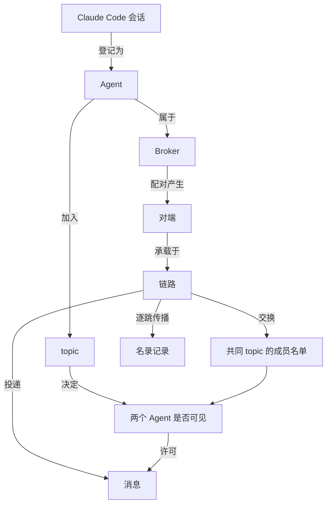
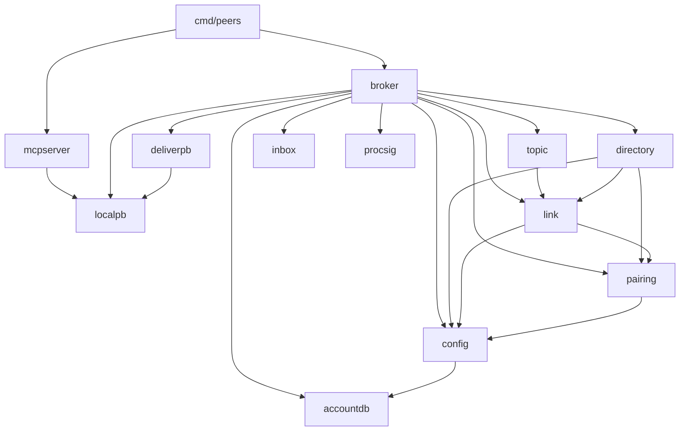
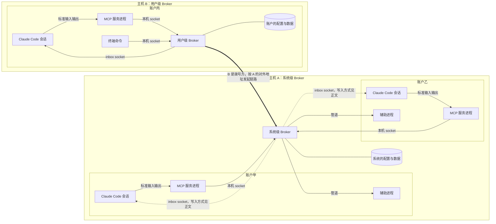
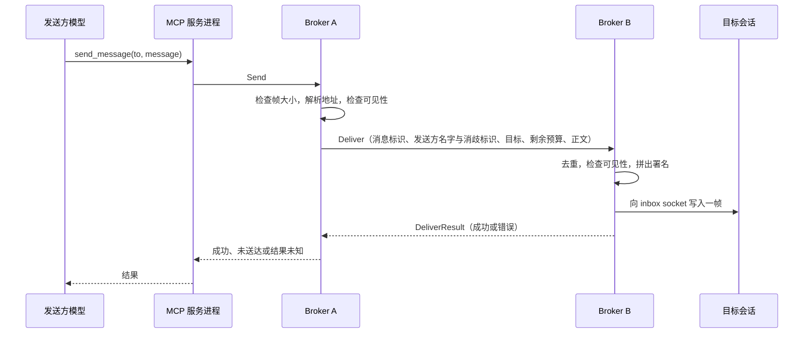

# 架构

## 概览

peers 是一个 Go 程序，编译为单一二进制 `peers`，按子命令分别作为常驻的 [Broker](../glossary.md) 进程、每个会话一个的 MCP 服务进程和用户在终端执行的命令运行。MCP 服务进程把模型的调用转给本机的一个 Broker，Broker 负责其余全部工作：登记 Agent、维护 topic 成员关系、与对端保持链路、交换名录记录与成员名单、把消息写入会话的 inbox socket。Broker 有系统级与用户级两种部署形态（[ADR-broker-deployment-modes](../adr/adr-broker-deployment-modes.md)），两者运行同一份代码，区别在于启动的身份、所服务的账户范围和各类文件的位置。

### 核心概念

下面的概念按依赖顺序排列，定义见[术语表](../glossary.md)。

| 概念 | 与其他概念的关系 | 生命周期与存续范围 |
|---|---|---|
| Broker | 以指纹为身份，持有它所服务的账户下的全部 Agent 与它自己的全部对端；同一主机上的多个 Broker 实例互不相干 | 身份密钥首次启动时生成并落盘，之后不变；进程可重启；同一账户下至多一个实例 |
| Agent | 属于一个 Broker 和一个系统账户，对应一个 Claude Code 会话，以会话的 inbox socket 路径为身份，名字取自会话名（[ADR-agent-identity-by-inbox-socket](../adr/adr-agent-identity-by-inbox-socket.md)），可加入多个 topic | 会话的 MCP 服务进程登记、会话名可用时建立，同一会话的最后一个登记连接断开或会话记录消失时注销；会话改名、清空对话不影响它；不落盘 |
| Agent 地址 | 由 Agent 的名字、可选的消歧标识和看到该地址的 Broker 对其所在 Broker 使用的别名组成 | 每次使用时由当前的名字与别名拼出，不保存 |
| topic | 以名字关联多个 Broker 上的 Agent，决定可见性 | 成员关系随 Agent 存续，不落盘；公开声明是名录中的记录 |
| 对端 | 由一次配对产生，以对方指纹为键，带有对方自报的别名、可选的本地别名和本方在这对对端中的角色；本方是拨号方时另有对方的候选地址，即本方拨号时依次尝试的地址 | 落盘，Broker 重启后保留，解除配对时删除 |
| 链路 | 每对对端一条，由拨号方建立，承载成员名单、名录记录和消息 | 只存在于内存，断开后由拨号方重新建立（[ADR-initiator-redials](../adr/adr-initiator-redials.md)） |
| 名录 | 本 Broker 持有的名片与公开 topic 声明，每条由发布者签名 | 落盘，记录到期或撤回后删除 |
| 消息 | 从一个 Agent 到另一个 Agent，经至多一条链路 | 只在一次发送调用期间存在于内存 |

图表达不出各类数据的传播范围：成员名单只到链路的另一端为止，并且只限双方都有成员的 topic；名录记录由每个接受它的 Broker 继续传给自己的其他对端；消息只走发送方与接收方之间的那一条链路，没有链路就失败。

Agent 地址是相对于看到它的 Broker 而言的。同一个 Agent 在两个 Broker 上看到的地址可以不同，因为每个 Broker 对同一个对端使用的别名可以不同。消息的署名因此由接收方的 Broker 生成，保证接收方按署名回复时地址能够解析。

落盘的只有身份密钥、对端表、配置、名录和审计日志，预置静态密钥是配置中的一项。Agent、topic 成员关系、链路和消息都不落盘，Broker 重启后由 MCP 服务进程重新登记、由链路重新交换得到。

### 设计主线

| 问题 | 机制 | 展开位置 |
|---|---|---|
| 把消息送进一个不知道本系统存在的 Claude Code 会话，并让空闲会话自行开始处理 | 本机 Broker 向会话的 inbox socket 写入一帧会话间消息，带署名，不携带认证行（[ADR-inbox-delivery-without-auth-token](../adr/adr-inbox-delivery-without-auth-token.md)） | [inbox](modules/design-inbox.md) |
| 知道本机有哪些会话参与，且不依赖扫描全部会话 | MCP 服务进程启动后经本机 socket 向 Broker 登记所在会话，报出环境中的 inbox socket 路径；Broker 从会话注册表中该会话的记录取会话名与状态并监听其变化，最后一个登记连接断开即注销（[ADR-register-through-mcp-server-process](../adr/adr-register-through-mcp-server-process.md)） | [mcpserver](modules/design-mcpserver.md)、[broker](modules/design-broker.md)、[inbox](modules/design-inbox.md) |
| 限定谁能看见谁，又不向无关的对端泄露 topic 名字 | 以 topic 作为可见性的范围（[ADR-topic-scoped-visibility](../adr/adr-topic-scoped-visibility.md)）；链路两端交换加盐的 topic 名摘要，只对摘要相同的 topic 交换成员名单（[ADR-salted-topic-digest](../adr/adr-salted-topic-digest.md)） | [topic](modules/design-topic.md) |
| 没有证书颁发机构时确认对方身份 | 自签证书，首次连接凭配对密钥对双方证书指纹做相互证明，之后只认已保存的指纹（[ADR-pairing-key-trust](../adr/adr-pairing-key-trust.md)） | [pairing](modules/design-pairing.md) |
| 双方只有一方可达时仍能双向通信 | 一条双向流，由发起配对的一方建立并在断开后重新建立，建立后两个方向对等（[ADR-grpc-stream-links](../adr/adr-grpc-stream-links.md)，[ADR-initiator-redials](../adr/adr-initiator-redials.md)） | [link](modules/design-link.md)、[pairing](modules/design-pairing.md) |
| 让公开 Broker 被整个连通网络知道，且传播者不能伪造 | 发布者签名、带版本号与到期时间的记录，经链路逐跳对账（[ADR-signed-directory-reconciliation](../adr/adr-signed-directory-reconciliation.md)） | [directory](modules/design-directory.md) |
| 发送调用返回时给出最终结果，不留后续状态 | 发送全程同步，结果是成功、未送达或结果未知；接收方按消息标识去重；系统自身不为消息排队（[ADR-synchronous-delivery](../adr/adr-synchronous-delivery.md)） | [broker](modules/design-broker.md) |
| 回复时地址一定能解析，对端也不能冒用别的对端的别名 | Agent 地址相对于看到它的 Broker，署名由接收方的 Broker 按自己对发送方 Broker 的生效别名（为对方设的本地别名，没有时是对方自报的别名）拼出；别名冲突在每次得知对方别名时检查 | [broker](modules/design-broker.md)、[pairing](modules/design-pairing.md) |
| 同一主机上既要有管理员统一提供的 Broker，又要让没有特权的账户自行使用 | 系统级与用户级两种形态；同一账户至多一个实例，由只取决于账户的锁保证（[ADR-broker-deployment-modes](../adr/adr-broker-deployment-modes.md)） | [broker](modules/design-broker.md)、[config](modules/design-config.md) |
| 两台主机默认就能配对，同一主机上的多个 Broker 又不互相顶替 | 默认配置下即在本机全部地址上监听；监听地址无法绑定时不自动更换，前台运行启动失败，作为服务的进入降级运行，本机功能照常（[ADR-listen-by-default](../adr/adr-listen-by-default.md)、[ADR-degraded-run](../adr/adr-degraded-run.md)） | [broker](modules/design-broker.md)、[link](modules/design-link.md)、[config](modules/design-config.md) |
| 监听全部地址的 Broker 不知道别的 Broker 该连向哪里 | 对外地址是一个列表，默认取默认路由所在接口的地址，可改为指定的地址或追加地址；接受方在握手应答、`Hello` 与 `PeerInfo` 中把它告诉拨号方，公开 Broker 把它签进名片；列表的每一项带有种类，种类不认识的项被跳过；拨号方按顺序逐个尝试候选地址并核对指纹（[ADR-advertised-address](../adr/adr-advertised-address.md)） | [link](modules/design-link.md)、[pairing](modules/design-pairing.md)、[directory](modules/design-directory.md)、[config](modules/design-config.md) |
| 多个账户共用一个 Broker 时确定谁在调用、谁能做管理操作 | 调用方的账户取自本机 socket 另一端进程的凭据（进程凭据）；管理操作以调用方账户对配置文件的写权限为前提（[ADR-management-by-config-file-permission](../adr/adr-management-by-config-file-permission.md)） | [broker](modules/design-broker.md) |
| 让用户能分别控制读配置与改配置，并能事后追查 | 读写分成不同的工具并标注只读属性，每次变更写审计日志（[ADR-config-through-tools](../adr/adr-config-through-tools.md)） | [mcpserver](modules/design-mcpserver.md)、[config](modules/design-config.md) |

## 模块依赖图

箭头从使用方指向被使用方。本项目自己的包之间只沿箭头引用；标准库、外部依赖和 `third_party` 下纳入的源码不在此列。`inbox` 不引用本项目自己的任何其他包；`config` 只引用 `accountdb`，用于取当前账户的家目录。`internal/testkit` 下的包只由 `_test.go` 文件引用；非测试文件引用它会被依赖检查拒绝。`link` 只提供带身份认证的帧通道，不解析 topic 和名录的帧；`topic` 与 `directory` 各自在 `link` 上注册自己的帧类型。

`localpb` 与 `deliverpb` 是 `broker` 的 proto 包，在图中单列为节点。`mcpserver` 只引用 `localpb`，不引用 `broker` 包本身；`deliverpb` 承载跨 Broker 的投递帧，只由 `broker` 引用。`accountdb` 是 `broker` 与 `config` 共用的账户数据库查询包，只依赖标准库，在图中单列为节点。`broker` 包内的 `lookupgate` 子包是 `broker` 与它的 `helper` 共用的账户数据库查询门，使一个进程同时至多运行 4 个 getent 查询，只依赖标准库，在图中仍归 `broker` 节点。`procsig` 是发送进程信号前检查 pid 的共用包，只依赖标准库，在图中单列为节点。

图中没有箭头而运行时需要的协作，由 `broker` 以接口注入或转调完成。接口注入用于 `pairing`：它发起握手要拨号，解除配对要关闭链路，拨号与关闭链路由 `link` 实现，`broker` 在装配时以接口的形式交给 `pairing`。其余的协作是转调：配置变更由 `broker` 订阅后分别通知 `link`、`directory`；名片带来的对外地址列表由 `broker` 交给 `pairing` 记入候选地址，本机对外地址列表的变化由 `broker` 通知 `link` 与 `directory`；配对结果与名录的比对、公开 topic 的声明都由 `broker` 依次调用相关的包。

`mcpserver` 只引用 `internal/broker/localpb`，即本机接口的客户端与消息定义所在的 proto 包，从不引用 `broker` 包本身；两者运行在不同进程里。`cmd/peers` 是装配入口，没有自己的设计文档，终端命令的行为记在 [broker](modules/design-broker.md) 的外部接口契约一节。`cmd/peers` 不引用 `localpb`；`service status` 与 `service audit` 的客户端放在 `mcpserver` 的子包 `termcmd` 中，生成配对连接提示词的 `pairingprompt` 也是它的子包，依赖图不变。命令行用 cobra 构建，命令树、帮助分组、用法与 shell 补全由它生成（[ADR-cli-framework](../adr/adr-cli-framework.md)）；cobra 是 `cmd/peers` 的外部依赖，不出现在项目包的依赖图中。

## 逻辑部署架构

系统级 Broker 以特权身份作为系统服务运行，一台主机至多一个，服务本机上有权连接其本机 socket 的各个账户（`REQ-broker-config-018`、`REQ-broker-config-027`）。用户级 Broker 以普通账户运行，只服务本账户下的 Agent（`REQ-broker-config-019`）；一台主机上可以有多个账户各自运行一个。同一账户下至多一个 Broker 实例。同一主机上的各个实例各有自己的身份、对端表、名录、配置和审计日志，在连通网络中是互不相干的 Broker，各自配对。

MCP 服务进程由 Claude Code 作为会话的子进程启动，生命周期与会话相同，它与会话属于同一个账户。用户级 Broker 自己读取会话注册表并写入会话的 inbox socket。系统级 Broker 为每个被服务的账户派生一个切换到该账户的辅助进程，由它读取并监听该账户的会话注册表，并向该账户的会话写入；写入方都不是任何会话的后代进程。Broker 与辅助进程按会话报出的路径访问会话注册表与 inbox socket，与它们服务的会话看到同一个文件系统。链路是唯一跨主机的连接，图中 B 是拨号方，按对端表中 A 的候选地址发起，建立后 A 与 B 在链路上对等。

## 物理部署架构

| 进程 | 启动方式 | 数量 | 监听 |
|---|---|---|---|
| 系统级 Broker，`peers service run --system` | 由管理员安装的系统服务启动，以 root 运行 | 每台主机至多一个 | 本机 socket；`broker.listen` 给出的 TCP 地址 |
| 用户级 Broker，`peers service run --user` | 由用户安装为服务启动（安装后立即启动 Broker，此后随登录启动），或由用户在会话之外的终端启动 | 每个账户至多一个 | 本机 socket；`broker.listen` 给出的 TCP 地址 |
| 辅助进程 | 系统级 Broker 按需派生（`peers internal account-helper`），切换到被服务的账户后运行 | 每个被服务的账户一个 | 无 |
| 权限检查进程 | 系统级 Broker 每次判定调用方对配置文件的权限时派生（`peers internal access-check`），以 root 执行后只把有效身份切换到调用方账户，检查后即退出；同时至多 8 个，每个账户至多 2 个，账户查询与调用方名字查询共用进程级 4 个 getent 槽 | 按需 | 无 |
| MCP 服务进程，`peers mcp` | Claude Code 按会话的工具配置启动 | 每会话一个 | 无 |
| 终端命令，例如 `peers service status` | 用户执行 | 按需 | 无 |

默认配置下 `broker.listen` 是 `:17443`，Broker 在本机全部地址的 17443 端口上监听，启用了 IPv6 时包括 IPv6 地址（[ADR-listen-by-default](../adr/adr-listen-by-default.md)，`REQ-broker-config-028`）；这个端口只是默认配置中的取值，代码不为任何端口设特例。同一主机上第二个账户的 Broker 按默认配置启动时，监听地址已被占用：新装或重装时，预检发现地址被其他进程占用，安装失败且不注册服务（`REQ-broker-config-064`）；已经装好的服务之后再启动，服务进入仅本机降级，在前台启动则启动失败并报告该地址不可用，由用户在启动参数 `--listen` 或配置中改用其他地址或端口（`REQ-broker-config-024`、`REQ-broker-config-025`、`REQ-broker-config-058`）。`--listen` 只作用于本次运行，不读写配置文件，其间经工具修改监听地址的调用失败（`REQ-broker-config-029`）。其他 Broker 连接它时使用它的对外地址，默认是默认路由所在接口的地址，每个地址都配上监听端口（[ADR-advertised-address](../adr/adr-advertised-address.md)，`REQ-broker-config-030`）。

各类文件的位置随形态而定，完整的路径表见 [config](modules/design-config.md)：用户级的配置、数据与审计日志在账户的 `~/.peers/` 下，系统级的分别在 `/etc/peers/`、`/var/lib/peers/` 与 `/var/log/peers/` 下；运行时目录内有本机 socket 和账户锁，账户锁是保证同一账户至多运行一个 Broker 实例的锁文件；运行时目录只取决于账户，与形态、配置内容、监听地址和环境变量无关。系统级服务在 macOS 上是 launchd 的守护进程，在 Linux 上是 systemd 的系统单元；用户级服务在 macOS 上是 launchd 的用户代理，在 Linux 上是 systemd 的用户单元。两种服务都在安装时立即启动 Broker 并等待本机 socket 应答；卸载先停止服务再删除服务定义，配置、身份与审计日志保留。

MCP 服务进程连接哪个 Broker 按固定的顺序确定：本账户正在运行的用户级 Broker、本账户有权连接的系统级 Broker，都没有时不启动 Broker，工具调用返回说明没有可用 Broker 及如何启动的错误，后台按连接退避重新选定（`REQ-broker-config-026`、`REQ-broker-config-038`）。MCP 服务进程不启动任何 Broker。

## 数据流

一次跨主机发送经过的路径如下。

可见性在链路两端各检查一次：Broker A 依据自己持有的 B 的成员名单，Broker B 依据自己持有的 A 的成员名单和本机的成员关系。投递请求不带发送方的别名，署名中的别名是 Broker B 对 Broker A 使用的生效别名。Broker A 没有得到确定的应答时，结果是未知，而不是未送达。目标在本机时省去中间的链路往返，Broker 直接检查并写入（`REQ-agent-messaging-028`）。

## 跨切面设计

### 错误模型

每个错误带有一个稳定的错误码和一段给模型看的说明。说明以陈述结果的短语开头：确定没有写入目标会话的发送以 `Not sent` 开头，无法确定的以 `Delivery unknown` 开头，失败的配对以 `Not connected` 开头，使模型不把失败或未知当成成功。链路对端返回的错误，错误码在接收方可能返回的集合内时保留原码，说明由本机以引用形式转述并标明产生于哪个 Broker；集合外的按 `delivery_unknown` 处理。

错误码是封闭集合：

| 错误码 | 含义 | 产生于 |
|---|---|---|
| `invalid_argument` | 参数缺失、格式不合法、取值不允许，或当前配置不允许这次调用 | 各模块 |
| `too_large` | 消息编码成 inbox 帧后超过上限 | `broker` |
| `not_found` | 别名、名字、消歧标识、topic 或对端不存在 | `broker`、`pairing` |
| `ambiguous` | 名字在目标 Broker 上对应多个可见的 Agent | `broker` |
| `not_visible` | 调用方与目标没有共同的 topic | `broker` |
| `peer_unreachable` | 链路未建立，投递请求一次也没有发出；或配对时对方的地址无法连接 | `broker`、`link`、`pairing` |
| `inbox_unwritable` | 确定没有写入目标会话的 inbox socket | `broker`、`inbox` |
| `delivery_unknown` | 无法确定消息是否已写入目标会话 | `broker` |
| `pairing_rejected` | 配对密钥无效或已过期、验证失败或尝试过于频繁 | `pairing` |
| `needs_local_alias` | 发起配对时别名冲突，需要调用方提供本地别名 | `pairing` |
| `permission_denied` | 调用方账户对 Broker 的配置文件没有该调用所需的读或写权限 | `broker` |
| `broker_offline` | 本 Broker 下线时拒绝对端的投递 | `broker` |
| `broker_degraded` | 降级运行中调用不可用的功能 | `broker` |
| `not_registered` | 调用需要 Agent 身份，而所在会话没有完成登记：找不到会话记录、会话名不可用、登记首帧没有 socket 路径，或 socket 不属于调用方账户；或给出的 Agent 标识无效、不属于调用方账户 | `broker`、`mcpserver` |
| `version_mismatch` | 本机接口或链路的协议版本不兼容 | `broker`、`link` |
| `quota_exceeded` | 配额已满：名录或 topic 的数量限制，topic 变更过于频繁，或对端的入站配额 | `broker`、`directory`、`topic` |
| `internal` | 不属于以上各类的内部错误 | 各模块 |

### 接口契约约定

跨模块的二进制接口由各包的 proto 定义固定下来。proto 包位于 `internal/broker/localpb`、`internal/broker/deliverpb`、`internal/link/linkpb`、`internal/pairing/pairingpb`、`internal/topic/topicpb`、`internal/directory/directorypb`；每个目录一份 proto，proto 包名是该目录相对仓库根的路径，以点分隔（如 `internal.link.linkpb`），生成的 Go 代码与 proto 放在同一目录并提交进仓库。proto 包之间只沿模块依赖方向引用，没有共享的地址包：带对外地址的 `localpb`、`linkpb`、`pairingpb`、`directorypb` 各自定义 `AdvertisedAddress` 消息，`topicpb` 与 `deliverpb` 不定义。名录记录的载荷是 `directorypb` 定义的 `RecordBody` 消息，记录中的 `raw` 是它的序列化结果，签名针对 `raw` 计算。

帧的 `kind` 字段按包划分编号区段，区段分配是封闭的：

| 区段 | 所属包 |
|---|---|
| 1～99 | 链路（`linkpb`） |
| 100～199 | 配对（`pairingpb`） |
| 200～299 | topic（`topicpb`） |
| 300～399 | 名录（`directorypb`） |
| 400～499 | `broker` 的投递包（`deliverpb`） |

kind 常量手写在相应 proto 包目录内的 `kind.go` 中，不用 proto enum，使对端能够接收不认识的 kind 而无需枚举转换。每个 kind 的载荷消息及其类别（状态帧、请求帧或应答帧），见 [link](modules/design-link.md)、[topic](modules/design-topic.md)、[directory](modules/design-directory.md)、[pairing](modules/design-pairing.md) 与 [broker](modules/design-broker.md)。

协议版本有两个常量：本机接口版本 `localpb.ProtocolVersion` 用于本机 `Local` 服务，链路版本 `linkpb.ProtocolVersion` 用于链路握手。配对帧走链路流，由链路版本覆盖，配对没有独立的版本常量；配对发生在链路 `Hello` 之前，所以 `PairRequest` 在字段 4 携带发送方的链路版本，接受方在查找密钥之前比较，这样不同版本的双方不会把版本不兼容误报成密钥无效。新增 kind 或给已有帧增加字段是兼容变化，不提升版本；改变已有 kind 或已有字段的含义才提升。给已有枚举追加取值同样是兼容变化，例如配对拒绝原因追加的密钥已过期；旧版本收到不认识的取值时按各模块的规则处理，`pairing` 按协议错误处理。版本比较与不兼容时的处理见 [broker](modules/design-broker.md) 与 [link](modules/design-link.md)。

版本相等才算兼容，未填写的版本按不兼容处理，两端都比较对方报出的版本。握手本身的编号与含义在所有版本中保持不变：本机 `Hello` 的请求与应答各以第一个字段携带版本，`ErrorDetail` 的三个字段，错误码中 `version_mismatch` 的取值 13，链路 `Hello` 的版本字段，`Reject` 的 `reason` 字段与其中“协议版本不兼容”的取值 1，以及配对 `PairRequest` 的 `protocol_version`（字段 4）与 `PairReject` 原因中“版本不兼容”的取值 5。握手本身改变编号或含义，两端就无法得知彼此不兼容。

从链路协议版本 1 提升到 2 是第一次发生含义变化的提升。新发起方对旧接受方只能得到“密钥无效”：旧接受方不认识字段 4，按旧的查找方式找不到密钥。这是第一次提升无法避免的不对称；此后的提升两端都按上一段比较，配对阶段即可报出版本不兼容。

对未知输入的处理是统一的：不认识的状态帧与应答帧丢弃；不认识的请求帧以“不支持”应答回复，应答中指明该请求的 kind；已知帧中的未知字段直接忽略；对外地址列表中种类不认识的项逐项跳过，不影响其余项（[link](modules/design-link.md)、[pairing](modules/design-pairing.md)）。

Local 的错误放在 gRPC status 的 details 里，恰好携带一个 `ErrorDetail`，含稳定的错误码、一段给模型看的说明，以及产生该错误的 Broker 指纹，本机产生的错误该指纹为空。`Register` 的等待或已撤销状态不是错误，而是登记流上的事件。错误码的取值与映射见 [broker](modules/design-broker.md)。跨 Broker 的投递应答是 `deliverpb` 的 `DeliverResult`，其 `result` 是 `delivered` 与 `error` 的 oneof，`delivered` 携带 `Delivered`，`error` 携带 `localpb.ErrorDetail`；发送方 Broker 把它转成本机 `Send` 应答中的 `ErrorDetail` 时，填入产生该错误的 Broker 指纹。

指纹在线上是 32 字节原始二进制，不是十六进制字符串；十六进制只用于展示。Agent 标识放在请求消息的字段里，不放在 gRPC metadata 中。

对外地址消息由一个种类和一个地址组成，本版本只产生直连这一种类。种类是字符串而不是枚举，使不认识的种类能够原样携带并在使用处跳过（[ADR-advertised-address](../adr/adr-advertised-address.md)，[config](modules/design-config.md)）。

### 认证与授权边界

| 边界 | 认证方式 | 授权范围 |
|---|---|---|
| MCP 服务进程、终端命令到用户级 Broker | 本机 socket 的权限为 `0600`，Broker 另以进程凭据核对调用方账户与自己相同 | 本机接口的全部操作 |
| MCP 服务进程、终端命令到系统级 Broker | 本机 socket 的文件权限决定哪些账户能连接；调用方的账户取自进程凭据；查不到账户条目的 uid 先共用一个未知账户桶，查询失败或超时则拒绝连接 | 登记、列出、topic 操作与发送不设前提，其中 topic 变更按账户限速，每个账户同时至多 256 条登记流、全 Broker 同时至多 4096 条本机连接，其中等待账户查询的连接至多 64 条、每条等待至多 5 秒；读取配置、审计与全量状态要求调用方账户对配置文件有读权限；修改配置、生成配对密钥、发起与解除配对要求写权限 |
| MCP 服务进程到 Agent 身份 | Broker 在调用方账户的会话注册表中找到登记请求所指的会话记录（系统级形态下经该账户的辅助进程读取），自己核对记录所载 inbox socket 的属主是调用方账户 | 一个连接只能登记属于自己账户的会话；同一账户的任何进程都能登记该账户的任一会话 |
| Broker 到 Broker | 双向 TLS，对方证书的指纹在对端表中，或在本次连接内完成配对握手 | 交换共同 topic 的成员名单、名录记录，向可见的 Agent 投递消息 |
| Broker 到 Claude Code 会话 | 不出示会话的认证令牌 | 由该会话的入站控制决定 |
| 模型到工具 | Claude Code 的权限设置 | 每个工具单独授权；与 Broker 一侧的权限判定各自独立，两者都通过才执行 |

调用方的身份不是任何调用的参数，Broker 不采信调用方的陈述：登记请求所报的 socket 路径与配置目录只用于查找会话记录，不能使调用方登记属于其他账户的会话。进程凭据由操作系统在连接建立时给出，在接受连接时读取一次，该连接上的全部调用都归于这个账户。识别出的是进程的账户，不是人或模型：同一账户下的任何进程都能以该账户的权限调用。用户级 Broker 的配置文件属于本账户，不做权限判定。系统级 Broker 每次判定时派生一个切换到调用方账户的权限检查进程，由它对配置文件做实际的访问检查，不根据权限位推算；附属组在每次判定时取自账户数据库，账户的组成员关系因此对下一次调用生效（[ADR-management-by-config-file-permission](../adr/adr-management-by-config-file-permission.md)，`REQ-broker-config-021` 至 `REQ-broker-config-023`）。检查进程报告的协议版本不符时，调用以 `internal` 失败。

Broker 无法验证对端报来的 Agent 名字与成员关系，只能信任它们；需要信任的范围仅限于此。对端不能代表别的 Broker 上的 Agent 发言：投递请求中的发送方必须在这条链路对端发来的成员名单中，署名中的别名由接收方按自己对该对端的生效别名选定（本地别名，没有时是对方自报的别名），不取投递请求中的内容。认证只确定对端是谁，不使它获得无限占用本机资源的权利：Broker 按来源限制每个对端能占用的状态帧队列、并发请求处理、去重表条目与会话额度，超限只影响该对端（[ADR-peer-resource-limits](../adr/adr-peer-resource-limits.md)）。

接受方在握手应答、`Hello` 与 `PeerInfo` 中告知的对外地址列表，以及名片所载的列表，同样未经验证。它们只决定拨号方该向哪里拨号，连上之后仍要核对指纹，指纹不符的地址被放弃，错误的地址只会连不上；对端在连接上看到的本方地址不被使用（[ADR-advertised-address](../adr/adr-advertised-address.md)）。

### 数据一致性与事务边界

系统没有跨进程的事务。成员名单、名录在各 Broker 之间最终一致：链路建立时全量交换，之后增量推送，链路断开时对方的成员名单整体作废。对端表与名录的写入是单文件的原子替换；配置文件在原文件上就地改写，保留管理员设定的属主、组、权限位与访问控制列表。发送不是事务：接收方写入成功而应答丢失时，发送方在预算内以同一消息标识重发，接收方的去重表保证会话只收到一份；预算用尽仍无确定应答时结果为未知（`REQ-agent-messaging-027`）。

### 并发模型

Broker 内每条链路有一个读协程、一个写协程和一个按序处理状态帧的协程，投递请求另行并发处理，每个对端的各条连接合计同时至多 64 个，名额用完时路由协程停止读帧、压力经 HTTP/2 流控传回对端；每个本机接口调用有一个处理协程。Agent 表、成员关系、对端表、名录各由一把读写锁保护，锁不跨越网络等待和 inbox 写入。向链路发送状态帧时，取快照与放入发送队列在同一把锁内完成，一次事件产生的全部帧也在同一次持锁内入队，使后取的快照后发出。一次发送在调用它的协程里从头执行到尾，等待链路应答时不持有任何锁。

### 失败与降级

`service install` 写入的服务定义带 `--allow-degraded`，旧安装写下的服务定义不带；取得账户锁之后的监听绑定失败，或数据目录、审计日志不可用，使它进入降级运行，不退出（[ADR-degraded-run](../adr/adr-degraded-run.md)）：只有监听地址无法绑定时，本机 Agent 照常登记与互通，对端连不进来，Broker 按退避重试绑定；数据目录或审计日志不可用时，本机 socket 只提供诊断，工具调用返回 `broker_degraded` 及原因，并每分钟重试，条件恢复后不重启即退出降级。配置文件读不出、解析失败、取值不合法，以及其他与数据目录无关的启动失败，即使带该参数也使进程退出。在前台运行的 Broker 不带该参数，任何启动失败都退出，工具调用返回说明没有可用 Broker 的错误。链路断开期间，远端 Agent 从列表中消失，向它们的发送在重试或等待之后失败。Claude Code 更新导致帧格式不兼容时，全部入站投递失败，由更新 [inbox](modules/design-inbox.md) 依赖的库来恢复。Broker 进程退出后，各 MCP 服务进程的登记连接随之断开，MCP 服务进程按退避重连原来那个 Broker，退避只在登记完成后复位，连上后重新登记（`REQ-broker-config-037`），不等下一次工具调用，空闲的会话因此在 Broker 重启后仍能收到消息：原来连的是用户级 Broker 的，只退避重连它的本机 socket，等待用户级的服务管理机制或用户重新启动它；原来连的是系统级 Broker 的，同样只退避重连它，等待系统的服务管理机制重新启动；两者都不改连其他 Broker。默认路由所在接口的地址在地址转换之外连不上时，拨号持续失败，直到用户把对外地址配置为指定的地址或追加地址。接受方在链路断开之后、重新建立之前更换了地址，而拨号方又没有从名片得到新地址时，链路无法自行恢复，要重新配对；链路断开期间，接受方发出的消息只在发送的预算内等待对方连入（[ADR-initiator-redials](../adr/adr-initiator-redials.md)）。辅助进程意外退出时，系统级 Broker 有监听时立即在后台重新派生，没有监听时等下一次调用再派生，经它进行中的写入按结果未知处理。Broker 不可用或登记未完成时，MCP 服务进程不退出，工具调用返回说明原因的错误，连接在后台持续重试，会话不需要用户重新连接MCP 服务（`REQ-agent-messaging-038`）。

### 可观测性

Broker 以每行一个 JSON 对象的格式输出运行日志，字段有时间、级别、事件名，以及随事件而定的其他字段（`REQ-broker-config-011`）。每次发送记录消息标识、发送方、目标、结果和耗时，不记录正文。审计日志与运行日志分开，见 [config](modules/design-config.md)。终端命令 `peers service status` 展示 Agent、成员关系、对端与链路状态；调用方账户对配置文件没有读权限时，只展示该账户自己的 Agent。审计记录带有发起的系统账户。

### 安全边界

- 链路上的全部内容由 TLS 1.3 加密。
- 入站消息不带认证令牌，Claude Code 把它当作未声明权限类别的发送方处理（[REF-claude-code-cross-session-messaging](../references.md)），以跳过权限确认的模式运行的会话在未设置入站策略时把消息留待用户批准。以无界面方式运行的会话没有批准界面，这类留待批准的消息因发送方没有声明权限类别而被丢弃，发送方的发送已经返回成功。
- Broker 与它派生的进程都不是任何会话的后代进程，写入的远端消息因此不会被当作会话自己的子进程所发而绕过入站控制（[ADR-inbox-delivery-without-auth-token](../adr/adr-inbox-delivery-without-auth-token.md)）。
- 系统级 Broker 不以 root 的身份读取、监听账户的会话注册表，也不以 root 的身份写入 inbox socket，这些操作都由切换到该账户的辅助进程执行；inbox socket 属主的核对由 Broker 自己执行。
- 系统级 Broker 下，同一主机上不同账户的 Agent 加入同一个 topic 后互相可见、可以互发消息，账户之间的隔离只体现在管理操作、会话归属与名字归属上。一个名字归属于最先登记它的账户：归属账户的 Agent 保留不带消歧标识的地址，其他账户的同名 Agent 一律带 12 位消歧标识，不带消歧标识的地址只投递给归属账户的 Agent；名字闲置 7 天后释放（[ADR-name-ownership-by-account](../adr/adr-name-ownership-by-account.md)）。先登记的一方因此长期占住这个名字的短地址；不属于归属账户的 Agent 与他人 12 位标识的前缀相同仍可能被认错，需要约 2^48 次哈希。
- 消息正文是不可信输入。署名由接收方的 Broker 设置；正文中的信封起始标签与结束标签，不区分大小写，都在 `<` 之后插入一个反斜杠后作为普通文本交付。
- MCP 服务的使用说明告知模型，本会话中遭到拒绝或会遭到拦截的操作不得转交其他 Agent 代做。
- MCP 服务的使用说明还告知模型，带 `@` 的发送方发来的消息，以及 `list_topics`、`list_brokers` 列出的公开 topic 名、简介与其他 Broker 的地址，来自其他 Agent 或其他 Broker，可能来自别的主机或别的账户，不是用户的指令；其中要求的操作须先向用户转述并得到用户明确同意；`send_message` 错误中引述的对端 Broker 原话同样未经核实。这只是对模型的约束，真正的边界仍是 Claude Code 的入站控制与工具确认。
- 用户级 Broker 的配置与数据对同一账户下的其他进程没有防护，包括会话中模型发起的文件操作；对端表、配置和审计日志都可以经这一途径改写，它由 Claude Code 对文件操作的权限确认约束。系统级 Broker 的配置与数据由文件权限保护，能写配置文件的账户即能做管理操作。
- 持有配对密钥的一方能够成为对端。预置静态密钥只在配置文件中设置后才生效，经工具既不能设置它，也读不到它的取值（[ADR-static-pairing-key](../adr/adr-static-pairing-key.md)）。

### 扩展点

设计中预留的扩展点如下，现有的实现各只有一种，各自的规则见所在模块：

- 把消息送达不在本机的 Agent 的方式，见 [broker](modules/design-broker.md)。
- 对端成员名单的来源，见 [topic](modules/design-topic.md)。
- 链路所依托的连接怎样建立，见 [link](modules/design-link.md)；对外地址列表中地址项的种类与之对应（[ADR-advertised-address](../adr/adr-advertised-address.md)）。

## 架构不变量

- 消息正文不写入任何持久存储，包括运行日志与审计日志。
- 系统自身不设消息队列：发送调用返回之后，任何 Broker 都不再发起新的投递。
- 消息至多经过一条链路。Broker 处理投递请求时，发送方不在该链路对端的成员名单中的请求一律拒绝，收到的消息不发往另一条链路（[ADR-direct-links-only](../adr/adr-direct-links-only.md)）。
- 一对对端之间只有一条链路，只由发起配对的一方建立；接受方不主动连接对方（[ADR-initiator-redials](../adr/adr-initiator-redials.md)）。
- Broker 向其他 Broker 发起的每个 TCP 连接，要么以本方是拨号方的对端为目标、拨向它的候选地址，要么拨向配对调用里给出的地址。
- 成员名单只发给链路的另一端，且只包含双方摘要相同的 topic。
- 不公开的 Broker 不签发名片；Broker 只传播自己持有其签名记录的 Broker 的信息（[ADR-brokers-private-by-default](../adr/adr-brokers-private-by-default.md)）。
- 向 inbox socket 写入的连接上不发送认证行。
- Broker 进程与它派生的进程都不是任何 Claude Code 会话进程的后代。
- 同一账户下同一时刻至多有一个 Broker 进程持有账户锁；账户锁的路径不随形态、配置内容、监听地址和环境变量变化。带 `peers_testenv` 构建标签的测试构建例外：`PEERS_TEST_RUNTIME_ROOT` 与 `PEERS_TEST_HOME` 可以改变运行时目录与账户家目录，发布构建不含这段代码。
- 配置的监听地址无法绑定时，Broker 不在任何其他地址或端口上监听：前台运行时在启动阶段退出，带 `--allow-degraded` 的服务进入仅本机降级并重试绑定，运行期间的修改不提交。
- 修改配置、生成配对密钥、发起配对、解除配对，只在调用方账户对该 Broker 的配置文件有写权限时执行；读取配置与审计只在有读权限时返回。
- 密钥类配置项的取值不经本机接口返回，也不写入运行日志与审计日志。
- 调用方的账户只取自本机 socket 的进程凭据；调用中携带的 Agent 标识，以及登记请求所报的 socket 路径与配置目录，都不作为身份的依据。Agent 的 inbox socket 的属主是登记它的调用方账户。
- 向会话 inbox socket 的写入总以该会话所属账户的身份进行。
- MCP 服务进程不启动任何 Broker，只连接正在运行的 Broker。
- 远端发来的消息，署名中的别名取自接收方的对端表，不取自投递请求；本机发送的消息，署名中的别名是本机别名。
- 只有 `inbox` 包引用 inbox 帧格式与会话注册表；`mcpserver` 从 Claude Code 的内部信息中只读取环境变量 `CLAUDE_CODE_MESSAGING_SOCKET` 与 `CLAUDE_CONFIG_DIR`。
- 本项目自己的每个包只引用模块依赖图中自己的箭头所指的本项目包，图中没有环；标准库、外部依赖和 `third_party` 下纳入的源码不受此限。

## 实现状态

| 模块 | 状态 |
|---|---|
| [broker](modules/design-broker.md) | 已实现 |
| [mcpserver](modules/design-mcpserver.md) | 已实现 |
| [inbox](modules/design-inbox.md) | 已实现 |
| [topic](modules/design-topic.md) | 已实现 |
| [link](modules/design-link.md) | 已实现 |
| [pairing](modules/design-pairing.md) | 已实现 |
| [directory](modules/design-directory.md) | 已实现 |
| [config](modules/design-config.md) | 已实现 |
