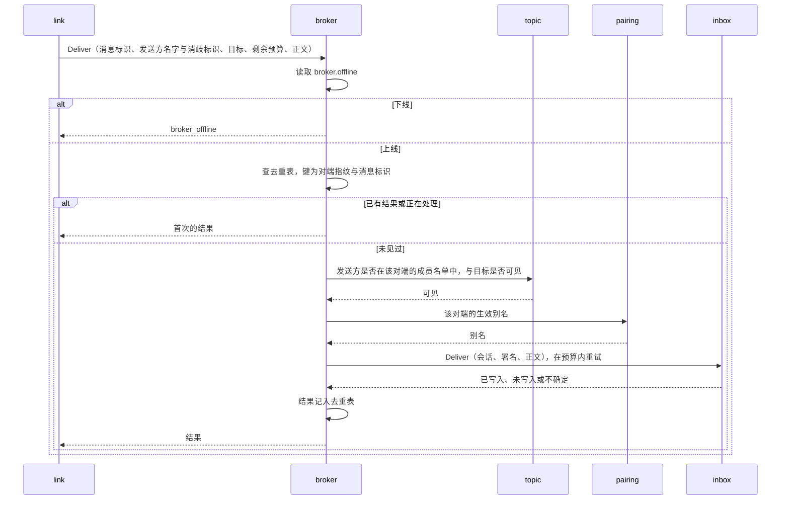
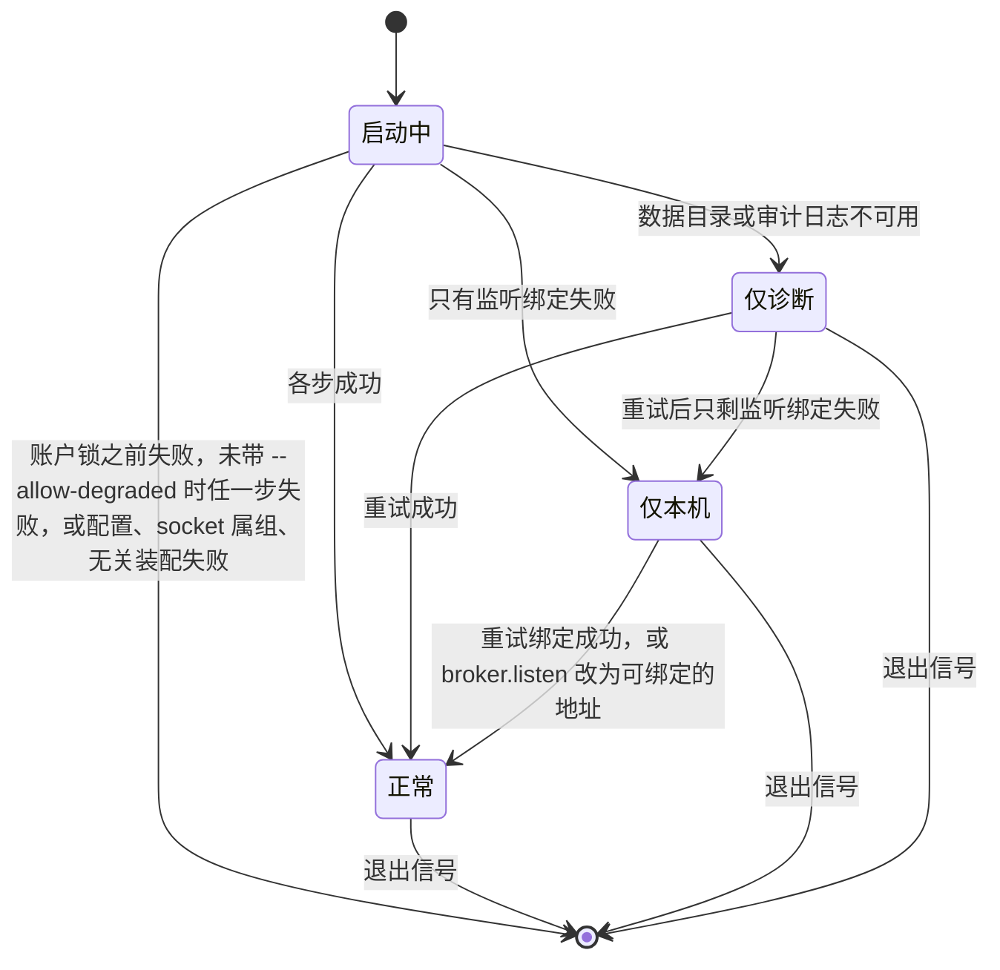

# broker

`broker` 是 [Broker](../../glossary.md) 进程的主体和装配入口。它决定进程以系统级还是用户级的形态运行，持有 Agent 表，向 MCP 服务进程和终端命令提供本机接口并判定每个调用的账户与权限，把一次发送从地址解析一路执行到得到结果，并把彼此不相引用的包接在一起。topic 成员关系、链路、配对、名录、配置和 inbox 写入分别由各自的包实现。可以把它看作一张 Agent 表、一道按账户把关的本机接口、一个同步的发送过程，加上各包之间的接线。

首次阅读按顺序读职责、外部接口契约和核心算法与流程里的走查；核心数据结构和错误与失败语义供查阅。

## 职责

- 按 `service run` 的 `--system` 或 `--user` 确定部署形态：`--system` 时是系统级 Broker，服务本机多个账户下的 Agent；`--user` 时是用户级 Broker，只服务本账户下的 Agent；两者互斥，都不给时 root 为系统级，其他账户为用户级（[ADR-broker-deployment-modes](../../adr/adr-broker-deployment-modes.md)，`REQ-broker-config-018`）。
- 启动时确认形态与身份，确认自己不在任何会话的进程树内，取得账户锁（保证同一账户至多运行一个 Broker 实例的锁文件），加载配置，装配各包，绑定监听地址，然后在本机 socket 上监听（`REQ-broker-config-013`）。不带 `--allow-degraded` 时任何一步失败都退出（`REQ-broker-config-024`、`REQ-broker-config-056`）；带它时，账户锁之后的监听绑定失败，或数据目录、审计日志不可用，使进程进入降级运行，保留本机 socket 并报告故障，在配置文件变化时与每分钟重试失败的步骤（[ADR-degraded-run](../../adr/adr-degraded-run.md)，`REQ-broker-config-057` 至 `REQ-broker-config-062`）；其余失败照常退出。
- 在接受本机接口的每个连接时读取本机 socket 另一端进程的凭据（进程凭据），确定调用方的账户；用户级 Broker 拒绝其他账户的连接（`REQ-broker-config-019`）。
- 按调用方账户对配置文件的访问权限判定每个调用能否执行（[ADR-management-by-config-file-permission](../../adr/adr-management-by-config-file-permission.md)，`REQ-broker-config-021` 至 `REQ-broker-config-023`）。
- 接受 MCP 服务进程的登记：经 `inbox` 在调用方账户的会话注册表中找到会话记录，核对记录所载 inbox socket 的属主是调用方账户，会话名可用时以 socket 路径为身份建立 Agent 记录；同一 socket 路径上的多个登记连接归于同一个 Agent，最后一个断开时删除它并通知 `topic` 清除其成员关系；没有完成登记的会话不出现在任何结果中，也不能成为目标（[ADR-register-through-mcp-server-process](../../adr/adr-register-through-mcp-server-process.md)，[ADR-agent-identity-by-inbox-socket](../../adr/adr-agent-identity-by-inbox-socket.md)，`REQ-agent-messaging-001`、`REQ-agent-messaging-002`、`REQ-agent-messaging-012`、`REQ-agent-messaging-030`、`REQ-agent-messaging-034` 至 `REQ-agent-messaging-036`、`REQ-broker-config-020`）。
- 跟踪已登记会话的变化：经 `inbox` 监听会话注册表目录，并在列出 Agent 与投递之前按需重读；名字变化时更新名字并记下曾用名，状态变化时更新状态，记录消失时注销（`REQ-agent-messaging-005`、`REQ-agent-messaging-010`、`REQ-agent-messaging-033`）。
- 系统级形态下为每个被服务的账户维持一个辅助进程，把查找、监听、重读该账户的会话注册表和向该账户的会话写入的操作交给它以该账户的身份执行。
- 为每个 Agent 生成地址：名字取会话名的规范化结果；同名时，或名字不能原样出现在署名中，或放不下时，附消歧标识，别名取看到该地址的 Broker 对其所在 Broker 的生效别名（`REQ-agent-messaging-003`、`REQ-agent-messaging-004`、`REQ-agent-messaging-006`、`REQ-agent-messaging-029`、`REQ-agent-messaging-037`）。
- 把 Agent 地址解析为本机 Agent 或远端 Agent，名字有歧义时拒绝，以曾用名为目标时给出现在的地址（`REQ-agent-messaging-007`、`REQ-agent-messaging-031`）。
- 执行发送：检查帧大小与可见性，本机目标交给 `inbox` 写入，远端目标经 `link` 请求对端投递，全程同步（[ADR-synchronous-delivery](../../adr/adr-synchronous-delivery.md)），结果是成功、未送达或结果未知（`REQ-agent-messaging-013` 至 `REQ-agent-messaging-020`、`REQ-agent-messaging-026` 至 `REQ-agent-messaging-028`）。
- 处理对端的投递请求：检查 `broker.offline`，去重，核对发送方，检查可见性，拼出署名，在请求的预算内交给 `inbox` 写入并重试，返回结果（`REQ-agent-messaging-018`、`REQ-agent-messaging-022`）。下线时以 `broker_offline` 拒绝，不写入会话；链路、成员关系、名录对账与新的配对不受影响（`REQ-agent-messaging-039` 至 `REQ-agent-messaging-041`）。
- 在各包之间转接：把拨号与关闭链路的能力注入 `pairing`；订阅配置变更并通知 `link`、`directory`；把对端名片所载的对外地址列表交给 `pairing` 更新候选地址，把本机对外地址列表的变化通知 `link` 与 `directory`（[ADR-advertised-address](../../adr/adr-advertised-address.md)，`REQ-broker-config-030`、`REQ-broker-discovery-016`）；配对成功后比对指纹与名录（`REQ-broker-pairing-023`）；处理带公开声明的加入时先调用 `directory` 的 `DeclarePublicTopic`，成功后再调用 `topic` 的 `Join`，任一失败则不加入；本机最后一个以公开方式加入某个 topic 的 Agent 退出该 topic 或注销时，调用 `directory` 的 `RetirePublicTopic`（`REQ-topics-025`）。
- 汇总 `topic`、`link`、`pairing`、`directory` 的状态，回答列出 Agent、列出 Broker 和查看状态的请求；列出 Agent 时注明改名后 10 分钟内的曾用名（`REQ-agent-messaging-032`）。
- 周期检查本项目在 GitHub 上的最新正式发布版本，把当前版本与可用版本保存在内存中，供本机接口 `UpdateStatus` 和终端状态输出使用；检查失败只记 Debug 日志，不影响其他功能（[ADR-self-update](../../adr/adr-self-update.md)，`REQ-update-001` 至 `REQ-update-003`）。
- 在本机接口上执行委托升级：当前进程由服务管理器启动时，取本项目最新的正式发布版本，下载、校验并替换自己的二进制，回复调用方后正常退出，由服务管理器以新二进制重新启动；不在服务管理器下运行时拒绝（[ADR-self-update](../../adr/adr-self-update.md)，`REQ-update-007`、`REQ-update-008`）。
- 在本机接口上做版本握手：`Hello` 的版本号与本进程不同时返回 `version_mismatch`，不断开连接，并在这条连接上标记“已拒绝”，此后这条连接上的其他调用都返回 `version_mismatch`；版本不兼容不使进程退出；其中“已拒绝”标记与后续调用返回 `version_mismatch` 归版本不兼容处理（`REQ-broker-config-016`）。
- 提供整体卸载命令 `peers uninstall` 与服务控制命令 `peers service start|stop|restart`（`REQ-broker-config-051` 至 `REQ-broker-config-055`）。

### 非职责

- 不向模型提供工具，不决定工具的名字与说明，由 [mcpserver](design-mcpserver.md) 负责。
- 不解析 Claude Code 的会话注册表，不构造 inbox 帧，由 [inbox](design-inbox.md) 负责；`broker` 只决定这些操作在本进程内执行，还是交给某个账户的辅助进程执行。
- 不判定两个 Agent 是否可见，由 [topic](design-topic.md) 负责，`broker` 只调用其判定。
- 不管理 TLS、重连和帧的收发，由 [link](design-link.md) 负责。
- 不保存对端表，不执行配对握手，由 [pairing](design-pairing.md) 负责。
- 不决定各类文件的位置与默认别名的取法，由 [config](design-config.md) 负责。
- 不保存消息。发送调用返回后这条消息的正文即被丢弃。
- 不限制发送频率，不检测消息循环，由 Claude Code 接收端的入站控制承担（[ADR-no-broker-rate-limiting](../../adr/adr-no-broker-rate-limiting.md)）。
- 不另设管理员名单，也不采信调用方自报的身份。
- 不自行重启自己：委托升级成功后进程正常退出，由服务管理器用新二进制拉起；没有服务管理器时拒绝执行更新。终端命令的本地替换路径只替换二进制，不启动或重启任何服务。

## 外部接口契约

本机接口是 Unix domain socket 上的 gRPC 服务，socket 位于 `config` 给出的运行时目录内，名为 `broker.sock`。调用方只有同一二进制内的 MCP 服务进程和终端命令，接口不对其他程序承诺兼容；两端以握手时交换的本机协议版本号判断能否互通。

`Hello` 的版本与本进程不等时返回 `version_mismatch`，并在这条连接上记“已拒绝”；此后该连接上除 `Hello` 外的调用一律返回同一错误，之后版本相符的 `Hello` 也不清除标记。其他连接与已登记的 Agent 不受影响，进程不退出，也不要求 `Hello` 先于其他调用（`REQ-broker-config-016`）。

下面的 proto 只是草图，消息名以 `local.proto` 为准；草图中的 `HelloReply`、`RegisterUp`、`RegisterDown` 等名称与 `local.proto` 中的消息名不同。

```proto
service Local {
  rpc Hello(HelloRequest) returns (HelloReply);                  // 版本握手
  rpc Register(stream RegisterUp) returns (stream RegisterDown); // 登记，流存续即 Agent 存续
  rpc ListAgents(ListAgentsRequest) returns (ListAgentsReply);
  rpc Send(SendRequest) returns (SendReply);
  rpc JoinTopic / LeaveTopic / ListTopics ...
  rpc ListBrokers / Connect / Disconnect / CreatePairingKey ...
  rpc GetConfig / SetConfig ...
  rpc Status / Audit ...                                         // 终端命令使用
  rpc UpdateStatus(UpdateStatusRequest) returns (UpdateStatusResponse); // 当前版本与可用版本
  rpc ApplyUpdate(ApplyUpdateRequest) returns (ApplyUpdateResponse); // 委托升级
}
```

本机接口只新增字段与错误码，不提升本机协议版本，与 `UpdateStatus` 的引入方式相同。`ErrorCode` 新增 `broker_offline` 与 `broker_degraded`，两者都映射为 gRPC `FailedPrecondition`。`NotRegisteredReason` 新增 `broker_degraded`，登记流事件的 `detail` 写故障原因。`StatusResponse` 新增 `offline`（布尔；仅诊断时为假，配置不生效）与 `degraded`（档位取 `local_only` 或 `diagnostics_only`，另有步骤、原因与修复提示）。`ListBrokersResponse` 带 `local`，含 `offline` 与 `degraded`（后者含 level、step、reason 与 fix），给 `list_brokers` 与 `broker list` 显示本 Broker 的离线与降级状态。应答必须带 `local`：缺少它属于违反协议的响应，`list_brokers` 返回错误，`broker list` 报错并以非零码退出。

仅诊断降级时，本机接口只照常应答 `Hello`；`Status` 返回只含 `current_version` 与 `degraded` 的应答；`Register` 在下行流上发出 `not_registered` 及原因 `broker_degraded`，流保持打开；其余调用返回 `broker_degraded`，说明为 `degraded.reason`。离开仅诊断时，降级服务关闭全部本机连接，同一 socket 路径上换成完整服务，客户端按现有规则重连。

`CreatePairingKey` 除可空的 `agent_id` 外不带参数，只生成一次性配对密钥，应答另带供展示的本 Broker 对外地址；本次运行不监听时以 `invalid_argument` 拒绝，仅本机降级时以 `broker_degraded` 拒绝，说明含无法绑定的地址与 `broker.listen`（`REQ-broker-pairing-025`、`REQ-broker-pairing-028`、`REQ-broker-pairing-036`、`REQ-broker-config-058`）。`Connect` 带对方的地址、配对密钥与可选的本地别名（`REQ-broker-pairing-010`）。`ListBrokers` 的每一项带有该 Broker 的对外地址列表，对端另带本方是它的拨号方还是接受方（`REQ-broker-discovery-012`）。`SetConfig` 在本次运行的监听地址来自启动参数时拒绝修改 `broker.listen`（`REQ-broker-config-029`），对密钥类配置项（只经配置文件设置、取值不经本机接口返回的配置项，例如预置静态密钥）一律拒绝（`REQ-broker-pairing-031`）；`GetConfig` 对密钥类配置项只给出是否已设置（`REQ-broker-pairing-030`）。

`SetConfig` 先解析审计发起者，`agent_id` 无效时不改动配置；对于键不存在、密钥类配置项与本次运行由 `--listen` 固定的 `broker.listen`，它在处理取值之前拒绝，说明不取决于取值的写法，取值无法解析时同样给出。`GetConfig` 的 `key` 为空时返回全部配置项，按键名的字典序；非空时只返回该项，未知键返回 `invalid_argument`。`Audit` 的 `since` 缺省时返回全部记录；`limit` 非 0 时返回最新的 N 条，仍按时间顺序发送，读完即结束，不跟随新事件。

`Disconnect` 的 `broker` 参数取对端的生效别名或 64 位十六进制指纹（大小写不敏感），先按别名解析，解析不到且恰为 64 位十六进制时按指纹解析；指定的 Broker 不是对端时返回 `not_found`；解除配对经注入的关闭链路接口断开链路（`REQ-broker-pairing-021`）。`Connect` 成功后促使对该对端立即拨号；成功应答带对方的生效别名、指纹、地址中的主机名与警告（`REQ-broker-pairing-010`）。警告按地址逐条给出：对 `Peer.Candidates` 中来源为 `SourcePairing` 与 `SourceAcceptor` 的每个地址，名录中每个指纹不同于对方的发布者各产生一条，说明为 `fingerprint mismatch: the directory card for <addr> belongs to <card fingerprint>, but the paired Broker presented <peer fingerprint>`，两个指纹均为完整的 64 位小写十六进制；没有不一致时警告为空（`REQ-broker-pairing-023`）。失败时错误码：地址或本地别名写法不合法为 `invalid_argument`，别名冲突为 `needs_local_alias`，对方拒绝、握手超时、连接在握手完成前关闭或对方违反配对协议为 `pairing_rejected`，地址连不上为 `peer_unreachable`（`REQ-broker-pairing-004`、`REQ-broker-pairing-011`）。`ListBrokers` 中对端的对外地址列表：本方是拨号方的取接受方告知的列表与名片所载的列表，不含发起配对时拨通的地址；本方是接受方的只取名片所载的列表。不取对端表中来源为名片的候选地址，名片地址以名录当前有效的名片为准。对端的状态按链路是否已建立、是否知道地址取三者之一。被拒绝或角色不符时 `status_detail` 说明需要重新配对，协议版本不兼容时说明带对方版本（已知时），链路因入站限额断开时说明对端在一条连接上超过了本机的状态帧入站上限、链路已关闭并会在退避后重新连接、可查审计日志的 `link_down` 记录。其余失败原因不作说明。排序先对端后非对端，同类按别名再按指纹（`REQ-broker-discovery-012`、`REQ-broker-discovery-013`、`REQ-broker-pairing-035`）。

调用方的账户不是任何调用的参数，它取自连接的进程凭据。下表是每个调用的前提；用户级 Broker 的检查器恒允许，配置文件属于本账户，表中的权限前提只在系统级 Broker 上检查。

| 调用 | 需要 Agent 身份 | 对配置文件的权限 | 需求 |
|---|---|---|---|
| `Hello` | 否 | 无 | `REQ-broker-config-016` |
| `Register`、`ListAgents`、`ListTopics`、`JoinTopic`、`LeaveTopic`、`Send` | 是，`Register` 除外 | 无 | `REQ-broker-config-023` |
| `ListBrokers` | 否 | 无 | `REQ-broker-config-023` |
| `UpdateStatus` | 否 | 无 | `REQ-update-002`、`REQ-update-003` |
| `GetConfig`、`Audit` | 否 | 读 | `REQ-broker-config-022` |
| `Status` | 否 | 读；没有读权限时只省略其他账户的 Agent | `REQ-broker-config-010` |
| `SetConfig`、`CreatePairingKey`、`Connect`、`Disconnect` | 否 | 写 | `REQ-broker-config-021` |
| `ApplyUpdate` | 否 | 写 | `REQ-update-007`、`REQ-update-008` |

`set_broker_online` 经 `SetConfig` 修改 `broker.offline`，权限为写，与 `SetConfig` 同档。

需要 Agent 身份的调用携带登记时得到的 Agent 标识，标识无效或不属于调用方账户时返回 `not_registered`。权限不足时返回 `permission_denied`，不改变任何状态。Claude Code 对工具调用的权限确认发生在调用到达本机接口之前，与本表的判定各自独立。

`UpdateStatus` 不需要 Agent 身份，也不需要对配置文件的权限，与 `ListBrokers` 同一类。应答带 `current_version`、`available_version` 与 `release_url`；没有可用版本时 `available_version` 为空。`StatusResponse` 另带 `available_version`，字段号取下一个空号。只新增调用与字段，不提升本机协议版本。`UpdateStatus` 返回错误时，MCP 服务进程按查询失败处理：跳过提示，不记为已查询，下次工具调用重试；以 `Unimplemented` 应答同样按查询失败处理。

`ApplyUpdate` 不带参数与来源：Broker 自己调用 `update.Latest` 取本项目最新的正式发布版本，只有 `update.Newer(current, latest)` 为真时才执行，否则返回空的 `to_version`，不做任何改动。调用方不能指定版本或来源，也不能要求降级。应答带 `from_version`、`to_version` 与 `restarting`；`restarting` 为真表示二进制已替换、Broker 即将退出并由服务管理器重新启动。它要求调用方账户对配置文件有写权限，与 `SetConfig` 同档；用户级 Broker 的检查器恒允许。当前进程不是由服务管理器启动的服务进程时返回 `failed_precondition`：向该级别的服务管理器查询服务的主进程 PID（Linux 上 `systemctl [--user] show --property MainPID --value peers.service`，macOS 上 `launchctl print system/<label>` 或 `launchctl print gui/<uid>/<label>` 中的 `pid`），只有它等于本进程 PID 才算由服务管理器启动，查询失败、服务未安装、PID 不一致都按不是处理，环境变量不作判据。系统级安装的说明给出 `sudo peers service install --system`，用户级安装的说明给出 `peers service install`。同一时间只允许一个 `ApplyUpdate` 执行，并发的请求返回 `aborted`。

终端命令不自行判断权限：`GetConfig`、`SetConfig`、`CreatePairingKey`、`Connect`、`Disconnect` 由 Broker 的拦截器按执行命令的账户判定，与上表相同，终端一侧不做预判，也不开特例。`permission_denied` 时，Broker 给出的英文错误文字原样写到标准错误，其中包含配置文件的路径，进程以退出码 1 结束。

四个管理调用 `SetConfig`、`Connect`、`Disconnect`、`CreatePairingKey` 携带可选的 `agent_id`，只用于填写审计记录中的 `actor` 字段；空值允许；非空而无效或不属于调用方账户时返回 `not_registered`；该字段不参与权限判定，也不作为工具参数暴露。

`Connect`、`Disconnect`、`CreatePairingKey` 先解析审计发起者，`agent_id` 无效时不产生任何副作用。发起方一侧的 `pairing_key_created`、`pairing_succeeded`、`pairing_failed`、`unpaired` 由 `broker` 写入；`pairing_failed` 只在已开始拨号或握手之后的失败写入，详情为原因与请求中的地址；任何审计都不含配对密钥。接受方一侧的配对审计由 `pairing` 写入（`REQ-broker-config-007`、`REQ-broker-config-008`）。

终端命令的四个写操作 `config set`、`key create`、`broker connect`、`broker disconnect` 发出的调用 `agent_id` 为空；审计记录的 `account` 是执行命令的账户，`actor` 为空。不新增审计字段。

`Register` 的上行首帧带两项：MCP 服务进程环境中的 inbox socket 路径（可以为空）、环境中的 Claude Code 配置目录（可以为空）；Broker 只读取首帧，其后的上行帧被忽略。首帧的 socket 路径为空时，Broker 立即在下行流上发出 `not_registered` 及原因 `socket_path_missing`，流保持打开，这条登记不会自行完成。Broker 按“登记”一节完成登记后，在下行流上发出登记完成，带 Agent 标识、Agent 地址和 `topics.auto_join` 的当前值；10 秒内未能完成时发出 `not_registered` 及原因，流保持打开，此后条件满足时照常发出登记完成。socket 路径不是绝对路径或含 `..` 元素时按找不到记录处理，10 秒后以 `session_record_not_found` 报告。socket 文件的属主不是调用方账户时，与找不到记录、名字不可用一样等待，10 秒后以 `socket_not_owned` 报告，并随注册表的变化继续尝试。系统级形态下查找经辅助进程执行，`Lookup` 返回包装了 `helper.ErrUnavailable` 的错误（辅助进程未能启动或与它的通信失败）时，10 秒后以 `account_helper_failed` 报告，与找不到记录分开，并记一条 Warn 运行日志；记录存在但读不到（例如权限拒绝）不属于这一类，仍按找不到记录处理。已完成的登记因名字变得不可用、记录消失或记录所载 socket 路径改变而撤销时，下行流立即发出 `not_registered` 及原因。之后下行流还用于通知地址变化：`agent_changed` 只在 Agent 的地址或曾用名变化时发出，带当前状态；本机别名变化后，每条登记流都收到带新地址的 `agent_changed`。同一个 socket 路径上的多个登记连接得到同一个 Agent 标识。

命令行：

| 命令 | 调用 | 用途 |
|---|---|---|
| `peers service run [--system \| --user] [--listen <地址>] [--allow-degraded]` | — | 在前台运行 Broker，由服务定义调用。`--system` 与 `--user` 互斥，选择部署形态；都不给时 root 为系统级，其他账户为用户级。`--listen` 取代配置中的监听地址，只对本次运行有效，不读写配置文件中的这一项；其间经工具修改监听地址的调用失败（`REQ-broker-config-025`、`REQ-broker-config-029`）。`--allow-degraded` 允许降级运行，见“降级运行”；`service install` 写入的服务定义总带它，前台运行默认不带（`REQ-broker-config-063`） |
| `peers mcp` | — | 作为 MCP 服务进程运行，由 Claude Code 按会话的工具配置启动，见 [mcpserver](design-mcpserver.md) |
| `peers service status [--system \| --user]` | `Status` | 查看 Agent、成员关系、对端与链路（`REQ-broker-config-010`）。降级运行与下线时先输出状态行，见“列出 Agent 与查看状态”（`REQ-broker-config-068`） |
| `peers service offline [--system \| --user]` | `SetConfig` | 把 `broker.offline` 设为真（`REQ-broker-config-066`） |
| `peers service online [--system \| --user]` | `SetConfig` | 把 `broker.offline` 设为假（`REQ-broker-config-066`） |
| `peers service audit [--system \| --user] [--limit <条数>]` | `Audit` | 以流的方式查看审计日志，`--limit` 指定取最新的多少条，为 0 表示不限条数（`REQ-broker-config-009`） |
| `peers config list` | `GetConfig` | 列出全部配置项（`REQ-broker-config-039`） |
| `peers config get <key>` | `GetConfig` | 读取一个配置项（`REQ-broker-config-039`） |
| `peers config set <key> <value>` | `SetConfig` | 修改配置项（`REQ-broker-config-039`） |
| `peers key create` | `CreatePairingKey` | 生成一次性配对密钥，输出密钥、失效时间、本机对外地址与连接提示词（`REQ-broker-config-039`、`REQ-broker-pairing-038`） |
| `peers broker list` | `ListBrokers` | 列出 Broker 及其连接状态（`REQ-broker-config-039`） |
| `peers broker connect <address> --key <key> [--alias <alias>]` | `Connect` | 发起配对（`REQ-broker-config-039`） |
| `peers broker disconnect <broker>` | `Disconnect` | 解除配对（`REQ-broker-config-039`） |
| `peers update [--yes]` | `ApplyUpdate` | 检查并安装本项目的新版本。对选出的 Broker 调用 `ApplyUpdate`；所选的是本账户的用户级 Broker 且它没有在服务管理器下运行时，改为在本地替换。`--yes` 跳过询问（`REQ-update-004` 至 `REQ-update-007`） |
| `peers service install [--system \| --user] [--admin-group <名称>]` | — | 安装并立即启动用户级服务，或系统级服务；此后的登录或系统启动由服务管理器负责。服务定义以 `--allow-degraded` 启动 Broker（`REQ-broker-config-063`）。系统级安装创建管理组并让新配置文件的属组为它（`REQ-broker-config-015`、`REQ-broker-config-043`） |
| `peers service start [--system \| --user]` | — | 启动所选级别的服务（`REQ-broker-config-055`） |
| `peers service stop [--system \| --user]` | — | 停止所选级别的服务，不禁用，下次登录或开机仍启动（`REQ-broker-config-055`） |
| `peers service restart [--system \| --user]` | — | 重启所选级别的服务（`REQ-broker-config-055`） |
| `peers service remove [--system \| --user]` | — | 停止并卸载服务，保留配置、身份与审计日志 |
| `peers uninstall [--purge] [--yes]` | — | 卸载本系统，见“卸载”（`REQ-broker-config-051` 至 `REQ-broker-config-054`） |
| `peers completion [bash \| zsh \| fish \| powershell]` | — | 输出对应 shell 的补全脚本；安装脚本用它写入补全文件 |
| `peers --version` | — | 输出本二进制报告的版本并以 0 退出 |

帮助按配对、本机 Broker 与安装三组显示；`help` 命令本身不进帮助列表，`mcp` 与 `internal` 隐藏。`--admin-group` 只接受与 `--system` 一起使用，单独给出或以用户级给出时按用法错误退出。

`service offline` 与 `service online` 连接所选级别的 Broker，与 `config set broker.offline <值>` 等价，输出一行 `The Broker is now offline.` 或 `The Broker is now online.`，审计记录与 `config set` 相同。service 下的全部子命令接受互斥的 `--system` 与 `--user`，都不给时 root 为系统级，其他账户为本账户的用户级；服务定义显式写出其中一个。

`broker connect` 的 `<address>` 与 `connect_broker` 工具相同，写成 `address:port` 或 `hostname(address:port)`；`broker disconnect` 的 `<broker>` 与 `disconnect_broker` 工具相同，写别名或 64 位十六进制指纹。每个终端命令都支持 `-h` 与 `--help`。参数错误时先输出 `<path>: <原因>`，再输出 `Run '<path> --help' for usage.`，以用法错误的退出码（2）结束；只有不带动词地执行命令组时才打印完整的用法文本。

失败时进程以非零退出码结束，标准错误的最后一行是 `peers <子命令>: <原因>`，原因取上游错误的原文；用法错误另附 `Run '<path> --help' for usage.` 一行。命令的结果只写标准输出，Broker 的 JSON 运行日志另行写标准错误。退出码按原因区分：

| 退出码 | 含义 |
|---|---|
| 0 | 正常结束；Broker 与 MCP 服务进程收到 SIGINT 或 SIGTERM 后正常退出也是 0 |
| 1 | 其他失败：Broker 运行期错误（含账户锁丢失）、终端命令连不上 Broker、Broker 返回错误、版本不同 |
| 2 | 用法错误：未知子命令、未知标志、多余的位置参数、标志取值不合法（含 `--listen` 为空或写法不合法、`--limit` 超出范围） |
| 3 | 启动失败：已有实例持有账户锁 |
| 4 | 启动失败：监听地址不可用 |
| 5 | 启动失败：配置不合法 |
| 6 | 启动失败：处在会话的进程树内 |
| 7 | 启动失败：`--system` 而不是 root |
| 8 | 启动失败：运行时目录属主或权限不符 |

`broker.listen` 的端口小于 1024 而配置文件可被组或其他人写入时，拒绝发生在监听绑定一步，退出码为 4，不是 5；作为服务的 Broker 带 `--allow-degraded` 时进入仅本机降级。

`service install`、`service start` 与 `service restart` 另以退出码 3 表示服务已安装并在运行，但 Broker 处于降级运行；它与 `service run` 的退出码 3（已有实例持有账户锁）同值，分属不同命令。`service install` 与 `service remove` 成功时退出码为 0，安装或卸载失败为 1、原因写在标准错误，用法错误为 2；`--system` 的身份校验失败按一般失败处理，退出码为 1。`uninstall` 成功、没有安装时为 0；非 root 而只有系统级安装时，给了 `--yes` 或终端上确认后经 sudo 重跑，没有终端又没有 `--yes` 时报错并以 1 退出，错误信息给出可直接重跑的 `sudo peers uninstall ... --yes`。没有终端又没有 `--yes` 的其他卸载也以 1 退出，说明要加 `--yes`；其余失败为 1，用法错误为 2。

`--listen` 的取值必须非空。要本次运行不监听，把配置中的 `broker.listen` 设为空。地址写法是否合法由 `config` 判定，不合法按用法错误退出。

进程级信号由 `cmd/peers` 统一处理：第一次 SIGINT 或 SIGTERM 取消运行，第二次直接终止进程。

`service status`、`service online`、`service offline` 与 `service audit` 连接所选级别的 Broker，级别由 `--system` 或 `--user` 指定，都不给时 root 为系统级，其他账户为本账户的用户级。`config`、`key`、`broker` 与 `update` 连接哪个 Broker 按调用者身份选择，不提供显式参数：root 连接系统级 Broker；其他账户按 [mcpserver](design-mcpserver.md) 中 MCP 服务进程选择 Broker 的顺序前三项确定，先找本账户的用户级 Broker，没有再落到系统级。选择只查找正在运行的 Broker，不启动 Broker。`--system` 找不到正在运行的 Broker 时报系统级 Broker 不可用；都不给级别而本账户的用户级 Broker 不在、系统级 Broker 在运行时，报错提示加 `--system`。`update` 对选出的 Broker 调用 `ApplyUpdate`；返回 `failed_precondition` 且所选的是本账户的用户级 Broker 时，改为在本地替换；选不出正在运行的 Broker 时同样在本地替换（见“更新检查与自我更新”）。其余命令找不到正在运行的 Broker 时报错，报错文字与 `service status` 相同，说明 `peers service install` 与 `peers service run` 两种启动方法。连上后先调用 `Hello`，本机协议版本不同时报 `version_mismatch` 并退出，说明 Broker 与本二进制各自的版本，提示用本二进制重启 Broker。单个一元调用超时 10 秒；`Audit` 的流不设总时限，靠信号取消。会话中的 MCP 服务进程按自己的顺序选择 Broker，与终端命令各自独立。

`service status` 的输出分 Agent 与对端两段，表格按地址或别名排序，空值写 `-`；topic 按字典序以逗号连接；指纹写完整的 64 位小写十六进制，不截短；枚举取值写去掉前缀的小写蛇形。段内没有条目时写 `Agents: none` 或 `Peers: none`。`service audit` 每个事件输出一行，按到达顺序排列，依次是 RFC 3339 UTC 时间、事件名，以及 `actor`、`account`、`peer`、`key`、`old`、`new`、`count`、`detail` 中的非空字段；值为空或含空格、引号、等号时加引号。

配置、配对与对端管理命令沿用 `service status` 的输出约定：指纹写完整的 64 位小写十六进制，枚举写去掉前缀的小写蛇形，空值写 `-`，表格按各自的排序键排序。各命令的输出：

- `config list`：每项一行，写成 `<key> = <value>`，按 `key` 排序；密钥类配置项只写 `set` 或 `unset`，不输出取值。
- `config get`：只输出一项，写法与 `config list` 相同；未知键返回错误。
- `config set`：一行，写成 `<key>: <old> -> <new>`。
- `key create`：依次输出 `Key: <key>`、`Expires: <RFC 3339 UTC>`、`Addresses:`，之后每个对外地址一行，缩进两格；有可展示的地址时，最后再输出一段可直接粘贴的连接提示词，内容与 `create_pairing_key` 的 `connect_prompt` 相同，两者由同一个函数生成（`REQ-broker-pairing-038`）。提示词先给一句可以粘贴到对方主机会话的自然语言请求，再给等价的终端命令 `peers broker connect <地址> --key <密钥>`，地址按 shell 规则加引号；有多个地址时列出全部并说明可任选一个对方能连上的，命令给第一个地址并说明其余可以替换；没有可展示的地址时不输出提示词。本次运行不监听时，Broker 以 `invalid_argument` 拒绝，命令以退出码 1 结束。
- `broker list`：表格，列为 ALIAS、FINGERPRINT、PEER（yes 或 no）、STATUS、DIRECTION、ADDRESSES（逗号连接）。按别名排序；没有任何 Broker 时输出 `Brokers: none`。应答缺少 `local` 时报错并以退出码 1 结束，不输出表格。
- `broker connect`：一行 `Paired with <alias> (<fingerprint>)`；应答中的 warnings 每条一行写到标准错误，前缀 `warning: `，退出码仍为 0。
- `broker disconnect`：一行 `Disconnected <broker>`。

`service install` 写入服务定义、启用服务并立即启动 Broker，随后用本机 socket 轮询 Broker 是否应答，上限为 20 秒。上限覆盖 Broker 自身的启动时间与 launchd 默认 10 秒的节流；超时使安装失败，错误给出服务日志的位置，并并入日志中最后一条 `startup_failed` 记录的 `error` 字段：Linux 为 `journalctl --user -u peers.service`（系统级去掉 `--user`），macOS 为 `~/Library/Logs/peers/broker.log`（系统级为 `/var/log/peers/broker.log`）。只采用本次安装开始之后写入的记录：Linux 用 `journalctl --since` 限定查询起点，再按记录时间过滤；macOS 按记录的 `time` 字段过滤。安装前的旧记录描述上一次运行，不并入错误。找不到本次安装开始之后的 `startup_failed` 记录时，改为给出服务管理器报告的状态与最后的退出码：`systemctl [--user] show -p ActiveState -p SubState -p ExecMainStatus peers.service`，或 `launchctl print <域>/<标签>` 中的 `state` 与 `last exit code`（`REQ-broker-config-049`）。

服务定义以允许降级运行的方式启动 Broker：Linux 用户级为 `ExecStart=<二进制> service run --user --allow-degraded`，系统级为 `ExecStart=<二进制> service run --system --allow-degraded`；macOS 的 `ProgramArguments` 为 `service run --user` 或 `service run --system`，末尾加 `--allow-degraded`（`REQ-broker-config-063`）。本机 socket 应答之后调用一次 `Status`：处于降级运行时，服务保持已安装并在运行，输出 `Status` 的故障与修复提示，以退出码 3 结束（`REQ-broker-config-064`）。

本机 socket 应答且服务管理器报告的 PID 与 socket 对端 PID 一致之后，服务即视为已安装并在运行。此后读不到 `Status` 时，安装先在就绪等待的剩余时间内重试；仍然失败则以退出码 1 结束，不清理也不禁用服务，报错说明服务在运行、状态读不到，并引导用户执行 `peers service status`（系统级加 `--system`）。

成功或降级时，`service install` 打印汇总（`REQ-broker-config-050`）：

```
peers <version> installed (<user service|system service>, starts at <login|boot>)
  binary:      <path>
  config:      <path> (generated|kept)
  admin group: <name> (created | existing | existing, members: <names> | existing, no members listed)
  run log:     journalctl ... | <log file path>
  audit log:   <path>
  start:       [sudo ]peers service start
  stop:        [sudo ]peers service stop
  restart:     [sudo ]peers service restart
  uninstall:   peers uninstall
```

用户级的命令不带 `sudo`，日志写 `journalctl --user -u peers.service` 或 macOS 的 `~/Library/Logs/peers/broker.log`。路径取 [config](design-config.md) 的路径表，日志位置取现有的 `logHint`。`config` 一行沿用现有的“已生成”与“沿用已有”两种说法；系统级沿用已有配置文件时，把已有文件交给管理组的命令照旧另起一行，放在汇总之后。`admin group:` 一行只在系统级安装时出现，写明管理组的名字与来源。

发布包的安装脚本把二进制放进目标目录、以它调用 `service install`、为执行安装的用户注册 MCP 服务（`REQ-broker-config-041`）；服务定义的写入、启动与重装仍只由 `service install` 负责，它可重复执行，安装脚本因此不另做判断。远程安装脚本负责下载发布包、核对发布包的 sha256 并在解压后调用包内的 `install.sh`；权限检查、拒绝以 `root` 走用户级安装等判断仍由包内脚本负责（`REQ-broker-config-042`）。

系统级安装以 root 写补全与 man 页之前，从 `${DESTDIR:-}/usr/local` 到目标目录逐级核对并创建：每一级先核对，通过之后才在其下创建下一级，`${DESTDIR:-}/usr/local` 本身不存在时先以 root 创建它。每一级必须不是符号链接，属主是执行脚本的有效账户或 `SUDO_USER` 对应的账户，组与其他人不可写。不满足时跳过这个文件，以 `install.sh: warning:` 开头打印警告，写明目录、原因与手工安装的命令，脚本的退出状态不变。目标目录属主是 `SUDO_USER` 时，临时文件的 `mktemp`、写入与改名都由该账户经 `sudo -u` 完成，root 不在该目录内创建、写入或改名任何文件：补全内容先在 `/tmp` 下 root 建立的临时文件里生成，再由该账户复制进自己的临时文件、`chmod 0644` 并改名到目标，man 页也由该账户用 `install -m 0644` 写入。属主是 root 的目录保持 root 直接写。目标路径上的符号链接被替换而不是跟随，目标位置是目录时跳过并警告；生成失败时删除临时文件，目标不变。用户级安装写入 `$HOME` 下的补全目录时同样经临时文件改名，不做属主核对。

发布包的安装脚本在没有 `--system` 与 `--user` 时确定安装级别：当前是 root 时为系统级；能在终端询问时，主机上已有系统级服务定义则询问 `Upgrade the system installation? [Y/n]`，否则询问 `Install for every account on this host? [y/N]`；无法询问时为用户级。同时给出 `--system` 与 `--user` 时以用法错误退出；以 root 执行 `--user` 时拒绝，提示去掉 `--user`。级别为系统级而当前不是 root 时，脚本以 `sudo sh <自身路径> --system <原参数>` 重新执行；主机上找不到 `sudo` 时以非零退出，说明需要 sudo，并提示改用 `--user` 装用户级。`service install` 以 3 退出时，脚本继续注册 MCP 服务并输出自己的汇总，最后以 3 退出；脚本自己的汇总只列 MCP 注册与 PATH 两项，其余由 `service install` 输出。替换前目标路径上已有二进制时，脚本按语义化版本比较它与新版本，在汇总之前输出 `Upgraded from <旧版本>.`（新版本更高）、`Downgraded from <旧版本>.`（新版本更低）、`Reinstalled peers <版本>.`（两者相同）或 `Replaced peers <旧版本>.`（无法确定新旧顺序，例如 `dev` 或预发布版本）；旧版本取替换前目标路径上二进制的 `--version`。`--no-service` 时脚本自己输出二进制路径与版本。对 `Upgrade the system installation? [Y/n]` 回答 n 时，脚本不做任何改动，以 0 退出，并说明系统安装没有改动（`REQ-broker-config-044` 至 `REQ-broker-config-048`）。

升级只替换二进制，不改写服务定义。已安装的服务要重新执行 `service install`，才采用当前版本写入的服务定义与启动方式。

Linux 上，用户级单元写到 `~/.config/systemd/user/peers.service`，系统级写到 `/etc/systemd/system/peers.service`，随后依次执行 `systemctl --user daemon-reload`、`systemctl --user enable peers.service` 与 `systemctl --user restart peers.service`，系统级去掉 `--user`；`restart` 在服务未运行时启动它，重装时换上新的二进制。用户级的配置目录取 `XDG_CONFIG_HOME`，为空或不是绝对路径时取 `~/.config`。

macOS 上，用户级 plist 写到 `~/Library/LaunchAgents/io.github.wangzw.peers.plist`，系统级写到 `/Library/LaunchDaemons/io.github.wangzw.peers.plist`，标签为 `io.github.wangzw.peers`。用户级只使用 `gui/<uid>` 域；该域不存在时在写 plist 之前安装失败，错误说明用户级服务需要在图形登录会话中安装，没有图形会话的主机改用 `--system`。系统级使用 `system` 域。安装先写 plist，重装随后用同一份定义完成 bootout 与 bootstrap。预检识别 `broker.listen` 的占用者，但不在预检阶段停服务；预检通过后在 bootstrap 之前执行一次 `launchctl bootout <域>/io.github.wangzw.peers`，替换段内只执行这一次；就绪失败后的清理会再 bootout 一次并 disable。`launchctl` 以退出码 3 报告服务未加载，此时安装忽略该错误；其余 bootout 错误一律使安装失败。无论 bootout 返回 0 还是 3，安装都轮询 `launchctl print <域>/io.github.wangzw.peers`，间隔 100 毫秒，直到该命令报告服务不存在；服务未加载时第一次 print 就失败，几乎不花时间。只有退出码 113 或输出 `Could not find service` 算已卸载，其他错误继续轮询到上限，避免在 launchd 仍持有旧任务时覆盖它。是否重装按 bootout 之前 `launchctl print` 的结果判断，不看 bootout 的退出码。地址被本服务的 Broker 占用时，卸载后继续轮询 `broker.listen`，直到地址可以绑定；卸载等待与地址等待共用一个 20 秒上限，不逐步叠加。随后执行 `launchctl enable <域>/io.github.wangzw.peers` 清掉上一次失败留下的禁用状态，再执行 `launchctl bootstrap <域> <plist 路径>`。bootstrap 以退出码 5 失败时，即 `Bootstrap failed: 5: Input/output error`，表示它与旧服务的拆除过程竞争，安装按 200 毫秒间隔重试。重试有独立的 10 秒上限（`bootstrapRetryBound`），不从卸载与地址等待的 20 秒里扣，因此卸载等待用尽预算后仍能重试；其他退出码立即失败。最坏总耗时是 20 秒卸载与地址等待、10 秒 bootstrap 重试和 20 秒就绪等待，共 50 秒。失败处理见“本次安装写入或启用的服务”一段。实际使用的域记在安装结果中。

安装前检查该级别的本机 socket。Broker 在应答时，安装取服务管理器报告的 PID（systemd 的 `MainPID`，launchd `print` 中的 `pid`）与 socket 对端的 PID 比较：相等才是本服务正在运行，安装用新的二进制重启它；不相等或服务管理器没有运行中的进程时，一律视为外来 Broker，拒绝安装并说明要先停掉它。

`--system` 时按解析符号链接后的真实路径检查二进制及其每一级目录：属主必须是 root，组与其他人不可写，二进制对其他人可执行，各级目录对其他人可进入；二进制位于临时目录下时，用户级与系统级都拒绝安装。

安装时，该级别的配置文件不存在就生成一份列出全部配置项的模板。系统级写到 `/etc/peers/config.yaml`，以 root 为属主、管理组为属组、`0660` 为权限，内容为 `config.Template(config.ModeSystem)`；用户级写到 `~/.peers/config.yaml`，以本账户为属主、`0600` 为权限，内容为 `config.Template(config.ModeUser)`，所在目录不存在时按数据目录的规则创建。两者都以独占方式创建（`O_EXCL`），文件已存在时不改动；本机已有的配置文件不迁移，也不改写。安装输出写明“已生成配置文件 <路径>”或“沿用已有配置文件 <路径>”（`REQ-broker-config-040`）。

配置文件先于预检生成。Linux 的单元文件在预检通过后才写入；macOS 的 plist 先于预检写入，因为重装随后用同一份文件 bootout 与 bootstrap。注册服务之前，安装读取这次安装将生效的 `broker.listen`，包括本次刚生成的模板。值不为空时试绑该地址再释放。地址被占用时先识别占用者：服务管理器报告的主进程（Linux 的 `MainPID`，launchd `print` 中的 `pid`）与本机 socket 对端的 PID 相同，才说明占用者是本服务的 Broker（重装或升级），这与 update 判断自身是否由服务管理器启动时用的是同一个主进程查询。Linux 随即停掉该服务并轮询地址，直到旧 Broker 退出并释放，等待上限为 20 秒，覆盖 Broker 收到 SIGTERM 后的关闭、launchd 拆除旧任务的时间与 10 秒节流。macOS 不在预检阶段停服务，只记下地址被本服务占用，由随后的 bootout 与卸载等待处理，因此全流程不会 bootout 两次。占用者不是本服务时安装直接失败，不停、不卸载、不改动已安装的服务；macOS 本次新建的 plist 会删除，原有 plist 保持原状。地址仍被占用则安装失败，不注册、不启动服务。报错写明地址、`already in use`、配置文件路径与 `broker.listen` 键，并提示改用其他端口，或留空表示不监听（`REQ-broker-config-064`）。

本次安装写入或启用的服务，在安装失败后都不会在开机或登录时自动启动。macOS 预检失败时，本次新建的 plist 删除，原有 plist 保持原状；Linux 预检失败发生在单元文件写入之前，本次不会新写单元文件。占用者不是本服务时，已安装的服务保持原状，仍按它原来的启用状态运行。就绪失败（Broker 启动失败或 20 秒内不应答）或注册失败后，Linux 执行 `systemctl --user disable --now peers.service`（系统级去掉 `--user`）。macOS 的注册失败包括 bootout 出错、卸载等待超时与 bootstrap 最终失败。清理按写 plist 之前记录的状态决定：本次新建的 plist 删除；安装前已存在的 plist 保留并执行 `launchctl disable <域>/io.github.wangzw.peers`，无论其服务当时是否加载。launchd 会在登录或开机时加载 LaunchAgents 与 LaunchDaemons 目录下的每个 plist，只有删除或 disable 才能阻止它重新加载。就绪失败后 macOS 先 bootout 再 disable，停掉刚加载但不应答的服务。plist 被保留时，恢复命令先 `launchctl enable` 再 `launchctl bootstrap`，也可以重新执行 `service install`。旧服务已卸载的失败，报错写明旧服务已卸载、当前没有 Broker 在运行；未能卸载的失败，报错写明旧服务未能卸载。label 已禁用时说明它不会自动启动，禁用失败时说明服务可能自动启动。配置文件与 Linux 的单元文件保留，macOS 的 plist 按上面的规则删除或保留，报错说明修好后重新执行 `service install`。如果失败发生在停掉原本运行的服务之后，报错写明 `the existing service was stopped`，并给出恢复该服务的命令。预检中停掉原服务失败时，安装照样禁用该服务，报错写明 `will not start automatically` 并给出恢复命令；连禁用也失败时，报错说明它仍可能在下次开机或登录时自动启动。预检与真正的绑定之间仍有竞态；带 `--allow-degraded` 时，启动后进入仅本机降级，由就绪后的 `Status` 检查报告；未带时启动失败，由上面的日志原因兜底。

系统级安装创建管理组：组不存在时 Linux 执行 `groupadd --system <名称>`，macOS 用 `dseditgroup` 创建；组已存在时沿用，不改成员。组名默认为 `peers`，由 `--admin-group` 指定；建组失败时安装失败，并且不改动配置文件。沿用已有组时，gid 为 0 的组一律拒绝，例如 `cannot use group "wheel" as the administration group: its group id is 0`。下列条件同时成立时也拒绝安装：组已存在且不是本次创建；`/var/lib/peers/admin-group` 没有记录这个组名；这次将生成新的配置文件；管理员没有用 `--admin-group` 显式指定组名；该组列出了成员。错误列出成员，并给出两条出路：显式指定这个组以接受成员，或改用另一个组名，例如 `cannot use the existing group "peers" as the administration group: its members alice and bob would be able to manage the system Broker; pass --admin-group peers to accept them, or pass --admin-group with another name`。拒绝发生在写任何文件之前，不留下配置文件。配置文件已存在时，内容、属组与权限都不动，安装输出给出把已有文件交给管理组的命令 `chgrp <组> <路径> && chmod 0660 <路径>`。无论组是新建还是沿用，汇总的 `admin group:` 一行写明组名与来源：`<名称> (created)`、`<名称> (existing)`、`<名称> (existing, members: <成员列表>)` 或 `<名称> (existing, no members listed)`。成员包括账户数据库列出的附属成员与以该组为主组的账户，macOS 上还包括 `NestedGroups` 列出的嵌套组；嵌套组以 GUID 列出时用 `dscl` 解析为组名展示，解析不了仍按 GUID 计入并照常拒绝。读取成员失败时按拒绝处理。主组账户由 `getent passwd`（macOS 上为 `dscl` 的账户列表）枚举，SSSD 关闭 enumerate 时可能只返回本地账户，目录服务里的账户因此看不到；与目标组共享同一 gid 的别名组不在读取范围内，其成员不计入。管理员用 `--admin-group` 显式指定组名或这次沿用已有配置文件时，安装跳过核对也跳过成员读取，汇总只写 `<名称> (existing)`，重装不会被账户数据库的故障挡住。发布包内的安装脚本询问是否把执行安装的账户加入该组，默认不加入，只把管理员给出的 `--admin-group` 转发给 `service install`（[ADR-admin-group](../../adr/adr-admin-group.md)，`REQ-broker-config-043`）。

`service remove` 先停止并卸载服务，成功后才删除服务定义；停止失败时保留文件并返回错误。Linux 上执行 `systemctl --user disable --now peers.service`，系统级去掉 `--user`，删除单元文件后执行 `daemon-reload`；`daemon-reload` 失败时恢复单元文件，使下一次卸载仍可完成。macOS 上执行 `launchctl bootout <域>/io.github.wangzw.peers`，再删除 plist，bootout 的错误处理与安装相同。判断是否已安装看两样：单元文件或 plist 存在，或服务管理器仍有启用、加载状态；文件已删除但服务仍在加载的照样卸载。配置、身份与审计日志保留。没有安装过时命令直接成功并报告未安装，因此可以重复执行。`--system` 需要 root。

`Audit` 是服务端流式调用：审计事件按时间顺序作为一条流逐条到达，读完即结束。请求带一个可选的 `limit`：非 0 时返回最新的 N 条事件，这 N 条仍按时间顺序到达；为 0 表示不限条数。读取不保留游标或分页状态，每次调用各自重新读取，`limit` 只截断这一次流的内容。

Agent 地址的文法是对模型的稳定承诺：

```
地址     = 名字部分 "@" 别名
名字部分 = 名字 [ " [" 消歧标识 "]" ]
消歧标识 = 6 至 12 位小写十六进制字符
别名     = 1 至 24 个字符，取自字母、数字、"."、"-"、"_"
```

地址中的名字是 Agent 的名字经署名清洗、必要时截短的结果，见“处理投递请求”中署名的生成；地址整体不超过 64 个码点。Agent 的名字不含空白、`@` 与 `*`，名字部分末尾的 ` [` 因此只出现在消歧标识之前。

## 依赖

`broker` 引用 `topic`、`directory`、`link`、`inbox`、`pairing`、`config`，自身不被这些包引用，符合模块依赖图的方向。链路上投递请求的正文采用 A2A 的 Message 结构，只含一个文本部分（[REF-a2a](../../references.md)，[ADR-a2a-message-body](../../adr/adr-a2a-message-body.md)），`broker` 负责在它与纯文本之间转换。进程凭据取自操作系统：Linux 上是 `SO_PEERCRED`，macOS 上是 `LOCAL_PEERCRED`。

## UML 图

下图是处理对端投递请求时各包的调用顺序。下线检查先于去重查询；未下线时去重查询先于其他检查，重复的请求不再触发检查和写入，直接得到首次的结果；首次请求仍在处理时，重复的请求等待它的结果。图中对 `inbox` 的写入，在系统级形态下按“辅助进程”一节所述的方式执行。



## 核心数据结构

Agent 记录，只存在于内存，以 inbox socket 路径为身份（[ADR-agent-identity-by-inbox-socket](../../adr/adr-agent-identity-by-inbox-socket.md)）：

| 字段 | 含义 |
|---|---|
| `ID` | 对字符串 `session:` 接 socket 路径求 SHA-256 的十六进制结果，同一 socket 路径的登记总得到同一个 `ID`；socket 路径先规范化为绝对路径，不是绝对路径或含 `..` 的写法按找不到记录等待，以 `session_record_not_found` 报告 |
| `Ref` | 消歧标识，取 `ID` 的前 12 位中能在本 Broker 的全部 Agent 之间区分的最短前缀，至少 6 位；算法与 Claude Code 会话列表中的标识相同，在 Claude Code 的默认配置下两者取值相同，各自比较的范围不同时长度可能不同，较短的是较长的前缀。本 Broker 上的 Agent 增减使某个 Agent 的 `Ref` 变长或变短时，按 Agent 的变化推送 |
| `SocketPath` | 会话的 inbox socket 路径 |
| `Account` | 登记连接的进程凭据给出的账户，也是 socket 文件的属主 |
| `ConfigDir`、`RecordPID` | 会话记录所在的配置目录与记录的进程号，用于重读 |
| `Name` | 会话名经 `inbox` 的 `NormalizeName` 规范化后的结果 |
| `PrevName`、`PrevNameAt` | 最近一次的曾用名及改名的时刻，保留 10 分钟后由一次性的计时器清除并推送一次变化；保留时间是常量，不可配置 |
| `PublicTopics` | 该 Agent 以公开方式加入的 topic 名集合，用于退出或注销时撤回公开声明，以及 Broker 改为公开时重新声明 |
| `Status` | 会话状态，取 `idle`、`busy`、`waiting`、`shell` 之一；记录中缺失或不认识的值记为未知，线上以 `AGENT_STATUS_UNSPECIFIED` 表示状态未知 |
| `Conns` | 归于该 Agent 的登记连接数 |

调用方记录，每个本机接口连接一条，在接受连接时建立，连接关闭时丢弃：进程凭据给出的账户、附属组所依据的账户名。同一连接上的全部调用都归于这个账户。

辅助进程表，只在系统级形态下存在：以账户为键，值是该账户的辅助进程及与它通信的管道。

去重表的键是来源与消息标识：对端发来的请求以对端指纹为来源，本机为来源的键留给将来，本版本没有使用者。值是该消息的处理状态（处理中、已有结果）和结果。条目从得出结果时起算保留期，取那一刻的 `send.dedupe_window`，但不短于这次请求的预算截止时刻，两者取较晚者，到期后删除；处理中的条目不过期。过期清理分摊到各次查表：每次只核对有限条数，正在查的那个键单独核对，因此过期条目即使没被这一轮扫到，也不会被当作命中返回。表最多保存 65536 条，满了之后新消息不进表，直接以 `inbox_unwritable` 答复，说明为 `Not sent: the Broker is temporarily holding too many messages`；判断满之前先清除全部已过期的条目。每个来源另至多保存 4096 条，一个来源占满自己的份额时，它的新消息标识不进表，直接以 `quota_exceeded` 答复，说明为 `Not sent: this Broker holds too many recent messages from your Broker`，其他来源不受影响。份额按来源对端指纹计，与消息发往哪个会话无关。表只在内存中，Broker 重启后清空。本机发送在本版本不进表：本机路径每次发送生成新的消息标识，从不以同一标识重发。消息标识必须是 UUID，不是 UUID 的请求以 `invalid_argument` 拒绝。

链路上属于本包的帧：

| kind | 帧 | 类别 | 内容 | 用途 |
|---|---|---|---|---|
| 400 | `DeliverRequest` | 请求帧 | 消息标识、发送方名字与消歧标识、目标、剩余预算、A2A Message 正文 | 请求对端 Broker 把消息写入目标会话的 inbox |
| 401 | `DeliverResult` | 应答帧 | `delivered` 与 `error` 的 oneof | 对 `DeliverRequest` 的应答 |

两帧都经 `link` 的 `Request` 传输，`DeliverResult` 作为 `DeliverRequest` 的应答回来。

## 核心算法与流程

### 走查

Broker A 自报的别名是 `hostA`，Broker B 自报的别名是 `hostB`，A 凭 B 的地址和配对密钥发起过配对，是 B 的拨号方；双方都没有为对方设本地别名，链路已建立。A 上的 `api-worker` 与 B 上的 `frontend` 同在 topic `github.com/org/repo`。`api-worker` 调用发送，目标 `frontend@hostB`，B 的首次应答在返回途中因链路中断而丢失，链路随后由 A 重新建立。

| 步骤 | 事件 | A 的状态 | B 的去重表 |
|---|---|---|---|
| 1 | A 收到 `Send`，生成消息标识 `m1`，帧大小在上限内 | 预算开始计时 | 空 |
| 2 | A 解析 `frontend@hostB`，在 B 的成员名单中找到唯一的 `frontend`，`topic` 判定可见 | 同上 | 空 |
| 3 | A 经链路发出 `Deliver(m1)`，带剩余预算 | 已发出，等待应答 | 空 |
| 4 | B 查表未见 `m1`，核对发送方与可见性，重读 `frontend` 的会话记录，以 `api-worker@hostA` 署名写入 `frontend` 的 inbox socket | 等待应答 | `m1`：成功 |
| 5 | 链路中断，B 的应答丢失 | 已发出，无确定应答 | `m1`：成功 |
| 6 | A 重新建立链路，以同一个 `m1` 和新的剩余预算重发 | 等待应答 | `m1`：成功 |
| 7 | B 查表命中，不再写入，返回首次的结果 | 得到确定应答 | `m1`：成功 |
| 8 | A 向 MCP 服务进程返回成功 | 无 | `m1`：成功，到期后删除 |

目标会话只收到一份消息。链路在预算用尽前没有重建时，A 在第 6 步之前就已停止，返回的是 `delivery_unknown`，因为请求在第 3 步已经发出。

### 进程启动与单实例

1. 确定形态。带 `--system` 而进程不是以 root 运行的，报错退出。
2. 经 `inbox` 的 `InSession` 检查自己是否运行在某个 Claude Code 会话的进程树内，是则报错退出。
3. 对账户锁加排他的文件锁，拿不到即报告已有实例在运行并退出；取得解析出的那把锁之后，再检查本账户另一处候选运行时目录的账户锁，任一处被本账户运行中的实例持有都按已有实例处理，错误文字相同。账户锁的路径由 `config` 给出，只取决于本进程的账户，与形态、配置内容和监听地址无关；以不同的监听地址再启动一个实例，同样拿不到锁。系统级 Broker 取的是 root 的账户锁，root 因此不能同时运行一个系统级和一个用户级的实例。
4. 加载配置，把 `--listen` 给出的地址作为本次运行的监听地址。带 `--allow-degraded` 时，`Load` 因审计日志不可用而失败使进程转入仅诊断；配置文件读取与解析、取值校验、对外地址准备的失败都与不带该参数时一样使进程退出。
5. 按顺序执行各装配器：由装配器依次打开身份与对端表、构造 link 并把拨号与关闭链路的能力注入 `pairing`、构造 topic 与名录，各包实例在此时建立；配置读写与审计的装配器排在最后，把权限拦截器加入本机接口的服务端选项；随后构造本机接口并启动各组件，各组件在此时注册链路帧处理、配置变更的订阅与 `broker.listen` 的校验函数，早于本机 socket 的绑定与 `link` 的启动，因此先于任何入站连接和链路事件生效。身份、对端表与名录由装配器打开，不在 `Load` 里；装配器把打开它们时的“数据目录不可用”错误包上 `config` 导出的哨兵（[config](design-config.md) 的“错误与失败语义”）。带 `--allow-degraded` 时，`run.go` 用 `errors.Is` 认出这个哨兵并转入仅诊断；其余装配或组件启动失败照常致命退出。
6. 绑定监听地址。这一步在全部组件启动之后执行，地址取本次运行的生效监听地址。绑定失败时，未带 `--allow-degraded` 的报告该地址不可用并退出；带它的进入仅本机降级，不改用其他地址或端口（[ADR-listen-by-default](../../adr/adr-listen-by-default.md)，[ADR-degraded-run](../../adr/adr-degraded-run.md)，`REQ-broker-config-024`、`REQ-broker-config-058`）。监听地址配置为空时跳过这一步。启动组件之后、各组件的 `AfterReady` 之前送达的 `broker.listen` 变更不立即绑定：`AfterReady` 阶段按当时的生效值与这一步绑定的地址比较，不同则补绑一次，相同则跳过。
7. 只有持锁的进程删除残留的本机 socket 文件并绑定本机 socket：用户级的权限为 `0600`；系统级的在绑定后按配置设置属组与权限，默认为运行时目录的属组与 `0666`，管理员把它设为某个组与该组可写的权限，即把能连接它的账户限定到该组（`REQ-broker-config-027`）。绑定后关闭 Go 默认的关闭即删除行为；删除本机 socket 文件前核对它仍是本进程绑定的文件。系统级先设属组再设权限；`broker.local_socket_group` 指向不存在的组时启动失败并指出该项，即使带 `--allow-degraded` 也退出。这两项经配置文件或 `SetConfig` 变化时立即重新应用到 socket 文件，已建立的连接不受影响。

8. 启动 `link`：对本方是拨号方的对端拨号，对本方是接受方的对端等待连入（[ADR-initiator-redials](../../adr/adr-initiator-redials.md)，`REQ-broker-pairing-019`）。

收到退出信号后，先关闭 `link`，再停止本机接口，按启动的逆序停止各组件，删除自己的本机 socket，关闭但不删除账户锁文件。

投递的帧处理与链路订阅在装配阶段注册，早于本机 socket 的绑定与 `link` 的启动，因此先于任何入站连接和链路事件生效。

持锁期间，Broker 每隔 1 分钟核对一次运行时目录：账户锁的路径上已不是自己持有的那个文件时退出，使锁文件被清理后不会出现两个实例；本机 socket 文件被删除或换成别的 socket 文件时重新绑定，换成普通文件时记一条 Warn 级别的日志并不替换。核对时把账户锁文件、运行时目录与本地 socket 的时间戳设为同一时刻，按路径设置时不跟随符号链接，使按时间清理 `/tmp` 的规则不会删除运行中 Broker 的文件。三个目标各自在开始失败时记一条 Warn 级别的日志，恢复后再记一条 Info 级别的日志：账户锁为 `account_lock_touch_failed` 与 `account_lock_touch_recovered`，运行时目录为 `runtime_dir_touch_failed` 与 `runtime_dir_touch_recovered`，本地 socket 为 `local_socket_touch_failed` 与 `local_socket_touch_recovered`；同一失败只记首次与恢复，不逐次记录，也不退出，失败时在字段里给出路径与原因。运行时目录被其他账户占用而改用[后备位置](design-config.md)时，首次加载配置后以 Warn 级别记一条 `runtime_dir_fallback` 日志，字段是被占用的首选位置、占用者的 uid 与后备路径。

同一主机上另一个账户的 Broker 已经占用了默认配置中的监听地址时：新装或重装由安装的预检拒绝，不注册服务（`REQ-broker-config-064`）；已经装好的服务之后再启动，前台运行的本实例在第 6 步失败，作为服务运行的进入仅本机降级，本机 Agent 照常互通，由用户改用其他地址或端口后自动开始监听。Agent 表为空时 Broker 不退出（`REQ-broker-config-014`）。

运行日志每行一个 JSON 对象，键为 `time`（RFC 3339，UTC）、`level` 与 `event`，其余为事件字段；一行中每个键只出现一次。调用方需要附加说明文字时放进 `message` 字段。用户级 Broker 写到标准错误；由用户级的服务管理机制启动时，标准错误由该机制收集。级别随 `log.level` 的修改即时变化。名为 `event` 的组和非字符串的 `event` 值放进 `event_details`。

### 降级运行

降级运行（[降级运行](../../glossary.md)）是带 `--allow-degraded` 的 Broker 在取得账户锁之后某一步失败时所处的运行状态。进程不退出，保留账户锁，在本机 socket 上应答，故障经 `Status`、工具错误与运行日志报告。取得账户锁之前的失败不进入降级运行，照常退出：`--system` 而不是 root、处在会话的进程树内、运行时目录不可用、已有实例持有账户锁（`REQ-broker-config-060`）。绑定本机 socket 失败同样退出，降级运行要靠它报告故障。

降级分两档：

| 档 | 进入条件 | 本机接口 | 退出降级 |
|---|---|---|---|
| 仅本机（`local_only`） | 只有绑定监听地址失败，其余步骤成功；系统级的低端口规则拒绝绑定时同样归这一档 | 全部调用照常；`CreatePairingKey` 返回 `broker_degraded`，说明含地址与 `broker.listen`；`Status` 与 `ListBrokers` 带故障；向本方作为接受方的对端发送按现有规则返回 `peer_unreachable`，说明末尾附降级原因 | 重试绑定成功 |
| 仅诊断（`diagnostics_only`） | 账户锁之后、监听绑定之前的失败，且失败是数据目录（身份、对端表、名录文件）或审计日志不可用 | `Hello` 照常；`Status` 只返回故障；`Register` 发出 `not_registered` 及原因 `broker_degraded`，流保持打开；其余调用返回 `broker_degraded` | 重试从失败的那一步起的全部启动步骤成功 |

启动阶段，以下失败即使带 `--allow-degraded` 也致命退出：配置文件读不出或解析失败、取值不合法、对外地址准备失败、`broker.local_socket_group` 指向不存在的组，以及与数据目录无关的装配或组件启动失败。配置不可信时不提供诊断服务，避免用一份读错的值决定谁能连接本机 socket。

#### 状态一览



| 状态 | 含义 | 谁使它离开 |
|---|---|---|
| 仅本机 | 链路监听不存在，接受方角色的对端连不进来；本方作为拨号方的链路照常 | 绑定重试的计时器，或 `broker.listen` 的变更 |
| 仅诊断 | 只有降级服务在本机 socket 上应答，没有 Agent 表、链路与配置 | 配置文件的变化通知，或每分钟的重试 |

#### 进入与重试

启动步骤的顺序不变（“进程启动与单实例”）。带 `--allow-degraded` 时，`fail` 不再撤销账户锁与退出，而是：

1. 撤销失败之前已启动的组件，与现在的 `fail` 相同，只保留账户锁。
2. 失败发生在本机 socket 绑定之前的，此时绑定本机 socket。系统级按配置文件中的 `broker.local_socket_group` 与 `broker.local_socket_mode` 设置属组与权限；配置已经成功加载，这两项可以取得。
3. 在本机 socket 上运行降级服务，写一条 `degraded_entered` 运行日志，字段为档位、步骤与原因；`startup_failed` 照常写，安装命令读取它。
4. 开始重试。

监听绑定失败不调用 `fail`：Broker 照常执行本机 socket 绑定与 `link` 的启动，记下“监听未绑定”，进入仅本机。

重试规则：

- 配置文件变化时立即重试。仅诊断时 `config` 的监视没有运行（`Load` 失败时不会启动它），由降级服务自己监视配置文件所在目录；仅本机时沿用 `broker.listen` 的变更订阅，变更时调用 `link.Listen`，失败记 `listen_rebind_failed`。
- 仅诊断时的失败另每分钟重试一次；重试失败只在原因发生变化时写运行日志，避免每分钟一条。仅诊断状态下重试时，`Load` 因配置文件读取、解析或取值失败不退出，只把原因与修复提示更新为这次失败；致命分类只适用于启动阶段。
- 监听绑定失败另按退避重试：首次 1 秒，每次翻倍，封顶 1 分钟（`REQ-broker-config-062`）。以 `--listen` 给出地址的运行中，配置文件中的 `broker.listen` 不参与，只有这一项重试生效。

离开仅诊断时，降级服务关闭全部本机接口连接，本机 socket 文件不重新绑定，完整的本机服务接着在同一个 socket 上应答。MCP 服务进程在连接离开 READY 后按现有规则重连并重新调用 `Hello` 与登记（[mcpserver](design-mcpserver.md) 的“启动与登记”与“重新登记”），会话不需要重新连接 MCP 服务。离开时写 `degraded_left` 运行日志。

降级服务的故障说明不含配置项的取值与密钥，沿用 `config` 对启动错误的约定（[config](design-config.md) 的“错误与失败语义”）。修复提示按步骤给出：

| 步骤 | `fix` |
|---|---|
| 监听绑定 | `peers config set broker.listen <free address>`，或编辑 `<配置文件路径>` 中的 `broker.listen`；系统级加 `sudo`。低端口规则拒绝时改为 `chmod g-w <配置文件>`，或改用 1024 以上的端口 |
| 数据目录（身份、对端表、名录） | 检查 `<数据目录>` 的属主与权限，然后 `peers service restart`；不重启时每分钟重试 |
| 审计日志 | 检查 `<审计日志路径>` 的属主与权限，然后 `peers service restart`；不重启时每分钟重试 |

### 调用方的识别与权限判定

接受本机接口的连接时，读取一次进程凭据，得到调用方的账户，记为这条连接的调用方记录。用户级 Broker 在这一步拒绝账户与自己不同的连接。识别出的是进程的账户：同一账户下的任何进程都能以该账户的权限调用。

需要配置文件权限的调用到达时，判定“调用方账户对配置文件有没有读或写的权限”：

- 用户级 Broker 不做判定。它的配置文件属于本账户，调用方就是本账户。
- 系统级 Broker 每次判定时派生一个权限检查进程：子进程以 root 身份执行，进入协议循环前依次把附属组、有效组与有效 uid 切换为调用方账户此刻在账户数据库中的对应值，真实与保存的 uid 仍为 root，调用方因此既不能停止也不能读取这个进程。目标 uid 与 gid 已等于子进程的有效身份时不做切换：跳过要求有效 uid 与有效 gid 都相同，而子进程由 Broker 以 root 启动，只有检查的目标账户也是 root 时才满足，不存在以 root 的有效身份替其他账户判定的失效开放。子进程以隐藏的子命令 `peers internal access-check` 运行本二进制，对配置文件做一次读或写的访问检查，返回结果后退出。检查直接调用 `faccessat2`（`AT_EACCESS`），按有效身份判定，读检查 `R_OK`，写检查 `W_OK`；文件不存在、调用方没有权限、路径中有一段不是目录等情形判为不允许。判定不根据权限位推算，检查结果因此包含了组权限和访问控制列表的作用。`faccessat2` 要求 Linux 5.8 及以上；内核返回 `ENOSYS` 或 `EPERM` 时，检查按自身失败处理，调用以 `internal` 失败，不退回按权限位推算，因为那样的回退会绕过访问控制列表。macOS 没有独立的 `faccessat2`，`faccessat(AT_EACCESS)` 由内核直接按有效身份判定，没有按权限位推算的回退。子进程的标准错误不继承 Broker，写入的内容被丢弃。检查超时 5 秒、派生失败或子进程报告的有效 uid 与调用方不符时，调用以 `internal` 失败；账户数据库中没有调用方 uid 时判为不允许。

macOS 上，身份切换不经过 `setgroups`：Darwin 的 `setgroups` 与 `initgroups` 的静态组表都受 `NGROUPS`（16）限制，所属组超过 16 个的账户直接切换会得到 `EINVAL`。检查进程先 `setegid` 到账户主组，再以 Darwin 的 `initgroups` 系统调用（`bsd/kern/syscalls.master` 中的 243 号，签名为 `initgroups(u_int gidsetsize, gid_t *gidset, int gmuid)`，没有 libc stub）传入只含主组的静态表和账户 uid 作为 `gmuid`，由内核在判定组成员时经 memberd 解析其余组，最后 `seteuid` 到账户 uid。静态表因此始终不超过 `NGROUPS`，判定仍由内核按账户的完整组成员关系完成，组权限与 ACL 都包含在内。任何一步失败都按检查失败处理，不退回按权限位推算。切换失败时，检查进程把带 errno 的错误写进响应的 `Error` 字段后以失败退出；Broker 读取响应时先看 `Error`，非空就以 `internal` 失败，并用 Warn 记录这段文本，因此 errno 进入 Broker 日志，该响应也不会被判为允许。这个系统调用号是私有接口，由 macOS 的端到端测试守护。

系统级 Broker 接受所有账户的连接，哪些账户能使用它由本机 socket 的文件权限限定。

Linux 上，账户与组经 `getent` 取自系统的账户数据库，来源由 NSS 配置决定，LDAP、SSSD、extrausers 等来源的账户同样可以派生权限检查进程。查询使用绝对路径 `/usr/bin/getent` 或 `/bin/getent`，子进程环境只给 `LANG=C`，账户名或 uid 之前加 `--`，单次调用限时 5 秒。应答要求恰好一行且与请求一致；getent 报告不存在时按账户数据库中没有该账户处理，找不到 getent、超时、其他退出码或格式异常时退回 `os/user` 并记一条 Warn，此时只有本地文件来源可见（[ADR-account-database-source](../../adr/adr-account-database-source.md)）。

管理员把系统级 Broker 配置文件的写权限授予某个组，即把管理操作委托给该组的账户。判定结果不缓存，文件权限与组成员关系的变更都对下一次调用生效。系统级 Broker 的配置文件在安装系统级服务时创建；文件不存在时，需要权限的调用一律返回 `permission_denied`。

系统级安装创建管理组并让新配置文件的属组为它，管理员也可以用 `chgrp` 与 `chmod` 把已有文件交给一个组（[ADR-admin-group](../../adr/adr-admin-group.md)，`REQ-broker-config-043`）。管理组等同于可以手工编辑配置文件，不获得配置文件以外的能力。`broker.listen` 的端口小于 1024 时，只在配置文件只有 root 可写时才生效：经 `SetConfig` 修改而调用方不是 root 的返回 `permission_denied`；文件可被组或其他人写入时，热加载保留旧值并记 Warn 与 `config_rejected` 审计，启动时拒绝启动。配置目录 `/etc/peers` 以 root 为属主、组不可写，配置文件写入以 `O_NOFOLLOW` 打开，细节见 [config](design-config.md)。直接编辑配置文件触发的重载没有账户归属，审计的 `account` 与 `actor` 为空。系统级的 `peers update` 不直接替换属 root 的二进制，而是经 `ApplyUpdate` 由 Broker 自己替换并重启；对配置文件有写权限的账户因此不需要 root 就能更新（`REQ-update-007`）。

权限判定由本机接口的 gRPC 拦截器执行，一元调用与流式调用分别由对应的拦截器判定：按调用的完整方法名查表，表项与外部接口契约中的权限表对应，拦截器经服务端选项挂到本机服务上。用户级 Broker 的检查器恒允许，不读文件；系统级的检查器派生权限检查进程，对配置文件做一次读或写的访问检查。表外的调用返回 `internal`；检查器自身失败也返回 `internal`，不放行。权限不足时返回 `permission_denied`，说明缺的是读权限还是写权限，并给出配置文件的路径。`Status` 不因缺少读权限而拒绝：拦截器把读判定记在调用的上下文上，`Status` 据此只省略其他账户的 Agent，对端与链路照常返回。

topic 变更按调用方账户限速。`JoinTopic` 与 `LeaveTopic` 的每一次调用消耗该账户一个令牌，令牌桶容量 64，每秒补充 4 个；令牌不足时返回 `quota_exceeded`，说明稍后再试，不改变成员关系。不带名字的调用由 [mcpserver](design-mcpserver.md) 对每个默认 topic 各调用一次，每个 topic 各消耗一个令牌。注销时的 `LeaveAll` 不限速。用户级 Broker 只有一个账户，系统级 Broker 的各账户各自计数，时间取自 `Deps.Clock`。

系统级 Broker 另限制每个账户的本机 topic 数：一个账户至多在有成员的 128 个 topic 下持有成员，`JoinTopic` 使该账户超过时返回 `quota_exceeded`，说明 topic 数已达上限；已在该账户某个 topic 中的 Agent 重复加入仍成功。这一上限与 topic 注册表的全局 512 个上限叠加：账户先触及 128 时由 broker 拒绝，全部账户合计触及 512 时由注册表返回 `ErrTopicLimit`，两者都映射为 `quota_exceeded`。用户级 Broker 只有一个账户，只受全局 512 个上限。

### 登记

1. 读取 `Register` 上行首帧中的 socket 路径与配置目录。socket 路径须为绝对路径且不含 `..` 元素，按 `filepath.Clean` 规范化后作为 Agent 的身份；不满足时按找不到记录处理。这两个值用于在调用方账户的会话注册表中查找记录。
2. socket 路径为空时，登记停在等待，立即在下行流上发出 `not_registered` 及原因 `socket_path_missing`，流保持打开；本进程的环境不变，这条登记不会自行完成。路径不为空时，经 `inbox` 的 `Lookup` 取 `messagingSocketPath` 与它相同的记录。系统级形态下这一步由调用方账户的辅助进程执行。
3. 核对 socket 文件的属主是调用方账户：路径上必须是 socket 文件，其属主 uid 等于调用方 uid。不符时与找不到记录一样等待，10 秒后在下行流上报告 `socket_not_owned`，随注册表的变化继续尝试。这一步由 Broker 进程自己执行，不交给辅助进程。
4. 以 `NormalizeName` 规范化记录中的会话名。结果为空、经 `CleanSignature` 清洗后为空或含有 `@` 或 `*` 时名字不可用，没有替代名（`REQ-agent-messaging-030`）。
5. 找不到记录或名字不可用时，登记处于等待，随注册表目录的变化重新执行第 2 步至第 4 步；10 秒后仍不满足时，在下行流上发出 `not_registered`，说明是哪一种原因，流保持打开，继续等待。事件除原因枚举外带一个可选的 `detail` 说明：名字不可用时它写明具体规则（会话名为空、清洗后没有接收方可见的字符、含 `@` 或含 `*`），不回显会话名本身；其余原因没有更细的信息时留空。
6. 第 2 步由辅助进程执行时，`Lookup` 返回的错误若包装了哨兵 `helper.ErrUnavailable`（用 `errors.Is` 判定，不按错误文本匹配），说明该账户的辅助进程未能启动，或与它的通信失败。派生失败（包括派生之前查询账户数据库失败）、就绪帧超时和管道断开都由辅助进程一侧用 `%w` 包装该哨兵。登记同样等待并重试，10 秒后以 `account_helper_failed` 报告。记录存在但读不到，例如权限拒绝，不包装该哨兵，仍按 `session_record_not_found` 报告。除找不到记录与记录只写了一半之外，`Lookup` 的每次失败都记一条 Warn 运行日志，因此即使原因仍是 `session_record_not_found`，失败也留在 Broker 日志里。报告因此指向辅助进程与 Broker 日志，不会把读者引向一条可能存在的会话记录。本机接口只追加这一个枚举取值，不提升本机协议版本。
7. 条件满足后，socket 路径上已有 Agent 的，把这条连接归于它，`Conns` 加一；没有的，以 socket 路径为身份建立 Agent 记录。在下行流上发出登记完成。

最后一个登记连接断开时 Agent 注销，`topic` 清除它的全部成员关系。用户在会话中停用本系统的 MCP 服务后，MCP 服务进程被结束，连接断开，Agent 随之注销；重新启用后新的 MCP 服务进程以同一个 socket 路径登记，得到同一个 Agent 标识，地址的消歧标识按当时的 Agent 集合计算（`REQ-agent-messaging-034`）。子代理经主会话的 MCP 服务进程调用工具，以主会话的 Agent 身份行事；子代理定义中自行声明本服务而另起的进程，以同一个 socket 路径登记，归于同一个 Agent（`REQ-agent-messaging-035`）。无界面运行的会话与交互式会话同样有注册表记录并绑定 inbox，登记没有区别（`REQ-agent-messaging-036`）。

### 跟踪会话的变化

`inbox` 监听那些有 Agent 或有等待中登记的配置目录，不设周期性的检查。某个 Agent 的记录变化时，经 `Reread` 重读该记录；读到写了一半的内容时保留上一次的值，等待下一次变化。处理列出 Agent 的请求和投递请求之前，另重读所涉及的本机 Agent 的记录；`Status` 不重读会话记录。重读的结果按下列规则处理：

- 名字变化且新名字可用：`Name` 换成新名字，原来的名字记入 `PrevName` 与 `PrevNameAt`，旧地址随即失效，下行流通知地址变化，`topic` 推送成员的变化（`REQ-agent-messaging-005`）。
- 状态变化：更新 `Status` 并推送。
- 名字变得不可用：Agent 注销，各登记连接回到第 5 步的等待；名字恢复可用后重新完成登记，MCP 服务进程按重新登记恢复它记着的 topic。
- 记录消失：视为会话结束，Agent 注销。
- 记录所载的 socket 路径与 Agent 的不同（包括变为空串）：视为该 Agent 的记录已消失，Agent 注销；新会话以新的 socket 路径重新登记，得到新的 Agent 标识（[ADR-agent-identity-by-inbox-socket](../../adr/adr-agent-identity-by-inbox-socket.md)）。
- 记录所载的协议版本号非 0 且不是 1：写一条 `session_protocol_unrecognized` 运行日志，同一个 Agent 的同一个取值只写一次，登记与投递照常。

上述注销发生后，原来的登记连接回到等待，条件恢复时重新发出登记完成。

会话执行 `/clear` 或 `/compact` 时 socket 路径、会话名都不变，Agent 的地址与成员关系随之不变，不需要任何处理（`REQ-agent-messaging-033`）。

### 辅助进程

系统级 Broker 在某个账户的第一个连接需要它时派生该账户的辅助进程：以隐藏的子命令 `peers internal account-helper` 运行本二进制。身份切换按平台分别进行。Linux 在 exec 之前经 `syscall.Credential` 把账户的 uid、主组与完整组表交给内核，子进程启动时已是该账户；Linux 的 `setgroups` 没有条数上限。Darwin 的 `setgroups` 与 `initgroups` 的静态组表都受 `NGROUPS`（16）限制，完整组表放不进凭据，因此子进程以 root 启动，经环境变量取得账户的 uid 与 gid，在进入协议循环之前依次调用 `setgid`、`initgroups` 与 `setuid`：`setgid` 把真实、有效与保存的 gid 切到账户主组；`initgroups` 传入只含主组的静态表和账户 uid 作为 `gmuid`，由内核经 memberd 解析其余组，静态表因此不超过 `NGROUPS`，所属组超过 16 个的账户同样能完成切换；最后 `setuid` 把真实、有效与保存的 uid 切到账户。切换完成后核对 `getuid`、`geteuid`、`getgid`、`getegid` 四项，任一与账户不符即以非零状态退出，原因写到标准错误，不进入协议循环，因此不会以 root 继续服务。四项之外再做两项核对，做法同 OpenSSH 的 `permanently_set_uid`：调用一次 `setuid(0)`，若成功说明进程仍在保存的 uid 或能力里留有 root，以非零状态退出；读取附属组（`getgroups`），目标主组不是 0 而组表里含 0 时同样退出，避免账户保留 root 组的访问。这次读取只覆盖 `initgroups` 建立的静态组表：root 原有的静态附属组已被替换，但核对只能确认表里不含 0；内核在判定组成员时经 memberd 按账户解析的组不进入 `getgroups` 的结果，不在核对范围内。目标 uid 为 0 的请求直接拒绝，Broker 从不为辅助进程指定 root。核对全部通过后用 `os.Unsetenv` 清掉承载身份的两个变量，进程不再把身份带进它以后派生的子进程。切换要求进程以 root 启动，非 root 的子进程直接拒绝，普通账户无法借环境变量进入另一个账户。

子进程的环境只设 `HOME`、`USER`、`LOGNAME`（取自账户数据库）、固定的 `PATH`，以及 Darwin 上承载账户身份的变量，其余环境变量一概不传。两个隐藏子命令各用自己的一组变量，互不复用。`peers internal access-check` 读取 `PEERS_ACCESS_CHECK_UID`、`PEERS_ACCESS_CHECK_GID` 与 `PEERS_ACCESS_CHECK_GROUPS`：权限检查进程以 root 启动，只把有效组与有效 uid 切到调用方账户，真实与保存的 uid 仍为 root，附属组按平台设置，Linux 用环境里的组表替换，Darwin 经 `initgroups` 由内核解析。`peers internal account-helper` 读取 `PEERS_ACCOUNT_HELPER_UID` 与 `PEERS_ACCOUNT_HELPER_GID`：辅助进程以 root 启动，按上文的顺序把真实、有效与保存的身份全部切到账户。两组变量的读取与 uid、gid 解析由 `lookupIdentityEnv` 与 `parseID`（`internal/broker/helper/account.go`）提供，两个子命令共用同一份实现，但变量名不同，一个子命令不会接受为另一个准备的账户身份。uid 变量未设置时视为子进程已经是目标账户，不做切换，Linux 的辅助进程与进程内测试走这条路径。Darwin 上辅助进程的环境不携带组表，附属组全部由内核在 `initgroups` 时解析。辅助进程经管道接受 Broker 的请求，执行 `inbox` 的查找、监听、重读与写入并返回结果。管道上的消息是以 varint 长度为前缀的 protobuf 消息，消息定义在 `internal/broker/helperpb`。子进程启动后先报告协议版本与实际的 uid、gid、附属组，Broker 核对不符即终止它。请求带请求号，同一个连接上的请求可以并发，投递请求可以取消；监听由辅助进程分配监听号并推送事件。它是系统服务的子进程，不是任何会话的后代。向会话的 inbox socket 写入始终经该会话所属账户的辅助进程进行，调用方即使报出别的账户的 socket 路径也无法写入。

该账户的最后一个 Agent 注销、没有监听、没有等待中的登记且没有待处理的请求时，辅助进程退出。辅助进程意外退出时，仍有监听的立即在后台重新派生，失败按 1 秒起、每次翻倍、单次不超过 30 秒的间隔重试；重新派生后恢复全部监听，并以 `pid=0` 回调一次每个监听，使 Broker 全量重读。没有监听时等下一次调用再派生；进行中的写入按不确定处理。Linux 上 Broker 退出时，子进程收到 SIGKILL。Broker 正常停止期间的辅助进程退出按 Info 级别记录，其标准错误里的 `context canceled` 按 Debug 级别记录，都不算意外退出，也不重新派生。

用户级 Broker 不派生辅助进程，这些操作在 Broker 进程内直接执行。

账户与组同样经 `getent` 取自系统的账户数据库，组列表由 `getent initgroups` 补齐；查询失败时退回 `os/user` 并记一条 Warn，退回的条目 uid 与请求不符时不予采用，补充组查询的临时失败按检查失败上报，不当作账户不存在（[ADR-account-database-source](../../adr/adr-account-database-source.md)）。

### 发送

1. 校验正文非空，生成消息标识，向 `inbox` 询问该正文连同最长可能的署名编码成帧后的字节数，超过 1 000 000 字节时返回 `too_large`（`REQ-agent-messaging-026`）。这个上限是常量，不可配置。最长可能的署名以发送方当前的名字与消歧标识为根据：别名长度取 1 至 24，发送方的名字在自己的 Broker 上是否唯一取两种情形，逐一按署名的规则生成，取编码后帧长最大的一个。远端目标的别名由接收方决定，发送方不知道，因此按全部别名长度与两种唯一性取上界；本机目标用同一个值，使同机与跨主机的上限一致（`REQ-agent-messaging-028`）。这个帧长由导出的 `MaxSendFrameSize` 计算，端到端测试用它求 `too_large` 的边界。
2. 解析目标地址的别名。别名的查找先比本机别名（`broker.alias` 的生效值），再查对端表中已提交的对端，比较区分大小写；都不是时返回 `not_found`。地址整体先去首尾空白；名字部分末尾的 ` [` 后跟 6 至 12 位小写十六进制时取作消歧标识，大写十六进制不作消歧标识。
3. 本机目标：同样以 `send.request_timeout` 为总预算，解析名字部分，向 `topic` 询问调用方与目标是否可见，重读目标的会话记录，然后调用 `inbox` 写入。署名是调用方在本机别名下的地址，按“处理投递请求”第 4 步的规则生成。`inbox` 报告未写入时按 `send.inbox_retries` 重试，报告不确定时不重试；预算用尽即返回未送达。本机的两个 Agent 可以属于不同的账户，可见性的规则不因此改变。
4. 远端目标：以 `send.request_timeout` 为这次发送的预算，即一次发送的总时限（`REQ-agent-messaging-017`、`REQ-agent-messaging-018`）。链路已建立时，解析名字部分并检查可见性，经 `link` 发出投递请求，等待应答直到预算用尽。投递请求总是带上发送方解析出的目标的名字与消歧标识，即使模型给出的地址没有带消歧标识，接收方因此定位到发送方选定的那一个 Agent。远端成员的消歧标识按互为前缀匹配：地址中的标识与成员条目的标识，一方是另一方的前缀即视为匹配。链路刚建立而对端发来的成员名单尚未到达时，按名单为空解析，返回 `not_found`。链路未建立时，本方是拨号方的，每次等待前先促使 `link` 重新拨号，等待时间从 `send.link_backoff` 起每次翻倍、单次不超过 8 秒（[config](design-config.md)），至多 `send.link_retries` 次；本方是接受方的，不能促使对方连入，只在预算内等待链路建立（[ADR-initiator-redials](../../adr/adr-initiator-redials.md)）。请求在写出之前因链路刚断开而未能交给传输层时，不立即重发，按同样的规则再等待一次，拨号方消耗一次重试次数；整个发送期间，重试次数只有一份。链路在等待应答期间中断的，重新建立后以同一消息标识重发。
5. 归结结果。得到对端的确定应答时原样返回；应答是错误时，把 `DeliverResult` 的 `error` 转成本机接口的 `ErrorDetail`，来源 Broker 指纹填入该对端的指纹，对端自带的来源指纹被忽略。错误码在接收方可能返回的集合（`not_found`、`ambiguous`、`not_visible`、`invalid_argument`、`too_large`、`inbox_unwritable`、`broker_offline`、`delivery_unknown`）内时保留原码，说明由本机生成：去掉对端说明开头的 `Not sent: ` 或 `Delivery unknown: `，在 UTF-8 字符边界上截到不超过 512 字节，截断时末尾加 `...`，再用 `strconv.Quote` 引用，写成 `Not sent: Broker <生效别名> said: "<引用内容>"`，码为 `delivery_unknown` 时开头改为 `Delivery unknown: `。码不在集合内时，结果为 `delivery_unknown`，说明为本机固定文字 `Delivery unknown: Broker <生效别名> returned an error this Broker does not recognize`，不转述对端文字。对端返回的错误不重试。对端以“不支持”应答时（`link` 返回 `*link.UnsupportedError`），返回 `version_mismatch`，不重发：请求已到达对方，而对方确定没有处理它。应答无法解码，或应答不是 `DeliverResult` 时，结果为 `delivery_unknown`。预算或重试用尽时，投递请求一次也没有发出的返回 `peer_unreachable`，发出过的返回 `delivery_unknown`（`REQ-agent-messaging-017`、`REQ-agent-messaging-027`）。

本机 Agent 之间的发送与发往对端的发送不检查 `broker.offline`（`REQ-agent-messaging-041`）。

名字部分的解析，别名与名字部分在地址的最后一个 `@` 处分开，名字先经 `NormalizeName` 规范化。解析先在调用方可见的 Agent 中进行，歧义也只在可见的 Agent 中判定：

- 末尾形如 ` [6 至 12 位小写十六进制]` 的，以消歧标识定位 Agent，名字只作参考：在可见的 Agent 中取 `ID` 以该标识开头的，恰有一个时，地址中的名字与该 Agent 的现名、曾用名都经署名清洗，地址中的名字是清洗后现名的开头时取它；是清洗后曾用名的开头而与现名不符时返回 `not_found`，说明中给出它现在的地址；都不是开头时返回 `not_found`；地址中的名字清洗后为空时不匹配，同样返回 `not_found`。以该标识开头的有多个时返回 `ambiguous` 并列出各自现在的地址。
- 其余整体当作名字，在可见的 Agent 中查找名字相同的，恰有一个时取它，有多个时返回 `ambiguous` 并列出各自带消歧标识的地址。一个也没有而有可见的 Agent 以它为曾用名时，返回 `not_found`，说明中给出该 Agent 现在的地址（`REQ-agent-messaging-031`）。

目标存在但只在调用方不可见的 Agent 中有匹配时返回 `not_visible`，说明中不含该 Agent 的地址；可见与不可见都没有匹配时，按上面的曾用名规则返回 `not_found`。`not_visible` 的含义是调用方与目标没有共同的 topic（[architecture](../architecture.md)）。

远端 Agent 的名字、消歧标识与曾用名取自链路对端发来的成员条目，解析规则相同。

### 处理投递请求

收到请求帧时先校验：`body.message_id` 必须等于消息标识，`parts` 恰有一项且是非空文本，剩余预算必须存在，发送方名字与目标名字的原文字节数各不超过 1024，否则以 `invalid_argument` 拒绝；校验失败的请求不进去重表。名字的这个上限是常量，不可配置，按原文的字节数计，使接收方写进日志、错误说明与去重表的字符串有界。不检查 `role`。

0. 读取 `broker.offline`，为真时以 `broker_offline` 应答，说明为 `Broker <本机生效别名> is offline and refuses messages from other hosts`，不进去重表，不写审计，以 Debug 级记一条 `delivery_refused_offline` 运行日志。
1. 查去重表。已有结果的返回该结果，处理中的等待其结果。已有条目与发送方此刻是否仍在成员名单中无关：第一次请求已经通过核对，重发必须得到同一个结果。
2. 未命中时，发送方的名字与消歧标识必须与该链路对端发来的、处在当前交集内的某条成员条目的名字与消歧标识完全相同，否则以 `not_visible` 拒绝，不进去重表。投递请求帧与成员变化的状态帧在接收方不保证顺序（[link](design-link.md)），对端刚改了消歧标识而成员变化尚未处理时，这条投递会被拒；消歧标识只在对端 Broker 的 Agent 增减时变化，这个窗口很短，代价被接受。通过核对后占位为处理中：占位是原子的“未命中则占位”，同一标识的两个并发请求只有一个执行写入。该来源已有 4096 条时以 `quota_exceeded` 拒绝，说明为 `Not sent: this Broker holds too many recent messages from your Broker`，全表已满时以 `inbox_unwritable` 拒绝，说明为 `Not sent: the Broker is temporarily holding too many messages`，两种情形都不写入。查表、核对与占位之间允许并发。
3. 按上面的规则解析目标，歧义只在对发送方可见的 Agent 中判定，使发送方得不到它看不见的 Agent 的信息。目标不存在或不可见时，说明中的地址只写名字部分（名字，需要时附 ` [消歧标识]`），后接 `on this Broker`，不写别名：接收方不知道发送方对它使用的别名。
4. 拼出署名，即发送方在接收方视角下的 Agent 地址：名字，需要时附 ` [消歧标识]`，`@`，本方对该对端的生效别名。名字先经 `inbox` 的 `CleanSignature` 清洗，署名使用清洗后的名字；原始名字与清洗结果不同，或发送方的名字在其 Broker 上不唯一时，附消歧标识（`REQ-agent-messaging-029`）。这里的“不唯一”以该链路对端发来的、处在当前交集内的成员条目判定，按名字计不同的消歧标识数。整个署名要不超过 64 个码点，并不超过 200 字节；放不下时从末尾截短名字，并必须附消歧标识，消歧标识与别名保持完整（`REQ-agent-messaging-037`）。生成的署名经 `CleanSignature` 后必须与原文完全相同，接收方因此总能识别出发送方。
5. 由剩余预算算出本地的截止时刻，为当前时刻加上剩余预算与本机 `send.request_timeout` 中较小者；剩余预算不大于 0 时不写入，结果 `inbox_unwritable`。重读目标的会话记录；目标已结束时不写入，结果 `inbox_unwritable`。
6. 取一个令牌。每个（来源对端指纹，目标 Agent）一个令牌桶，容量 10，每 10 秒补充 1 个；没有令牌时不写入，结果 `quota_exceeded`，说明为 `Not sent: <目标名字> is receiving too many messages from your Broker; try again in <秒数> seconds`，秒数向上取整，为 1 时单位写作 `second`。一条消息只取一次，下面的 `send.inbox_retries` 重试不再取。令牌桶只在内存中，补满的桶等同于没有；目标 Agent 结束或该对端被解除配对时删除相应的桶，链路断开时不删除，对端重连因此不能刷新额度。表的大小因此不超过已配对的对端数与本机 Agent 数的乘积。在截止时刻之前调用 `inbox` 写入，报告未写入时按 `send.inbox_retries` 重试；过了截止时刻不再写入。这次处理不随链路断开而取消，一直执行到得出结果或到达截止时刻，结果照常记入去重表，发送方重发时得到的是这个结果。本机发送不经这里，不受这条限额约束。
7. `inbox` 报告已写入时结果为成功，报告不确定时结果为 `delivery_unknown`，其余为 `inbox_unwritable`。结果记入去重表后返回。

投递请求的正文是一个 A2A 的 Message，只含一个文本部分。它的 `message_id` 复用投递请求的消息标识，`role` 取 `ROLE_USER`。接收方取出文本部分作为要写入会话的正文。

### 本机别名的转接

`broker.alias` 的变更订阅把新的生效别名推入 `pairing` 的本机别名缓存；启动装配时先订阅、再推一次当前值，这个订阅先于向对端宣告新别名的订阅登记，订阅之前与订阅之后发生的变更都不会丢失（`REQ-broker-pairing-003`）。

`broker.alias` 的校验函数只调用 `pairing` 的别名冲突查询，冲突时拒绝修改，说明不带对端指纹。两包之间的锁序是 `config` 锁在前、`pairing` 锁在后，`pairing` 不在自身锁内调用 `config`。校验通过与推入之间的窄窗口内若有握手提交了同名对端，按 [pairing](design-pairing.md) 与 [config](design-config.md) 记载的代价处理。

### 对外地址的转接

`directory` 打开时登记 `OnCard` 回调，回调由 `relayCard` 处理：发布者是本方作为拨号方的对端的，把名片所载的对外地址列表交给 `pairing` 的 `UpdateCardAddresses`，作为来源为名片的候选地址；本方是接受方的对端与非对端的名片不写入对端表。`config` 的对外地址列表变化时，`broker` 调用 `link` 的 `AnnounceAddresses`，使本方是接受方的各条链路收到 `PeerInfo`，并调用 `directory` 的 `Reissue`，本 Broker 公开时立即签发新版本的名片（`REQ-broker-discovery-016`）。

名录由 directory 装配器在装配阶段打开。`directoryAssembler.Assemble` 以 `directory.NewIdentity(asm.Pairing)` 得到的身份、`asm.Pairing` 作为对端表、`directory.NewLinkTransport(asm.Link)`、`deps.Logger` 与 `wallClock` 构造 `directory.Deps`，经 `directory.Open` 打开名录，并在此时登记 `OnCard`。`asm.Pairing` 或 `asm.Link` 为 nil 时不装配，`Deps.Directory` 保持 nil，Broker 使用内置的不公开实现；`directory.NewIdentity` 的任何错误都使启动失败。`directoryAdapter.install` 把同一个适配器填进 `Deps.Directory`、`Deps.Catalog`、`Deps.Warner` 与 `Deps.CardIssuer`，适配器实现 `PublicTopicDirectory`、`BrokerCatalog`、`ConnectWarner` 与 `CardIssuer`。

`directoryComponent.Start` 在 link 监听之前调用名录的 `Start`，随后登记 `broker.public` 订阅，并读一次当前值调用 `SetPublic`，补上配置加载与订阅之间的改动；`SetPublic` 失败记 `set_public_failed` 运行日志，不使启动失败。该组件不订阅 `broker.alias` 与对外地址列表，这两项的转调由配置读写与审计的装配器负责。

`broker.public` 由假变真时，`publicChanged` 取 `publicTopicSet` 的快照，按名字排序逐个调用 `DeclarePublicTopic`；单个失败记 `public_topic_redeclare_failed`，不影响其余。声明完成后再取一次快照，对两次之间失去公开成员的 topic 调用 `RetirePublicTopic`。由真变假时只调用 `SetPublic(false)`，名片与声明的撤回由名录自己完成（`REQ-broker-discovery-009`、`REQ-topics-024`）。

重启后，`directoryComponent.AfterReady` 在就绪两分钟时调用 `RetireInactiveTopics`，撤回上次运行留下、本次没有 Agent 重新声明的公开 topic；`Stop` 先取消这个计时器，再关闭名录。

本方先持有某 Broker 的名片、后向它发起配对时，`OnCard` 不会再次触发，名片地址要等对方下一次续签才进入候选地址，间隔至多约一天；握手中已拿到接受方告知的地址，候选地址不为空。

本机别名变化时，`broker` 依次调用 `link` 的 `AnnounceAlias`、`directory` 的 `Reissue` 与向各登记流推送新地址：`AnnounceAlias` 使各条链路收到 `PeerInfo`，本 Broker 公开时 `Reissue` 立即签发新名片，地址推送使每条登记流收到带新地址的 `agent_changed`。对外地址列表变化时依次调用 `link` 的 `AnnounceAddresses` 与 `directory` 的 `Reissue`。`broker.listen` 变化时调用 `link` 的 `Listen` 在新地址上绑定，失败时以错误级别记一条 `listen_rebind_failed` 运行日志，字段为地址与错误，不重试。`config` 按登记顺序串行调用订阅者，这些转调因此按提交顺序执行；`pairing` 推入本机别名的订阅先于这些订阅登记。一次修改同时触发本机别名与对外地址列表的通知时，`Reissue` 对每次通知各调用一次，不合并。

配对成功后，`fingerprintWarnings` 依次检查 `Peer.Candidates` 中来源为 `SourcePairing` 与 `SourceAcceptor` 的地址，按出现顺序去重，对每个地址用 `CardsByAddress` 查名录；返回的每个指纹不同于对方的发布者都产生一条警告，配对结果照常成功。警告的文字与逐地址的规则见外部接口契约中的 `Connect`（`REQ-broker-pairing-023`）。

### 列出 Agent 与查看状态

处理之前先重读调用方与本机各个可见 Agent 的会话记录。列出 Agent 的结果由本机可见的 Agent 与各链路上可见的远端 Agent 组成，每项的地址按署名的同一规则拼出，别名取本方的生效别名；远端项的别名取不到时（链路刚断开、对端已解除配对），该项不列出；同一 Broker 上有同名 Agent 时这些项都带消歧标识。曾用名仍在保留期内的，该项注明曾用名（`REQ-agent-messaging-032`）。调用方自己的地址单独给出，别名取本机别名。可见性只取决于 topic，与 Agent 属于哪个账户无关。

终端输出对来自 Broker 的字符串做清理：制表符、换行、回车与行分隔符 U+2028、段分隔符 U+2029 显示为空格，其余控制字符（C0、DEL、C1）与 Unicode 格式字符（类别 Cf，含双向覆盖符）显示为 `\xNN`（码点小于 0x100）、`\uNNNN`（不超过 0xFFFF）或 `\UNNNNNNNN`（超过 0xFFFF），无效的 UTF-8 字节显示为 `\xNN`。已用 `strconv.Quote` 加引号的值不重复处理。

`Status` 的全量输出列出本机全部 Agent 及其成员关系，对端与链路另行列出，远端 Agent 不在 Agent 表中。调用方账户对配置文件没有读权限时，只省略其他账户的 Agent，对端与链路照常列出。

`service status` 的输出在 Agent 段之前按需加状态行，格式固定：

```
Broker: degraded (local only): listen address :17443 is unavailable: address already in use
Fix: peers config set broker.listen <free address>, or edit broker.listen in /home/u/.peers/config.yaml
Broker: offline; messages from other hosts are refused. Run peers service online to accept them.
```

正常且上线时不输出状态行，输出与现在相同。仅诊断时第一行写 `Broker: degraded (diagnostics only): <reason>`，只输出前两行，不输出 Agent 段与对端段，`peers service status` 以 1 退出；其余情况以 0 退出。`broker list` 在表格之前输出同样的状态行；仅诊断时得到 `broker_degraded`，按现有错误路径以 1 退出（`REQ-broker-config-068`）。

`ListTopics` 返回调用方已加入的 topic 与已知的公开 topic，公开 topic 只列调用方尚未加入的（`REQ-topics-013`）。

### 更新检查与自我更新

周期检查在 Broker 进程内进行。启动后先等待 1 分钟，然后立即检查一次，此后按 `update.check_interval` 周期检查；`update.check` 为假时不检查。修改 `update.check` 或 `update.check_interval` 后，当前周期不中断，新值从下一个周期起生效。`update.check` 变为假时，已经在内存中的可用版本立刻清除，`service status` 与会话提示不再报告该版本，不必等到下一个周期或重启；变回真后，从下一个周期开始的检查重新填充结果。检查结果只保存在内存中，不落盘，Broker 重启后重新检查。检查请求失败或应答无法解析时，只记一条 Debug 级运行日志，不写审计，也不影响其他功能；当前版本不是正式发布版本时根本不检查，也不记日志（`REQ-update-001`）。结果由一把互斥锁保护，读取方看到的是上一份完整结果或新的一份。

版本比较采用语义化版本。当前版本不是合法的正式发布版本时，例如 `dev`、`e2e` 或带 `SNAPSHOT` 的版本，Broker 不检查。可用版本只取 GitHub API 最新正式发布接口返回的版本，预发布与草稿不参与（[REF-github-rest-api](../../references.md)）。

`UpdateStatus` 返回当前版本、可用版本与发布页面地址；没有可用版本时可用版本为空。终端 `service status` 的输出在有可用版本时，最后另加一行：

```
Update: <v> available (current <c>); run peers update
```

没有可用版本时不输出这一行（`REQ-update-002`）。

`peers update [--yes]` 先检查当前版本是不是正式发布版本，不是时拒绝执行。没有 `--yes` 时，标准输入不是终端就报错，说明要加 `--yes`，并以 1 退出；否则显示已安装版本并询问是否更新，用户不确认时以 0 退出，不做任何改动。确认之后才按终端命令的选择规则选出 Broker，对它调用 `ApplyUpdate`。返回 `failed_precondition` 且所选的是本账户的用户级 Broker 时，转到下面的本地替换路径；选不出正在运行的 Broker 时同样在本地替换。管理员账户没有运行自己的用户级 Broker 时，选中的是系统级 Broker，命令直接作用于系统级；同时运行着用户级 Broker 时，选择先落在用户级 Broker，管理系统级要加 `sudo`，使进程属于 root 并直接选中系统级 Broker。

本地替换路径直接查询 GitHub，不在 Broker 中执行替换。前面已经通过了正式发布版本的检查，用户也已确认，以下步骤不再重复这两项检查：

1. 取 `os.Executable()` 的结果并解析符号链接，得到要替换的二进制路径。
2. 在目标所在目录试建一个临时文件，检查写权限。没有写权限时，在任何下载请求之前失败，并提示用 `sudo`（`REQ-update-006`）。
3. 查询最新正式发布版本。已经是最新版本时输出 `peers <c> is up to date`，以 0 退出。
4. 下载本平台与架构的安装包和 `checksums.txt`，按 [ADR-self-update](../../adr/adr-self-update.md) 的规则校验、解压，并在临时位置运行新二进制的 `--version`。
5. 在目标所在目录写临时文件，把模式和属主改成与原二进制相同，`fsync` 后 `rename` 到目标路径。不保留旧版本。
6. 不启动、也不重启任何服务：服务可能被有意停掉。
7. 输出 `The new binary takes effect the next time the Broker starts.`。

委托路径不读写二进制。前面已经完成了正式发布版本的检查与用户确认，按以下顺序执行：

1. 调用 `ApplyUpdate`。权限由 Broker 按调用方账户对配置文件的写权限判定，命令不预判；`permission_denied` 时把 Broker 的英文错误原样写到标准错误，以 1 退出，此时没有发出任何下载请求。
2. 应答的 `to_version` 为空时输出已经是最新版本，以 0 退出。
3. `restarting` 为真时，在 `updateRestartWait` 内轮询 `UpdateStatus`，直到 `current_version` 等于 `to_version` 才报告成功。上限取 60 秒，覆盖 `updateShutdownGrace`、服务管理器的重启间隔、launchd 默认 10 秒的节流与 Broker 的启动时间。超时报错，并给出该级别服务日志的位置。
4. 输出更新结果。

以 root 执行时选择系统级 Broker，同样走这条路径；选不出 Broker 时在本地替换。`peers update` 不再调用 `service.Restart`。

Broker 执行 `ApplyUpdate` 的流程见下文“委托升级”。委托路径成功后另输出一行提示（`REQ-update-004`、`REQ-update-005`、`REQ-update-007`）：

```
Sessions that are already open keep the old MCP server until they are reopened; this Broker's connections recover automatically.
```

本地替换路径成功后只输出 `The new binary takes effect the next time the Broker starts.`，不提示连接恢复，因为 Broker 没有重启。

二进制被多个级别共用时，例如系统级安装位于 `/usr/local/bin`，而某个普通用户的用户级服务也运行它，系统级更新只重启系统级服务，其他级别的 Broker 要由各自的用户重启。用户级路径只处理本账户的用户级服务，不读取本账户 HOME 以外的内容。

下载使用 `http.DefaultTransport`，它读取代理环境变量。用户级更新由命令下载，代理变量取自命令的环境；系统级更新由 Broker 下载，代理变量取自 Broker 服务进程的环境。

系统级 Broker 的代理变量要写在服务的环境里：

- Linux：`sudo systemctl edit peers.service`，在生成的 drop-in 中写入 `[Service]` 与 `Environment=HTTPS_PROXY=http://proxy.example:8080`，需要时再加 `HTTP_PROXY` 与 `NO_PROXY`，然后 `sudo systemctl restart peers.service`。`service install` 只重写主单元文件，drop-in 在重装后仍然保留。
- macOS：在 `/Library/LaunchDaemons/io.github.wangzw.peers.plist` 的顶层字典中加入 `EnvironmentVariables` 字典，写入 `HTTPS_PROXY` 等变量，然后执行 `sudo launchctl bootout system/io.github.wangzw.peers` 与 `sudo launchctl bootstrap system /Library/LaunchDaemons/io.github.wangzw.peers.plist`。`service install` 与更新后的重写都保留 plist 里已有的 `EnvironmentVariables`，其他键按本项目当前的格式重写。

用户级服务在服务管理器下执行 `ApplyUpdate` 时同理：Linux 用 `systemctl --user edit peers.service`，drop-in 在重写后仍然保留；macOS 改 `~/Library/LaunchAgents/io.github.wangzw.peers.plist`，重写时同样保留 `EnvironmentVariables`。

#### 更新后步骤

服务定义的格式随版本变化，例如启动 Broker 的子命令与参数不同。执行升级的是正在运行的旧二进制，它只认识旧格式，因此重写服务定义这一步交给新二进制：旧二进制在换完二进制之后调用新二进制的一个固定子命令，由新二进制按自己的格式重写（[ADR-post-update-contract](../../adr/adr-post-update-contract.md)、[ADR-launchd-detached-reload](../../adr/adr-launchd-detached-reload.md)）。子命令名与参数是跨版本的契约，一经发布不再更改：

- 命令是隐藏的子命令 `peers internal post-update --level system|user`，处理 `--level` 指定的级别。调用时还可以带 `--pid`，值是回答这次更新的 Broker 的 PID；辅助进程用它确定要等哪个进程。
- 后续版本只能给这个调用新增可选参数，不能新增必填参数，也不能改变已有参数的含义。新二进制必须忽略它不认识的选项，不能让更早的调用方失败；采用 cobra 的命令树在解析该子命令时必须允许未知选项（`FParseErrWhitelist.UnknownFlags`）。新增的选项必须写成 `--name=value`，不能写成 `--name value`：解析时先丢弃不认识的选项名，分开写法里的值会留下来，被当成意外的位置参数而使这次调用失败。
- 新二进制按自己的格式重写该级别的主单元，写入是原子的。Linux 只替换主单元，drop-in 不动；macOS 没有 drop-in，重写时保留原 plist 里的 `EnvironmentVariables`，只替换本项目生成的键。
- 主单元的路径与文件名同属这份契约，后续版本不得更改；确实需要更改时，必须先修订这份契约。旧二进制兜底保存与恢复主单元时，用的是它自己解析出的路径；路径一改，回滚只会恢复旧路径，新二进制写入新路径的文件会留下来，成为孤儿文件。
- 成功时退出码为 0；用法错误与运行失败返回 1，标准错误写明原因；只有“不认识这个子命令”返回 2，调用方据此视为不需要更新后步骤。入口把 panic 转成 1，运行期崩溃不会被当成 2。
- 子命令不启动、不重启 Broker，重启仍由“委托升级”的流程负责。

更新后步骤分两段执行。第一段在应答之前同步完成，决定更新是否成立；第二段在应答之后，由服务管理器或辅助进程完成，失败时调用方已经收到成功应答。

第一段是重写主单元：

- Linux 重写后同步执行 `systemctl [--user] daemon-reload`。它不停止正在运行的进程。
- macOS 重写 plist 后启动一个脱离当前任务的辅助进程。辅助进程用 `setsid` 建立新会话，不继承 Broker 的标准输入输出，标准输入显式打开 `/dev/null`，输出写入该级别服务日志目录中的 `post-update.log`；日志文件以 `O_NOFOLLOW` 打开，打开前核对目录属于运行辅助进程的账户、组与其他账户不可写，系统级时目录属于 root。它等调用它的 Broker 进程退出后，先 `launchctl bootout` 再 `launchctl bootstrap`，使新的 `ProgramArguments` 生效；`bootout` 报告任务已不在时不算失败。重新读取必须等到 Broker 退出：`bootout` 会停掉正在处理这条 update RPC 的 Broker，而新二进制作为 Broker 的子进程也在同一个 launchd 任务里，会被一起停掉，`bootstrap` 因此没有机会执行。辅助进程脱离任务后不受这次 `bootout` 影响。
- 辅助进程的等待有上限（`launchdHelperWaitBound`，60 秒）。Broker 超出上限仍未退出时，辅助进程放弃重载，只写 `post-update.log` 与审计：更新可能已经回滚，`bootout` 会停掉正在服务旧版本的 Broker。调用方通过 `--pid` 把 Broker 的 PID 传给辅助进程，不依赖父进程关系；PID 不大于 1 时没有要等的 Broker，直接重新加载。`bootout` 之前还核对 plist 的 `ProgramArguments` 指向的可执行文件就是启动辅助进程的那个新二进制（比对设备号与 inode）；不一致说明二进制已回滚，同样放弃重载。

第一段失败（退出码非 0 且不是 2，或者超时）时，`ApplyUpdate` 把二进制回滚为旧版本，不重启，写一条 `update_failed` 审计记录，向调用方返回错误，消息写明原因。重新加载失败时，新二进制在报错前先把它替换掉的主单元恢复成调用前的样子，并在 Linux 上再执行一次 `daemon-reload`；恢复本身失败时另记一条 `update_failed`，Detail 写明单元未能恢复，调用方据此知道磁盘与服务管理器可能不一致。新二进制不认识这个子命令时进程以 2 退出，视为不需要更新后步骤，更新继续；将来删掉该子命令的版本因此不会让更早的更新路径卡住。

单元恢复由旧二进制兜底。调用 `internal post-update` 之前，旧二进制先读取并保存该级别主单元的原始字节：Linux 是 systemd 单元，macOS 是 plist。第一段以任何非 0、非 2 的状态结束都算失败，包括触及 `postUpdateTimeout` 上限与上下文取消；旧二进制在回滚二进制的同时把主单元恢复成调用前的样子，原本不存在时删掉本次新写的文件。Linux 在恢复后再执行一次 `daemon-reload`，让 systemd 忘掉新格式；macOS 不需要额外处理，辅助进程在重载前核对 plist 指向的可执行文件的设备号与 inode，二进制已回滚就放弃重载。新二进制与旧二进制的分工是：新二进制在恢复逻辑来得及执行时尽力恢复，覆盖重新加载失败这类它能返回错误的情形；旧二进制的保存与恢复是兜底，覆盖新二进制被上限或上下文取消杀死、自身恢复逻辑没有机会运行的路径。两者都执行时，旧二进制按自己保存的字节再写一遍，结果相同。

第二段是让服务管理器加载新定义。`ApplyUpdate` 写完 `update_applied` 审计记录、发出 `restarting=true` 的应答后退出：Linux 按已经重新读取的单元重启，macOS 由辅助进程重新加载。这一段失败时调用方已经收到成功应答，无法再报错。macOS 的辅助进程把失败写进 `post-update.log` 与审计日志，Detail 以 `second phase:` 开头，`peers update` 等待 Broker 回来的超时提示同时给出 Broker 服务日志与 `post-update.log` 的位置。Linux 这一段由服务管理器执行，本项目拿不到它的结果，因此不写审计；重启失败只出现在 systemd 的日志与单元状态里，`peers update` 的等待超时同样给出服务日志的位置。

`ApplyUpdate` 调用新二进制的上限为 `postUpdateTimeout`（30 秒，具名常量），覆盖第一段的重写与重新读取。上限可以在调用时替换（`update.PostUpdateOptions.Timeout`），测试据此在不带期限的上下文里验证它确实生效。

跨版本的重写路径由 Linux 的系统级端到端测试 `TestREQUpdate009_UpdatesARealV040InstallToTheNewCommandTree` 覆盖：它从 `v0.4.0` 标签构建旧二进制，分别安装系统级与用户级服务，再自更新到当前代码树构建的新版本，检查主单元改写成 `service run` 形式、二进制与运行中的 Broker 都换成新版本。macOS 不做跨版本的端到端测试：这条路径需要真实的旧版本 launchd 守护进程与 launchd 环境，而 `test/e2e/darwinservice` 的 `TestREQUpdate007_LaunchDaemonReplacedByApplyUpdate` 覆盖同一段 plist 重写与辅助进程重载，跨版本的子命令与选项契约由上文的规则保证。

### 委托升级

Broker 处理 `ApplyUpdate`：

1. 判定服务管理器：向该级别的服务管理器查询服务的主进程 PID（Linux 上 `systemctl [--user] show --property MainPID --value peers.service`，macOS 上 `launchctl print system/<label>` 或 `launchctl print gui/<uid>/<label>` 中的 `pid`），只有它等于本进程 PID 才算由服务管理器启动；查询失败、服务未安装、PID 不一致都按不是处理。不是时返回 `failed_precondition`，说明需要以服务方式运行，并给出该级别的 `service install` 命令。
2. 取本项目最新的正式发布版本。当前版本不是正式发布版本时，`update.Newer` 视为不更新，按已是最新处理；否则 `update.Newer` 不为真时返回空的 `to_version`，不做任何改动（`REQ-update-007`、`REQ-update-008`）。
3. 目标为 `os.Executable()` 解析符号链接后的路径，调用 `update.Install`。失败时写一条 `update_failed` 审计记录，带调用方账户与原因，返回错误；二进制不变，进程不退出。
4. 换完二进制后按“更新后步骤”执行第一段。调用前旧二进制先保存该级别主单元的原始字节；第一段失败或超时时回滚二进制，并连同主单元一起恢复。单元恢复由旧二进制兜底，新二进制在来得及执行时先尽力恢复，恢复失败时另有审计。按上一步的失败处理：写 `update_failed` 审计记录，返回错误，进程不退出。
5. 第一段成功后写一条 `update_applied` 审计记录，记录调用方账户与新旧版本，再把带 `restarting=true` 的应答完整发出。应答发出后等 `updateShutdownGrace`（500 毫秒，让应答经本机 socket 送达调用方）再取消运行上下文，走正常关闭流程，退出码为 0；服务管理器按 `Restart=always` 或 `KeepAlive` 用新二进制拉起，macOS 的辅助进程按第 4 步重写的 plist 重新加载服务。
6. 同一时间只允许一个升级执行；第一个完成之前到达的请求返回 `aborted`。

`update_applied` 与 `update_failed` 都不记录 URL 以外的敏感内容。

会话中的提示由 [mcpserver](design-mcpserver.md) 负责：每个 MCP 服务进程在第一次工具调用时调用 `UpdateStatus`，此后最多每 10 分钟再查询一次；有可用版本且不同于已提示的版本时，在结果末尾追加提示。

**已知风险**：本机协议将来发生不兼容改动时，旧会话的 MCP 服务进程连上新的 Broker，现有的版本不一致提示会要求用户“用同一个版本重启 Broker”，而实际需要重启的是会话。本设计不改变这条提示。

### 服务的启动、停止与重启

级别由 `--system` 或 `--user` 确定，两者互斥；都不给时 root 为系统级，其他账户为本账户的用户级。该级别没有安装服务时以 1 退出，说明没有安装；非 root 账户只装有系统级服务时另给出 `sudo peers service <命令> --system`。

| 命令 | Linux | macOS |
|---|---|---|
| `start` | `systemctl [--user] start peers.service` | 服务已加载时 `launchctl kickstart <域>/<标签>`，未加载时先 `launchctl enable <域>/<标签>` 再 `launchctl bootstrap <域> <plist>` |
| `stop` | `systemctl [--user] stop peers.service` | `launchctl bootout <域>/<标签>` |
| `restart` | `systemctl [--user] restart peers.service` | 先 `launchctl bootout <域>/<标签>`，等 launchd 报告服务已卸载，再 `launchctl enable <域>/<标签>` 与 `launchctl bootstrap <域> <plist>`；未加载时忽略 bootout 的退出码 3 |

`stop` 不禁用服务：Linux 上下次开机或登录仍启动；macOS 的 `bootout` 卸载服务直到下次登录或开机，`KeepAlive` 因此不会立即拉起它。`restart` 在 macOS 上重新读取 plist，服务定义的变化随之生效。`start` 与 `restart` 在 macOS 上先 `enable`，因为失败的安装会禁用标签，不 enable 就无法 `bootstrap`。`stop` 与 `restart` 的 `bootout` 之后等 launchd 报告服务已卸载再返回（上限与安装的卸载等待相同），否则紧接着的 `bootstrap` 会撞上退出码 5。`start` 与 `restart` 之后与安装一样等待本机 socket 应答并检查降级运行，退出码规则相同（`REQ-broker-config-055`、`REQ-broker-config-063`）。

### 卸载

`peers uninstall [--purge] [--yes]` 的步骤：

1. 确定级别。root 为系统级。非 root 账户：本账户有用户级安装时为用户级；否则有系统级安装时经 sudo 重跑，给了 `--yes` 就直接重跑，有终端时先询问是否经 sudo 卸载（问句写到标准错误），回答 y 后重跑，没有终端又没有 `--yes` 时报错并以 1 退出，错误信息给出可以直接重跑的 `sudo peers uninstall [--purge] --yes`；两者都没有时，MCP 注册指向默认安装前缀下的本可执行文件的按用户级卸载，否则报告没有安装并以 0 退出。默认安装前缀为用户级的 `~/.local/bin/peers`、系统级的 `/usr/local/bin/peers`；经 `sudo` 运行的其他位置的副本不算安装。root 同时有用户级与系统级安装时卸载系统级；非 root 同时有时卸载用户级，结束后说明主机上仍有系统级安装及 `sudo peers uninstall`。一次只卸载一个级别。“有安装”的判定沿用 `service remove`：服务定义文件存在，或服务管理器仍有启用或加载的状态。
2. 确定是否删除数据：`--purge` 为删；`--yes` 跳过询问并保留数据。不带 `--purge` 且不带 `--yes` 时询问 `Also remove configuration, identity, audit and service logs? [y/N]`。没有终端又没有 `--yes` 时报错，`--purge` 也一样，以 1 退出，不做任何删除。每句只问一次。`$HOME` 不是绝对路径时，命令在调用 `service.Uninstall` 与删除 MCP 注册之前失败，以 1 退出，不做任何删除。
3. 从服务定义中读出它启动的二进制路径（`ExecStart` 的第一个字段，或 `ProgramArguments` 的第一项）。解析 `ExecStart` 时先去掉 systemd 允许的前缀字符 `-@+!:`。
4. 调用现有的 `service.Uninstall` 停止并删除服务定义。
5. 删除 MCP 注册：用户级为执行命令的账户；系统级为 `SUDO_USER`，为空或为 root 时跳过并给出手工命令。只在 `claude mcp get peer` 报告的命令等于第 3 步的二进制路径时执行 `claude mcp remove -s user peer`，与安装脚本只认自己注册的条目相同；找不到 `claude` 时给出手工命令。
6. 删除安装脚本写入的补全文件，以及系统级的 man 页。补全文件为系统级的 `/usr/local/share/bash-completion/completions/peers`、`/usr/local/share/zsh/site-functions/_peers`、`/usr/local/share/fish/vendor_completions.d/peers.fish`，用户级的 `~/.local/share/bash-completion/completions/peers` 与 `~/.config/fish/completions/peers.fish`。删除前读取内容，只有带 cobra 为本程序生成的标记（bash 的 `# bash completion V2 for peers`、zsh 的 `#compdef peers`、fish 的 `# fish completion for peers`）才删除，否则保留并输出原因。man 页只匹配 `peers.1` 与 `peers-*.1`，不删 `peerstat.1` 这类别人的文件。与这些文件同名的目录一律保留并输出原因。
7. 删除运行时目录：系统级为 Linux 的 `/run/peers/` 或 macOS 的 `/var/run/peers/`，用户级为 `/tmp/peers-<uid>/`（[config](design-config.md) 的路径表）。
8. 删除数据（第 2 步为删时）：配置文件与配置目录、数据目录、审计日志、服务日志，系统级另按下面的规则删除管理组与 systemd 的 drop-in 目录 `peers.service.d`。完整位置如下表。
9. 删除系统级二进制之前，查看 `/tmp/peers-*/broker.sock`；`OtherAccountBrokers` 只扫描 `/tmp/peers-*`，采用后备运行时目录的用户级 Broker 不在其中，不会被列出。有其他账户的 Broker 在应答时列出这些账户并提示，照常删除。
10. 最后删除第 3 步的二进制。只删除同时满足以下条件的文件：绝对路径；文件名为 `peers`；与当前进程的可执行文件是同一文件（同设备同 inode）。任一条件不满足时保留该文件，输出保留原因与手动删除命令 `rm <路径>`；命令不执行这个文件来判断它的版本。没有服务定义时，只有第 1 步按默认安装前缀认定安装的情况下，才把当前可执行文件当作第 3 步的路径；经 `sudo` 运行的其他位置的副本保留。

| 内容 | Linux 用户级 | Linux 系统级 | macOS 用户级 | macOS 系统级 |
|---|---|---|---|---|
| 服务定义 | `~/.config/systemd/user/peers.service`（`XDG_CONFIG_HOME` 优先） | `/etc/systemd/system/peers.service` | `~/Library/LaunchAgents/io.github.wangzw.peers.plist` | `/Library/LaunchDaemons/io.github.wangzw.peers.plist` |
| drop-in | `~/.config/systemd/user/peers.service.d/` | `/etc/systemd/system/peers.service.d/` | 无 | 无 |
| 配置 | `~/.peers/config.yaml` | `/etc/peers/` | `~/.peers/config.yaml` | `/etc/peers/` |
| 数据与审计 | `~/.peers/` | `/var/lib/peers/`、`/var/log/peers/audit.log` | `~/.peers/` | `/var/lib/peers/`、`/var/log/peers/audit.log` |
| 服务日志 | 无 | 无 | `~/Library/Logs/peers/` | `/var/log/peers/broker.log` |
| 运行时目录 | `/tmp/peers-<uid>/` | `/run/peers/` | `/tmp/peers-<uid>/` | `/var/run/peers/` |
| 管理组 | 无 | `groupdel <组>` | 无 | `dseditgroup -o delete <组>` |

drop-in 不在服务定义之内，只在删除数据时删除，因为其中可能有用户写入的代理设置。管理组只在安装记录能够证明它由本项目创建时才删除。安装创建组时在 `/var/lib/peers/admin-group` 写入组名，卸载在删除数据目录之前读取。同时满足以下条件才删除：有记录，且记录中的组名与配置文件当前的属组名一致；gid 不为 0；组不是任何账户的主组。没有记录时，组存在就保留它并说明安装没有记录创建它，不论配置文件当前的属组是否恰好是默认的 `peers`，也不论 `--admin-group` 指定的组名；记录存在而配置文件已不存在时，按记录中的组名检查后两项。主组检查枚举平台目录查询返回的账户，查询不到的账户不会被看到，`groupdel` 本身也拒绝删除本地账户的主组。任一条件不满足时保留该组，输出保留原因与手动删除命令（`groupdel <组>`，macOS 上 `dseditgroup -o delete <组>`）。不论有没有记录，组不存在都跳过。

任一步失败时不回滚已完成的步骤，错误写明是哪一步、哪个路径与原因，以 1 退出；再次执行可以继续完成（`REQ-broker-config-049`）。删除数据中途失败时，先逐个输出已经删除的路径再报错。`service remove` 的行为不变，只处理服务。

## 错误与失败语义

| 情形 | 错误码 | 是否重试 |
|---|---|---|
| 正文为空，消息标识不是 UUID，发送方名字或目标名字的原文超过 1024 字节；本次运行的监听地址来自启动参数时修改 `broker.listen`；修改 `broker.listen` 而新地址无法绑定（`REQ-broker-config-034`）；修改密钥类配置项；`Connect` 的地址写法不合法；本次运行不监听时生成配对密钥 | `invalid_argument` | 否 |
| 本 Broker 不公开时以公开方式加入 topic | `invalid_argument` | 否 |
| 本机公开 topic 声明数达上限 | `quota_exceeded` | 否 |
| 本机有成员的 topic 数或一个 topic 的本机成员数达上限，或系统级 Broker 下一个账户的 topic 数达 128 个上限 | `quota_exceeded` | 否 |
| 同一账户的 topic 变更超过限速允许的频率 | `quota_exceeded` | 是，稍后重试 |
| 公开 topic 简介不合法 | `invalid_argument` | 否 |
| 编码后的帧超过上限 | `too_large` | 否 |
| 别名未知，名字或消歧标识不存在；目标是某个 Agent 的曾用名，说明中给出它现在的地址 | `not_found` | 否 |
| 名字对应多个可见的 Agent | `ambiguous` | 否 |
| 调用方与目标不可见 | `not_visible` | 否 |
| 调用方账户对配置文件没有所需的权限 | `permission_denied` | 否 |
| 本 Broker 下线时收到对端的投递请求 | `broker_offline` | 否 |
| 降级运行中调用不可用的功能：仅诊断时的任何调用，仅本机时的 `CreatePairingKey` | `broker_degraded` | 否 |
| 当前 Broker 不是由服务管理器启动，`ApplyUpdate` 因此被拒绝 | `failed_precondition` | 否 |
| 已有一次升级在进行 | `aborted` | 否 |
| Agent 标识无效或不属于调用方账户；登记时找不到会话记录、会话名不可用、登记首帧没有 socket 路径、socket 不属于调用方账户，或仅诊断降级时登记被拒 | `not_registered` | 否，等待中的登记随注册表的变化继续 |
| 链路未建立，请求一次也没有发出 | `peer_unreachable` | 本方是拨号方时重试，是接受方时在预算内等待对方连入；用尽后返回 |
| `inbox` 确定没有写入 | `inbox_unwritable` | 是，由目标所在的 Broker 重试，用尽后返回 |
| 对端发来的投递占满该来源的去重表份额，或对端发往同一会话超出额度 | `quota_exceeded` | 否 |
| 请求发出后没有确定应答，或 `inbox` 报告不确定 | `delivery_unknown` | 链路重建后重发；`inbox` 不确定时不重试 |
| 对端返回的集合内错误 | 保留原错误码，说明由本机以 `Broker <别名> said: "..."` 引用转述 | 否 |
| 对端返回的集合外错误 | `delivery_unknown`，说明为本机固定文字 | 否 |

对端返回集合外的错误码时，另以 Warn 级记一条 `peer_delivery_error_unrecognized` 运行日志，字段为对端指纹与错误码的整数值，不记对端说明。

启动阶段的失败不经本机接口返回，带 `--allow-degraded` 时账户锁之后的可降级失败除外：监听绑定失败与数据目录、审计日志不可用经 `Status` 与 `broker_degraded` 返回，见“降级运行”。进程以非零的退出码结束，并在标准错误输出说明原因：`--system` 而不是 root、处在会话的进程树内、已有实例持有账户锁、配置不合法、监听地址不可用。用户级 Broker 由服务管理机制或用户在会话之外的终端启动，会话中的工具调用在它启动并应答本机 socket 之前返回说明没有可用 Broker 的错误。退出码的取值与标准错误的格式见命令行一节。

安装、更新与卸载失败时，标准错误写明出错的步骤、路径与原因，不只说连不上或没有启动（`REQ-broker-config-049`）。

发送对同一消息标识是幂等的，幂等只在去重表保留条目的时间内成立；接收方的 Broker 在两次请求之间重启时，同一条消息可能写入两次。返回未送达类错误之后系统不再投递（`REQ-agent-messaging-019`）；返回 `delivery_unknown` 之后同样不再投递，但消息可能已经写入。

### 错误码与 gRPC 状态码

本机接口的错误以 gRPC 状态返回，状态中携带 `ErrorDetail`。错误码按下表映射为 gRPC 状态码，未知的数值错误码按 `internal` 处理。

| 错误码 | gRPC 状态码 |
|---|---|
| `unspecified` | `Internal` |
| `invalid_argument` | `InvalidArgument` |
| `too_large` | `InvalidArgument` |
| `not_found` | `NotFound` |
| `ambiguous` | `FailedPrecondition` |
| `not_visible` | `FailedPrecondition` |
| `peer_unreachable` | `Unavailable` |
| `inbox_unwritable` | `Unavailable` |
| `delivery_unknown` | `Unknown` |
| `pairing_rejected` | `FailedPrecondition` |
| `needs_local_alias` | `FailedPrecondition` |
| `permission_denied` | `PermissionDenied` |
| `aborted` | `Aborted` |
| `not_registered` | `FailedPrecondition` |
| `version_mismatch` | `FailedPrecondition` |
| `quota_exceeded` | `ResourceExhausted` |
| `broker_offline` | `FailedPrecondition` |
| `broker_degraded` | `FailedPrecondition` |
| `internal` | `Internal` |

## 并发与事务边界

Agent 表由一把读写锁保护。发送过程只在解析地址时短暂读取 Agent 表和成员名单，等待链路应答和写入 inbox 时不持有锁。同一会话的多次发送可以并行，彼此之间不保证到达顺序。去重表有自己的锁，占位（未命中则占位为处理中）是原子操作，使并发到达的两个相同标识的请求只有一个执行写入，另一个等待其结果。配置变更的转调按 `config` 提交的顺序串行执行。

调用方记录在连接建立时写入一次，之后只读。辅助进程表由一把锁保护；发给同一个辅助进程的请求可以并行，各带请求号，应答按请求号对应。权限判定与随后的操作之间不加锁：判定通过之后文件权限被收回的，这一次调用仍然执行。

`ApplyUpdate` 以一个“升级中”的原子标记实现单飞：第一个请求把它置位并执行到进程退出，其余请求在此之前返回 `aborted`。升级失败时清除标记，后续请求可以重试。

对端管理调用不持有 Agent 表的锁等待配对握手；`Connect` 的耗时以 `pairing` 的握手期限为上限。

### 测试钩子

带 `peers_testenv` 构建标签的二进制在环境变量 `PEERS_TEST_CLOCK_FILE` 指向的文件中读取时长偏移，并把 `wallClock`（`internal/broker/wallclock.go`）换成返回当前时间加该偏移的时钟（`internal/broker/wallclock_testenv.go`）。`wallClock` 只由 directory 装配器传给 `directory.Deps.Now`，link、pairing 与 Broker 自身的计时不受影响。发布构建不包含这个钩子。

## 扩展点

把消息送达不在本机的 Agent 的方式是一个扩展点，为与使用其他协议的 Agent 互通而预留。现有的实现只有一种：经 `link` 请求对端 Broker 投递。地址解析得到的是“哪个对端上的哪个 Agent”，与到达方式无关。下列规则对任何到达方式都适用：发送的结果只取成功、未送达或结果未知；一次发送以 `send.request_timeout` 为预算；以同一消息标识重发的消息按消息标识去重。

## 实现状态

| 能力 | 状态 | 代码 |
|---|---|---|
| 部署形态与启动参数 | 已实现 | `internal/broker/run.go`（`Run`）、`internal/broker/assemble.go`（`DefaultAssemblers`）、`internal/broker/system.go`（`applyLocalSocketPerms`、`validateSocketGroup`、`watchSocketPerms`） |
| 账户锁、进程树检查与监听地址绑定 | 已实现 | `internal/broker/lock.go`（`AcquireAccountLock`）、`internal/broker/localsock.go`（`BindLocalSocket`）、`internal/broker/run.go`（`Run`）；监听地址由 `run.go` 经 link 装配器提供的接口绑定 |
| 本机接口与版本握手 | 已实现 | `internal/broker/broker.go`（`New`）、`internal/broker/hello.go`（`Hello`）、`internal/broker/version_reject.go`；“已拒绝”标记与后续调用的 `version_mismatch` 归版本不兼容处理 |
| 调用方识别 | 已实现 | `internal/broker/caller.go`（`ReadPeerCred`、`CallerFrom`） |
| 权限判定的挂接与用户级的恒允许 | 已实现 | `internal/broker/access.go`（`methodAccess`、`accessUnaryInterceptor`、`accessStreamInterceptor`、`allowAllAccess`）、`internal/broker/configassemble.go`（`configWiring`） |
| 系统级的权限检查进程 | 已实现 | `internal/broker/helper/access.go`（`AccessChecker`、`RunAccessCheck`）、`internal/broker/helper/access_darwin.go`（Darwin 的 `initgroups` 系统调用）、`internal/broker/system_wiring.go`（`systemChecker`） |
| Agent 登记与注销 | 已实现 | `internal/broker/register.go`（`Register`）、`internal/broker/agents.go`（`lookupAgent`）、`internal/broker/localalias.go`（`localAliasChanged`） |
| 会话变化的跟踪与曾用名 | 已实现 | `internal/broker/tracking.go`（`refreshAgent`） |
| 账户辅助进程 | 已实现 | `internal/broker/helper/`（`Serve`、`Client`、`Pool`）、`internal/broker/system_wiring.go`（`helperPool`） |
| 地址生成与解析 | 已实现 | `internal/broker/address.go`（`AgentIDFor`、`FormatAddress`、`ParseAddress`）、`internal/broker/resolve.go`（`parseTarget`、`pickTarget`） |
| 发送、重试与结果归结 | 已实现 | `internal/broker/send.go`（`Send`）、`internal/broker/sendpeer.go`（`sendToPeer`）、`internal/broker/inboxwrite.go`（`writeInbox`） |
| 投递请求处理、署名与去重 | 已实现 | `internal/broker/receive.go`（`handleDeliver`）、`internal/broker/signature.go`（`signatureFor`）、`internal/broker/dedupe.go`（`dedupeTable`） |
| 各包之间的转接 | 已实现 | `internal/broker/latetransport.go`、`internal/broker/aliaswire.go`、`internal/broker/peerassemble.go`、`internal/broker/topicassemble.go` |
| 配置变更与对外地址变化的转接 | 已实现 | `internal/broker/configwire.go`、`internal/broker/configassemble.go` |
| 名片地址交给 pairing 与配对后比对指纹 | 已实现 | `internal/broker/discoveryrelay.go`（`relayCard`）、`internal/broker/fpcheck.go`（`fingerprintWarnings`） |
| 名录的装配：公开开关、公开 topic 适配与非对端列出 | 已实现 | `internal/broker/diradapter.go`（`directoryAdapter`、`directoryAdapter.install`）、`internal/broker/dirassemble.go`（`directoryAssembler`、`directoryComponent`）、`internal/broker/discoveryrelay.go`（`publicChanged`） |
| 配对与对端管理的本机调用 | 已实现 | `internal/broker/connect_rpc.go`、`internal/broker/disconnect_rpc.go`、`internal/broker/pairkey_rpc.go`、`internal/broker/listbrokers.go`、`internal/broker/peerinfo.go`；非对端的列出由名片与公开 topic 接入 |
| 配置读写与审计的本机调用 | 已实现 | `internal/broker/configrpc.go`、`internal/broker/auditrpc.go` |
| 终端命令 | 已实现 | `cmd/peers`、`internal/mcpserver/termcmd`、`cmd/peers/service_cmd.go` |
| 更新检查与自我更新 | 已实现 | `internal/broker/updatecheck.go`（`startUpdateChecks`、`checkForUpdate`、`UpdateStatus`）、`internal/broker/update/`（`Latest`、`Newer`、`Apply`、`Install`、`RunPostUpdate`）、`internal/broker/update_rpc.go`（`ApplyUpdate`、`detectServiceManager`、`runningUnderServiceManager`）、`internal/broker/service/postupdate.go`（`PostUpdate`、`LaunchdReload`）、`internal/broker/service/mainpid.go`（`MainPID`）、`cmd/peers/update_cmd.go`、`cmd/peers/update_rpc.go`、`cmd/peers/internal_cmd.go`（`postUpdateCmd`、`launchdReloadCmd`） |
| 降级运行 | 已实现 | `internal/broker/run.go`（`Run` 的降级分支与仅诊断重试）、`internal/broker/degradedstate.go`（`degradedStateFor`、降级状态）、`internal/broker/degradedsvc.go`（仅诊断服务）、`internal/broker/listenretry.go`（监听重试）、`internal/broker/diagwatch.go`（配置文件目录监视）、`internal/broker/datafault.go`（数据目录类失败） |
| 状态行输出 | 已实现 | `internal/mcpserver/termcmd/format.go`（`WriteStatus`）、`internal/mcpserver/termcmd/client.go`（`ErrDiagnosticsOnly`、`RunStatus`、`RunPeerList`）、`cmd/peers/termcmd_cmd.go`（`serviceStatusCommand`） |
| 下线时拒绝投递 | 已实现 | `internal/broker/receive.go`（`handleDeliver` 的下线检查、`logDeliveryRefusedOffline`、`EvDeliveryRefusedOffline`）、`internal/broker/delivery_wire.go`（`configSettings.Offline`、`readFailed`）、`internal/broker/status.go`（`Status.Offline`）、`internal/broker/listbrokers.go`（`ListBrokers.Local.Offline`） |
| `service offline` 与 `service online` 命令 | 已实现 | `cmd/peers/offline_cmd.go`、`internal/mcpserver/termcmd/client.go`（`RunSetOnline`） |
| `service start`、`stop`、`restart` | 已实现 | `internal/broker/service/control.go`（`Start`、`Stop`、`Restart`、`ErrNotInstalled`）、`cmd/peers/service_cmd.go` |
| `uninstall` | 已实现 | `cmd/peers/uninstall_cmd.go`、`internal/broker/service/remove.go`、`internal/broker/service/admin_group.go` |
| 安装汇总与降级检查 | 已实现 | `internal/broker/service/install.go`（`Install` 的降级检查、`waitStatus`、`waitReady` 的 `serviceManagerState`、`Result` 的 `Binary`/`RunLog`/`AuditLog`、`auditLogPath`）、`cmd/peers/service_cmd.go`（`printInstalled`、`printServiceDegraded`） |
| 安装脚本的级别询问与汇总 | 已实现 | `scripts/install.sh`（`usage` 与文件头注释、级别确定与询问、经 sudo 重新执行、透传 `service install` 的退出码 3、脚本侧汇总）、`scripts/remote-install.sh`（下载、校验与参数转发） |
