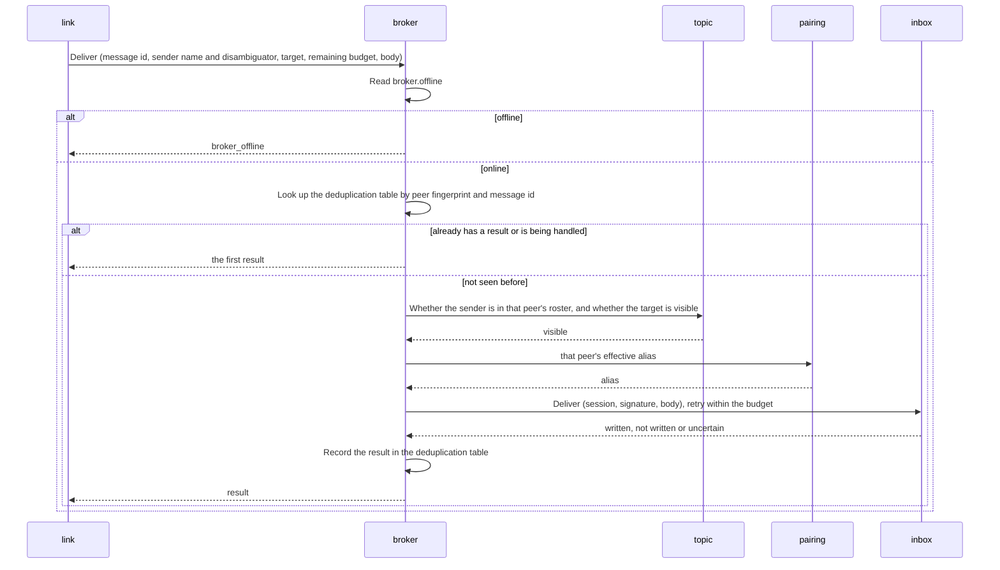
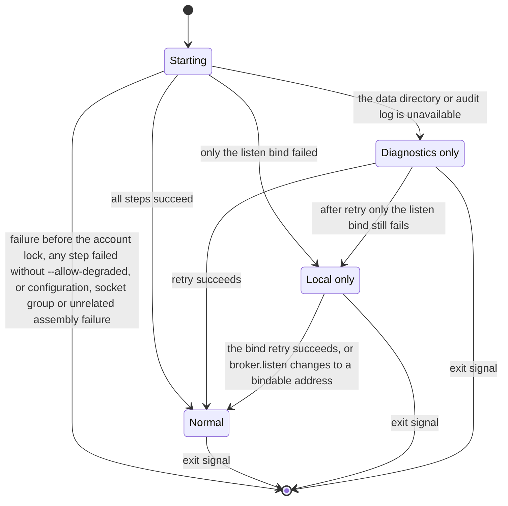

# broker

`broker` is the body of the [Broker](../../glossary.md) process and the assembly entry point. It decides whether the process runs in the system or user form, holds the agent table, provides the local interface to the MCP server process and terminal commands and decides each call's account and permission, executes one send from address resolution all the way to a result, and wires together packages that do not reference each other. Topic membership, links, pairing, the directory, configuration and inbox writes are each implemented by their own package. It can be seen as an agent table, a local interface gated per account, a synchronous send process, plus the wiring between packages.

On first reading, read Responsibilities, External Interface Contract and the Worked Example in Core Algorithms and Flows in order; Core Data Structures and Error and Failure Semantics are for reference.

## Responsibilities

- Determine the deployment form from `--system` or `--user` of `service run`: with `--system` it is a system Broker serving agents under several accounts on the host; with `--user` it is a user Broker serving only agents under its own account; the two are mutually exclusive, and when neither is given, root is system and another account is user ([ADR-broker-deployment-modes](../../adr/adr-broker-deployment-modes.md), `REQ-broker-config-018`).
- On startup, confirm the form and identity, confirm it is not in any session's process tree, acquire the account lock (the lock file guaranteeing at most one Broker instance per account), load the configuration, assemble the packages, bind the listen address, and then listen on the local socket (`REQ-broker-config-013`). Without `--allow-degraded`, a failure at any step exits (`REQ-broker-config-024`, `REQ-broker-config-056`); with it, a listen bind failure after the account lock, or an unavailable data directory or audit log, makes the process enter a degraded run, keep the local socket and report the fault, retrying the failed step when the configuration changes and every minute ([ADR-degraded-run](../../adr/adr-degraded-run.md), `REQ-broker-config-057` through `REQ-broker-config-062`); other failures exit as usual.
- On accepting each local interface connection, read the credentials of the process on the other end of the local socket (process credentials) to determine the caller's account; a user Broker refuses connections from other accounts (`REQ-broker-config-019`).
- Decide whether each call may run by the caller account's access permission on the configuration file ([ADR-management-by-config-file-permission](../../adr/adr-management-by-config-file-permission.md), `REQ-broker-config-021` through `REQ-broker-config-023`).
- Accept registration by an MCP server process: through `inbox`, find the session record in the caller's account's session registry, verify that the inbox socket recorded there is owned by the caller's account, and, when the session name is usable, establish an agent record with the socket path as its identity; several registration connections on the same socket path belong to the same agent, and when the last one disconnects it is deleted and `topic` is told to clear its membership; a session that has not completed registration appears in no result and cannot be a target ([ADR-register-through-mcp-server-process](../../adr/adr-register-through-mcp-server-process.md), [ADR-agent-identity-by-inbox-socket](../../adr/adr-agent-identity-by-inbox-socket.md), `REQ-agent-messaging-001`, `REQ-agent-messaging-002`, `REQ-agent-messaging-012`, `REQ-agent-messaging-030`, `REQ-agent-messaging-034` through `REQ-agent-messaging-036`, `REQ-broker-config-020`).
- Track changes to registered sessions: watch the session registry directory through `inbox`, and reread on demand before listing agents and before delivery; on a name change, update the name and record the former name, on a status change, update the status, and when the record disappears, deregister (`REQ-agent-messaging-005`, `REQ-agent-messaging-010`, `REQ-agent-messaging-033`).
- In the system form, maintain a helper process for each served account, handing it, to run as that account, the operations of looking up, watching and rereading that account's session registry and writing to that account's sessions.
- Generate an address for each agent: the name is the normalized result of the session name; a disambiguator is attached when the name belongs to another account, when the name is not unique under the owner account, when the name cannot appear as is in a signature, or when the name is shortened because it does not fit, and when the name is shortened because it does not fit the disambiguator is fixed to the full 12 characters; the alias is the effective alias the Broker seeing the address uses for the Broker hosting the agent (`REQ-agent-messaging-003`, `REQ-agent-messaging-004`, `REQ-agent-messaging-006`, `REQ-agent-messaging-029`, `REQ-agent-messaging-037`, `REQ-agent-messaging-047`).
- Resolve an agent address to a local agent or a remote agent, refuse when the name is ambiguous, and give the current address when a former name is the target (`REQ-agent-messaging-007`, `REQ-agent-messaging-031`).
- Execute a send: check the frame size and visibility, hand a local target to `inbox` for writing, and request delivery for a remote target from the peer through `link`, synchronously throughout ([ADR-synchronous-delivery](../../adr/adr-synchronous-delivery.md)), with the result being success, not delivered or unknown (`REQ-agent-messaging-013` through `REQ-agent-messaging-020`, `REQ-agent-messaging-026` through `REQ-agent-messaging-028`).
- Handle a peer's delivery request: check `broker.offline`, deduplicate, verify the sender, check visibility, compose the signature, hand it to `inbox` for writing within the requested budget and retry, and return the result (`REQ-agent-messaging-018`, `REQ-agent-messaging-022`). When offline, refuse with `broker_offline` without writing to the session; links, membership, directory reconciliation and new pairings are unaffected (`REQ-agent-messaging-039` through `REQ-agent-messaging-041`).
- Relay between packages: inject the ability to dial and close a link into `pairing`; subscribe to configuration changes and notify `link` and `directory`; hand the advertised address list carried by a peer's card to `pairing` to update candidate addresses, and announce a change in the local advertised address list to `link` and `directory` ([ADR-advertised-address](../../adr/adr-advertised-address.md), `REQ-broker-config-030`, `REQ-broker-discovery-016`); after a successful pairing, compare the fingerprint and the directory (`REQ-broker-pairing-023`); on a join with a public declaration, call `directory`'s `DeclarePublicTopic` first and only then `topic`'s `Join`, and do not join if either fails; when the last local agent that joined a topic publicly leaves it or deregisters, call `directory`'s `RetirePublicTopic` (`REQ-topics-025`).
- Aggregate the state of `topic`, `link`, `pairing` and `directory` to answer requests to list agents, list Brokers and view status; when listing agents, note a former name within 10 minutes of a rename (`REQ-agent-messaging-032`).
- Periodically check this project's latest formal release on GitHub and keep the current and available versions in memory for the local interface's `UpdateStatus` and the terminal status output; a failed check only logs at Debug and does not affect other functions ([ADR-self-update](../../adr/adr-self-update.md), `REQ-update-001` through `REQ-update-003`).
- Perform a delegated upgrade on the local interface: when the current process was started by a service manager, fetch this project's latest formal release, download, verify and replace its own binary, reply to the caller and exit normally so the service manager restarts with the new binary; refuse when not running under a service manager ([ADR-self-update](../../adr/adr-self-update.md), `REQ-update-007`, `REQ-update-008`).
- Do the version handshake on the local interface: when `Hello`'s version number differs from this process's, return `version_mismatch` without disconnecting, mark the connection as "rejected", and thereafter return `version_mismatch` for other calls on the connection; a version incompatibility does not make the process exit; the "rejected" mark and the `version_mismatch` returned to later calls are handled as a version incompatibility (`REQ-broker-config-016`).
- Provide the whole-uninstall command `peers uninstall` and the service control commands `peers service start|stop|restart` (`REQ-broker-config-051` through `REQ-broker-config-055`).

### Non-Responsibilities

- It provides no tools to the model and does not decide a tool's name or description; [mcpserver](design-mcpserver.md) does.
- It does not parse Claude Code's session registry or build inbox frames; [inbox](design-inbox.md) does; `broker` only decides whether these operations run in this process or are handed to an account's helper process.
- It does not decide whether two agents are visible; [topic](design-topic.md) does, and `broker` only calls its decision.
- It does not manage TLS, reconnection or frame sending and receiving; [link](design-link.md) does.
- It does not store the peer table or perform the pairing handshake; [pairing](design-pairing.md) does.
- It does not decide the locations of the various files or how the default alias is derived; [config](design-config.md) does.
- It stores no messages. After a send call returns, the message body is discarded.
- It does not limit sending frequency or detect message loops; Claude Code's inbound controls at the receiving end do ([ADR-no-broker-rate-limiting](../../adr/adr-no-broker-rate-limiting.md)).
- It establishes no separate administrator list and does not trust an identity the caller reports.
- It does not restart itself: after a successful delegated upgrade the process exits normally and the service manager starts it with the new binary; without a service manager it refuses to perform an update. The terminal command's local replacement path only replaces the binary and starts or restarts no service.

## External Interface Contract

The local interface is a gRPC service on a Unix domain socket, located in the runtime directory given by `config` and named `broker.sock`. The only callers are the MCP server process and terminal commands within the same binary, and the interface promises no compatibility to other programs; the two ends judge whether they can interoperate by the local protocol version exchanged in the handshake.

When `Hello`'s version differs from this process's, it returns `version_mismatch` and marks the connection as "rejected"; thereafter every call on that connection except `Hello` returns the same error, and a later `Hello` with a matching version does not clear the mark. Other connections and registered agents are unaffected, the process does not exit, and `Hello` is not required to precede other calls (`REQ-broker-config-016`).

The proto below is only a sketch, and message names follow `local.proto`; names in the sketch such as `HelloReply`, `RegisterUp` and `RegisterDown` differ from the message names in `local.proto`.

```proto
service Local {
  rpc Hello(HelloRequest) returns (HelloReply);                  // version handshake
  rpc Register(stream RegisterUp) returns (stream RegisterDown); // registration; the agent lives while the stream lives
  rpc ListAgents(ListAgentsRequest) returns (ListAgentsReply);
  rpc Send(SendRequest) returns (SendReply);
  rpc JoinTopic / LeaveTopic / ListTopics ...
  rpc ListBrokers / Connect / Disconnect / CreatePairingKey ...
  rpc GetConfig / SetConfig ...
  rpc Status / Audit ...                                         // used by terminal commands
  rpc UpdateStatus(UpdateStatusRequest) returns (UpdateStatusResponse); // current and available versions
  rpc ApplyUpdate(ApplyUpdateRequest) returns (ApplyUpdateResponse); // delegated upgrade
}
```

The local interface only adds fields and error codes and does not raise the local protocol version, in the same way `UpdateStatus` was introduced. `ErrorCode` adds `broker_offline` and `broker_degraded`, both mapped to gRPC `FailedPrecondition`. `NotRegisteredReason` adds `broker_degraded`, and the registration stream event's `detail` carries the fault reason. `StatusResponse` adds `offline` (a boolean; false in diagnostics only, where configuration does not take effect) and `degraded` (the degree is `local_only` or `diagnostics_only`, plus the step, reason and fix hint). `ListBrokersResponse` carries `local`, holding `offline` and `degraded` (the latter with level, step, reason and fix), giving `list_brokers` and `broker list` this Broker's offline and degraded state. A reply must carry `local`: its absence is a protocol-violating response, `list_brokers` returns an error, and `broker list` reports an error and exits with a non-zero code.

In diagnostics-only degradation, the local interface answers only `Hello` as usual; `Status` returns a reply containing only `current_version` and `degraded`; `Register` sends `not_registered` with reason `broker_degraded` on the downstream stream, and the stream stays open; other calls return `broker_degraded` with the description `degraded.reason`. On leaving diagnostics only, the degraded service closes all local connections, and the full service answers on the same socket path, with clients reconnecting by the existing rules.

`CreatePairingKey` takes no parameter other than a nullable `agent_id` and generates only a one-time pairing key, and the reply additionally carries this Broker's advertised address for display; when this run does not listen, it is refused with `invalid_argument`, and in local-only degradation it is refused with `broker_degraded`, with a description containing the address that cannot be bound and `broker.listen` (`REQ-broker-pairing-025`, `REQ-broker-pairing-028`, `REQ-broker-pairing-036`, `REQ-broker-config-058`). `Connect` carries the other side's address, a pairing key and an optional local alias (`REQ-broker-pairing-010`). Each item in `ListBrokers` carries that Broker's advertised address list, and a peer also carries whether this side is its dialer or acceptor (`REQ-broker-discovery-012`). `SetConfig` refuses to change `broker.listen` when this run's listen address comes from a startup parameter (`REQ-broker-config-029`), and always refuses key-type configuration items (items set only through the configuration file whose values are not returned through the local interface, such as a pre-provisioned static key) (`REQ-broker-pairing-031`); `GetConfig` gives only whether a key-type configuration item is set (`REQ-broker-pairing-030`).

`SetConfig` first resolves the audit initiator and changes nothing when `agent_id` is invalid; for a missing key, a key-type configuration item, and a `broker.listen` fixed by `--listen` for this run, it refuses before handling the value, with a description that does not depend on how the value is written, which it also gives when the value cannot be parsed. When `GetConfig`'s `key` is empty, it returns all configuration items in lexicographic order of key names; when non-empty, it returns only that item, and an unknown key returns `invalid_argument`. When `Audit`'s `since` is absent, it returns all records; when `limit` is non-zero, it returns the latest N, still sent in temporal order, ending when read and not following new events.

`Disconnect`'s `broker` parameter takes the peer's effective alias or 64-digit hex fingerprint (case-insensitive), resolved by alias first and, if that fails and the value is exactly 64 hex digits, by fingerprint; when the named Broker is not a peer, it returns `not_found`; unpairing disconnects the link through the injected close-link interface (`REQ-broker-pairing-021`). A successful `Connect` prompts an immediate dial to that peer; a successful reply carries the other side's effective alias, fingerprint, the host name in the address, and warnings (`REQ-broker-pairing-010`). Warnings are given per card: for each address in `Peer.Candidates` whose source is `SourcePairing` or `SourceAcceptor`, and for the last connected address (`LastConnected`), look up the directory one by one, and each publisher in the directory whose fingerprint differs from the peer's produces one, one per card at most, at most 8 in total, with the description `fingerprint mismatch: the directory card of <card fingerprint> lists <addr>, but the paired Broker presented <peer fingerprint>; directory cards are self-reported, so confirm the fingerprint with the other side`, both fingerprints being full 64-digit lowercase hex; when there is no inconsistency the warnings are empty (`REQ-broker-pairing-023`). Error codes on failure: an address or local alias written invalidly is `invalid_argument`, an alias conflict is `needs_local_alias`, and the other side refusing, a handshake timeout, the connection closing before the handshake completes or the other side violating the pairing protocol is `pairing_rejected`, while an address that cannot be connected is `peer_unreachable` (`REQ-broker-pairing-004`, `REQ-broker-pairing-011`). For a peer's advertised address list in `ListBrokers`: when this side is the dialer it takes the list the acceptor told and the list the card carries, excluding the address dialed when initiating pairing; when this side is the acceptor it takes only the list the card carries. It does not take candidate addresses sourced from cards in the peer table; card addresses follow the directory's currently valid card. A peer's status is one of three depending on whether the link is established and whether its address is known. When refused or the role is wrong, `status_detail` explains that re-pairing is needed; when the protocol version is incompatible, it explains with the other side's version (when known); when the link was closed for an inbound limit, it explains that the peer exceeded this host's inbound limit for status frames on one connection, the link has been closed and reconnects after backoff, and the audit log's `link_down` record can be checked. Other failure reasons give no description. Sorting puts peers before non-peers, and within a kind sorts by alias then fingerprint (`REQ-broker-discovery-012`, `REQ-broker-discovery-013`, `REQ-broker-pairing-035`).

The caller's account is not a parameter of any call; it comes from the connection's process credentials. The table below is the precondition of each call; a user Broker's checker always allows, the configuration file belongs to its own account, and the permission preconditions in the table are checked only on a system Broker.

| Call | Needs agent identity | Permission on the configuration file | Requirement |
|---|---|---|---|
| `Hello` | No | None | `REQ-broker-config-016` |
| `Register`, `ListAgents`, `ListTopics`, `JoinTopic`, `LeaveTopic`, `Send` | Yes, except `Register` | None | `REQ-broker-config-023` |
| `ListBrokers` | No | None | `REQ-broker-config-023` |
| `UpdateStatus` | No | None | `REQ-update-002`, `REQ-update-003` |
| `GetConfig`, `Audit` | No | Read | `REQ-broker-config-022` |
| `Status` | No | Read; without read permission only other accounts' agents are omitted | `REQ-broker-config-010` |
| `SetConfig`, `CreatePairingKey`, `Connect`, `Disconnect` | No | Write | `REQ-broker-config-021` |
| `ApplyUpdate` | No | Write | `REQ-update-007`, `REQ-update-008` |

`set_broker_online` changes `broker.offline` through `SetConfig`, with write permission, the same level as `SetConfig`.

A call that needs an agent identity carries the agent identity obtained at registration, and returns `not_registered` when the identity is invalid or belongs to another account. When permission is insufficient it returns `permission_denied` and changes no state. Claude Code's permission confirmation for a tool call happens before the call reaches the local interface and is independent of this table's decision.

`UpdateStatus` needs no agent identity and no permission on the configuration file, the same class as `ListBrokers`. Its reply carries `current_version`, `available_version` and `release_url`; when there is no available version, `available_version` is empty. `StatusResponse` also carries `available_version`, using the next free field number. Only calls and fields are added, without raising the local protocol version. When `UpdateStatus` returns an error, the MCP server process treats it as a failed query: skips the hint, does not record it as queried, and retries on the next tool call; a reply of `Unimplemented` is likewise treated as a failed query.

`ApplyUpdate` takes no parameter and no source: the Broker itself calls `update.Latest` to get this project's latest formal release, and executes only when `update.Newer(current, latest)` is true, otherwise it returns an empty `to_version` and changes nothing. The caller cannot specify a version or source, nor request a downgrade. The reply carries `from_version`, `to_version` and `restarting`; a true `restarting` means the binary has been replaced and the Broker is about to exit and be restarted by the service manager. It requires the caller's account to have write permission on the configuration file, the same level as `SetConfig`; a user Broker's checker always allows. When the current process is not a service process started by a service manager, it returns `failed_precondition`: query the service manager at that level for the service's main process PID (on Linux `systemctl [--user] show --property MainPID --value peers.service`, on macOS the `pid` in `launchctl print system/<label>` or `launchctl print gui/<uid>/<label>`), and only if it equals this process's PID is it considered started by the service manager, with a failed query, an uninstalled service or a mismatched PID all treated as not started, and environment variables not used as evidence. The system installation's instructions give `sudo peers service install --system`, and the user installation's instructions give `peers service install`. Only one `ApplyUpdate` may execute at a time, and a concurrent request returns `aborted`.

Terminal commands do not judge permission themselves: `GetConfig`, `SetConfig`, `CreatePairingKey`, `Connect` and `Disconnect` are decided by the Broker's interceptor according to the account running the command, the same as the table above, and the terminal side neither pre-judges nor makes exceptions. On `permission_denied`, the English error text the Broker gives is written to standard error as is, containing the configuration file's path, and the process exits with code 1.

The four management calls `SetConfig`, `Connect`, `Disconnect` and `CreatePairingKey` carry an optional `agent_id`, used only to fill the audit record's `actor` field; an empty value is allowed; a non-empty value that is invalid or belongs to another account returns `not_registered`; the field takes no part in the permission decision and is not exposed as a tool parameter.

`Connect`, `Disconnect` and `CreatePairingKey` first resolve the audit initiator and produce no side effect when `agent_id` is invalid. On the initiator's side, `pairing_key_created`, `pairing_succeeded`, `pairing_failed` and `unpaired` are written by `broker`; `pairing_failed` is written only for a failure after dialing or the handshake has begun, with the reason and the address in the request as details; no audit contains the pairing key. The acceptor side's pairing audits are written by `pairing` (`REQ-broker-config-007`, `REQ-broker-config-008`).

The calls the four write operations of terminal commands, `config set`, `key create`, `broker connect` and `broker disconnect`, send have an empty `agent_id`; the audit record's `account` is the account running the command and `actor` is empty. No audit field is added.

`Register`'s first upstream frame carries two items: the inbox socket path from the MCP server process's environment (may be empty) and the Claude Code configuration directory from the environment (may be empty); the Broker reads only the first frame and ignores upstream frames after it. When the first frame's socket path is empty, the Broker immediately sends `not_registered` with reason `socket_path_missing` on the downstream stream, and the stream stays open, so this registration never completes by itself. After the Broker completes registration per the "Registration" section, it sends a registration completion on the downstream stream, carrying the agent identity, the agent address and the current value of `topics.auto_join`; when it cannot complete within 10 seconds, it sends `not_registered` with a reason and keeps the stream open, and later sends the completion as usual once the condition holds. When the socket path is not absolute or contains a `..` element, it is treated as no record found and reported as `session_record_not_found` after 10 seconds. When the socket file's owner is not the caller's account, it waits as for no record found and an unusable name, reporting `socket_not_owned` after 10 seconds and continuing to try as the registry changes. In the system form the lookup runs through the helper process, and when `Lookup` returns an error wrapping `helper.ErrUnavailable` (the helper failed to start or communication with it failed), it reports `account_helper_failed` after 10 seconds, separate from no record found, and logs one Warn run log; a record that exists but cannot be read (for example, permission denied) does not belong to this class and is still treated as no record found. When a completed registration is revoked because the name becomes unusable, the record disappears or the socket path the record carries changes, the downstream stream immediately sends `not_registered` with a reason. Afterwards the downstream stream also carries address changes: `agent_changed` is sent only when the agent's address or former name changes, carrying the current status; after a local alias change, every registration stream receives `agent_changed` with the new address. Several registration connections on the same socket path get the same agent identity.

Command line:

| Command | Call | Purpose |
|---|---|---|
| `peers service run [--system \| --user] [--listen <address>] [--allow-degraded]` | — | Run the Broker in the foreground, invoked by the service definition. `--system` and `--user` are mutually exclusive and select the deployment form; when neither is given, root is system and another account is user. `--listen` replaces the listen address in the configuration, applies only to this run, and does not read or write that item in the configuration file; during it, a call through a tool that changes the listen address fails (`REQ-broker-config-025`, `REQ-broker-config-029`). `--allow-degraded` allows a degraded run, see "Degraded Run"; a service definition written by `service install` always carries it, and a foreground run omits it by default (`REQ-broker-config-063`) |
| `peers mcp` | — | Run as the MCP server process, started by Claude Code according to the session's tool configuration; see [mcpserver](design-mcpserver.md) |
| `peers service status [--system \| --user]` | `Status` | View agents, membership, peers and links (`REQ-broker-config-010`). During a degraded run and when offline, output the status line first; see "Listing Agents and Viewing Status" (`REQ-broker-config-068`) |
| `peers service offline [--system \| --user]` | `SetConfig` | Set `broker.offline` to true (`REQ-broker-config-066`) |
| `peers service online [--system \| --user]` | `SetConfig` | Set `broker.offline` to false (`REQ-broker-config-066`) |
| `peers service audit [--system \| --user] [--limit <count>]` | `Audit` | View the audit log as a stream; `--limit` specifies how many of the latest records to take, and 0 means no limit (`REQ-broker-config-009`) |
| `peers config list` | `GetConfig` | List all configuration items (`REQ-broker-config-039`) |
| `peers config get <key>` | `GetConfig` | Read one configuration item (`REQ-broker-config-039`) |
| `peers config set <key> <value>` | `SetConfig` | Change a configuration item (`REQ-broker-config-039`) |
| `peers key create` | `CreatePairingKey` | Generate a one-time pairing key and output the key, expiry time, local advertised addresses and connection prompt (`REQ-broker-config-039`, `REQ-broker-pairing-038`) |
| `peers broker list` | `ListBrokers` | List Brokers and their connection status (`REQ-broker-config-039`) |
| `peers broker connect <address> --key <key> [--alias <alias>]` | `Connect` | Initiate pairing (`REQ-broker-config-039`) |
| `peers broker disconnect <broker>` | `Disconnect` | Unpair (`REQ-broker-config-039`) |
| `peers update [--yes]` | `ApplyUpdate` | Check for and install a new version of this project. Call `ApplyUpdate` on the selected Broker; when the selected one is this account's user Broker and it is not running under a service manager, replace the binary locally instead. `--yes` skips the question (`REQ-update-004` through `REQ-update-007`) |
| `peers service install [--system \| --user] [--admin-group <name>]` | — | Install and immediately start a user or system service; login or boot afterwards is the service manager's job. The service definition starts the Broker with `--allow-degraded` (`REQ-broker-config-063`). A system installation creates the administration group and makes it the group of the new configuration file (`REQ-broker-config-015`, `REQ-broker-config-043`) |
| `peers service start [--system \| --user]` | — | Start the service of the selected level (`REQ-broker-config-055`) |
| `peers service stop [--system \| --user]` | — | Stop the service of the selected level without disabling it, so it still starts at the next login or boot (`REQ-broker-config-055`) |
| `peers service restart [--system \| --user]` | — | Restart the service of the selected level (`REQ-broker-config-055`) |
| `peers service remove [--system \| --user]` | — | Stop and uninstall the service, keeping the configuration, identity and audit log |
| `peers uninstall [--purge] [--yes]` | — | Uninstall this system; see "Uninstallation" (`REQ-broker-config-051` through `REQ-broker-config-054`) |
| `peers completion [bash \| zsh \| fish \| powershell]` | — | Output the completion script for the given shell; the install script uses it to write the completion file |
| `peers --version` | — | Output the version this binary reports and exit 0 |

Help is shown in three groups: pairing, local Broker, and installation; the `help` command itself is not in the help list, and `mcp` and `internal` are hidden. `--admin-group` is accepted only together with `--system`, and given alone or with `--user` it exits as a usage error.

`service offline` and `service online` connect to the Broker of the selected level, equivalent to `config set broker.offline <value>`, and output one line `The Broker is now offline.` or `The Broker is now online.`, with an audit record the same as `config set`. Every subcommand under `service` accepts the mutually exclusive `--system` and `--user`, and when neither is given, root selects the system installation and another account selects its own user installation; a service definition writes one of them explicitly.

`broker connect`'s `<address>` is the same as the `connect_broker` tool, written as `address:port` or `hostname(address:port)`; `broker disconnect`'s `<broker>` is the same as the `disconnect_broker` tool, written as an alias or a 64-digit hex fingerprint. Every terminal command supports `-h` and `--help`. On a parameter error it first outputs `<path>: <reason>`, then `Run '<path> --help' for usage.`, and exits with the usage-error code (2); the full usage text is printed only when a command group is run without a verb.

On failure the process exits with a non-zero code, and the last line of standard error is `peers <subcommand>: <reason>`, where the reason is the upstream error's text as is; a usage error adds a line `Run '<path> --help' for usage.`. A command's result is written only to standard output, and the Broker's JSON run log is written separately to standard error. Exit codes distinguish the reason:

| Exit code | Meaning |
|---|---|
| 0 | Normal completion; a Broker or MCP server process receiving SIGINT or SIGTERM and exiting normally is also 0 |
| 1 | Other failures: a Broker runtime error (including loss of the account lock), a terminal command unable to connect to the Broker, an error returned by the Broker, a differing version |
| 2 | Usage error: unknown subcommand, unknown flag, extra positional argument, invalid flag value (including an empty or invalidly written `--listen`, an out-of-range `--limit`) |
| 3 | Startup failure: an existing instance holds the account lock |
| 4 | Startup failure: the listen address is unavailable |
| 5 | Startup failure: the configuration is invalid |
| 6 | Startup failure: it is in a session's process tree |
| 7 | Startup failure: `--system` but not root |
| 8 | Startup failure: the runtime directory's owner or permission does not match |

When `broker.listen`'s port is below 1024 and the configuration file is writable by group or other, the refusal happens at the listen bind step, with exit code 4, not 5; a Broker run as a service with `--allow-degraded` enters a local-only degraded run.

`service install`, `service start` and `service restart` also use exit code 3 to mean the service is installed and running but the Broker is in a degraded run; it has the same value as `service run`'s exit code 3 (an existing instance holds the account lock) but belongs to different commands. `service install` and `service remove` exit 0 on success, 1 on an installation or uninstallation failure with the reason on standard error, and 2 on a usage error; a `--system` identity check failure is treated as a general failure with exit code 1. `uninstall` exits 0 on success and when nothing is installed; when not root and only a system installation exists, after `--yes` or confirmation on the terminal it reruns through sudo, and without a terminal and without `--yes` it reports an error and exits 1, with the error giving a directly rerunnable `sudo peers uninstall ... --yes`. Other uninstalls without a terminal and without `--yes` also exit 1, saying to add `--yes`; other failures are 1 and usage errors 2.

`--listen`'s value must be non-empty. To not listen in this run, set `broker.listen` in the configuration to empty. Whether an address is written validly is decided by `config`, and an invalid one exits as a usage error.

Process-level signals are handled uniformly by `cmd/peers`: the first SIGINT or SIGTERM cancels the run, and the second terminates the process directly.

`service status`, `service online`, `service offline` and `service audit` connect to the Broker of the selected installation, specified by `--system` or `--user`, and when neither is given, root selects the system installation and another account selects its own user installation. Which Broker `config`, `key`, `broker` and `update` connect to is chosen by the caller's identity, with no explicit parameter: root connects to the system Broker; another account follows the first three items of the order in which the MCP server process selects a Broker in [mcpserver](design-mcpserver.md), first its own account's user Broker and then the system Broker. The selection only finds a running Broker and starts none. When `--system` finds no running Broker it reports that the system Broker is unavailable; when neither option is given, this account's user Broker is absent and the system Broker is running, it reports an error suggesting `--system`. `update` calls `ApplyUpdate` on the selected Broker; when it returns `failed_precondition` and the selected one is this account's user Broker, it replaces the binary locally instead; when no running Broker can be selected it likewise replaces locally (see "Update Checking and Self-Update"). Other commands report an error when they find no running Broker, with the same error text as `service status`, stating the two ways to start one, `peers service install` and `peers service run`. After connecting, it calls `Hello` first, and on a differing local protocol version reports `version_mismatch` and exits, stating the Broker's and this binary's versions and suggesting restarting the Broker with this binary. A single unary call times out after 10 seconds; the `Audit` stream has no overall time limit and relies on signal cancellation. The MCP server process in a session selects a Broker by its own order, independent of terminal commands.

`service status`'s output is in two parts, agents and peers, with tables sorted by address or alias, and an empty value written as `-`; topics are joined by commas in lexicographic order; a fingerprint is written as full 64-digit lowercase hex, not shortened; an enum value is written in lowercase snake case with its prefix removed. When a part has no entries, it writes `Agents: none` or `Peers: none`. `service audit` outputs one line per event, in arrival order: the RFC 3339 UTC time, the event name, and the non-empty fields among `actor`, `account`, `peer`, `key`, `old`, `new`, `count` and `detail`; a value that is empty or contains a space, quote or equals sign is quoted.

Configuration, pairing and peer management commands follow `service status`'s output conventions: a fingerprint is full 64-digit lowercase hex, an enum is lowercase snake case without its prefix, an empty value is `-`, and tables are sorted by their own sort key. Each command's output:

- `config list`: one line per item, written as `<key> = <value>`, sorted by `key`; a key-type configuration item writes only `set` or `unset`, never its value.
- `config get`: outputs only one item, written as in `config list`; an unknown key returns an error.
- `config set`: one line, written as `<key>: <old> -> <new>`.
- `key create`: outputs in order `Key: <key>`, `Expires: <RFC 3339 UTC>` and `Addresses:`, then one line per advertised address, indented two spaces; when there is a displayable address, it finally outputs a directly pasteable connection prompt, the same content as `create_pairing_key`'s `connect_prompt`, both generated by the same function (`REQ-broker-pairing-038`). The prompt first gives a natural-language request that can be pasted into a session on the other host, then the equivalent terminal command `peers broker connect <address> --key <key>`, with the address quoted by shell rules; with several addresses it lists them all and says any one the other side can reach may be chosen, giving the first address in the command and saying the rest may be substituted; with no displayable address it outputs no prompt. When this run does not listen, the Broker refuses with `invalid_argument`, and the command exits with code 1.
- `broker list`: a table with columns ALIAS, FINGERPRINT, PEER (yes or no), STATUS, DIRECTION, ADDRESSES (comma-joined). Sorted by alias; with no Brokers it outputs `Brokers: none`. When the reply lacks `local`, it reports an error and exits with code 1, printing no table.
- `broker connect`: one line `Paired with <alias> (<fingerprint>)`; the reply's warnings are written one per line to standard error with the prefix `warning: `, and the exit code is still 0.
- `broker disconnect`: one line `Disconnected <broker>`.

`service install` writes the service definition, enables the service and starts the Broker immediately, then polls over the local socket for the Broker to answer, for up to 20 seconds. The limit covers the Broker's own startup time and launchd's default 10-second throttle; a timeout makes the installation fail, with the error giving the location of the service log and folding in the `error` field of the last `startup_failed` record in the log: on Linux `journalctl --user -u peers.service` (without `--user` for system), on macOS `~/Library/Logs/peers/broker.log` (for system, `/var/log/peers/broker.log`). Only records written after this installation began are used: on Linux, `journalctl --since` bounds the query start, then records are filtered by their time; on macOS, records are filtered by their `time` field. Older records from before the installation describe the previous run and are not folded into the error. When no `startup_failed` record after this installation began is found, it instead gives the state the service manager reports and the last exit code: `systemctl [--user] show -p ActiveState -p SubState -p ExecMainStatus peers.service`, or the `state` and `last exit code` in `launchctl print <domain>/<label>` (`REQ-broker-config-049`).

The service definition starts the Broker in a way that allows a degraded run: on Linux the user installation's unit is `ExecStart=<binary> service run --user --allow-degraded` and the system installation's unit is `ExecStart=<binary> service run --system --allow-degraded`; on macOS `ProgramArguments` is `service run --user` or `service run --system` with `--allow-degraded` appended (`REQ-broker-config-063`). After the local socket answers, it calls `Status` once: when in a degraded run, the service stays installed and running, it outputs `Status`'s fault and fix hint, and it exits with code 3 (`REQ-broker-config-064`).

After the local socket answers and the PID the service manager reports matches the socket peer's PID, the service is considered installed and running. If `Status` cannot be read afterwards, the installation first retries within the remaining readiness wait; if it still fails it exits with code 1, neither cleaning up nor disabling the service, with an error saying the service is running but its status cannot be read, guiding the user to run `peers service status` (with `--system` for system).

On success or degradation, `service install` prints a summary (`REQ-broker-config-050`):

```
peers <version> installed (<user service|system service>, starts at <login|boot>)
  binary:      <path>
  config:      <path> (generated|kept)
  admin group: <name> (created | existing | existing, members: <names> | existing, no members listed)
  run log:     journalctl ... | <log file path>
  audit log:   <path>
  start:       [sudo ]peers service start
  stop:        [sudo ]peers service stop
  restart:     [sudo ]peers service restart
  uninstall:   peers uninstall
```

A user command omits `sudo`, and the log is `journalctl --user -u peers.service` or macOS's `~/Library/Logs/peers/broker.log`. Paths come from the path table in [config](design-config.md), and the log location from the existing `logHint`. The `config` line follows the existing two statements "generated" and "kept existing"; when the system installation reuses an existing configuration file, the command that hands the existing file to the administration group still goes on its own line after the summary. The `admin group:` line appears only in a system installation and states the administration group's name and source.

The release bundle's install script puts the binary into the target directory, calls `service install` with it, and registers the MCP service for the user performing the installation (`REQ-broker-config-041`); writing, starting and reinstalling the service definition are still only `service install`'s job, which is idempotent, so the install script makes no separate decision. The remote install script downloads the release bundle, verifies its sha256 and, after extracting, calls the bundle's `install.sh`; permission checks, refusing a user installation as `root`, and the like are still the bundle script's job (`REQ-broker-config-042`).

Before writing completions and man pages as root, a system installation checks and creates each level from `${DESTDIR:-}/usr/local` down to the target directory: each level is checked first and the next level is created under it only after it passes, and `${DESTDIR:-}/usr/local` itself is created as root first if it does not exist. Each level must not be a symlink, its owner must be the effective account running the script or the account `SUDO_USER` corresponds to, and it must not be writable by group or other. When it does not satisfy this, that file is skipped, a warning is printed starting with `install.sh: warning:` stating the directory, the reason and the manual installation command, and the script's exit status is unchanged. When the target directory's owner is `SUDO_USER`, the temporary file's `mktemp`, writing and renaming are all done by that account through `sudo -u`, and root creates, writes or renames no file in that directory: the completion content is first generated in a root-created temporary file under `/tmp`, then copied by that account into its own temporary file, `chmod 0644` and renamed to the target, and the man page is likewise written by that account with `install -m 0644`. A directory owned by root keeps being written by root directly. A symlink at the target path is replaced rather than followed, and when the target location is a directory it is skipped with a warning; on a generation failure the temporary file is deleted and the target is unchanged. A user installation writing to a completion directory under `$HOME` likewise renames through a temporary file, without an owner check.

The release bundle's install script determines the installation level when neither `--system` nor `--user` is given: system when the current user is root; when it can ask on the terminal, it asks `Upgrade the system installation? [Y/n]` if a system service definition already exists on the host, otherwise `Install for every account on this host? [y/N]`; when it cannot ask, user. Given both `--system` and `--user`, it exits as a usage error; running `--user` as root is refused with a hint to drop `--user`. When the level is system and the current user is not root, the script re-executes itself as `sudo sh <own path> --system <original arguments>`; when `sudo` is not found on the host it exits non-zero, saying sudo is needed and suggesting `--user` for a user installation. When `service install` exits 3, the script continues to register the MCP service and print its own summary, then exits 3; the script's own summary lists only the MCP registration and PATH items, and the rest is output by `service install`. When a binary already exists at the target path before replacement, the script compares it with the new version by semantic version and, before the summary, outputs `Upgraded from <old version>.` (the new version is higher), `Downgraded from <old version>.` (lower), `Reinstalled peers <version>.` (the same) or `Replaced peers <old version>.` (the order cannot be determined, for example `dev` or a pre-release version); the old version comes from the `--version` of the binary at the target path before replacement. With `--no-service` the script itself outputs the binary path and version. Answering n to `Upgrade the system installation? [Y/n]` makes the script make no change, exit 0, and say the system installation was not changed (`REQ-broker-config-044` through `REQ-broker-config-048`).

An upgrade only replaces the binary and does not rewrite the service definition. An installed service adopts the service definition and startup method written by the current version only after `service install` is run again.

On Linux, the user unit is written to `~/.config/systemd/user/peers.service` and the system unit to `/etc/systemd/system/peers.service`, then it runs `systemctl --user daemon-reload`, `systemctl --user enable peers.service` and `systemctl --user restart peers.service` in order, without `--user` for system; `restart` starts the service when it is not running and swaps in the new binary on reinstall. The user configuration directory is `XDG_CONFIG_HOME`, or `~/.config` when empty or not absolute.

On macOS, the user plist is written to `~/Library/LaunchAgents/io.github.wangzw.peers.plist` and the system plist to `/Library/LaunchDaemons/io.github.wangzw.peers.plist`, with the label `io.github.wangzw.peers`. The user installation uses only the `gui/<uid>` domain; when that domain does not exist, the installation fails before writing the plist, with an error saying a user service must be installed in a graphical login session and hosts without a graphical session should use `--system`. The system installation uses the `system` domain. The installation writes the plist first, and a reinstall then uses the same definition to do bootout and bootstrap. The pre-check identifies the occupant of `broker.listen` but does not stop the service in the pre-check stage; after the pre-check passes and before bootstrap, it runs `launchctl bootout <domain>/io.github.wangzw.peers`; within the replacement section it runs only this once; cleanup after a readiness failure does another bootout and a disable. `launchctl` reports a service that is not loaded with exit code 3, which the installation ignores; any other bootout error fails the installation. Regardless of whether bootout returns 0 or 3, the installation polls `launchctl print <domain>/io.github.wangzw.peers` at 100-millisecond intervals until the command reports the service does not exist; when the service is not loaded, the first print fails and takes almost no time. Only exit code 113 or the output `Could not find service` counts as unloaded; other errors keep polling to the limit, avoiding overwriting a task launchd still holds. Whether it is a reinstall is judged by the result of `launchctl print` before bootout, not by bootout's exit code. When the address is held by this service's Broker, after uninstallation it keeps polling `broker.listen` until the address can be bound; the uninstallation wait and the address wait share one 20-second limit and are not added step by step. Then it runs `launchctl enable <domain>/io.github.wangzw.peers` to clear a disabled state left by a previous failure, then `launchctl bootstrap <domain> <plist path>`. When bootstrap fails with exit code 5, that is `Bootstrap failed: 5: Input/output error`, meaning it raced with the teardown of the old service, and the installation retries at 200-millisecond intervals. The retry has its own 10-second limit (`bootstrapRetryBound`), not deducted from the 20 seconds of uninstallation and address waiting, so it can still retry after the uninstallation wait used up its budget; other exit codes fail immediately. The worst total duration is 20 seconds of uninstallation and address waiting, 10 seconds of bootstrap retry and 20 seconds of readiness waiting, 50 seconds in all. Failure handling is in the "Service written or enabled by this installation" paragraph. The domain actually used is recorded in the installation result.

The system unit's `[Service]` section sets `TasksMax=8192` and `LimitNOFILE=65536`, limiting the number of tasks in the service cgroup and the file descriptors each process in the service can open, so that the Broker and its child processes cannot exhaust the whole host even if they bypass the in-process limits. `MemoryMax` is not set: helper processes are in the same cgroup as the Broker, total memory grows with the number of accounts the service serves, and a fixed limit would kill the Broker outright on a host with many accounts, so memory is bounded by the in-process limits. The user unit and the macOS launchd definition add no such limits: launchd's `NumberOfProcesses` is `RLIMIT_NPROC` counted per uid, which for a root daemon would count every root process on the whole host, and there is no equivalent to a cgroup.

Before installation it checks the local socket at that level. When the Broker answers, the installation compares the PID the service manager reports (systemd's `MainPID`, the `pid` in launchd's `print`) with the socket peer's PID: equal means this service is running, and the installation restarts it with the new binary; unequal, or the service manager has no running process, is always treated as a foreign Broker, and the installation refuses and says to stop it first.

With `--system`, it checks the binary and each of its directories by the real path after resolving symlinks: the owner must be root, it must not be writable by group or other and must be executable by other, and each directory must be enterable by other; when the binary is under a temporary directory, both the user and system installations refuse the installation.

On installation, if the configuration file at that level does not exist, it generates a template listing all configuration items. The system installation writes `/etc/peers/config.yaml`, owned by root with the administration group as group and `0660` as permission, with the content `config.Template(config.ModeSystem)`; the user installation writes `~/.peers/config.yaml`, owned by the current account with `0600` as permission, with the content `config.Template(config.ModeUser)`, creating its directory by the data directory's rules when absent. Both are created exclusively (`O_EXCL`) and left unchanged when the file exists; an existing local configuration file is not migrated or rewritten. The installation output states "generated configuration file <path>" or "kept existing configuration file <path>" (`REQ-broker-config-040`).

The configuration file is generated before the pre-check. On Linux the unit file is written only after the pre-check passes; on macOS the plist is written before the pre-check, because a reinstall then uses the same file to bootout and bootstrap. Before registering the service, the installation reads the `broker.listen` that will take effect for this installation, including a template just generated now. When the value is non-empty, it tries to bind the address and then releases it. When the address is occupied, it first identifies the occupant: only when the main process the service manager reports (Linux's `MainPID`, the `pid` in launchd's `print`) equals the socket peer's PID does it mean the occupant is this service's Broker (a reinstall or upgrade), and this uses the same main-process query as update uses to judge whether it is started by the service manager. On Linux it then stops the service and polls the address until the old Broker exits and releases it, waiting up to 20 seconds, covering the Broker's shutdown after SIGTERM, launchd's time to tear down the old task and the 10-second throttle. macOS does not stop the service in the pre-check stage, only records that the address is held by this service, and the subsequent bootout and uninstallation wait handle it, so the whole flow does not bootout twice. When the occupant is not this service, the installation fails directly, without stopping, uninstalling or changing the installed service; a plist newly created this time on macOS is deleted and an existing plist is left as is. If the address is still occupied, the installation fails, registers nothing and starts no service. The error states the address, `already in use`, the configuration file path and the `broker.listen` key, and suggests another port, or leaving it empty to not listen (`REQ-broker-config-064`).

A service written or enabled by this installation does not start automatically at boot or login after the installation fails. On a macOS pre-check failure, the plist newly created this time is deleted and an existing plist is left as is; a Linux pre-check failure happens before the unit file is written, so no unit file is newly written this time. When the occupant is not this service, the installed service is left as is and keeps running in its original enabled state. After a readiness failure (the Broker fails to start or does not answer within 20 seconds) or a registration failure, Linux runs `systemctl --user disable --now peers.service` (without `--user` for system). macOS registration failures include a bootout error, an uninstallation wait timeout and a final bootstrap failure. Cleanup is decided by the state recorded before writing the plist: a plist newly created this time is deleted; a plist that existed before the installation is kept and `launchctl disable <domain>/io.github.wangzw.peers` is run, whether or not its service was loaded at the time. launchd loads every plist in the LaunchAgents and LaunchDaemons directories at login or boot, and only deletion or disable can stop it from reloading. After a readiness failure macOS first boots out and then disables, stopping a service just loaded but not answering. When a plist is kept, the recovery command first runs `launchctl enable` and then `launchctl bootstrap`, or `service install` can be run again. For a failure after the old service was uninstalled, the error says the old service was uninstalled and no Broker is running now; for a failure that could not uninstall it, the error says the old service could not be uninstalled. When the label was already disabled, it says it will not start automatically; when disabling failed, it says the service may start automatically. The configuration file and the Linux unit file are kept, and the macOS plist is deleted or kept by the rules above, with the error saying to fix it and run `service install` again. If the failure happens after stopping a service that was running, the error says `the existing service was stopped` and gives the command to restore it. When stopping the original service in the pre-check fails, the installation still disables the service, the error says `will not start automatically` and gives a recovery command; when even disabling fails, the error says it may still start automatically at the next boot or login. There is still a race between the pre-check and the actual bind; with `--allow-degraded` it enters a local-only degraded run after starting, reported by the readiness `Status` check; without it, startup fails, covered by the log reason above.

A system installation creates the administration group: when the group does not exist, Linux runs `groupadd --system <name>` and macOS creates it with `dseditgroup`; when it exists, it reuses it without changing members. On macOS, only a record-not-found answer from the directory service counts as a missing group; any other lookup failure fails the installation or uninstallation with the error, so a temporary directory-service fault never makes the installation create a group that may already exist and record it as created. The group name defaults to `peers` and is given by `--admin-group`; a group-creation failure fails the installation and changes no configuration file. When reusing an existing group, a group with gid 0 is always refused, for example `cannot use group "wheel" as the administration group: its group id is 0`. Installation is also refused when all of the following hold: the group exists and was not created this time; `/var/lib/peers/admin-group` does not record this group name; a new configuration file will be generated this time; the administrator did not explicitly specify the group name with `--admin-group`; and the group lists members. The error lists the members and gives two ways out: explicitly specify this group to accept the members, or use another group name, for example `cannot use the existing group "peers" as the administration group: its members alice and bob would be able to manage the system Broker; pass --admin-group peers to accept them, or pass --admin-group with another name`. The refusal happens before any file is written, leaving no configuration file. When the configuration file exists, its content, group and permission are unchanged, and the installation output gives the command to hand the existing file to the administration group, `chgrp <group> <path> && chmod 0660 <path>`. Whether the group is newly created or reused, the summary's `admin group:` line states the group name and source: `<name> (created)`, `<name> (existing)`, `<name> (existing, members: <member list>)` or `<name> (existing, no members listed)`. Members include supplementary members listed by the account database and accounts with this group as primary group, and on macOS also nested groups listed in `NestedGroups`; a nested group listed by GUID is resolved to a group name with `dscl` for display, and if it cannot be resolved it is still counted by GUID and refused as usual. A failure to read members is treated as a refusal. Primary-group accounts are enumerated by `getent passwd` (macOS's `dscl` account list), and when SSSD has enumerate off it may return only local accounts, so directory-service accounts are not seen; an alias group sharing the same gid as the target group is out of scope and its members are not counted. When the administrator explicitly specifies the group name with `--admin-group` or this time reuses an existing configuration file, the installation skips both the check and the member read, and the summary writes only `<name> (existing)`, so a reinstall is not blocked by an account-database fault. The install script in the release bundle asks whether to add the account performing the installation to the group, defaults to not adding, and only forwards the administrator-given `--admin-group` to `service install` ([ADR-admin-group](../../adr/adr-admin-group.md), `REQ-broker-config-043`).

`service remove` stops and uninstalls the service first and deletes the service definition only after success; when stopping fails it keeps the file and returns an error. On Linux it runs `systemctl --user disable --now peers.service`, without `--user` for system, deletes the unit file and runs `daemon-reload`; when `daemon-reload` fails it restores the unit file so the next uninstallation can still complete. On macOS it runs `launchctl bootout <domain>/io.github.wangzw.peers` and then deletes the plist, with bootout's error handling the same as installation. Whether it is installed is judged by two things: the unit file or plist exists, or the service manager still has it enabled or loaded; a file deleted but a service still loaded is still uninstalled. The configuration, identity and audit log are kept. When it was never installed, the command succeeds directly and reports not installed, so it is repeatable. `--system` requires root.

`Audit` is a server-side streaming call: audit events arrive one by one as one stream in temporal order, ending when read. The request carries an optional `limit`: when non-zero, it returns the latest N events, which still arrive in temporal order; when 0, it means no limit. Reading keeps no cursor or paging state, each call rereads on its own, and `limit` only truncates this stream's content.

The grammar of an agent address is a stable promise to the model:

```
address       = name-part "@" alias
name-part     = name [ " [" disambiguator "]" ]
disambiguator = 6 to 12 lowercase hex characters
alias         = 1 to 24 characters from letters, digits, ".", "-", "_"
```

The name in an address is the agent's name after signature cleaning and, when necessary, shortening, per the signature generation in "Handling Delivery Requests"; the whole address is at most 64 code points. When the name is shortened, the address always carries the full 12-character disambiguator. An agent's name contains no whitespace, `@` or `*`, so the trailing ` [` of the name part appears only before a disambiguator.

## Dependencies

`broker` references `topic`, `directory`, `link`, `inbox`, `pairing` and `config`, and is not referenced by these packages, satisfying the module dependency graph's direction. The delivery request body on the link uses A2A's Message structure with only one text part ([REF-a2a](../../references.md), [ADR-a2a-message-body](../../adr/adr-a2a-message-body.md)), and `broker` converts between it and plain text. Process credentials come from the operating system: `SO_PEERCRED` on Linux and `LOCAL_PEERCRED` on macOS.

## UML Diagrams

The diagram below is the call order of the packages when handling a peer's delivery request. The offline check precedes the deduplication lookup; when not offline, the deduplication lookup precedes the other checks, so a duplicate request triggers no further check or write and directly gets the first result; while the first request is still being handled, a duplicate request waits for its result. The write to `inbox` in the diagram is performed in the system form as described in the "Helper Process" section.



## Core Data Structures

The agent record exists only in memory and is identified by the inbox socket path ([ADR-agent-identity-by-inbox-socket](../../adr/adr-agent-identity-by-inbox-socket.md)):

| Field | Meaning |
|---|---|
| `ID` | The hex result of SHA-256 over the string `session:` concatenated with the socket path; registrations on the same socket path always get the same `ID`; the socket path is first normalized to an absolute path, and a non-absolute path or one with `..` waits as no record found and is reported as `session_record_not_found` |
| `Ref` | The disambiguator: the shortest prefix of the first 12 characters of `ID` that distinguishes it among all agents on this Broker, at least 6 characters; the algorithm is the same as Claude Code's identifier in its session list, and under Claude Code's default configuration the two values are the same, while when the compared scopes differ the lengths may differ and the shorter is a prefix of the longer. When the name belongs to another account it is fixed to the first 12 characters of `ID`. When the name is long enough that rendering the address under some valid alias would shorten it, it is likewise fixed to the first 12 characters of `ID`, so that a shortened address always resolves. When agents being added or removed on this Broker makes an agent's `Ref` longer or shorter, a change is pushed per agent ([ADR-name-ownership-by-account](../../adr/adr-name-ownership-by-account.md), `REQ-agent-messaging-006`, `REQ-agent-messaging-047`) |
| `RefPinned` | True means the name belongs to another account, `Ref` is fixed to 12 characters, and an identifier shorter than 12 does not match this agent. It is false when `Ref` is fixed to 12 only because the name does not fit |
| `RefMandatory` | True means the address and the signature must carry a disambiguator: the name belongs to another account, the name is not unique under the owner account, or the name has no owner and is not unique in the whole table. `recomputeRefsLocked` recomputes with the agent table, and on a change it pushes `agent_changed` and updates topic membership |
| `SocketPath` | The session's inbox socket path |
| `Account` | The account from the process credentials of the registering connection, also the owner of the socket file |
| `ConfigDir`, `RecordPID` | The configuration directory holding the session record and the record's process id, used for rereading |
| `Name` | The session name after normalization by `inbox`'s `NormalizeName` |
| `PrevName`, `PrevNameAt` | The most recent former name and the time of the rename; cleared by a one-shot timer after 10 minutes of retention and pushed once as a change; the retention time is a constant, not configurable |
| `PublicTopics` | The set of topic names this agent joined publicly, used to withdraw the public declaration on leaving or deregistering, and to declare again when the Broker becomes public |
| `Status` | The session status, one of `idle`, `busy`, `waiting`, `shell`; a missing or unrecognized value is recorded as unknown, and on the wire unknown status is `AGENT_STATUS_UNSPECIFIED` |
| `Conns` | The number of registration connections belonging to this agent |

The name-owner table is persisted in `name-owners.json` in the data directory ([ADR-name-ownership-by-account](../../adr/adr-name-ownership-by-account.md)):

| Field | Meaning |
|---|---|
| name | The name after normalization by `inbox`'s `NormalizeName`, also the key in the file |
| owner account | The uid of the account that registered this name first, kept during and before release |
| last-held time | The time when the owner account's last holder left or renamed, RFC 3339; a held entry is updated to the scan time during the hourly scan, and written as the write time when written to disk |

"Held" means at least one registered agent on the owner account currently has this name. The file format is `{"format":1,"records":[{"name":<name>,"uid":<uint32>,"last_held":<RFC 3339>}]}`; entries count against a quota by account key, and when the key differs from the uid (the uid has no account entry and shares the unknown-account key) an `account_key` is written separately, defaulting to the uid so an old file still reads. On registering or renaming to a name, if the name has no unexpired entry, it is recorded as the current account; if it has one, it is unchanged. An entry expires only when no one holds it and 7 days have passed since the last-held time; a scan runs hourly, expiry is also judged on lookup, and release precision is within an hour. The hourly scan also refreshes currently held entries to the scan time and marks them dirty for writing, so a name still held after a restart counts its 7 days from the most recent write time, not from its registration time and being released by mistake. Expiry triggered by a lookup path (such as `list_agents`) goes through the same path as the scan: on an ownership change it recomputes the disambiguator and pushes `agent_changed` and membership changes, not transferring silently. When an entry expires while another account currently holds the name, ownership passes to the account of the earliest-registered agent among them. Each account has at most 1024 entries, uids with no account entry share one quota (counted by the result of `accountKeyFor`, consistent with the other per-account limits, so a container rotating subuids cannot multiply it), and the whole table has at most 65536 entries; on exceeding, the oldest unheld entries are evicted (the per-account limit evicts that account's, and the whole-table limit then evicts the oldest in the whole table). The account key is computed outside `Broker.mu`, and neither the registration nor the rename path queries the account database under the lock. When all of an account's entries are held, a new name is not recorded, the name temporarily has no owner, behaviour is the same as with no owner table, and one Warn `name_owner_table_full` is logged (fields uid, account_key, limit), once per account until it falls back below the limit. The file is sorted by name, byte-identical for identical content, permission 0600, written through a temporary file plus rename with a directory sync; writes and scans do not happen while holding `Broker.mu`, which only takes a snapshot. When the file cannot be parsed or its format is unknown, one Warn `name_owners_unreadable` is logged and it starts from an empty table, and before the next write the file is renamed to `name-owners.json.corrupt-<time>` and kept; a failure to read at all is treated as the data directory being unavailable. A write failure is logged as Warn, only the first of consecutive failures is logged, and logging resumes after one success. A user Broker runs the same code, with all entries owned by one account.

The caller record is one per local interface connection, created when the connection is accepted and discarded when it closes: the account from the process credentials and the account name the supplementary groups rely on. Every call on the same connection belongs to this account.

The helper process table exists only in the system form: keyed by account, the value is that account's helper process and the pipe that communicates with it.

The deduplication table's key is the source and message id: a request from a peer has the peer fingerprint as source, and the key with the local side as source is reserved for the future, with no user in this version. The value is the message's handling state (handling, has a result) and the result. An entry's retention period counts from when the result was obtained, using that moment's `send.dedupe_window` but not shorter than this request's budget deadline, whichever is later, and it is deleted on expiry; a handling entry does not expire. Expired-entry cleanup is spread across lookups: each lookup checks only a limited number of entries, and the key being looked up is checked separately, so an expired entry is not returned as a hit even if this round did not reach it. The table holds at most 65536 entries; once full, new messages do not enter the table and are answered directly with `inbox_unwritable`, with the description `Not sent: the Broker is temporarily holding too many messages`; all expired entries are cleared before the fullness check. Each source also holds at most 4096 entries; when a source fills its share, its new message ids do not enter the table and are answered directly with `quota_exceeded`, with the description `Not sent: this Broker holds too many recent messages from your Broker`, while other sources are unaffected. The share is counted by the source peer fingerprint, regardless of which session the message is sent to. The table is in memory only and is cleared after a Broker restart. A local send does not enter the table in this version: the local path generates a new message id for each send and never resends with the same id. A message id must be a UUID, and a request whose id is not a UUID is refused with `invalid_argument`.

Frames on the link that belong to this package:

| kind | Frame | Category | Content | Purpose |
|---|---|---|---|---|
| 400 | `DeliverRequest` | Request frame | Message id, sender name and disambiguator, target, remaining budget, A2A Message body | Request the peer Broker to write the message into the target session's inbox |
| 401 | `DeliverResult` | Reply frame | A oneof of `delivered` and `error` | The reply to `DeliverRequest` |

Both frames are transported through `link`'s `Request`, and `DeliverResult` comes back as `DeliverRequest`'s reply.

## Core Algorithms and Flows

### Worked Example

Broker A's self-reported alias is `hostA` and Broker B's is `hostB`; A initiated pairing with B's address and pairing key, and is B's dialer; neither side set a local alias for the other, and the link is established. A's `api-worker` and B's `frontend` share topic `github.com/org/repo`. `api-worker` calls send to target `frontend@hostB`, B's first reply is lost on the way back because the link breaks, and the link is then re-established by A.

| Step | Event | A's state | B's deduplication table |
|---|---|---|---|
| 1 | A receives `Send`, generates message id `m1`, the frame size is within the limit | The budget starts counting | Empty |
| 2 | A resolves `frontend@hostB`, finds the unique `frontend` in B's roster, `topic` judges it visible | Same | Empty |
| 3 | A sends `Deliver(m1)` over the link with the remaining budget | Sent, waiting for a reply | Empty |
| 4 | B finds no `m1`, verifies the sender and visibility, rereads `frontend`'s session record, and writes into `frontend`'s inbox socket with the signature `api-worker@hostA` | Waiting for a reply | `m1`: success |
| 5 | The link breaks and B's reply is lost | Sent, no definite reply | `m1`: success |
| 6 | A re-establishes the link and resends with the same `m1` and a new remaining budget | Waiting for a reply | `m1`: success |
| 7 | B hits the table, writes nothing, and returns the first result | Gets a definite reply | `m1`: success |
| 8 | A returns success to the MCP server process | None | `m1`: success, deleted on expiry |

The target session receives only one message. When the link is not re-established before the budget runs out, A stops before step 6 and returns `delivery_unknown`, because the request was already sent in step 3.

### Process Startup and Single Instance

1. Determine the form. With `--system` and the process not running as root, it reports an error and exits.
2. Through `inbox`'s `InSession`, check whether it is running in a Claude Code session's process tree; if so, report an error and exit, with the description `this process or one of its parent processes belongs to a Claude Code session`, exit code 6. `InSession` first checks this process's environment variables, then walks up the parent chain: if any ancestor's environment contains a non-empty `CLAUDE_CODE_MESSAGING_SOCKET`, or an ancestor's pid appears in this account's session registry, it is judged to be in a session's process tree; an ancestor that cannot be read is skipped, and the chain length is capped at 256 levels (`REQ-broker-config-056`).
3. Take an exclusive file lock on the account lock; if it cannot be taken, report that an instance is already running and exit; after taking the resolved lock, also check the account lock in the other candidate runtime directory of this account, and either one held by a running instance of this account is treated as an existing instance with the same error text. The account lock's path is given by `config`, depends only on this process's account, and is independent of the form, configuration content and listen address; starting another instance with a different listen address likewise cannot take the lock. A system Broker takes root's account lock, so root cannot run a system and a user instance at the same time.
4. Load the configuration and use the address given by `--listen` as this run's listen address. With `--allow-degraded`, a `Load` failure because the audit log is unavailable makes the process switch to diagnostics only; a configuration file read or parse failure, a value-validation failure and an advertised-address preparation failure all make the process exit as without the parameter.
5. Run the assemblers in order: the assemblers open the identity and peer table, construct link and inject the dial-and-close-link ability into `pairing`, and construct topic and the directory, with each package's instance established at this time; the assembler for configuration read/write and audit comes last and adds the permission interceptor to the local interface's server options; then the local interface is constructed and the components are started, and the components register link frame handlers, configuration-change subscriptions and the `broker.listen` validation function at this time, before the local socket is bound and `link` is started, so they take effect before any inbound connection and link event. The identity, peer table and directory are opened by an assembler, not in `Load`; the assembler wraps the "data directory unavailable" error from opening them with a sentinel exported by `config` (in [config](design-config.md)'s "Error and Failure Semantics"). With `--allow-degraded`, `run.go` recognizes this sentinel with `errors.Is` and switches to diagnostics only; other assembly or component startup failures exit fatally as usual.
6. Bind the listen address. This step is performed after all components are started, with the address being this run's effective listen address. On a bind failure, without `--allow-degraded` it reports the address unavailable and exits; with it, it enters a local-only degraded run and does not switch to another address or port ([ADR-listen-by-default](../../adr/adr-listen-by-default.md), [ADR-degraded-run](../../adr/adr-degraded-run.md), `REQ-broker-config-024`, `REQ-broker-config-058`). When the listen address configuration is empty, this step is skipped. A `broker.listen` change delivered after components start and before each component's `AfterReady` is not bound immediately: in the `AfterReady` stage it is compared with the effective value at that time and the address bound in this step, and if different it binds once more, and if the same it skips.
7. Only the lock-holding process deletes a leftover local socket file and binds the local socket: a user socket has permission `0600`; a system socket sets its group and permission from the configuration after binding, by default the runtime directory's group and `0666`, and an administrator setting it to a group and a group-writable permission restricts the accounts that can connect to that group (`REQ-broker-config-027`). After binding it turns off Go's default delete-on-close behaviour; before deleting the local socket file it verifies the file is still the one this process bound. The system Broker sets the group first and then the permission; when `broker.local_socket_group` names a nonexistent group, startup fails and names the item, exiting even with `--allow-degraded`. When these two change through the configuration file or `SetConfig`, they are reapplied to the socket file immediately, and established connections are unaffected. If the socket file disappears between the bind and the setting of its mode, the bind closes that listener and binds again, up to three attempts, logging each retry as `local_socket_bind_retry` with the socket path and the attempt number and recording `local_socket_rebound` once a retry succeeds, so a concurrent cleanup of the runtime directory does not fail the startup; the socket left by a successful retry carries the same permission and group as an undisturbed bind.
8. Start `link`: dial the peers for which this side is the dialer, and wait for connections from the peers for which this side is the acceptor ([ADR-initiator-redials](../../adr/adr-initiator-redials.md), `REQ-broker-pairing-019`).

After receiving an exit signal, it closes `link` first, then stops the local interface, stops the components in reverse startup order, deletes its own local socket, and closes but does not delete the account lock file.

The delivery frame handler and link subscriptions are registered during assembly, before the local socket is bound and `link` is started, so they take effect before any inbound connection and link event.

While holding the lock, the Broker checks the runtime directory every minute: it exits if the path of the account lock is no longer the file it holds, so that two instances do not appear after the lock file is cleaned up; when the local socket file is deleted or replaced by a different socket file, it rebinds, and when it is replaced by a regular file, it logs a Warn and does not replace it. During the check it sets the account lock file, the runtime directory and the local socket's timestamps to the same moment, and when setting by path does not follow symlinks, so a `/tmp` cleanup rule by time does not delete a running Broker's files. Each of the three targets logs a Warn on a starting failure and an Info after recovery: the account lock as `account_lock_touch_failed` and `account_lock_touch_recovered`, the runtime directory as `runtime_dir_touch_failed` and `runtime_dir_touch_recovered`, and the local socket as `local_socket_touch_failed` and `local_socket_touch_recovered`; the same failure logs only its first occurrence and its recovery, not every time, and does not exit, giving the path and reason in fields on failure. When the runtime directory is occupied by another account and the [fallback location](design-config.md) is used, after the first configuration load it logs one Warn `runtime_dir_fallback`, with fields for the occupied preferred location, the occupant's uid and the fallback path.

When another account's Broker on the same host already occupies the default configuration's listen address: a fresh install or reinstall is refused by the installation's pre-check and registers no service (`REQ-broker-config-064`); for an already installed service started later, the foreground instance fails in step 6 and a service run enters a local-only degraded run, local agents keep communicating, and it starts listening automatically once the user switches to another address or port. When the agent table is empty, the Broker does not exit (`REQ-broker-config-014`).

The run log has one JSON object per line, with keys `time` (RFC 3339, UTC), `level` and `event`, and the rest event fields; each key appears only once in a line. When the caller needs to attach explanatory text, it goes in the `message` field. A user Broker writes to standard error; when started by a user service manager, standard error is collected by that manager. The level changes immediately with a change to `log.level`. A group named `event` and a non-string `event` value go into `event_details`.

### Degraded Run

A degraded run ([degraded run](../../glossary.md)) is the state a Broker with `--allow-degraded` is in when a step fails after the account lock is acquired. The process does not exit, keeps the account lock, answers on the local socket, and reports the fault through `Status`, tool errors and the run log. A failure before the account lock does not enter a degraded run and exits as usual: `--system` but not root, being in a session's process tree, the runtime directory unavailable, or an existing instance holding the account lock (`REQ-broker-config-060`). A failure to bind the local socket likewise exits, since a degraded run relies on it to report the fault.

Degradation has two degrees:

| Degree | Entry condition | Local interface | Leaving degradation |
|---|---|---|---|
| local only (`local_only`) | Only the listen address fails to bind and the other steps succeed; a system low-port rule refusing the bind also falls in this degree | All calls as usual; `CreatePairingKey` returns `broker_degraded` with a description containing the address and `broker.listen`; `Status` and `ListBrokers` carry the fault; a send to a peer for which this side is the acceptor returns `peer_unreachable` by the existing rules, with the degradation reason appended to the description | The bind retry succeeds |
| diagnostics only (`diagnostics_only`) | A failure after the account lock and before the listen bind, and the failure is that the data directory (identity, peer table, directory files) or the audit log is unavailable | `Hello` as usual; `Status` returns only the fault; `Register` sends `not_registered` with reason `broker_degraded`, and the stream stays open; other calls return `broker_degraded` | The retry of all startup steps from the failed one succeeds |

During startup, the following failures are fatal even with `--allow-degraded`: the configuration file cannot be read or fails to parse, a value is invalid, advertised-address preparation fails, `broker.local_socket_group` names a nonexistent group, and an assembly or component startup failure unrelated to the data directory. When the configuration is untrusted, no diagnostic service is offered, to avoid deciding who can connect to the local socket with a misread value.

#### State at a Glance



| State | Meaning | What makes it leave |
|---|---|---|
| Local only | No link listener exists, so peers in the acceptor role cannot connect in; links for which this side is the dialer work as usual | The bind-retry timer, or a change to `broker.listen` |
| Diagnostics only | Only the degraded service answers on the local socket; there is no agent table, links or configuration | A configuration file change notification, or the per-minute retry |

#### Entering and Retrying

The order of startup steps is unchanged ("Process Startup and Single Instance"). With `--allow-degraded`, `fail` no longer releases the account lock and exits, but instead:

1. Undo the components started before the failure, as the current `fail` does, keeping only the account lock.
2. If the failure happened before the local socket bind, bind the local socket now. A system installation sets the group and permission from `broker.local_socket_group` and `broker.local_socket_mode` in the configuration file; the configuration has loaded successfully, so these two can be obtained.
3. Run the degraded service on the local socket, and write one `degraded_entered` run log with fields for the degree, step and reason; `startup_failed` is written as usual, and the installation command reads it.
4. Start retrying.

A listen bind failure does not call `fail`: the Broker performs the local socket bind and the `link` start as usual, records "listen not bound", and enters local only.

Retry rules:

- On a configuration file change, retry immediately. In diagnostics only, `config`'s watch is not running (it is not started when `Load` fails), so the degraded service watches the configuration file's directory itself; in local only, it reuses the `broker.listen` change subscription and calls `link.Listen` on a change, logging `listen_rebind_failed` on failure.
- A failure in diagnostics only is also retried every minute; a failed retry is logged only when the reason changes, to avoid a line every minute. When retrying in diagnostics only, a `Load` failure from reading, parsing or validating the configuration does not exit, and only updates the reason and fix hint to this failure; the fatal classification applies only to the startup stage.
- A listen bind failure is also retried with backoff: 1 second first, doubling each time, capped at 1 minute (`REQ-broker-config-062`). In a run where the address is given by `--listen`, `broker.listen` in the configuration file does not participate, and only this retry applies.

On leaving diagnostics only, the degraded service closes all local interface connections, the local socket file is not rebound, and the full local service then answers on the same socket. After the connection leaves READY, the MCP server process reconnects by the existing rules and calls `Hello` and registers again ([mcpserver](design-mcpserver.md)'s "Startup and Registration" and "Re-Registration"), and the session does not need to reconnect the MCP server. On leaving, it writes a `degraded_left` run log.

The degraded service's fault description contains no configuration item value or key, following `config`'s conventions for startup errors ([config](design-config.md)'s "Error and Failure Semantics"). The fix hint is given per step:

| Step | `fix` |
|---|---|
| Listen bind | `peers config set broker.listen <free address>`, or edit `broker.listen` in `<configuration file path>`; add `sudo` for system. When the low-port rule refuses, instead `chmod g-w <configuration file>`, or use a port above 1024 |
| Data directory (identity, peer table, directory, name ownership) | Check `<data directory>`'s owner and permission, then `peers service restart`; without a restart it retries every minute |
| Audit log | Check `<audit log path>`'s owner and permission, then `peers service restart`; without a restart it retries every minute |

### Caller Identification and Permission Decision

On accepting a local interface connection, it reads the process credentials once to get the caller's account, recorded as the connection's caller record. A user Broker refuses a connection whose account differs from its own at this step. What is identified is the process's account: any process of the same account can call with that account's permissions.

Each account holds at most 256 local connections at once, and each connection runs at most 64 streams at once; the whole Broker holds at most 4096 local connections at once, summed over accounts. 4096 is far below the system unit's `LimitNOFILE` (65536): each connection occupies at least one descriptor, and the Broker also holds helper-process pipes, the link listener and the configuration file, leaving room at 4096. When the connection count reaches the limit, new connections fail and close at the handshake stage, and are accepted again only after the count falls below the limit.

The handshake first looks up the caller's account cache without blocking. A uid cached as a real account takes a global connection slot directly without entering the lookup queue; when a cache entry expires, the old name keeps being used and is refreshed in the background, and expiry itself does not send an account into the queue. Other connections first take a lookup-wait slot, then the global slot: a lookup waits for a getent slot, waiting connections count toward the global limit, the wait-slot count has its own limit of 64, and connections beyond it are refused immediately. A lookup wait is capped at 5 seconds, the same as the budget before a permission check begins, because both wait on the same process-wide getent gate; a timeout or lookup failure always refuses the connection (fail closed), and the global slot and wait slot are returned immediately.

A uid with no account entry shares one "unknown account" bucket and takes part in every per-account limit. A normal account may own a whole subuid range, so a rootless container can connect with tens of thousands of uids that have no account entry; if each uid had its own quota, the per-account limits would be meaningless. Unknown uids share one per-account quota rather than being refused outright, so rootless containers can still connect. Only a definite "no such account" enters this bucket; a lookup failure or timeout is refused by fail closed above, entering neither the unknown bucket nor the unknown cache. A user Broker admits only its own account, and these values are large enough not to affect normal use; the diagnostics-only service in a degraded run uses the same connection, stream and registration limits.

A limit refusal logs Warn `local_connection_limit_reached` (fields uid, limit, scope being account or broker), at most one per account per minute, and a global-limit refusal likewise at most one per minute, so a retrying client cannot flood the run log.

The account name is used for the caller record and error descriptions. A successfully found name is cached for 5 minutes; when no account entry is found or the name is empty, the decimal uid is cached as the name for 30 seconds, and the uid enters the unknown-account bucket. A lookup failure (timeout, unavailable auxiliary source and the like) refuses only the current request, writes no cache, and the next lookup queries the account database again. After a real account's entry expires, the old name keeps being used and is requeried in the background; on a background lookup failure the old name is kept and retried after 30 seconds, and only a definite "no such account" deletes the entry and downgrades the uid to unknown account. Real accounts and no-account uids use separate caches: the real-account cache's entry count depends on the host's account count with no entry limit, so no-account uids cannot push it out; the no-account negative cache is separate, holds at most 1024 entries, evicts in least-recently-used order, and on a hit moves the uid to the front. Concurrent misses for the same uid run only one lookup, and the rest wait for its result. Caller-name lookups and the account lookup of a permission check share one getent gate for the whole process, running at most 4 lookups at once; two callers each opening a gate would let twice the limit of getent processes run at once.

When a call requiring configuration-file permission arrives, it decides "whether the caller's account has read or write permission on the configuration file":

- A user Broker makes no decision. Its configuration file belongs to its own account, and the caller is that account.
- A system Broker spawns a permission-check process on each decision: the child process runs as root, and before entering the protocol loop it switches the supplementary groups, effective group and effective uid in turn to the caller account's values in the account database at that moment, while the real and saved uids remain root, so the caller can neither stop nor read this process. When the target uid and gid already equal the child process's effective identity, it does not switch: skipping requires both the effective uid and effective gid to be the same, and since the Broker starts the child as root, that holds only when the account being checked is also root, so there is no fail-open that decides for another account under root's effective identity. The child process runs this binary with the hidden subcommand `peers internal access-check`, performs one read or write access check on the configuration file, returns the result and exits. The check calls `faccessat2` (`AT_EACCESS`) directly, deciding by effective identity, with `R_OK` for a read check and `W_OK` for a write check; a nonexistent file, a caller without permission, or a path segment that is not a directory is judged not allowed. The decision is not inferred from permission bits, so the result includes the effect of group permissions and access control lists. `faccessat2` requires Linux 5.8 or later; when the kernel returns `ENOSYS` or `EPERM`, the check is treated as its own failure, the call fails with `internal`, and there is no fallback to permission-bit inference, because that fallback would bypass access control lists. macOS has no separate `faccessat2`, and `faccessat(AT_EACCESS)` is decided by the kernel by effective identity, with no permission-bit fallback. The child process's standard error is not inherited from the Broker, and anything written to it is discarded. On a check timeout, a spawn failure, or the child reporting an effective uid that differs from the caller's, the call fails with `internal`; when the account database has no caller uid, it is judged not allowed.

A system Broker runs at most 8 check processes at once, at most 2 per uid. A check first looks up the caller's account, then takes that account's slot, and finally the global slot, so one account cannot fill every slot; taking a slot and the check itself share a 5-second timeout budget, and when a slot cannot be taken within the budget the call fails with `quota_exceeded`, with the explanation `Too many configuration access checks are running; try again shortly.`, rather than proceeding, and one Warn `access_check_busy` (field uid) is logged, at most one per uid per minute. Both slots are released after the child process is reaped, and a timed-out check likewise releases them after the child stops.

The account lookup uses the process-wide getent gate above, at most 4 at once, combined with caller-name lookups. A uid whose lookup fails or times out gets no per-uid slot entry and the request is refused as a failure (fail closed); only a definite "no such account" shares the unknown-account bucket and is judged not allowed, logging one Warn `access_check_unknown_account` (field uid), with all no-account uids sharing one rate-limit window of at most one per minute, the rate limit storing one timestamp and not growing with the uid count. The account slot table keeps only accounts that actually exist; a slot idle for 5 minutes is deleted, and there is a total limit of 4096 entries; when the total limit is full and no idle entry can be deleted, a new account's check fails with `internal`, without growing the table.

On macOS, identity switching does not go through `setgroups`: Darwin's `setgroups` and `initgroups` both limit the static group table by `NGROUPS` (16), so an account in more than 16 groups would get `EINVAL` from a direct switch. The check process first `setegid`s to the account's primary group, then calls Darwin's `initgroups` system call (number 243 in `bsd/kern/syscalls.master`, signature `initgroups(u_int gidsetsize, gid_t *gidset, int gmuid)`, with no libc stub), passing a static table containing only the primary group and the account uid as `gmuid`, and the kernel resolves the other groups through memberd when judging group membership, and finally `seteuid`s to the account uid. The static table therefore never exceeds `NGROUPS`, and the decision is still made by the kernel according to the account's full group membership, including group permissions and ACLs. A failure at any step is handled as a check failure, with no permission-bit fallback. On a switch failure, the check process writes an error with errno into the response's `Error` field and exits with failure; on reading the response the Broker checks `Error` first, and if non-empty fails with `internal` and logs that text at Warn, so errno enters the Broker log and the response is never judged as allowed. This system-call number is a private interface, guarded by macOS's end-to-end tests.

A system Broker accepts connections from all accounts; which accounts can use it is limited by the local socket's file permission.

On Linux, accounts and groups come from the system's account database through `getent`, whose sources are determined by the NSS configuration, and accounts from sources such as LDAP, SSSD and extrausers can likewise spawn permission-check processes. The lookup uses the absolute path `/usr/bin/getent` or `/bin/getent`, the child environment gives only `LANG=C`, the account name or uid is preceded by `--`, and a single call is limited to 5 seconds. The reply must be exactly one line and match the request; when getent reports not found, it is treated as the account not being in the account database, and when getent is not found, times out, returns another exit code or has an abnormal format, it falls back to `os/user` and logs one Warn, at which point only local-file sources are visible ([ADR-account-database-source](../../adr/adr-account-database-source.md)).

An administrator granting write permission on a system Broker's configuration file to a group delegates management operations to that group's accounts. The decision result is not cached, and changes to file permissions and group membership take effect for the next call. A system Broker's configuration file is created when the system service is installed; when the file does not exist, a call requiring permission always returns `permission_denied`.

A system installation creates the administration group and makes it the group of the new configuration file, and an administrator can also hand an existing file to a group with `chgrp` and `chmod` ([ADR-admin-group](../../adr/adr-admin-group.md), `REQ-broker-config-043`). The administration group is equivalent to being able to edit the configuration file by hand, and gains no ability beyond the configuration file. When `broker.listen`'s port is below 1024, it takes effect only when the configuration file is writable by root alone: a change through `SetConfig` with a caller that is not root returns `permission_denied`; when the file is writable by group or other, hot reload keeps the old value and logs a Warn and a `config_rejected` audit, and startup refuses to start. The configuration directory `/etc/peers` is owned by root and not group-writable, and the configuration file is opened with `O_NOFOLLOW`; details are in [config](design-config.md). A reload triggered by editing the configuration file directly has no account attribution, and the audit's `account` and `actor` are empty. A system `peers update` does not replace the root-owned binary directly but replaces and restarts through `ApplyUpdate` by the Broker itself, so an account with write permission on the configuration file can update without root (`REQ-update-007`).

The permission decision is performed by the local interface's gRPC interceptors, with unary and streaming calls decided by their respective interceptors: it looks up a table by the call's full method name, the entries correspond to the permission table in the external interface contract, and the interceptors are attached to the local service through server options. A user Broker's checker always allows and reads no file; the system Broker's checker spawns a permission-check process that performs one read or write access check on the configuration file. A call outside the table returns `internal`; a checker's own failure returns `internal`, not proceeding, except that a failure to take a check slot because the per-account or global quota is full within the budget returns `quota_exceeded` and says to retry shortly. On insufficient permission it returns `permission_denied`, stating whether read or write permission is missing and giving the configuration file's path. `Status` is not refused for lacking read permission: the interceptor records the read decision in the call's context, and `Status` therefore only omits other accounts' agents, returning peers and links as usual.

Topic changes are rate-limited by the caller's account. Each call to `JoinTopic` and `LeaveTopic` consumes one token of that account, with a token bucket of capacity 64 refilling 4 per second; when tokens are insufficient it returns `quota_exceeded`, saying to try again later, and changes no membership. A call without a name is made once per default topic by [mcpserver](design-mcpserver.md), each consuming one token per topic. `LeaveAll` on deregistration is not rate-limited. A user Broker has one account; a system Broker counts each account separately, with the time taken from `Deps.Clock`.

A system Broker also limits the number of local topics per account: an account may hold membership in at most 128 topics that have members, and `JoinTopic` returns `quota_exceeded`, saying the topic count has reached the limit, when that account would exceed it; an agent already in one of that account's topics joining again still succeeds. Both limits apply: this one and the topic registry's global limit of 512: when an account first hits 128 the broker refuses, and when all accounts together hit 512 the registry returns `ErrTopicLimit`, both mapped to `quota_exceeded`. A user Broker has one account and is subject only to the global limit of 512.

### Registration

1. Read the socket path and configuration directory from `Register`'s first upstream frame. The socket path must be absolute and contain no `..` element, and after normalization by `filepath.Clean` it serves as the agent's identity; otherwise it is treated as no record found. These two values are used to find a record in the caller's account's session registry. After reading the first frame and identifying the caller's account, it first counts by account, then takes the session backend: each account runs at most 256 `Register` streams at once, and beyond that the stream ends with `quota_exceeded`, with a description stating that the account already has 256 open registrations, and logs one Warn `register_limit_reached` (fields uid, limit), once per overrun. The connection itself is not closed. When the caller's account lookup before counting fails or times out (not "no such account"), the stream ends with `internal` and is not counted into the unknown-account bucket.
2. When the socket path is empty, registration stays waiting, immediately sends `not_registered` with reason `socket_path_missing` on the downstream stream, and keeps the stream open; this process's environment does not change, so this registration never completes by itself. When the path is non-empty, it takes the record whose `messagingSocketPath` equals it through `inbox`'s `Lookup`. In the system form, this step is performed by the caller account's helper process.
3. Verify that the socket file is owned by the caller's account: the path must be a socket file whose owner uid equals the caller's uid. When it does not match, it waits as for no record found, reports `socket_not_owned` on the downstream stream after 10 seconds, and keeps trying as the registry changes. This step is performed by the Broker process itself, not handed to the helper process.
4. Normalize the session name in the record with `NormalizeName`; the normalized result is truncated at a UTF-8 character boundary to at most 128 bytes, and a trailing `-` left after truncation is removed. The name is unusable when the result is empty, empty after `CleanSignature`, or contains `@` or `*`, and there is no substitute name (`REQ-agent-messaging-030`).
5. When no record is found or the name is unusable, registration stays waiting and re-executes steps 2 to 4 as the session registry directory changes; when the condition still does not hold after 10 seconds, it sends `not_registered` on the downstream stream stating which reason, and keeps the stream open, continuing to wait. The event carries an optional `detail` in addition to the reason enum: for an unusable name it states the specific rule (the session name is empty, has no character visible to the receiver after cleaning, contains `@` or contains `*`), not echoing the session name itself; other reasons leave it empty when there is no finer information.
6. When step 2 is performed by the helper process, if the error `Lookup` returns wraps the sentinel `helper.ErrUnavailable` (judged with `errors.Is`, not by matching error text), it means the account's helper process failed to start or communication with it failed. A spawn failure (including an account-database lookup failure before spawning), a readiness-frame timeout and a pipe break are all wrapped with this sentinel by the helper side using `%w`. Registration likewise waits and retries, reporting `account_helper_failed` after 10 seconds. A record that exists but cannot be read, such as permission denied, is not wrapped with this sentinel and is still reported as `session_record_not_found`. Except for no record found and a half-written record, every `Lookup` failure logs one Warn run log, so even when the reason is still `session_record_not_found`, the failure stays in the Broker log. The report therefore points to the helper process and the Broker log, not leading the reader to a session record that may exist. The local interface appends only this one enum value and does not raise the local protocol version.
7. When the condition holds, if an agent already exists at the socket path, the connection is assigned to it and `Conns` is incremented; otherwise an agent record is established with the socket path as its identity. A registration completion is sent on the downstream stream. When the new agent's name has no unexpired entry in the owner table, it is recorded for the registering account; when there is an unexpired entry, ownership is unchanged.

When the last registration connection disconnects, the agent deregisters, `topic` clears all its membership, and if the name is no longer held by the owner account as a result, the last-held time is updated to that moment. After the user disables this system's MCP service in a session, the MCP server process is terminated, the connection disconnects, and the agent deregisters; after re-enabling, the new MCP server process registers with the same socket path and gets the same agent identity, with the address's disambiguator computed from the agent set at that time (`REQ-agent-messaging-034`). A subagent calls tools through the main session's MCP server process and acts as the main session's agent; a process a subagent definition starts separately by declaring this service itself registers with the same socket path and belongs to the same agent (`REQ-agent-messaging-035`). A headless session has a registry record and a bound inbox like an interactive session, so registration is no different (`REQ-agent-messaging-036`).

### Tracking Session Changes

`inbox` watches the configuration directories that have agents or pending registrations, with no periodic check. When an agent's record changes, the record is reread through `Reread`; when a half-written content is read, the previous value is kept and the next change is awaited. Before handling a list-agents request and a delivery request, it also rereads the records of the local agents involved; `Status` does not reread session records. The reread results are handled by the following rules:

- Name changed and new name usable: `Name` becomes the new name, the original name is recorded in `PrevName` and `PrevNameAt`, the old address immediately becomes invalid, the downstream stream notifies the address change, and `topic` pushes the membership change (`REQ-agent-messaging-005`). When the new name has no unexpired entry in the owner table, it is recorded for the current account; if the old name is no longer held by the owner account, the last-held time is updated to that moment.
- Status changed: update `Status` and push.
- Name becomes unusable: the agent deregisters, each registration connection returns to the wait in step 5; once the name is usable again registration completes again, and the MCP server process restores the topics it remembers per re-registration.
- Record disappears: treated as the session ending, and the agent deregisters.
- The socket path the record carries differs from the agent's (including becoming an empty string): treated as the agent's record having disappeared, and the agent deregisters; the new session registers again with the new socket path and gets a new agent identity ([ADR-agent-identity-by-inbox-socket](../../adr/adr-agent-identity-by-inbox-socket.md)).
- The protocol version the record carries is non-zero and not 1: write one `session_protocol_unrecognized` run log, only once per same value for the same agent, and registration and delivery proceed as usual.

After the deregistration above, the original registration connection returns to waiting and sends the registration completion again once the condition recovers.

When a session runs `/clear` or `/compact`, the socket path and session name are unchanged, so the agent's address and membership are unchanged and no handling is needed (`REQ-agent-messaging-033`).

Downstream events are sent to the client through each registration connection's own queue. Consecutive not-yet-sent `agent_changed` events for the same agent are merged into the latest one, and other events are appended in the order they arise. When the queue waiting to be sent reaches 64 events, the Broker ends the `Register` stream with `quota_exceeded`, with a description stating the backlog exceeds 64, and logs one Warn `register_events_overflow` (fields uid, agent). The connection itself is not closed, and the client can register again.

### Helper Process

A system Broker spawns an account's helper process when that account's first connection needs it: it runs this binary with the hidden subcommand `peers internal account-helper`. Identity switching is done per platform. On Linux, before exec it hands the account's uid, primary group and full group table to the kernel through `syscall.Credential`, and the child is already that account when it starts; Linux's `setgroups` has no count limit. Darwin's `setgroups` and `initgroups` both limit the static group table by `NGROUPS` (16), so the full group table does not fit in the credentials; the child therefore starts as root, gets the account's uid and gid from environment variables, and before entering the protocol loop calls `setgid`, `initgroups` and `setuid` in order: `setgid` switches the real, effective and saved gid to the account's primary group; `initgroups` is passed a static table containing only the primary group and the account uid as `gmuid`, and the kernel resolves the other groups through memberd, so the static table does not exceed `NGROUPS` and an account in more than 16 groups can likewise complete the switch; finally `setuid` switches the real, effective and saved uid to the account. After the switch it verifies `getuid`, `geteuid`, `getgid` and `getegid`; if any differs from the account it exits with a non-zero status, writing the reason to standard error and never entering the protocol loop, so it does not keep serving as root. Beyond these four it does two more checks, the same as OpenSSH's `permanently_set_uid`: it calls `setuid(0)` once, and if that succeeds the process still has root in the saved uid or capabilities, so it exits with a non-zero status; it reads the supplementary groups (`getgroups`), and if the target primary group is not 0 and the group table contains 0 it likewise exits, so the account does not retain access to the root group. This read covers only the static group table `initgroups` builds: root's original static supplementary groups have been replaced, but the check can only confirm the table contains no 0; groups the kernel resolves through memberd by account when judging group membership do not enter `getgroups`'s result and are out of scope. A request whose target uid is 0 is refused directly; the Broker never specifies root for a helper process. Once all checks pass it clears the two identity-carrying variables with `os.Unsetenv`, so the process no longer carries the identity into child processes it later spawns. The switch requires the process to start as root; a non-root child is refused directly, and an ordinary account cannot enter another account through environment variables.

The child's environment sets only `HOME`, `USER` and `LOGNAME` (from the account database), a fixed `PATH`, and on Darwin the variables carrying the account identity; no other environment variable is passed. The two hidden subcommands each use their own set of variables, never sharing. `peers internal access-check` reads `PEERS_ACCESS_CHECK_UID`, `PEERS_ACCESS_CHECK_GID` and `PEERS_ACCESS_CHECK_GROUPS`: the permission-check process starts as root and switches only the effective group and effective uid to the caller's account, with the real and saved uids remaining root, and sets supplementary groups per platform, with Linux replacing them from the group table in the environment and Darwin resolving them through `initgroups` by the kernel. `peers internal account-helper` reads `PEERS_ACCOUNT_HELPER_UID` and `PEERS_ACCOUNT_HELPER_GID`: the helper process starts as root and switches the real, effective and saved identity entirely to the account in the order above. The two sets of variables are read and the uid and gid parsed by `lookupIdentityEnv` and `parseID` (`internal/broker/helper/account.go`), with both subcommands sharing the same implementation but using different variable names, so one subcommand does not accept an account identity prepared for the other. When the uid variable is unset, the child is treated as already being the target account and no switch is made, which is the path Linux helper processes and in-process tests take. On Darwin the helper process's environment does not carry the group table, and all supplementary groups are resolved by the kernel during `initgroups`. The helper process accepts the Broker's requests through a pipe, performs `inbox`'s lookup, watch, reread and write, and returns the results. Messages on the pipe are varint-length-prefixed protobuf messages defined in `internal/broker/helperpb`. After starting, the child first reports the protocol version and its actual uid, gid and supplementary groups, and the Broker terminates it on a mismatch. A request carries a request number, requests on one connection may run concurrently, and a delivery request may be cancelled; watching has the helper process allocate a watch number and push events. It is a child of the system service, not a descendant of any session. A write to a session's inbox socket always goes through the helper process of the account the session belongs to, so a caller cannot write even by reporting another account's socket path.

When the account's last agent deregisters, there is no watch, no pending registration and no pending request, the helper process exits. When a helper process exits unexpectedly, if there are still watches it is spawned again in the background immediately, with retries at intervals starting at 1 second, doubling each time, at most 30 seconds each; after re-spawning it restores all watches and calls back each watch once with `pid=0`, so the Broker rereads everything. When there are no watches it waits for the next call to spawn again; an in-progress write is treated as uncertain. On Linux, when the Broker exits, the child receives SIGKILL. A helper process exit during a normal Broker stop is logged at Info, and `context canceled` in its standard error is logged at Debug, neither counted as an unexpected exit nor re-spawned.

A user Broker spawns no helper process and performs these operations directly in the Broker process.

Accounts and groups likewise come from the system account database through `getent`, with the group list completed by `getent initgroups`; on a lookup failure it falls back to `os/user` and logs one Warn, an entry whose uid does not match the request is not used, and a temporary failure of a supplementary-group lookup is reported as a check failure, not treated as the account not existing ([ADR-account-database-source](../../adr/adr-account-database-source.md)).

### Sending

1. Verify the body is non-empty, generate a message id, and ask `inbox` for the byte count of the body plus the longest possible signature encoded into a frame, returning `too_large` when it exceeds 1 000 000 bytes (`REQ-agent-messaging-026`). This limit is a constant, not configurable. The longest possible signature is based on the sender's current name and disambiguator: the alias length ranges from 1 to 24, and whether the sender's name is unique on its own Broker has two cases, each generating a signature by the signature rules, taking the one with the largest encoded frame length. The alias of a remote target is decided by the receiver and unknown to the sender, so it takes the upper bound over all alias lengths and both uniqueness cases; a local target uses the same value, so the limits are the same locally and across hosts (`REQ-agent-messaging-028`). This frame length is computed by the exported `MaxSendFrameSize`, and the end-to-end tests use it to find the `too_large` boundary.
2. Resolve the target address's alias. The alias lookup first compares the local alias (`broker.alias`'s effective value), then looks up the committed peers in the peer table, case-sensitively; when neither matches it returns `not_found`. The whole address is first trimmed; when the name part ends with ` [` followed by 6 to 12 lowercase hex digits, that is taken as the disambiguator, and uppercase hex is not treated as a disambiguator.
3. Local target: likewise with `send.request_timeout` as the total budget, resolve the name part, ask `topic` whether the caller and the target are visible, reread the target's session record, and then call `inbox` to write. The signature is the caller's address under the local alias, generated by the same address decision: it carries a disambiguator when `RefMandatory` is true or the name does not fit and is shortened, and not otherwise. When `inbox` reports not written, it retries `send.inbox_retries` times, and when it reports uncertain it does not retry; the budget running out returns not delivered. Two local agents may belong to different accounts, and the visibility rule does not change because of that.
4. Remote target: with `send.request_timeout` as this send's budget, that is, the total time limit of one send (`REQ-agent-messaging-017`, `REQ-agent-messaging-018`). When the link is established, it resolves the name part and checks visibility, sends the delivery request through `link`, and waits for a reply until the budget runs out. The delivery request carries as is the name and disambiguator the caller wrote in the address, not replaced by the member entry's full identifier: a short identifier may come from the owner account's old address, and only the receiver's local ownership judgment can tell whom it points at. A remote member's disambiguator matches by mutual prefix: an address identifier and a member entry identifier match when one is a prefix of the other. When the link was just established and the peer's roster has not arrived, it resolves by an empty roster and returns `not_found`. When the link is not established, this side as the dialer prompts `link` to redial before each wait, with the wait time starting at `send.link_backoff`, doubling each time, at most 8 seconds each ([config](design-config.md)), at most `send.link_retries` times; this side as the acceptor cannot prompt the other side to connect in and only waits within the budget for the link to be established ([ADR-initiator-redials](../../adr/adr-initiator-redials.md)). When the request could not be handed to the transport before being written because the link just broke, it is not resent immediately but waits again by the same rule, with the dialer consuming one retry; throughout one send there is only one retry count. When the link breaks while waiting for a reply, it resends with the same message id after re-establishing.
5. Settle the result. When a definite reply from the peer is obtained, it is returned as is; when the reply is an error, the `DeliverResult`'s `error` is converted to the local interface's `ErrorDetail`, with the source Broker fingerprint filled as that peer's fingerprint, ignoring the source fingerprint the peer carries. When the error code is within the set the receiver may return (`not_found`, `ambiguous`, `not_visible`, `invalid_argument`, `too_large`, `inbox_unwritable`, `broker_offline`, `delivery_unknown`), the original code is kept and the description is generated locally: strip the leading `Not sent: ` or `Delivery unknown: ` from the peer's description, truncate at a UTF-8 character boundary to at most 512 bytes, add `...` at the end when truncated, and quote it with `strconv.Quote`, written as `Not sent: Broker <effective alias> said: "<quoted content>"`, with the prefix changed to `Delivery unknown: ` when the code is `delivery_unknown`. When the code is outside the set, the result is `delivery_unknown`, with the local fixed text `Delivery unknown: Broker <effective alias> returned an error this Broker does not recognize`, not relaying the peer's text. An error the peer returns is not retried. When the peer answers "unsupported" (`link` returns `*link.UnsupportedError`), it returns `version_mismatch` and does not resend: the request reached the other side, which definitely did not handle it. When the reply cannot be decoded, or the reply is not a `DeliverResult`, the result is `delivery_unknown`. When the budget or retries run out, it returns `peer_unreachable` when the delivery request was never sent and `delivery_unknown` when it was sent (`REQ-agent-messaging-017`, `REQ-agent-messaging-027`).

A send between local agents and a send to a peer do not check `broker.offline` (`REQ-agent-messaging-041`).

For name-part resolution, the alias and the name part are separated at the address's last `@`, and the name is first normalized with `NormalizeName`. Resolution first searches among the agents visible to the caller, and ambiguity is judged only among visible agents:

- One ending in ` [6 to 12 lowercase hex digits]` locates the agent by the disambiguator, with the name for verification. Among visible agents it takes those whose `ID` starts with the identifier; when there is exactly one it then compares the name, the name in the address having first been cleaned by the signature rules: when the identifier is 12 characters, it matches if the cleaned name is exactly the current name, or equals the name this agent gets when its address is shortened under some valid alias length (1 to 24 bytes) (the alias length is decided by the seeing side, and the address a peer sees and replies by may not be rendered under this host's current alias, so the comparison is not against this host's current view); a name that is only a prefix of the current name but not equal to any valid-length shortened name does not match. When the identifier is shorter than 12 characters, the cleaned name must be exactly the current name, or the candidate must belong to this name's owner account, otherwise it does not match, and a shortened prefix no longer matches because the address was shortened. A prefix name not belonging to the owner account (for example, naming one's own agent `worker2` to answer `worker`, or naming it `worker` plus padding so the address is shortened) is therefore not selected by a short identifier. When the cleaned name equals a former name and does not match the current name, it returns `not_found`, with the description giving its current address; when it is neither the current name nor a former name it returns `not_found`; when the cleaned name in the address is empty it does not match and likewise returns `not_found`. When several start with the identifier it returns `ambiguous` and lists each one's current address.
- Everything else is taken as a whole name. When the name has an owner, it searches only among the owner account's visible agents for the same name; when exactly one, it takes it, and when several it returns `ambiguous` and lists each one's address with its disambiguator; another account's same-named agent takes no part in the by-name search and can be located only by an address with a disambiguator. When the name has no owner, it searches among all visible agents. A remote member entry whose `RefRequired` is true takes no part in the by-name search.
- When the owner account has no visible same-named agent but another account has a visible same-named agent, or there is a visible same-named member whose `RefRequired` is true, it returns `not_found`, with the description `no agent named "worker" on this Broker: the name belongs to another account; an agent of a different account is reached only by its full address with a disambiguator`. When the receiver handles a delivery request it uses `on this Broker`, and a local send and a send to a peer replace `on this Broker` with the alias in the address. The description does not give these agents' addresses. When the owner account has the name but it is not visible, it still returns `not_visible`.
- When no target exists but a visible agent has it as a former name, it returns `not_found`, with the description giving that agent's current address; the former-name hint likewise takes only the owner account's agents (`REQ-agent-messaging-031`, `REQ-agent-messaging-048`).

When the target exists but matches only agents invisible to the caller, it returns `not_visible`, with no such agent's address in the description; when neither visible nor invisible has a match, it returns `not_found` by the former-name rule above. `not_visible` means the caller and the target share no topic ([architecture](../architecture.md)).

A remote agent's name, disambiguator and former name come from the member entries the peer sends over the link, with the same resolution rules.

### Handling Delivery Requests

On receiving a request frame, it first validates: `body.message_id` must equal the message id, `parts` must have exactly one item and it must be non-empty text, the remaining budget must exist, and the sender name and target name must each be at most 1024 bytes of original text, otherwise it is refused with `invalid_argument`; a request that fails validation does not enter the deduplication table. This name limit is a constant, not configurable, counted by original bytes, so the strings the receiver writes into logs, error descriptions and the deduplication table are bounded. `role` is not checked.

0. Read `broker.offline`; when true, reply with `broker_offline`, with the description `Broker <local effective alias> is offline and refuses messages from other hosts`, do not enter the deduplication table, write no audit, and log one `delivery_refused_offline` run log at Debug.
1. Look up the deduplication table. An existing result returns that result, and a handling entry waits for its result. Whether the sender is still in the roster at this moment is irrelevant to an existing entry: the first request already passed the verification, and a resend must get the same result.
2. On a miss, the sender's name and disambiguator must exactly match the name and disambiguator of one member entry the link peer sent that is in the current intersection, otherwise it is refused with `not_visible` and does not enter the deduplication table. The delivery request frame and membership-change status frames are not guaranteed to arrive in order at the receiver ([link](design-link.md)); when the peer just changed its disambiguator and the membership change has not been handled, this delivery is refused; the disambiguator changes only when the peer Broker's agents are added or removed, so the window is short and the cost is accepted. After passing verification it reserves the entry as handling: the reservation is an atomic "reserve on a miss", so of two concurrent requests with the same identifier only one performs the write. When the source already has 4096 entries it refuses with `quota_exceeded`, with the description `Not sent: this Broker holds too many recent messages from your Broker`, and when the whole table is full it refuses with `inbox_unwritable`, with the description `Not sent: the Broker is temporarily holding too many messages`; neither case writes. Concurrency is allowed among the lookup, the verification and the reservation.
3. Resolve the target by the rules above, with ambiguity judged only among agents visible to the sender, so the sender learns nothing about agents it cannot see. The receiver judges once more by local name ownership: a bare address resolves only to the owner account's agent, and when the name belongs to another account it returns `not_found` and logs `delivery_refused_owner`; the sender's judgment merely fails earlier. When the target does not exist or is not visible, the address in the description gives only the name part (the name, with ` [disambiguator]` when needed) followed by `on this Broker`, without the alias: the receiver does not know the alias the sender uses for it.
4. Compose the signature, that is, the sender's agent address from the receiver's viewpoint: the name, with ` [disambiguator]` when needed, `@`, and this side's effective alias for that peer. The name is first cleaned by `inbox`'s `CleanSignature`, and the signature uses the cleaned name; when the original name differs from the cleaned result, or the sender's own member entry has `RefRequired` true, or the sender's name is not unique on its Broker, a disambiguator is attached (`REQ-agent-messaging-029`, `REQ-agent-messaging-047`). Here "not unique" is judged by the member entries the link peer sent that are in the current intersection, counting distinct disambiguators by name. The whole signature must be at most 64 code points and at most 200 bytes; when it does not fit, the name is shortened from the end and the full 12-character disambiguator must be attached, with the disambiguator and alias kept complete (`REQ-agent-messaging-037`). The generated signature after `CleanSignature` must be exactly the original, so the receiver can always identify the sender.
5. Compute the local deadline from the remaining budget, as the current time plus the smaller of the remaining budget and the local `send.request_timeout`; when the remaining budget is not greater than 0 it does not write, with result `inbox_unwritable`. Reread the target's session record; when the target has ended it does not write, with result `inbox_unwritable`.
6. Take a token. Each (source peer fingerprint, target agent) has a token bucket of capacity 10 refilling 1 per 10 seconds; without a token it does not write, with result `quota_exceeded` and the description `Not sent: <target name> is receiving too many messages from your Broker; try again in <seconds> seconds`, the seconds rounded up, and the unit written `second` when it is 1. One message takes only one token, and the `send.inbox_retries` retries below do not take another. The token buckets are in memory only, a full bucket is the same as none, and the bucket is deleted when the target agent ends or the peer is unpaired; it is not deleted when the link disconnects, so a peer reconnecting cannot refresh its quota. The table's size is therefore at most the product of the number of paired peers and the number of local agents. Before the deadline it calls `inbox` to write, retrying `send.inbox_retries` times when not written is reported; after the deadline it stops writing. This handling is not cancelled by a link disconnect, running until it gets a result or reaches the deadline, and the result is recorded in the deduplication table as usual, so a sender's resend gets this result. A local send does not go through here and is not subject to this limit.
7. When `inbox` reports written, the result is success; when it reports uncertain, the result is `delivery_unknown`; otherwise it is `inbox_unwritable`. The result is recorded in the deduplication table and returned.

The delivery request body is an A2A Message with only one text part. Its `message_id` reuses the delivery request's message id, and its `role` is `ROLE_USER`. The receiver takes the text part as the body to write into the session.

### Local Alias Relay

The `broker.alias` change subscription pushes the new effective alias into `pairing`'s local alias cache; during startup assembly it subscribes first and then pushes the current value once, and this subscription is registered before the subscription that announces the new alias to peers, so changes both before and after the subscription are not lost (`REQ-broker-pairing-003`).

`broker.alias`'s validation function only calls `pairing`'s alias-conflict query and refuses the change on a conflict, without the peer fingerprint in the description. The lock order between the two packages is `config`'s lock first and `pairing`'s lock after, and `pairing` does not call `config` within its own lock. In the narrow window between a passing validation and the push, if a handshake commits a same-named peer, the cost is handled as recorded in [pairing](design-pairing.md) and [config](design-config.md).

### Advertised Address Relay

When `directory` opens, it registers the `OnCard` callback, which `relayCard` handles: when the publisher is a peer for which this side is the dialer, it hands the advertised address list the card carries to `pairing`'s `UpdateCardAddresses`, as candidate addresses sourced from a card; a card of a peer for which this side is the acceptor, or of a non-peer, is not written to the peer table. When `config`'s advertised address list changes, `broker` calls `link`'s `AnnounceAddresses`, so each link for which this side is the acceptor receives `PeerInfo`, and calls `directory`'s `Reissue`, issuing a new version of the card immediately when this Broker is public (`REQ-broker-discovery-016`).

The directory is opened by the directory assembler during assembly. `directoryAssembler.Assemble` constructs `directory.Deps` with the identity obtained from `directory.NewIdentity(asm.Pairing)`, `asm.Pairing` as the peer table, `directory.NewLinkTransport(asm.Link)`, `deps.Logger` and `wallClock`, opens the directory through `directory.Open`, and registers `OnCard` at this time. When `asm.Pairing` or `asm.Link` is nil it does not assemble, `Deps.Directory` stays nil, and the Broker uses the built-in non-public implementation; any error from `directory.NewIdentity` fails startup. `directoryAdapter.install` fills the same adapter into `Deps.Directory`, `Deps.Catalog`, `Deps.Warner` and `Deps.CardIssuer`, and the adapter implements `PublicTopicDirectory`, `BrokerCatalog`, `ConnectWarner` and `CardIssuer`.

`directoryComponent.Start` calls the directory's `Start` before link listening, then registers the `broker.public` subscription and reads the current value once to call `SetPublic`, covering a change between configuration load and the subscription; a `SetPublic` failure logs a `set_public_failed` run log and does not fail startup. This component does not subscribe to `broker.alias` or the advertised address list, whose relays are handled by the configuration read/write and audit assembler.

When `broker.public` changes from false to true, `publicChanged` takes a snapshot of `publicTopicSet` and calls `DeclarePublicTopic` for each in name order; a single failure logs `public_topic_redeclare_failed` and does not affect the rest. After declaring, it takes the snapshot again and calls `RetirePublicTopic` for topics that lost public members between the two; when it changes from true to false, it only calls `SetPublic(false)`, and withdrawing cards and declarations is done by the directory itself (`REQ-broker-discovery-009`, `REQ-topics-024`).

After a restart, `directoryComponent.AfterReady` calls `RetireInactiveTopics` two minutes after readiness, withdrawing public topics left by the previous run that no agent redeclared this time; `Stop` cancels this timer first, then closes the directory.

When this side first holds a Broker's card and later initiates pairing with it, `OnCard` does not fire again, and the card's address enters the candidate addresses only at the other side's next renewal, at most about a day apart; the handshake has already obtained the address the acceptor gave, so the candidate addresses are not empty.

When the local alias changes, `broker` calls in turn `link`'s `AnnounceAlias`, `directory`'s `Reissue`, and pushes the new address to each registration stream: `AnnounceAlias` makes each link receive `PeerInfo`, `Reissue` issues a new card immediately when this Broker is public, and the address push makes each registration stream receive `agent_changed` with the new address. When the advertised address list changes, it calls in turn `link`'s `AnnounceAddresses` and `directory`'s `Reissue`. When `broker.listen` changes, it calls `link`'s `Listen` to bind on the new address, and on failure logs one `listen_rebind_failed` run log at error level, with the address and error as fields, without retry. `config` calls subscribers serially in registration order, so these relays execute in commit order; the subscription that pushes the local alias into `pairing` is registered before these. When one change triggers both the local alias and the advertised address list notifications, `Reissue` is called once for each notification and not merged.

After a successful pairing, `fingerprintWarnings` checks in turn the addresses in `Peer.Candidates` whose source is `SourcePairing` or `SourceAcceptor`, and the last connected address (`LastConnected`), deduplicated in order of appearance, looking up the directory for each address with `CardsByAddress`; each returned publisher whose fingerprint differs from the peer's produces one warning, one per card at most, at most 8 in total, and the pairing result still succeeds. The warning text and the per-card deduplication rule are in `Connect` in the external interface contract (`REQ-broker-pairing-023`).

### Listing Agents and Viewing Status

Before handling, it rereads the caller's and each local visible agent's session record. The list-agents result consists of the local visible agents and the visible remote agents on each link; each item's address is composed by the same rules as address generation, with the alias being this side's effective alias; a remote item whose alias cannot be obtained (the link just disconnected, the peer was unpaired) is not listed. A local agent's address carries a disambiguator by name ownership: the owner account's agent carries none when it coexists with no other same-named agent, another account's same-named agent always carries 12 characters, and a name that does not fit and is shortened also carries the full 12 characters; a remote member carries one according to its publisher's `RefRequired`. Each item also gives the account name that registered it, and a remote member gives the account name its publisher self-reports; the account name is for display only and takes no part in addressing, filtering or resolution (`REQ-agent-messaging-050`). When a former name is still within its retention period, the item notes the former name (`REQ-agent-messaging-032`). The caller's own address is given separately, with the alias being the local alias. Visibility depends only on topics and has nothing to do with which account an agent belongs to.

Terminal output cleans strings coming from the Broker: tab, newline, carriage return, the line separator U+2028 and the paragraph separator U+2029 are shown as spaces, other control characters (C0, DEL, C1) and Unicode format characters (category Cf, including bidirectional overrides) are shown as `\xNN` (code point below 0x100), `\uNNNN` (up to 0xFFFF) or `\UNNNNNNNN` (above 0xFFFF), and an invalid UTF-8 byte is shown as `\xNN`. A value already quoted with `strconv.Quote` is not processed again.

`Status`'s full output lists all local agents and their membership, with peers and links listed separately, and remote agents are not in the agent table. When the caller's account lacks read permission on the configuration file, it only omits other accounts' agents, and peers and links are listed as usual.

`service status`'s output adds a status line before the agent part when needed, in a fixed format:

```
Broker: degraded (local only): listen address :17443 is unavailable: address already in use
Fix: peers config set broker.listen <free address>, or edit broker.listen in /home/u/.peers/config.yaml
Broker: offline; messages from other hosts are refused. Run peers service online to accept them.
```

When normal and online, it outputs no status line and the output is the same as now. In diagnostics only, the first line is written as `Broker: degraded (diagnostics only): <reason>`, only the first two lines are output without the agent and peer parts, and `peers service status` exits 1; other cases exit 0. `broker list` outputs the same status line before the table; in diagnostics only it gets `broker_degraded` and exits 1 by the existing error path (`REQ-broker-config-068`).

`ListTopics` returns the topics the caller has joined and the known public topics, with public topics listing only those the caller has not joined (`REQ-topics-013`). Each public topic gives the name, description, the description's publisher, the publisher's alias, and the number of valid declarations of the name: `publisher_fingerprint` is the publisher's 64-digit lowercase hex fingerprint, `publisher_alias` is the effective alias for a peer and the alias a valid card carries for another publisher, empty when neither exists, and `declarers` is the number of valid declarations of the name. The description is taken in tiers by local, peer and other publisher, with the rules in [directory](design-directory.md)'s "External Interface Contract". These three fields are only added and do not raise the local protocol version (`REQ-topics-031`).

### Update Checking and Self-Update

The periodic check runs inside the Broker process. After starting it first waits 1 minute, then checks once immediately, and thereafter checks every `update.check_interval`; it does not check when `update.check` is false. After changing `update.check` or `update.check_interval`, the current period is not interrupted and the new value takes effect from the next period. When `update.check` becomes false, the available version already in memory is cleared immediately, and `service status` and session hints no longer report that version, without waiting for the next period or a restart; when it becomes true again, checks from the next period onwards refill the result. The check result is kept in memory only, not written to disk, and is checked again after a Broker restart. When the check request fails or the reply cannot be parsed, it only logs a Debug run log, writes no audit and does not affect other functions; when the current version is not a formal release, it does not check at all and logs nothing (`REQ-update-001`). The result is protected by a mutex, and a reader sees the previous complete result or a new one.

Version comparison uses semantic versioning. When the current version is not a valid formal release, such as `dev`, `e2e` or a version with `SNAPSHOT`, the Broker does not check. The available version is only the version returned by the GitHub API's latest formal release endpoint; pre-releases and drafts do not participate ([REF-github-rest-api](../../references.md)).

`UpdateStatus` returns the current version, the available version and the release page address; when there is no available version, the available version is empty. When there is an available version, the terminal `service status` output adds a final line:

```
Update: <v> available (current <c>); run peers update
```

When there is no available version, it outputs no such line (`REQ-update-002`).

`peers update [--yes]` first checks whether the current version is a formal release and refuses when it is not. Without `--yes`, when standard input is not a terminal it reports an error saying to add `--yes` and exits 1; otherwise it shows the installed version and asks whether to update, and exits 0 without any change when the user does not confirm. Only after confirmation does it select a Broker by the terminal command's selection rules and call `ApplyUpdate` on it. When it returns `failed_precondition` and the selected one is this account's user Broker, it switches to the local replacement path below; when no running Broker can be selected, it likewise replaces locally. When the administrator account is not running its own user Broker, the selected one is the system Broker and the command acts on the system installation directly; when a user Broker is also running, the selection falls on the user Broker first, and managing the system installation requires `sudo`, so the process belongs to root and selects the system Broker directly.

The local replacement path queries GitHub directly and does not perform the replacement in the Broker. The formal-release check and user confirmation have already passed, and the following steps do not repeat them:

1. Take the result of `os.Executable()` and resolve symlinks to get the binary path to replace.
2. Try to create a temporary file in the target's directory to check write permission. Without write permission it fails before any download request and suggests `sudo` (`REQ-update-006`).
3. Query the latest formal release. When it is already the latest it outputs `peers <c> is up to date` and exits 0.
4. Download the installation package for this platform and architecture and `checksums.txt`, verify, extract per [ADR-self-update](../../adr/adr-self-update.md)'s rules, and run the new binary's `--version` in a temporary location. Downloads are bounded: the installation package at most 100 MiB, and `checksums.txt` at most 64 KiB, scanned by line at most 1 KiB each; exceeding any bound fails.
5. Write a temporary file in the target's directory, change its mode and owner to those of the original binary, `fsync`, and `rename` to the target path. The old version is not kept.
6. Start or restart no service: the service may have been stopped on purpose.
7. Output `The new binary takes effect the next time the Broker starts.`.

The delegated path neither reads nor writes the binary. The formal-release check and user confirmation have already been done, and it executes in the following order:

1. Call `ApplyUpdate`. Permission is decided by the Broker by the caller account's write permission on the configuration file, and the command does not pre-judge; on `permission_denied` it writes the Broker's English error as is to standard error and exits 1, with no download request made.
2. When the reply's `to_version` is empty, it outputs that it is already the latest version and exits 0.
3. When `restarting` is true, it polls `UpdateStatus` within `updateRestartWait` until `current_version` equals `to_version` and only then reports success. The limit is 60 seconds, covering `updateShutdownGrace`, the service manager's restart interval, launchd's default 10-second throttle and the Broker's startup time. On timeout it reports an error and gives the location of the service log at that level.
4. Output the update result.

Running as root selects the system Broker and likewise takes this path; when no Broker can be selected it replaces locally. `peers update` no longer calls `service.Restart`.

The Broker's flow for `ApplyUpdate` is in "Delegated Upgrade" below. After the delegated path succeeds it additionally outputs a hint line (`REQ-update-004`, `REQ-update-005`, `REQ-update-007`):

```
Sessions that are already open keep the old MCP server until they are reopened; this Broker's connections recover automatically.
```

After the local replacement path succeeds it outputs only `The new binary takes effect the next time the Broker starts.`, with no connection-recovery hint, because the Broker did not restart.

When the binary is shared by several levels, for example a system installation in `/usr/local/bin` that an ordinary user's user service also runs, a system update restarts only the system service, and Brokers at other levels must be restarted by their own users. The user path handles only this account's user service and reads nothing outside this account's HOME.

The download uses `http.DefaultTransport`, which reads the proxy environment variables. A user update is downloaded by the command, with proxy variables from the command's environment; a system update is downloaded by the Broker, with proxy variables from the Broker service process's environment.

A system Broker's proxy variables must be written into the service's environment:

- Linux: `sudo systemctl edit peers.service`, write `[Service]` and `Environment=HTTPS_PROXY=http://proxy.example:8080` into the generated drop-in, add `HTTP_PROXY` and `NO_PROXY` if needed, then `sudo systemctl restart peers.service`. `service install` rewrites only the main unit file, and the drop-in is kept after a reinstall.
- macOS: add an `EnvironmentVariables` dictionary to the top-level dictionary of `/Library/LaunchDaemons/io.github.wangzw.peers.plist`, write variables such as `HTTPS_PROXY` into it, then run `sudo launchctl bootout system/io.github.wangzw.peers` and `sudo launchctl bootstrap system /Library/LaunchDaemons/io.github.wangzw.peers.plist`. `service install` and the rewrite after an update both keep the existing `EnvironmentVariables` in the plist, and other keys are rewritten in this project's current format.

A user service running `ApplyUpdate` under a service manager is the same: on Linux use `systemctl --user edit peers.service`, and the drop-in is kept after a rewrite; on macOS edit `~/Library/LaunchAgents/io.github.wangzw.peers.plist`, and a rewrite likewise keeps `EnvironmentVariables`.

#### Post-Update Steps

The service definition's format changes across versions, for example the subcommand and parameters for starting the Broker differ. The old binary performing the upgrade knows only the old format, so rewriting the service definition is left to the new binary: after swapping the binary, the old binary calls a fixed subcommand of the new binary, and the new binary rewrites it in its own format ([ADR-post-update-contract](../../adr/adr-post-update-contract.md), [ADR-launchd-detached-reload](../../adr/adr-launchd-detached-reload.md)). The subcommand name and parameters are a cross-version contract that never changes once released:

- The command is the hidden subcommand `peers internal post-update --level system|user`, handling the level given by `--level`. It may also be called with `--pid`, whose value is the PID of the Broker that answered this update; the helper process uses it to decide which process to wait for.
- Later versions may only add optional parameters to this call, not add required parameters or change the meaning of existing ones. The new binary must ignore options it does not recognize and must not fail an earlier caller; a command tree built with cobra must allow unknown options when parsing this subcommand (`FParseErrWhitelist.UnknownFlags`). A newly added option must be written as `--name=value`, not `--name value`: parsing first drops unrecognized option names, and a value in the separated form would be left behind as an unexpected positional argument that fails this call.
- The new binary rewrites the level's main unit in its own format, and the write is atomic. Linux replaces only the main unit, leaving the drop-in untouched; macOS has no drop-in, and a rewrite keeps the original plist's `EnvironmentVariables` and replaces only the keys this project generates.
- The main unit's path and file name are part of this contract and must not be changed by later versions; when a change is truly needed, this contract must be revised first. When the old binary saves and restores the main unit as a fallback, it uses the path it parsed itself; once the path changes, a rollback restores only the old path, and a file the new binary wrote to the new path is left as an orphan.
- On success the exit code is 0; a usage error or a runtime failure returns 1 with the reason on standard error; only "this subcommand is not recognized" returns 2, by which the caller knows that post-update steps are not needed. The entry point turns a panic into 1, so a runtime crash is not taken as 2.
- The subcommand starts or restarts no Broker; restarting is still the job of the "Delegated Upgrade" flow.

The post-update steps run in two segments. The first completes synchronously before the reply and decides whether the update stands; the second is completed after the reply by the service manager or the helper process, and on failure the caller has already received a successful reply.

The first segment is rewriting the main unit:

- On Linux, after the rewrite it synchronously runs `systemctl [--user] daemon-reload`. It does not stop the running process.
- On macOS, after rewriting the plist it starts a helper process detached from the current task. The helper process establishes a new session with `setsid`, does not inherit the Broker's standard input and output, opens standard input explicitly at `/dev/null`, and writes output to `post-update.log` in that level's service log directory; the log file is opened with `O_NOFOLLOW`, and before opening it verifies that the directory belongs to the account running the helper process and is not writable by group or other, and for the system installation that the directory belongs to root. It waits for the Broker process that called it to exit, then runs `launchctl bootout` and then `launchctl bootstrap`, to make the new `ProgramArguments` take effect; a `bootout` reporting the task is already gone is not a failure. Reloading must wait until the Broker exits: `bootout` stops the Broker that is handling this update RPC, and the new binary, being a child of the Broker in the same launchd task, is stopped with it, so `bootstrap` would have no chance to run. The helper process, detached from the task, is not affected by this `bootout`.
- The helper process's wait has a limit (`launchdHelperWaitBound`, 60 seconds). When the Broker still has not exited beyond the limit, the helper process gives up reloading and only writes `post-update.log` and an audit: the update may already have been rolled back, and `bootout` would stop the Broker serving the old version. The caller passes the Broker's PID to the helper process through `--pid`, not relying on a parent relationship; when the PID is not greater than 1 there is no Broker to wait for and it reloads directly. Before `bootout` it also verifies that the executable the plist's `ProgramArguments` points at is the new binary that started the helper process (comparing device number and inode); a mismatch means the binary was already rolled back, and it likewise gives up reloading.

When the first segment fails (exit code non-zero and not 2, or a timeout), `ApplyUpdate` rolls the binary back to the old version, does not restart, writes one `update_failed` audit record, and returns an error to the caller stating the reason. When reloading fails, the new binary first restores the main unit it replaced to the state before the call, and on Linux runs `daemon-reload` once more; when the restore itself fails it writes another `update_failed`, with the Detail stating the unit could not be restored, so the caller knows the disk and the service manager may disagree. When the new binary does not recognize this subcommand the process exits 2, treated as not needing post-update steps and the update continues; a future version that removes the subcommand therefore does not block an earlier update path.

Unit restoration is covered by the old binary as a fallback. Before calling `internal post-update`, the old binary first reads and saves the original bytes of the level's main unit: on Linux the systemd unit, on macOS the plist. The first segment ending with any non-zero, non-2 status counts as a failure, including reaching the `postUpdateTimeout` limit and a context cancellation; the old binary, while rolling back the binary, restores the main unit to the state before the call, deleting the file newly written this time when it did not exist originally. On Linux it runs `daemon-reload` once more after restoring, so systemd forgets the new format; macOS needs no extra handling, because the helper process verifies the device number and inode of the executable the plist points at before reloading, and gives up reloading if the binary was rolled back. The division between the new and old binaries is: the new binary restores as far as it can when the restore logic gets to run, covering cases where it can return an error such as a reload failure; the old binary's save and restore is the fallback, covering the path where the new binary is killed by the limit or a context cancellation and its own restore logic has no chance to run. When both run, the old binary writes its own saved bytes again with the same result.

The second segment is making the service manager load the new definition. `ApplyUpdate` writes the `update_applied` audit record, sends the `restarting=true` reply and then exits: Linux restarts by the already reread unit, and macOS reloads through the helper process. When this segment fails the caller has already received a successful reply and cannot be told again. On macOS the helper process writes the failure to `post-update.log` and the audit log, with the Detail starting with `second phase:`, and the timeout hint of `peers update` waiting for the Broker gives both the Broker service log and the location of `post-update.log`. On Linux this segment is performed by the service manager, and this project cannot get its result, so it writes no audit; a restart failure appears only in systemd's log and unit state, and the timeout hint of `peers update` likewise gives the service log's location.

The limit for `ApplyUpdate` to call the new binary is `postUpdateTimeout` (30 seconds, a named constant), covering the first segment's rewrite and reload. The limit can be replaced at call time (`update.PostUpdateOptions.Timeout`), and tests use this to verify it takes effect in a context without a deadline.

The cross-version rewrite path is covered by the Linux system end-to-end test `TestREQUpdate009_UpdatesARealV040InstallToTheNewCommandTree`: it builds the old binary from the `v0.4.0` tag, installs a system service and a user service respectively, then self-updates to a new version built from the current code tree, checking that the main unit is rewritten to the `service run` form and that both the binary and the running Broker are switched to the new version. macOS does not run a cross-version end-to-end test: this path needs a real old-version launchd daemon and launchd environment, while `test/e2e/darwinservice`'s `TestREQUpdate007_LaunchDaemonReplacedByApplyUpdate` covers the same plist rewrite and helper-process reload, and the cross-version subcommand and option contract is guaranteed by the rules above.

### Delegated Upgrade

The Broker handles `ApplyUpdate`:

1. Decide the service manager: query the service manager at that level for the service's main process PID (on Linux `systemctl [--user] show --property MainPID --value peers.service`, on macOS the `pid` in `launchctl print system/<label>` or `launchctl print gui/<uid>/<label>`), and only if it equals this process's PID is it considered started by the service manager; a failed query, an uninstalled service or a mismatched PID is all treated as not started. When not, it returns `failed_precondition`, saying it must run as a service, and gives the level's `service install` command.
2. Get this project's latest formal release. When the current version is not a formal release, `update.Newer` is treated as no update and handled as already the latest; otherwise when `update.Newer` is not true it returns an empty `to_version` and changes nothing (`REQ-update-007`, `REQ-update-008`).
3. The target is the path of `os.Executable()` after resolving symlinks, and it calls `update.Install`. On failure it writes one `update_failed` audit record with the caller's account and the reason, returns an error; the binary is unchanged and the process does not exit.
4. After swapping the binary it runs the first segment of "Post-Update Steps". Before the call the old binary first saves the original bytes of the level's main unit; when the first segment fails or times out it rolls back the binary and restores the main unit along with it. Unit restoration is covered by the old binary as a fallback, and the new binary restores as far as it can when it gets to run, with a separate audit if the restore fails. It handles the failure as in the previous step: writes one `update_failed` audit record, returns an error, and the process does not exit.
5. After the first segment succeeds it writes one `update_applied` audit record with the caller's account and the old and new versions, then sends the reply with `restarting=true` in full. After the reply is sent it waits `updateShutdownGrace` (500 milliseconds, for the reply to reach the caller over the local socket) then cancels the run context and goes through the normal shutdown, with exit code 0; the service manager starts it with the new binary per `Restart=always` or `KeepAlive`, and on macOS the helper process reloads the service per the plist rewritten in step 4.
6. Only one upgrade may run at a time; a request arriving before the first completes returns `aborted`.

Neither `update_applied` nor `update_failed` records sensitive content other than the URL.

Hints in a session are handled by [mcpserver](design-mcpserver.md): each MCP server process calls `UpdateStatus` on its first tool call and requeries at most once every 10 minutes thereafter; when there is an available version different from the one already hinted, it appends a hint at the end of the result.

**Known risk**: when the local protocol changes incompatibly in the future, an old session's MCP server process connecting to a new Broker triggers the existing version-mismatch hint telling the user to "restart the Broker with the same version", while what actually needs restarting is the session. This design does not change that hint.

### Service Start, Stop and Restart

The installation is determined by `--system` or `--user`, mutually exclusive; when neither is given, root selects the system installation and another account selects its own user installation. When that installation has no service installed it exits 1, saying it is not installed; a non-root account with only a system service installed is also given `sudo peers service <command> --system`.

| Command | Linux | macOS |
|---|---|---|
| `start` | `systemctl [--user] start peers.service` | when the service is loaded, `launchctl kickstart <domain>/<label>`; when not loaded, first `launchctl enable <domain>/<label>` then `launchctl bootstrap <domain> <plist>` |
| `stop` | `systemctl [--user] stop peers.service` | `launchctl bootout <domain>/<label>` |
| `restart` | `systemctl [--user] restart peers.service` | first `launchctl bootout <domain>/<label>`, wait for launchd to report the service unloaded, then `launchctl enable <domain>/<label>` and `launchctl bootstrap <domain> <plist>`; when not loaded, ignore bootout's exit code 3 |

`stop` does not disable the service: on Linux it still starts at the next boot or login; on macOS `bootout` unloads the service until the next login or boot, so `KeepAlive` does not start it immediately. `restart` on macOS rereads the plist, so a change to the service definition takes effect. `start` and `restart` on macOS first `enable`, because a failed installation disables the label and without `enable` `bootstrap` cannot run. After the `bootout` of `stop` and `restart`, it waits for launchd to report the service unloaded before returning (the same limit as the installation's uninstallation wait), otherwise the immediately following `bootstrap` hits exit code 5. After `start` and `restart`, like installation, it waits for the local socket to answer and checks for a degraded run, with the same exit code rules (`REQ-broker-config-055`, `REQ-broker-config-063`).

### Uninstallation

`peers uninstall [--purge] [--yes]` steps:

1. Determine the installation. Root selects the system installation. For a non-root account: when this account has a user installation, the target is the user installation; otherwise, when there is a system installation, it reruns through sudo, rerunning directly if `--yes` is given, asking first on a terminal whether to uninstall through sudo (the question written to standard error) and rerunning after y, and without a terminal and without `--yes` reporting an error and exiting 1, with the error giving a directly rerunnable `sudo peers uninstall [--purge] --yes`; when neither exists, if the MCP registration points at this executable under the default installation prefix it uninstalls the user installation, otherwise it reports not installed and exits 0. The default installation prefixes are the user's `~/.local/bin/peers` and the system's `/usr/local/bin/peers`; a copy at another location run through `sudo` does not count as an installation. When root has both a user installation and a system installation, it uninstalls the system one; when a non-root account has both, it uninstalls the user one and afterwards says a system installation remains on the host and `sudo peers uninstall`. Only one installation is uninstalled at a time. "Installed" is judged as in `service remove`: the service definition file exists, or the service manager still has it enabled or loaded.
2. Determine whether to delete data: `--purge` deletes; `--yes` skips the question and keeps data. Without `--purge` and without `--yes`, it asks `Also remove configuration, identity, audit and service logs? [y/N]`. Without a terminal and without `--yes` it reports an error, `--purge` included, and exits 1, deleting nothing. Each question is asked once. When `$HOME` is not an absolute path, the command fails before calling `service.Uninstall` and deleting the MCP registration, exiting 1 and deleting nothing.
3. Read the path of the binary it starts from the service definition (`ExecStart`'s first field, or `ProgramArguments`'s first item). When parsing `ExecStart`, first strip the prefix characters systemd allows, `-@+!:`.
4. Call the existing `service.Uninstall` to stop and delete the service definition.
5. Delete the MCP registration: for the user installation, for the account running the command; for the system installation, for `SUDO_USER`, skipping and giving a manual command when it is empty or root. Only when `claude mcp get peer` reports a command equal to the binary path from step 3 does it run `claude mcp remove -s user peer`, the same as the install script accepting only the entry it registered; when `claude` is not found it gives a manual command.
6. Delete the completion files the install script wrote, and the system man pages. The completion files are the system's `/usr/local/share/bash-completion/completions/peers`, `/usr/local/share/zsh/site-functions/_peers`, `/usr/local/share/fish/vendor_completions.d/peers.fish`, and the user's `~/.local/share/bash-completion/completions/peers` and `~/.config/fish/completions/peers.fish`. Before deleting, it reads the content and deletes only if it carries the marker cobra generates for this program (bash's `# bash completion V2 for peers`, zsh's `#compdef peers`, fish's `# fish completion for peers`), otherwise it keeps it and outputs the reason. The man pages match only `peers.1` and `peers-*.1`, not deleting others' files such as `peerstat.1`. A directory with the same name as these files is always kept and the reason output.
7. Delete the runtime directory: for a system installation, Linux's `/run/peers/` or macOS's `/var/run/peers/`; for a user installation, `/tmp/peers-<uid>/` ([config](design-config.md)'s path table).
8. Delete data (when step 2 is delete): the configuration file and configuration directory, the data directory, the audit log and the service log, and for a system installation also the administration group and the systemd drop-in directory `peers.service.d` by the rules below. The complete locations are in the table below.
9. Before deleting the system binary, check `/tmp/peers-*/broker.sock`; `OtherAccountBrokers` scans only `/tmp/peers-*`, so a user Broker using the fallback runtime directory is not among them and is not listed. When another account's Broker answers, it lists these accounts and warns, and deletes as usual.
10. Finally delete the binary from step 3. It deletes only a file satisfying all of: an absolute path; the file name `peers`; the same file as the current process's executable (same device and inode). When any condition fails it keeps the file, outputs the reason for keeping it and the manual delete command `rm <path>`; the command does not execute this file to judge its version. Without a service definition, it treats the current executable as the step 3 path only when step 1 judged it installed by the default installation prefix; a copy at another location run through `sudo` is kept.

| Content | Linux user | Linux system | macOS user | macOS system |
|---|---|---|---|---|
| Service definition | `~/.config/systemd/user/peers.service` (`XDG_CONFIG_HOME` takes precedence) | `/etc/systemd/system/peers.service` | `~/Library/LaunchAgents/io.github.wangzw.peers.plist` | `/Library/LaunchDaemons/io.github.wangzw.peers.plist` |
| drop-in | `~/.config/systemd/user/peers.service.d/` | `/etc/systemd/system/peers.service.d/` | None | None |
| Configuration | `~/.peers/config.yaml` | `/etc/peers/` | `~/.peers/config.yaml` | `/etc/peers/` |
| Data and audit | `~/.peers/` | `/var/lib/peers/`, `/var/log/peers/audit.log` | `~/.peers/` | `/var/lib/peers/`, `/var/log/peers/audit.log` |
| Service log | None | None | `~/Library/Logs/peers/` | `/var/log/peers/broker.log` |
| Runtime directory | `/tmp/peers-<uid>/` | `/run/peers/` | `/tmp/peers-<uid>/` | `/var/run/peers/` |
| Administration group | None | `groupdel <group>` | None | `dseditgroup -o delete <group>` |

The drop-in is not part of the service definition and is deleted only when data is deleted, because it may hold proxy settings a user wrote. The administration group is deleted only when the installation record can prove this project created it. When installation creates the group it writes the group name into `/var/lib/peers/admin-group`, and uninstallation reads it before deleting the data directory. It deletes only when all of the following hold: there is a record, and the group name in the record matches the name of the configuration file's current group; the gid is not 0; the group is not any account's primary group. Without a record, it keeps the group if it exists and says the installation did not record creating it, whether or not the configuration file's current group happens to be the default `peers`, and regardless of the group name given by `--admin-group`; when a record exists but the configuration file no longer does, it checks the last two conditions by the group name in the record. The primary-group check enumerates the accounts the platform's directory lookup returns, and accounts it cannot see are not seen, while `groupdel` itself also refuses to delete a local account's primary group. When any condition fails it keeps the group, outputs the reason for keeping it and the manual delete command (`groupdel <group>`, or on macOS `dseditgroup -o delete <group>`). Whether or not there is a record, it skips a group that does not exist.

When any step fails it does not roll back completed steps, the error states which step, which path and the reason, and it exits 1; running it again continues to completion (`REQ-broker-config-049`). When deleting data fails midway, it first outputs the paths already deleted one by one and then reports the error. `service remove`'s behaviour is unchanged and handles only the service.

## Error and Failure Semantics

| Situation | Error code | Retry? |
|---|---|---|
| The body is empty, the message id is not a UUID, or the sender name or target name's original text exceeds 1024 bytes; changing `broker.listen` when this run's listen address comes from a startup parameter; changing `broker.listen` to a new address that cannot be bound (`REQ-broker-config-034`); changing a key-type configuration item; an invalidly written `Connect` address; generating a pairing key when this run does not listen | `invalid_argument` | No |
| Joining a topic publicly when this Broker is not public | `invalid_argument` | No |
| The number of local public topic declarations reaches the limit | `quota_exceeded` | No |
| The number of topics with local members, or the number of local members in one topic, reaches the limit, or under a system Broker an account's topic count reaches the 128 limit | `quota_exceeded` | No |
| Topic changes by one account exceed the allowed rate | `quota_exceeded` | Yes, retry later |
| The registration downstream stream's backlog exceeds the limit | `quota_exceeded` | No |
| The number of concurrent registration streams for this account reaches the limit | `quota_exceeded` | No |
| A public topic description is invalid | `invalid_argument` | No |
| The encoded frame exceeds the limit | `too_large` | No |
| The alias is unknown, the name or disambiguator does not exist; the target is an agent's former name and the description gives its current address; a bare address's name belongs to another account and the description states this | `not_found` | No |
| The name matches several visible agents | `ambiguous` | No |
| The caller and the target are not visible | `not_visible` | No |
| The caller's account lacks the required permission on the configuration file | `permission_denied` | No |
| A permission check cannot take a free check slot because the per-account or global quota is full | `quota_exceeded` | Yes, retry later |
| A peer delivery request arrives while this Broker is offline | `broker_offline` | No |
| A call uses a feature unavailable during a degraded run: any call in diagnostics only, `CreatePairingKey` in local only | `broker_degraded` | No |
| The current Broker was not started by a service manager, so `ApplyUpdate` is refused | `failed_precondition` | No |
| An upgrade is already in progress | `aborted` | No |
| The agent identity is invalid or belongs to another account; during registration no session record is found, the session name is unusable, the first registration frame has no socket path, the socket does not belong to the caller's account, or registration is refused in diagnostics-only degradation | `not_registered` | No; a waiting registration continues as the registry changes |
| The link is not established and the request was never sent | `peer_unreachable` | Retry when this side is the dialer, wait within the budget for the other side to connect in when the acceptor; return when exhausted |
| `inbox` definitely did not write | `inbox_unwritable` | Yes, retried by the Broker hosting the target, returned when exhausted |
| A peer's delivery fills that source's deduplication-table share, or a peer exceeds the quota to the same session | `quota_exceeded` | No |
| No definite reply after the request was sent, or `inbox` reports uncertain | `delivery_unknown` | Resend after the link is re-established; not retried when `inbox` is uncertain |
| An in-set error returned by the peer | The original error code, with the description relayed locally as `Broker <alias> said: "..."` | No |
| An out-of-set error returned by the peer | `delivery_unknown`, with locally fixed text | No |

When the peer returns an out-of-set error code, it also logs one `peer_delivery_error_unrecognized` run log at Warn, with fields for the peer fingerprint and the error code's integer value, not the peer's description.

When it refuses by-name resolution because of name ownership, it logs one `delivery_refused_owner` at Info, with fields for name, owner_uid, matched_uids (the uids of the skipped same-named agents, ascending) and from (the local sender's short identifier or the peer fingerprint), not the body; a normal send after the original owner leaves also triggers it, so it uses Info rather than Warn. When the owner table is full and all of that account's entries are held, it logs Warn `name_owner_table_full` (uid, account_key, limit), once per account key until it falls back below the limit. When `name-owners.json` cannot be parsed or its format is unknown, it logs Warn `name_owners_unreadable` and starts from an empty table.

A startup failure is not returned through the local interface, except for a degradable failure after the account lock when `--allow-degraded` is given: a listen bind failure and an unavailable data directory or audit log are returned through `Status` and `broker_degraded`, see "Degraded Run". The process exits with a non-zero code and states the reason on standard error: `--system` but not root, being in a session's process tree, an existing instance holding the account lock, an invalid configuration, a listen address unavailable. A user Broker is started by a service management mechanism or by the user in a terminal outside a session, and a tool call in a session returns an error stating that no Broker is available before it starts and answers the local socket. Exit code values and the standard error format are in the command line section.

On an installation, update or uninstallation failure, standard error states the failing step, path and reason, not merely that it cannot connect or did not start (`REQ-broker-config-049`).

A send is idempotent for the same message id, and idempotence holds only while the deduplication table retains the entry; when the receiver's Broker restarts between two requests, the same message may be written twice. After returning a not-delivered kind of error the system delivers no more (`REQ-agent-messaging-019`); after returning `delivery_unknown` it likewise delivers no more, but the message may already have been written.

### Error Codes and gRPC Status Codes

Local interface errors are returned as gRPC statuses, and the status carries an `ErrorDetail`. Error codes map to gRPC status codes by the table below, and an unknown numeric error code is handled as `internal`.

| Error code | gRPC status code |
|---|---|
| `unspecified` | `Internal` |
| `invalid_argument` | `InvalidArgument` |
| `too_large` | `InvalidArgument` |
| `not_found` | `NotFound` |
| `ambiguous` | `FailedPrecondition` |
| `not_visible` | `FailedPrecondition` |
| `peer_unreachable` | `Unavailable` |
| `inbox_unwritable` | `Unavailable` |
| `delivery_unknown` | `Unknown` |
| `pairing_rejected` | `FailedPrecondition` |
| `needs_local_alias` | `FailedPrecondition` |
| `permission_denied` | `PermissionDenied` |
| `aborted` | `Aborted` |
| `not_registered` | `FailedPrecondition` |
| `version_mismatch` | `FailedPrecondition` |
| `quota_exceeded` | `ResourceExhausted` |
| `broker_offline` | `FailedPrecondition` |
| `broker_degraded` | `FailedPrecondition` |
| `internal` | `Internal` |

## Concurrency and Transaction Boundaries

The agent table is protected by one read-write lock. A send reads the agent table and the roster only briefly while resolving the address, and holds no lock while waiting for a link reply and writing to the inbox. Several sends of the same session may run in parallel, with no guaranteed arrival order among them. The deduplication table has its own lock, and the reservation (reserve on a miss as handling) is atomic, so of two concurrently arriving requests with the same identifier only one performs the write while the other waits for its result. Configuration-change relays execute serially in the order `config` commits.

The caller record is written once when the connection is established and is read-only afterwards. The helper process table is protected by one lock; requests to the same helper process may run in parallel, each with a request number, and replies correspond by request number. No lock is held between a permission decision and the following operation: when the file permission is revoked after the decision passes, this call still executes. The permission-check process's slots are protected by one lock inside the checker: a check takes that account's slot first, then the global slot, and both are released after the child process is reaped.

`ApplyUpdate` uses one atomic "upgrading" mark for single-flight: the first request sets it and runs until the process exits, and other requests return `aborted` before that. On an upgrade failure the mark is cleared and later requests can retry.

A peer management call holds no agent table lock while waiting for the pairing handshake; `Connect`'s duration is bounded by `pairing`'s handshake limit.

### Test Hooks

A binary built with the `peers_testenv` build tag reads a duration offset from the file pointed at by the environment variable `PEERS_TEST_CLOCK_FILE` and replaces `wallClock` (`internal/broker/wallclock.go`) with a clock returning the current time plus that offset (`internal/broker/wallclock_testenv.go`). `wallClock` is passed only by the directory assembler to `directory.Deps.Now`, and link, pairing and the Broker's own timing are unaffected. A release build does not contain this hook.

## Extension Points

How a message reaches an agent not on the local host is an extension point, reserved for interoperation with agents using other protocols. The current implementation has only one: request the peer Broker to deliver through `link`. Address resolution yields "which agent on which peer", independent of how it is reached. The following rules apply to any way of reaching: the send result is only success, not delivered or unknown; one send has `send.request_timeout` as its budget; a message resent with the same message id is deduplicated by message id.

## Implementation Status

| Capability | Status | Code |
|---|---|---|
| Deployment form and startup parameters | Implemented | `internal/broker/run.go` (`Run`), `internal/broker/assemble.go` (`DefaultAssemblers`), `internal/broker/system.go` (`applyLocalSocketPerms`, `validateSocketGroup`, `watchSocketPerms`) |
| Account lock, process-tree check and listen address binding | Implemented | `internal/broker/lock.go` (`AcquireAccountLock`), `internal/broker/localsock.go` (`BindLocalSocket`), `internal/broker/run.go` (`Run`); the listen address is bound by `run.go` through the interface the link assembler provides |
| Local interface and version handshake | Implemented | `internal/broker/broker.go` (`New`), `internal/broker/hello.go` (`Hello`), `internal/broker/version_reject.go`; the "rejected" mark and the `version_mismatch` returned to later calls are handled as a version incompatibility |
| Caller identification | Implemented | `internal/broker/caller.go` (`ReadPeerCred`, `CallerFrom`) |
| Permission decision hookup and the user Broker's always-allow | Implemented | `internal/broker/access.go` (`methodAccess`, `accessUnaryInterceptor`, `accessStreamInterceptor`, `allowAllAccess`), `internal/broker/configassemble.go` (`configWiring`) |
| System permission-check process | Implemented | `internal/broker/helper/access.go` (`AccessChecker`, `RunAccessCheck`), `internal/broker/helper/access_darwin.go` (Darwin's `initgroups` system call), `internal/broker/system_wiring.go` (`systemChecker`) |
| Agent registration and deregistration | Implemented | `internal/broker/register.go` (`Register`), `internal/broker/agents.go` (`lookupAgent`), `internal/broker/localalias.go` (`localAliasChanged`) |
| Session change tracking and former names | Implemented | `internal/broker/tracking.go` (`refreshAgent`) |
| Account helper process | Implemented | `internal/broker/helper/` (`Serve`, `Client`, `Pool`), `internal/broker/system_wiring.go` (`helperPool`) |
| Address generation and resolution | Implemented | `internal/broker/address.go` (`AgentIDFor`, `FormatAddress`, `ParseAddress`), `internal/broker/resolve.go` (`parseTarget`, `pickTarget`, `pickTargetByName`, `localRefMatch`), `internal/broker/agents.go` (`nameRefFlagsLocked`, `recomputeRefsLocked`) |
| Name ownership and expiry release | Implemented | `internal/broker/nameowner.go` (`nameOwnerState`, `recordNameOwnerLocked`, `expireNameOwnerLocked`, `releaseNameOwnerLocked`), `internal/broker/agents.go` (`nonOwnerRef`, `memberLocked`) |
| Send, retry and result settlement | Implemented | `internal/broker/send.go` (`Send`), `internal/broker/sendpeer.go` (`sendToPeer`), `internal/broker/inboxwrite.go` (`writeInbox`) |
| Delivery request handling, signature and deduplication | Implemented | `internal/broker/receive.go` (`handleDeliver`), `internal/broker/signature.go` (`signatureFor`), `internal/broker/dedupe.go` (`dedupeTable`) |
| Relays between packages | Implemented | `internal/broker/latetransport.go`, `internal/broker/aliaswire.go`, `internal/broker/peerassemble.go`, `internal/broker/topicassemble.go` |
| Configuration change and advertised address change relays | Implemented | `internal/broker/configwire.go`, `internal/broker/configassemble.go` |
| Card addresses to pairing and post-pairing fingerprint comparison | Implemented | `internal/broker/discoveryrelay.go` (`relayCard`), `internal/broker/fpcheck.go` (`fingerprintWarnings`) |
| Directory assembly: public switch, public topic adapter and non-peer listing | Implemented | `internal/broker/diradapter.go` (`directoryAdapter`, `directoryAdapter.install`), `internal/broker/dirassemble.go` (`directoryAssembler`, `directoryComponent`), `internal/broker/discoveryrelay.go` (`publicChanged`) |
| Pairing and peer management local calls | Implemented | `internal/broker/connect_rpc.go`, `internal/broker/disconnect_rpc.go`, `internal/broker/pairkey_rpc.go`, `internal/broker/listbrokers.go`, `internal/broker/peerinfo.go`; non-peer listing is added by cards and public topics |
| Configuration read/write and audit local calls | Implemented | `internal/broker/configrpc.go`, `internal/broker/auditrpc.go` |
| Terminal commands | Implemented | `cmd/peers`, `internal/mcpserver/termcmd`, `cmd/peers/service_cmd.go` |
| Update check and self-update | Implemented | `internal/broker/updatecheck.go` (`startUpdateChecks`, `checkForUpdate`, `UpdateStatus`), `internal/broker/update/` (`Latest`, `Newer`, `Apply`, `Install`, `RunPostUpdate`), `internal/broker/update_rpc.go` (`ApplyUpdate`, `detectServiceManager`, `runningUnderServiceManager`), `internal/broker/service/postupdate.go` (`PostUpdate`, `LaunchdReload`), `internal/broker/service/mainpid.go` (`MainPID`), `cmd/peers/update_cmd.go`, `cmd/peers/update_rpc.go`, `cmd/peers/internal_cmd.go` (`postUpdateCmd`, `launchdReloadCmd`) |
| Degraded run | Implemented | `internal/broker/run.go` (`Run`'s degraded branch and diagnostics-only retry), `internal/broker/degradedstate.go` (`degradedStateFor`, degraded state), `internal/broker/degradedsvc.go` (diagnostics-only service), `internal/broker/listenretry.go` (listen retry), `internal/broker/diagwatch.go` (configuration file directory watch), `internal/broker/datafault.go` (data-directory-class failure) |
| Status line output | Implemented | `internal/mcpserver/termcmd/format.go` (`WriteStatus`), `internal/mcpserver/termcmd/client.go` (`ErrDiagnosticsOnly`, `RunStatus`, `RunPeerList`), `cmd/peers/termcmd_cmd.go` (`serviceStatusCommand`) |
| Refusing delivery when offline | Implemented | `internal/broker/receive.go` (`handleDeliver`'s offline check, `logDeliveryRefusedOffline`, `EvDeliveryRefusedOffline`), `internal/broker/delivery_wire.go` (`configSettings.Offline`, `readFailed`), `internal/broker/status.go` (`Status.Offline`), `internal/broker/listbrokers.go` (`ListBrokers.Local.Offline`) |
| `service offline` and `service online` commands | Implemented | `cmd/peers/offline_cmd.go`, `internal/mcpserver/termcmd/client.go` (`RunSetOnline`) |
| `service start`, `stop`, `restart` | Implemented | `internal/broker/service/control.go` (`Start`, `Stop`, `Restart`, `ErrNotInstalled`), `cmd/peers/service_cmd.go` |
| `uninstall` | Implemented | `cmd/peers/uninstall_cmd.go`, `internal/broker/service/remove.go`, `internal/broker/service/admin_group.go` |
| Installation summary and degraded check | Implemented | `internal/broker/service/install.go` (`Install`'s degraded check, `waitStatus`, `waitReady`'s `serviceManagerState`, `Result`'s `Binary`/`RunLog`/`AuditLog`, `auditLogPath`), `cmd/peers/service_cmd.go` (`printInstalled`, `printServiceDegraded`) |
| Install script level question and summary | Implemented | `scripts/install.sh` (`usage` and the file-header comment, level determination and question, rerunning through sudo, passing through `service install`'s exit code 3, script-side summary), `scripts/remote-install.sh` (download, verification and parameter forwarding) |
