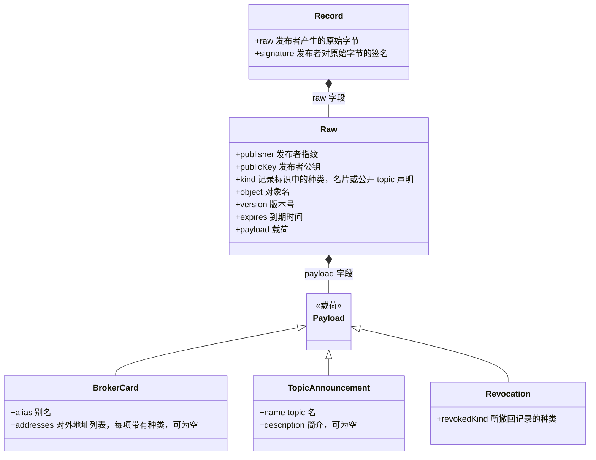

# directory

`directory` 维护[名录](../../glossary.md)：本 Broker 所知道的名片和公开 topic 的声明。记录由发布者签名，经链路在 Broker 之间逐跳对账，最终到达连通网络内的每一个 Broker。名录只是线索，不构成信任依据，也不触发连接。可以把它看作一本大家互相抄写、但每一页都有原作者签名的通讯录。

首次阅读按顺序读核心概念、职责和核心算法与流程里的走查；其余各节供查阅。

## 核心概念

名录要解决的问题是：一条信息要传到与发布者没有链路的 Broker 那里，途中经手的 Broker 既不能改它，也不能在它过时之后继续传它。

每条记录本身带有判断真伪和新旧所需的内容（[ADR-signed-directory-reconciliation](../../adr/adr-signed-directory-reconciliation.md)）：发布者的公钥与签名用来验证内容未经改动，版本号用来在同一发布者的多条记录之间取最新，到期时间使无人续签的记录自行消失。

传播的方式是对账：链路两端互相报出自己持有的每条记录的标识与版本，缺的和旧的向对方索取。对账在链路建立时做一次，之后有变化时推送，再以固定间隔重复，漏掉的推送由下一次对账补上。对账与下面的撤回记录都有公开文献可循（[REF-epidemic-algorithms](../../references.md)）。

发布者撤回一条记录时不能只是不再续签，否则旧记录在到期之前还会从其他 Broker 传回来。撤回因此也是一条签名的记录，版本号比它撤回的记录更高，持有它的 Broker 据此拒绝旧版本，直到撤回记录自己到期。

签名只证明记录出自它所载的发布者，不证明发布者可信：任何对端都能造出许多签名有效的记录。名录因此按来源链路和发布者分别限量。

## 职责

- Broker 设为公开时，以本 Broker 的身份签发名片，并按续签间隔重新签发以延长到期时间；Broker 默认不公开（[ADR-brokers-private-by-default](../../adr/adr-brokers-private-by-default.md)，`REQ-broker-discovery-001`、`REQ-broker-discovery-002`、`REQ-broker-discovery-007`、`REQ-broker-discovery-008`）。
- Broker 由公开改为不公开时，为本机名片和本机签发的每条公开 topic 声明签发撤回记录；启动时发现配置为不公开而存有本机签发的有效记录的，同样签发撤回（`REQ-broker-discovery-009`、`REQ-topics-024`）。
- 在本 Broker 为公开的前提下，签发公开 topic 的声明并续签，本 Broker 不公开时拒绝；本 Broker 上不再有以公开方式在该 topic 中的 Agent 时，为该声明签发撤回（`REQ-topics-010` 至 `REQ-topics-012`、`REQ-topics-023`、`REQ-topics-025`）。
- 与每条链路的对端对账，验证收到的每条记录的签名、版本与到期时间，接受后继续推送给其他对端，使不公开的 Broker 同样能得知别处的名片（`REQ-broker-discovery-003`、`REQ-broker-discovery-005`、`REQ-broker-discovery-006`、`REQ-broker-discovery-010`、`REQ-broker-discovery-017`）。
- 删除到期的记录，按总数、来源链路和发布者分别限量（`REQ-broker-discovery-011`、`REQ-broker-discovery-015`）。
- 回答列出已知 Broker 和列出公开 topic 的查询，为每个 Broker 算出状态（`REQ-broker-discovery-012` 至 `REQ-broker-discovery-014`）。
- 在接受一张名片时通知订阅者，使 [broker](design-broker.md) 能把对端的对外地址列表交给 `pairing` 记入候选地址。
- 签发名片时载入 [config](design-config.md) 给出的本机对外地址列表；列表或别名变化时，本 Broker 公开的，立即签发新版本的名片（[ADR-advertised-address](../../adr/adr-advertised-address.md)，`REQ-broker-config-031`、`REQ-broker-discovery-016`）。

### 非职责

- 不传播不公开 Broker 的任何信息。不公开的 Broker 不签发记录，其对端手里没有可传的内容（`REQ-broker-discovery-004`）。
- 不传播 Agent 与成员名单，由 [topic](design-topic.md) 在链路两端之间处理。
- 不依据名录发起连接或配对（`REQ-broker-pairing-014`）；配对由用户经 `broker` 发起，握手由 [pairing](design-pairing.md) 完成。
- 不探测名片所载地址能否连通，不计算本机的对外地址列表。
- 不判断何时声明公开 topic。加入时的公开声明由 `broker` 先转交本包，成功后再调用 `topic` 加入（`REQ-topics-023`）。

## 外部接口契约

除 `NewIdentity` 与 `NewLinkTransport` 两个包级构造函数外，下列函数是主类型 `*Directory` 的方法，签名稳定。`Fingerprint` 是 `pairing.Fingerprint` 的类型别名。

```go
type Deps struct {
    Identity Identity          // 本机身份，必填
    Peers    PeerTable         // 对端表，必填
    Links    Links             // 链路，必填
    Settings Settings          // 可空，空时读 config 包
    Logger   *slog.Logger      // 可空，空时用 slog.Default()
    Now      func() time.Time  // nil 时为 time.Now；只决定当前时刻
}
func NewIdentity(p *pairing.Pairing) (Identity, error) // 取本机 32 字节裸公钥；没有身份时返回 ErrNoIdentity
func NewLinkTransport(l *link.Link) Links              // 把 link.Link 适配成 Links

func Open(deps Deps) (*Directory, error) // 读 directory.json，清除到期记录；不注册帧处理、不签发、不起协程
func (d *Directory) Start() error        // 注册帧处理与链路订阅，做启动核对，启动维护循环
func (d *Directory) Close()              // 停止维护循环，等待在途的索取协程结束，落盘一次；可重复调用

func (d *Directory) SetPublic(public bool) error // 发布或撤回本机名片及本机的公开 topic 声明
func (d *Directory) DeclarePublicTopic(name, description string) error
func (d *Directory) RetirePublicTopic(name string)
func (d *Directory) RetireInactiveTopics() // 为本机已不再活动、仍有效的公开 topic 声明签发撤回
func (d *Directory) Reissue()              // 别名或对外地址列表变化时调用，本 Broker 公开时立即签发新名片

func (d *Directory) Brokers() []KnownBroker
func (d *Directory) PublicTopics() []PublicTopic
func (d *Directory) CardsByAddress(address string) []Fingerprint
func (d *Directory) OnCard(f func(fp Fingerprint, addresses []config.AdvertisedAddr))
```

`Deps` 的四个协作接口各承担一项外部依赖：`Identity` 提供本机指纹、32 字节裸 Ed25519 公钥与签名；`PeerTable` 提供对端判定、对端列表与生效别名；`Links` 收发对账帧，订阅链路的建立与断开，并查询链路状态；`Settings` 提供是否公开、别名、对外地址列表、数据目录与各项限制。`NewIdentity` 从 `(*pairing.Pairing).PublicKey()` 取本机公钥，并核对它与 `Fingerprint()` 一致。`Start` 由 `broker` 的 directory 装配器在组件 `Start` 阶段调用，早于 `link` 开始监听与拨号；`Close` 在关机阶段调用，可重复调用。

调用方观察到的错误：

| 返回 | 情形 | `broker` 映射 |
|---|---|---|
| `ErrNotPublic` | 不公开时调用 `DeclarePublicTopic` | `invalid_argument`，提示先把 Broker 设为公开 |
| `ErrQuotaExceeded` | 本机有效且未撤回的公开 topic 声明数（同名的不计）已达 `directory.max_topics_per_publisher` | `quota_exceeded` |
| `ErrInvalidTopic` | `DeclarePublicTopic` 的 `name` 为空 | `invalid_argument` |
| `ErrInvalidDescription` | `DeclarePublicTopic` 的简介超过 256 字节、不是合法 UTF-8 或含控制字符 | `invalid_argument` |
| `ErrClosed` | `Close` 之后调用 `Start`、`SetPublic`、`DeclarePublicTopic` | `internal` |
| `ErrNoIdentity` | `NewIdentity` 拿不到本机公钥，或 `Open` 收到的身份指纹为零 | 启动失败，`broker` 退出 |
| 其他（包装的文件错误） | `Open` 读取 `directory.json` 失败（例如权限不足） | `internal`，启动失败 |

`directory.json` 无法解析或 `format` 不是 1 时不返回错误：记一条 error 日志，按空名录启动，下一次落盘覆盖该文件。

简介的上述限制只约束本机声明，空简介合法；接收方不因此丢弃记录，但不合规定的声明不进入视图。

`OnCard` 可以注册多个回调，按注册顺序调用。回调在本包的锁之外、在处理该批记录的协程里执行，不同链路的批次可能并发调用，因此回调必须并发安全，且不得阻塞超过一次 `pairing` 写盘的时间。回调只在本包从链路接受一张非本机名片时调用，不在本机签发名片或加载文件时调用；交给回调的列表只含本版本认识的项，顺序同名片。

`CardsByAddress` 与当前有效、非撤回、非本机名片中本版本认识且写法合规定的地址项逐字比较，返回全部匹配的发布者指纹，去重后按指纹字节升序排列；没有匹配时返回 nil。地址的规范化由调用方在调用前完成。

`PublicTopic` 给出名字、简介、简介的发布者、发布者的别名与该名字的有效声明数。简介按发布者分档选取：本机的声明优先，其次是对端（对端表中的 Broker）的声明，最后是其他发布者的声明；同一档内取版本号最高的声明，版本相同取指纹字节序较小的。`Publisher` 是所取声明的发布者指纹；`PublisherAlias` 对端取生效别名，其他发布者取有效名片所载的别名，都没有时为空；`Declarers` 是该名字的有效声明数，即通过接收校验、未到期且未撤回的声明条数，同一发布者的同名声明按标识只保留最高版本，只计一条。名字或简介不合规定的声明不进入结果，规则见“核心数据结构”。结果按名字升序排列。

`KnownBroker` 给出指纹、生效别名或名片所载的别名、对外地址列表（`[]config.AdvertisedAddr`）、是否对端、本方在这对对端中的角色、状态与链路所处的阶段。对外地址列表：本方是拨号方的对端取接受方告知的列表，接上当前有效名片中本版本认识的项，按地址去重，不含发起配对时拨通的地址；本方是接受方的对端和非对端取名片所载的列表中本版本认识的地址项；都没有时为空；同一主机上的多个 Broker 是各自独立的条目，靠列表中的端口和别名区分（`REQ-broker-discovery-012`）。对外地址不参与身份的判定，条目以指纹为准。结果按别名升序排列，别名相同按指纹字节升序；本机自身不出现在结果中。`Detail` 只用于非对端条目，对端的说明文字由 `broker` 在列出 Broker 时产生（`REQ-broker-pairing-035`）。状态取值是封闭集合（`REQ-broker-discovery-013`）：

| 状态 | 条件 |
|---|---|
| 已连接 | 与它的链路处于已建立状态 |
| 可连接 | 链路未建立，且知道它至少有一个本版本认识的对外地址项 |
| 不可直达 | 链路未建立，且不知道它的任何本版本认识的对外地址项 |

## 依赖

`directory` 引用 `link`，用来收发对账帧、订阅链路的建立与断开并查询链路状态；引用 `pairing`，用来签名、验签和读取对端表；引用 `config`，用来读取是否公开、别名、本方的对外地址列表与各项限制。它不引用 `topic` 与 `broker`，符合模块依赖图的方向。

## UML 图

下图是记录的结构。名片、公开 topic 声明和撤回共用同一个信封。记录标识中的种类只有名片与公开 topic 声明，撤回不是第三种：撤回是原始字节载荷的一种，它的身份取它撤回的那条记录的种类与对象名，因此与它撤回的记录占用同一个位置，所撤回的种类也记在载荷里。载荷的种类不影响对账与验证。一条记录在链路上由两部分组成：发布者产生的原始字节，以及发布者对这段原始字节的签名；图中 `raw` 与 `signature` 之外的字段都编码在原始字节里，由收到记录的 Broker 在验签之后解析得到。



上图与 `directorypb` 中的消息定义一致，图中的 `Raw` 即 `RecordBody`。`raw` 是 `RecordBody` 的序列化结果；`RecordBody` 给出发布者指纹、发布者公钥、记录标识中的种类、对象名、版本号、到期时间，以及恰好一个载荷：名片、公开 topic 声明或撤回。名片载荷是 `BrokerCard`，给出别名与对外地址列表，列表中的每一项是带种类的 `AdvertisedAddress`；公开 topic 声明载荷是 `TopicAnnouncement`，给出 topic 名与简介；撤回载荷是 `Revocation`，给出所撤回记录的种类。

## 核心数据结构

记录的身份由发布者指纹、记录标识中的种类和对象名共同确定。对象名说明记录描述的是哪个对象：名片的对象名为空，公开 topic 声明的对象名是 topic 名，撤回记录的身份取它撤回的那条记录的种类与对象名，因此与它撤回的记录占用同一个位置；它所撤回的种类记在载荷里。同一标识只保留版本号最高的一条。

| 字段 | 规则 |
|---|---|
| `publisher` 与 `publicKey` | `publicKey` 是 32 字节裸 Ed25519 公钥，`publisher` 等于它的指纹 |
| `version` | 取“当前时间的毫秒数”与“本机已签发的最高版本加一”中较大的一个 |
| `expires` | 签发时刻加 7 天，撤回记录同样如此 |
| `signature` | 发布者用私钥对原始字节的签名；原始字节由发布者产生，编码了其余全部字段 |

收到记录的 Broker 先从 `RecordBody` 中取出发布者公钥，以它对收到的原始字节验签，通过后才解析其余字段；保存记录和继续传播给其他对端时，原样使用收到的原始字节与签名，不重新编码。记录的具体编码方式因此属于实现：不同版本的 Broker 对同一条记录不需要产生相同的字节，记录中出现本版本不认识的字段时，记录仍然可以被验证和传播。签发时以确定性编码序列化 `RecordBody`，同一载荷产生同样的原始字节。

名片的 `addresses` 是签发时 `config` 给出的本机对外地址列表，每项是 `config.AdvertisedAddr`，至多 8 项，本机不监听时为空；列表在发布者的签名之内，途中经手的 Broker 不能改动它（[ADR-advertised-address](../../adr/adr-advertised-address.md)）。列表中的每一项带有种类，本版本产生的只有直连（`direct`），见 [config](design-config.md) 的“对外地址”。本包使用名片中的地址时只取本版本认识且写法合规定的项。种类为 `direct` 的地址项须能由 `net.SplitHostPort` 拆出主机与端口：主机 1 至 253 字节、不含控制字符与空白，端口为 1 至 65535 的十进制数。`OnCard` 交给订阅者的列表、`CardsByAddress` 的比对、`KnownBroker` 的对外地址列表与状态的判定，都跳过种类不认识或写法不合规定的项，每张名片至多取 8 项；这些项仍留在原始字节中，随名片原样保存与传播，名片其余的地址照常可用。

记录的种类与载荷必须一致：载荷为 `BrokerCard` 时种类为 `RECORD_KIND_BROKER_CARD`、对象名为空且别名符合接受条件中的规则；载荷为 `TopicAnnouncement` 时种类为 `RECORD_KIND_TOPIC_ANNOUNCEMENT`、对象名等于 topic 名且非空；载荷为 `Revocation` 时所撤回的种类等于记录的种类。种类为 `RECORD_KIND_UNSPECIFIED` 的记录丢弃。载荷为空或种类是本版本不认识的取值时，记录照常验签，按版本与限量接受并传播，但不进入任何视图。

公开 topic 声明的名字须为 1 至 256 字节、合法 UTF-8、不含控制字符，与 [topic](design-topic.md) 的 `ValidateName` 同一规则；本包不引用 `topic`，因此另写一份并在两处同步。简介须为空，或不超过 256 字节、合法 UTF-8、不含控制字符。名字或简介不合规定的声明照常验签、按版本与限量接受并原样转发，但不进入 `PublicTopics`，与载荷为空或种类不认识的处理相同。

单条记录的原始字节不超过 64 KiB（65536 字节）。接收与本机签发都核对这一上限：接收时超出的记录按格式错误丢弃，记一条带 `reason=record_too_large` 的 warn 日志；本机签发时超出的返回错误，不产生记录。

名录保存在数据目录内的 `directory.json`，数据目录的位置由 `config` 按部署形态给出。文件格式为 `{"format":1,"highest_issued":<uint64>,"records":[{"raw":<base64>,"signature":<base64>,"source":"<64 位十六进制或空>"}]}`：`raw` 与 `signature` 是原始字节及其签名，`source` 是接受该记录的链路对端指纹，本机签发的为空串；`highest_issued` 是本机已签发的最高版本。文件权限 0600。文件不存在时按空名录启动；读取失败（例如权限不足）时 `Open` 返回错误，启动失败；无法解析或 `format` 不是 1 时记一条 error 日志并按空名录启动，下一次落盘覆盖该文件，名录由对账补回，已签发的最高版本由抬高机制恢复。Broker 重启时加载文件并立即清除已到期的记录；单条记录验签失败或已到期时丢弃并记一条 warn 日志。加载不执行数量限制，上限可能在两次运行之间被调低。`highest_issued` 取文件中的值与本机记录的最高版本中较大的一个。有效期 7 天与续签间隔 1 天不可配置。

多个 Broker 可以各自声明同名的公开 topic，每个声明是独立的记录。列出公开 topic 时按名字合并，每个名字一项。简介按发布者分档取：本机的声明优先，其次是对端（对端表中的 Broker）的声明，最后是其他发布者的声明；同一档内取版本号最高的声明，版本相同取指纹字节序较小的。这样远处的发布者不能靠把版本号设成最大值替换本机或对端声明的简介。结果同时给出简介的发布者与该名字的有效声明数。

默认限量 `directory.max_records` 为 1000，公开 topic 声明与名片各占一条记录，两者合计不超过 1000 条。名字与简介各至多 256 字节，因此 1000 条声明的 `list_topics` 应答不到 1 MiB；一张名片至多 8 个地址、每个主机至多 253 字节，因此 1000 张名片的 `list_brokers` 应答不到 3 MiB。名录中每张名片都可能在同一地址上产生一条指纹警告，但同一张名片只算一条且总数至多 8 条，每条不到 200 字节，`Connect` 的应答因此不会因名录内容而无限增长。`directory.max_records` 只要求为正数，管理员把它调到约万条以上时，这两个应答仍可能超过 MCP 服务进程 4 MiB 的接收上限；本版本不为它们分页或截断，这是已知的代价。

对账用的帧：

| 帧 | 类别 | 内容 |
|---|---|---|
| `RecordList` | 状态帧 | 发送方持有的每条记录的标识与版本号 |
| `RecordRequest` | 请求帧 | 要向对方索取的记录的标识 |
| `Records` | 应答帧与状态帧，可分多帧 | `RecordRequest` 的应答，以及一次应答放不下的后续批次，若干条完整的记录 |

`RecordRequest` 是请求帧，`RecordList` 是状态帧。`Records` 既作 `RecordRequest` 的应答帧，也作承载后续批次的状态帧：应答的记录总长超过 1 MiB 时拆成多帧，第一批作为请求的应答返回，其余批次以 `Records` 状态帧经链路发送，接收方对两者的接受规则相同。标识在应答内先去重；每帧不超过 1 MiB；所有被索取的记录都送达，不截断。

## 核心算法与流程

### 走查

A 与 B 之间、B 与 C 之间各有一条链路，A 与 C 之间没有。A 已配置别名 `hostA`，监听地址保持默认配置，对外地址列表是默认路由所在接口的地址 `198.51.100.4:17443`。A 由不公开改为公开，之后又改回不公开。

| 步骤 | 事件 | A 的名录 | B 的名录 | C 的名录 |
|---|---|---|---|---|
| 1 | A 调用 `SetPublic(true)`，签发名片，对外地址列表 `198.51.100.4:17443`，版本 `v1` | A 名片 `v1` | 空 | 空 |
| 2 | A 向 B 发增量 `RecordList`，B 索取后收到记录，对原始字节验签通过，其余检查也通过 | A 名片 `v1` | A 名片 `v1` | 空 |
| 3 | B 向来源之外的对端 C 发增量 `RecordList`，C 索取后收到原始字节与签名并验签通过 | A 名片 `v1` | A 名片 `v1` | A 名片 `v1` |
| 4 | C 没有其他对端，传播停止 | 不变 | 不变 | 不变 |
| 5 | 一天后 A 续签，版本 `v2`，同样逐跳到达 C | A 名片 `v2` | A 名片 `v2` | A 名片 `v2` |
| 6 | A 调用 `SetPublic(false)`，签发撤回，版本 `v3`，到期时间为此刻加 7 天 | A 撤回 `v3` | A 撤回 `v3` | A 撤回 `v3` |
| 7 | 一台仍持有 `v2` 的 Broker D 与 C 建立链路并对账 | 不变 | 不变 | C 不向 D 索取 `v2`，并以增量 `RecordList` 告知 `v3`，D 随后索取。C 建立链路时发出的全量清单里已经带了 `v3`，D 是据此去索取的；增量回告只是另一条途径 |
| 8 | 撤回 `v3` 到期 | 空 | 空 | 空 |

C 接受 `v1` 之后，列出已知 Broker 的结果包含 `hostA`，状态为可连接；接受 `v3` 之后不再包含。撤回 `v3` 到期时，各处的 `v2` 早已到期，因为 `v2` 的到期时间早于 `v3` 的。

### 对账

链路建立时与每隔 `directory.reconcile_interval`，双方各发出一帧全量 `RecordList`。收到对方的清单后，对每个标识比较版本：对方的更高或本方没有，列入索取清单；本方更高的，以一帧只含这些标识与本方版本的增量 `RecordList` 回告对方，不直接发 `Records`。版本必须严格更高这一条件使往返终止。本方持有、但从链路接受的现有版本未满 60 秒的标识不立即索取，而是记为待补取，在该版本接受满 60 秒时补取一次并接受。每个标识至多一条待补记录，重复出现只保留最早的到期时刻；待补集合至多 `directory.max_records` 个标识，满了不再记入，留给下一次定期对账；链路断开或解除配对时随该对端的对账状态一起清空。

待补取使撤回不必等到下一次定期对账。现有版本在撤回签发之前已被接受，它接受满 60 秒的时刻因此不晚于撤回签发后 60 秒；窗口一到就补取，撤回在本 Broker 上于签发后 60 秒内生效。撤回逐跳传播，每一跳的等待都不超过一个替换间隔，第二跳及更远还要再加上前面各跳的传播延迟，因此撤回不是在签发后 60 秒内全网同时生效，离发布者越远生效越晚；定期的清单交换照常进行。持续推新版本的发布者仍然每个标识每 60 秒至多替换一次：窗口内的其余版本只会更新待补记录，不会产生额外索取。

替换间隔在发布构建中恒为 60 秒，不读取任何环境变量。带 `peers_testenv` 构建标签的测试构建读取 `PEERS_TEST_DIRECTORY_REPLACE_INTERVAL`（Go duration），未设置、无法解析或非正数时仍取 60 秒；端到端测试用它把窗口缩短到 1 秒，以在既有的等待内覆盖逐跳撤回与地址变更，发布构建忽略该变量，构建钩子检查二进制中不含这个变量名。

接受新记录或签发本机记录后，本包向来源以外的每个已建立链路的对端发一帧只含这些标识与版本的增量 `RecordList`，对方按同样规则索取。`Records` 既作 `RecordRequest` 的应答，也作承载一次应答放不下的后续批次的状态帧；应答按标识去重并按 1 MiB 的字节预算拆成多帧，超出预算的余下部分以 `Records` 状态帧继续发送，不截断，两种到达方式按同一规则接受。本方向只接受向该对端索取过的标识：一个标识自发出请求起 60 秒内（`requestTimeout` 的两倍）可以经该对端的 `Records` 应答或 `Records` 状态帧被接受，每个标识只接受一次；不在其中的记录整条丢弃，同一帧中这类丢弃合并为一条 warn 运行日志，事件名 `directory_unrequested_records`，字段 `peer` 与 `count`。

每个对端同一时刻至多有一个在途索取。需要索取的标识进入该对端的待索取集合，已在途或已在集合中的不重复加入；集合至多 `directory.max_records` 个标识，满了的丢弃，由下一次对账补上。一次索取至多包含 256 个标识，同时不超过 `directory.max_records`，余下的留在集合中，在途索取结束后立即发起下一次。本方向已索取而尚未接受的标识一旦达到 `directory.max_records` 个就暂停索取新批次，数量最多再超出一批（至多 256 个），等有记录到达或窗口过期后再继续，因此对端持续发新的 `RecordList` 并回空应答也不能让已索取集合无限增长。每轮只清理已经过期的窗口和标识已全部到达的窗口，不遍历整个已索取集合；后一种窗口立即丢弃，窗口数因此受在途标识数约束，而不是受对端的应答速度约束。标识的对象名至多 4096 字节，超过的 `RecordList` 项与 `Records` 记录按格式错误丢弃，不进入待索取或已索取集合。每个请求的期限为 30 秒。索取由单独的协程完成，不阻塞该链路的状态帧；失败（超时、链路断开或应答不符合预期）只记 debug 级日志，不重试，由下一次对账补上。链路断开时清空该对端的待索取集合与已索取标识。一次对账传输的清单大小与名录的记录数成正比，记录数受上限约束；应答的帧大小受 1 MiB 预算约束，与记录数无关。

对方的清单中出现发布者为本机、版本高于本机已签发最高版本的标识时，本机先索取该记录，只有以本机公钥验签通过后才把已签发的最高版本抬到那个版本，使此后签发的记录不被各处当作旧版本拒绝；签发新记录时版本号用饱和加法，不因溢出回绕到 0。这种情形出现在时钟回拨或数据目录从较早的备份恢复之后。

### 接受一条记录

下列条件全部满足才接受，任何一个不满足即丢弃：

- 来源是已建立的链路。
- 以原始字节中的发布者公钥对收到的原始字节验签通过，`publisher` 等于 `publicKey` 的指纹。
- 尚未到期，且到期时间不晚于当前时间加 7 天再加 1 小时的时钟偏差容限。
- 名片所载的别名符合别名的规则：1 至 24 个字符，取自字母、数字、`.`、`-`、`_`（`REQ-broker-pairing-037`）。
- 本方没有同一标识的记录，或本方的版本号更低。
- 同一标识的替换，从链路来的，只有在本方接受现有版本满 60 秒之后才接受；不满的丢弃、不转发，计入同一批的限量丢弃日志，`limit` 取 `replace_interval`，同时把该标识记为待补取，窗口到期时补取一次并接受。`handleRecordList` 因同一原因不能索取的更高版本同样记为待补取。接受时刻只记在内存中，从文件加载的记录视为可以立即替换。每个标识的最后接受时刻保留一个替换间隔，即使记录已过期并被删除也仍然适用，因此短命记录不能靠先过期来绕过间隔；保留的时刻至多 `directory.max_records` 条，更早的先丢弃。发布者是本机的记录不受这条限制，以本机公钥验签通过的回传记录照现有规则抬高版本。
- 接受后不超出数量限制。同一标识的替换不增加记录数，不受数量限制。新标识的记录要同时满足：总数不超过 `directory.max_records`，经该链路接受的记录数不超过 `directory.max_records_per_link`，该发布者的公开 topic 声明与未知种类记录合计不超过 `directory.max_topics_per_publisher`，名片与撤回不计。本版本不认识的种类计入，使发布者不能借其他种类绕过这项上限。本机签发的记录不受这些限制，但计入总数。

来源不是已建立链路的 `RecordList` 与 `Records` 整帧忽略；来源不是已建立链路的 `RecordRequest` 回以空的 `Records`。

名片的对外地址列表中各项的种类不在上述条件之内：名片含有本版本不认识的种类的地址项时，只要上述条件满足即照常接受，其余的地址项照常可用（`REQ-broker-discovery-017`）。

接受后连同收到的原始字节与签名写入名录，并向来源以外的每个已建立链路的对端发一帧增量 `RecordList` 告知该标识与版本；记录本身仍以收到的原始字节与签名传播。版本号必须更高这一条件使一条记录在每个 Broker 上至多接受一次，传播在连通网络内必然终止，链路构成环时也是如此。

### 签发与续签

本机有效的名片在签发满 1 天时重新签发；本机的公开 topic 声明只在本 Broker 上仍有以公开方式在该 topic 中的 Agent 时，才在签发满 1 天时重新签发。版本号与到期时间按核心数据结构中的规则重新计算。

本机声明且尚未撤回的公开 topic 名与简介保存在内存中的活动集合里。`DeclarePublicTopic` 加入或更新活动集合，`RetirePublicTopic` 与 `SetPublic(false)` 移出。续签只针对公开时的名片与活动集合中的声明。重复声明同名的 topic 总是签发新版本，简介取本次给出的值，该名字不重复计入上限。

Broker 离线期间不续签，离线超过 7 天后其记录在各处到期；重新上线并仍为公开时立即签发新版本。重启后从文件加载的本机声明不在活动集合中，不续签；`broker` 在启动 2 分钟后调用一次 `RetireInactiveTopics`，为这些声明签发撤回。

别名或对外地址列表变化时，`broker` 调用 `Reissue`，本机立即签发新版本的名片，不等续签间隔（`REQ-broker-discovery-016`）。对外地址列表的变化来自 `broker.listen`、`broker.advertise`、`broker.advertise_extra` 的修改，或 `config` 定期重新枚举本机地址时发现的变化；监听端口的变更改变列表中的端口，默认别名不随监听端口变化。

发布者为本机的记录从网络回来时，本机先抬高已签发的最高版本，再按当前状态纠正。

| 回来的记录 | 当前状态 | 动作 |
|---|---|---|
| 名片 | 公开 | 立即签发新名片 |
| 名片 | 不公开 | 签发撤回 |
| 公开 topic 声明 | 公开且该名字在活动集合中 | 以活动集合中的简介签发新声明 |
| 公开 topic 声明 | 其他 | 签发撤回 |
| 撤回 | 名片位置、公开 | 签发新名片 |
| 撤回 | 声明位置、公开且在活动集合中 | 签发新声明 |
| 撤回 | 其他 | 不动作 |

维护循环每分钟执行一次，下一次对账更早时提前执行，做到期清理、续签判定、落盘重试与定期对账。视图与对账清单在读取时另行过滤已到期的记录，到期判定不依赖清理时刻。

### 启动时的核对

加载名录后比较配置与本机签发的记录。配置为公开时立即签发一张新名片，与重新上线时的处理一致。配置为不公开而名录中有本机签发、尚未到期且不是撤回的记录的，为每一条签发撤回。这使用户在 Broker 停止期间把它改为不公开的操作在启动后生效。

## 错误与失败语义

| 情形 | 行为 |
|---|---|
| 签名无效，发布者与公钥不符 | 丢弃，运行日志记录来源对端 |
| 原始字节超过 64 KiB | 丢弃，接收侧记一条带 `reason` 的 warn 日志；本机签发返回错误，不产生记录 |
| 已到期或到期时间过远 | 丢弃 |
| 版本不高于已有记录 | 丢弃，不记录日志；对账中属于正常情况 |
| 替换过快 | 丢弃，不转发，记为待补取，现有版本接受满 60 秒时补取一次；同一批 `Records` 中因替换间隔丢弃的记录并入限量丢弃日志，`limit` 取 `replace_interval` |
| 未索取的记录 | 丢弃整条，同一帧中这类丢弃合并为一条 warn 日志，事件名 `directory_unrequested_records`，带 `peer` 与 `count` |
| 超出任一数量限制 | 丢弃新标识的记录；同一批 `Records` 中因限量或替换间隔丢弃的记录按来源链路合并为一条 warn 日志，带丢弃条数与触发的是哪一项上限，`limit` 取 `max_records`、`max_records_per_link`、`max_topics_per_publisher` 或 `replace_interval`；已有标识的更新照常接受 |
| 对账进行中链路断开 | 放弃本次对账，链路重建时重新开始 |
| 本 Broker 不公开时调用 `DeclarePublicTopic` | 返回 `invalid_argument`，提示先把 Broker 设为公开 |
| 本机声明的公开 topic 数已达上限 | 返回 `quota_exceeded` |

接受记录是幂等的。各 Broker 的时钟不一致时，到期判断以各自的时钟为准，同一条记录在不同 Broker 上消失的时刻相差不超过它们的时钟偏差。

## 并发与事务边界

名录由一把读写锁保护。签发与接受的检查、写入在写锁内成批完成；广播与回调在锁外执行。向其他对端的推送在锁内收集清单，锁外调用 `Links.Send`，以缩短持锁时间。对账帧由 `link` 按到达顺序串行交给本包，索取由单独的协程完成；待补取的等待每个对端至多一个协程，`Close` 与索取协程一并等待它们结束。名录文件的写入在锁外由单独的互斥锁串行，先写临时文件再原子替换；写入失败不影响内存中的名录，下次变更或维护时重试。从链路接受的记录只置脏标记，由维护循环落盘，每分钟至多一次；落盘按独立的 60 秒节拍安排，不随 `directory.reconcile_interval` 缩短或拉长，`directory.reconcile_interval` 小于 60 秒时也不会把两次落盘的间隔拉长到两个对账间隔。本机签发、撤回与 `Close` 立即落盘。崩溃时至多丢失一分钟内从链路接受的记录，由对账补回。

## 实现状态

| 能力 | 状态 | 代码 |
|---|---|---|
| 名片的签发、续签与撤回 | 已实现 | `internal/directory/publish.go`（`SetPublic`、`renewDue`、`issueRevocationLocked`） |
| 对外地址列表变化时名片的重新签发 | 已实现 | `internal/directory/publish.go`（`Reissue`） |
| 公开 topic 声明的签发与续签 | 已实现 | `internal/directory/publish.go`（`DeclarePublicTopic`、`RetirePublicTopic`、`RetireInactiveTopics`） |
| 对账 | 已实现 | `internal/directory/reconcile.go`（`handleRecordList`、`handleRecordRequest`、`handleRecordsState`、`splitRecords`、`reconcileAll`）、`internal/directory/fetch.go`（`scheduleFetch`、`fetchLoop`、`acceptRecords`、`noteRefetch`、`refetchLoop`） |
| 记录的验证与逐跳推送 | 已实现 | `internal/directory/record.go`（`parseRecord`、`signRecord`）、`internal/directory/reconcile.go`（`acceptBatch`） |
| 到期清理与数量限制 | 已实现 | `internal/directory/store.go`（`accept`、`purgeExpired`、`load`） |
| 版本号的持久化与抬高 | 已实现 | `internal/directory/version.go`（`nextVersion`）、`internal/directory/persist.go` |
| 启动时的核对 | 已实现 | `internal/directory/publish.go`（`startupCheck`）、`internal/directory/start.go`（`Start`） |
| 已知 Broker 的状态计算 | 已实现 | `internal/directory/views.go`（`Brokers`） |
