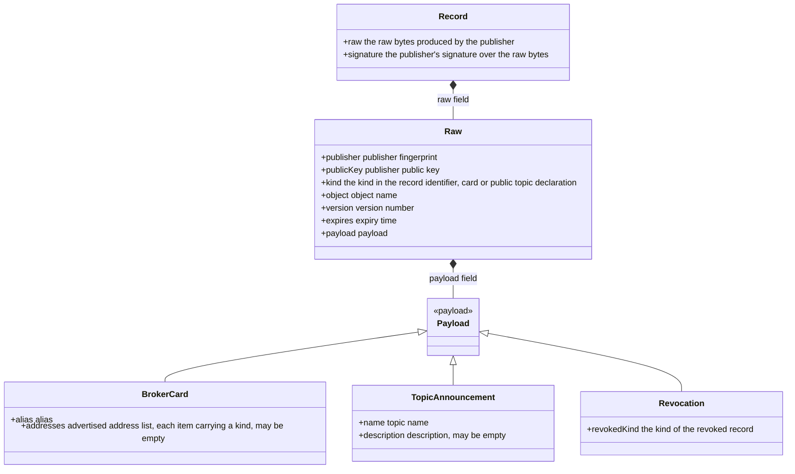

# directory

`directory` maintains the [directory](../../glossary.md): the cards this Broker knows and the declarations of public topics. A record is signed by its publisher, reconciled hop by hop between Brokers over links, and finally reaches every Broker in the connected network. The directory is only a clue; it is not a basis of trust and triggers no connection. It can be thought of as an address book that everyone copies from one another but on which every page is signed by its original author.

On a first read, read Core Concepts, Responsibilities, and the Worked Example under Core Algorithms and Flows in order; the other sections are for reference.

## Core Concepts

The problem the directory solves is this: a piece of information has to reach a Broker with no link to the publisher, and the Brokers that handle it along the way must be unable to change it or to keep passing it on after it is stale.

Each record carries what is needed to judge its authenticity and freshness ([ADR-signed-directory-reconciliation](../../adr/adr-signed-directory-reconciliation.md)): the publisher's public key and signature verify that the content is unaltered, the version number picks the latest among one publisher's several records, and the expiry time makes a record with no one renewing it disappear on its own.

Propagation works by reconciliation: the two ends of a link tell each other the identifier and version of each record they hold, and ask the other for the missing and older ones. Reconciliation runs once when the link is established, then on each change as a push, and again at a fixed interval, with a missed push made up by the next reconciliation. Both reconciliation and the revocation records below have public literature to follow ([REF-epidemic-algorithms](../../references.md)).

When a publisher withdraws a record it cannot simply stop renewing it, or the old record would travel back from other Brokers before it expires. A revocation is therefore also a signed record with a version higher than the record it revokes, and a Broker holding it refuses the older version until the revocation itself expires.

A signature proves only that a record came from the publisher it names, not that the publisher is trustworthy: any peer can produce many validly signed records. The directory therefore sets quotas by source link and by publisher.

## Responsibilities

- When the Broker is set public, issue a card under this Broker's identity and reissue it at the renewal interval to extend its expiry; a Broker is not public by default ([ADR-brokers-private-by-default](../../adr/adr-brokers-private-by-default.md), `REQ-broker-discovery-001`, `REQ-broker-discovery-002`, `REQ-broker-discovery-007`, `REQ-broker-discovery-008`).
- When the Broker changes from public to not public, issue revocation records for the local card and for each public topic declaration this Broker issued; on startup, if the configuration is not public while there are valid records this Broker issued, likewise issue revocations (`REQ-broker-discovery-009`, `REQ-topics-024`).
- Given that this Broker is public, issue and renew declarations of public topics, refusing when this Broker is not public; when no agent on this Broker is in that topic publicly any more, issue a revocation for that declaration (`REQ-topics-010` to `REQ-topics-012`, `REQ-topics-023`, `REQ-topics-025`).
- Reconcile with each link's peer, verify every received record's signature, version and expiry, and after accepting it keep pushing it to other peers, so that a not-public Broker also learns cards from elsewhere (`REQ-broker-discovery-003`, `REQ-broker-discovery-005`, `REQ-broker-discovery-006`, `REQ-broker-discovery-010`, `REQ-broker-discovery-017`).
- Delete expired records, setting quotas by total count, by source link and by publisher (`REQ-broker-discovery-011`, `REQ-broker-discovery-015`).
- Answer the queries that list known Brokers and list public topics, computing a status for each Broker (`REQ-broker-discovery-012` to `REQ-broker-discovery-014`).
- Notify subscribers when a card is accepted, so that [broker](design-broker.md) can hand the peer's advertised address list to `pairing` to record as candidate addresses.
- Load the local advertised address list that [config](design-config.md) gives when issuing a card; when the list or the alias changes, if this Broker is public, immediately issue a new version of the card ([ADR-advertised-address](../../adr/adr-advertised-address.md), `REQ-broker-config-031`, `REQ-broker-discovery-016`).

### Non-Responsibilities

- Does not propagate any information about a not-public Broker. A not-public Broker issues no records, and its peers have nothing to pass on (`REQ-broker-discovery-004`).
- Does not propagate agents or rosters; [topic](design-topic.md) handles those between the two ends of a link.
- Does not initiate a connection or pairing based on the directory (`REQ-broker-pairing-014`); pairing is initiated by the user through `broker`, and the handshake is done by [pairing](design-pairing.md).
- Does not probe whether a card's addresses are reachable, and does not compute the local advertised address list.
- Does not decide when to declare a public topic. A public declaration at join time is handed to this package by `broker` first, and only after success does it call `topic` to join (`REQ-topics-023`).

## External Interface Contract

Except for the two package-level constructors `NewIdentity` and `NewLinkTransport`, the functions below are methods of the main type `*Directory`, and the signatures are stable. `Fingerprint` is a type alias of `pairing.Fingerprint`.

```go
type Deps struct {
    Identity Identity          // local identity, required
    Peers    PeerTable         // peer table, required
    Links    Links             // links, required
    Settings Settings          // optional, reads the config package when empty
    Logger   *slog.Logger      // optional, uses slog.Default() when empty
    Now      func() time.Time  // time.Now when nil; decides only the current instant
}
func NewIdentity(p *pairing.Pairing) (Identity, error) // takes the local 32-byte raw public key; returns ErrNoIdentity when there is no identity
func NewLinkTransport(l *link.Link) Links              // adapts link.Link into Links

func Open(deps Deps) (*Directory, error) // reads directory.json and clears expired records; registers no frame handling, issues nothing, starts no goroutine
func (d *Directory) Start() error        // registers frame handling and link subscription, does the startup check, starts the maintenance loop
func (d *Directory) Close()              // stops the maintenance loop, waits for in-flight fetch goroutines to end, flushes once; callable repeatedly

func (d *Directory) SetPublic(public bool) error // publishes or withdraws the local card and this Broker's public topic declarations
func (d *Directory) DeclarePublicTopic(name, description string) error
func (d *Directory) RetirePublicTopic(name string)
func (d *Directory) RetireInactiveTopics() // issues revocations for this Broker's public topic declarations that are no longer active but still valid
func (d *Directory) Reissue()              // called when the alias or advertised address list changes; issues a new card immediately when this Broker is public

func (d *Directory) Brokers() []KnownBroker
func (d *Directory) PublicTopics() []PublicTopic
func (d *Directory) CardsByAddress(address string) []Fingerprint
func (d *Directory) OnCard(f func(fp Fingerprint, addresses []config.AdvertisedAddr))
```

`Deps`'s four collaborating interfaces each carry one external dependency: `Identity` provides the local fingerprint, the 32-byte raw Ed25519 public key and signing; `PeerTable` provides peer determination, the peer list and effective aliases; `Links` sends and receives reconciliation frames, subscribes to link establishment and teardown, and queries link state; `Settings` provides whether public, the alias, the advertised address list, the data directory and the various limits. `NewIdentity` takes the local public key from `(*pairing.Pairing).PublicKey()` and checks that it matches `Fingerprint()`. `Start` is called by `broker`'s directory assembler during the components' `Start` phase, before `link` begins listening and dialing; `Close` is called during shutdown and is callable repeatedly.

Errors a caller observes:

| Return | Situation | `broker` mapping |
|---|---|---|
| `ErrNotPublic` | `DeclarePublicTopic` called while not public | `invalid_argument`, saying to set the Broker public first |
| `ErrQuotaExceeded` | This Broker's valid, unrevoked public topic declarations (same-name ones not counted) have reached `directory.max_topics_per_publisher` | `quota_exceeded` |
| `ErrInvalidTopic` | `DeclarePublicTopic`'s `name` is empty | `invalid_argument` |
| `ErrInvalidDescription` | `DeclarePublicTopic`'s description exceeds 256 bytes, is not valid UTF-8 or contains control characters | `invalid_argument` |
| `ErrClosed` | `Start`, `SetPublic` or `DeclarePublicTopic` called after `Close` | `internal` |
| `ErrNoIdentity` | `NewIdentity` cannot get the local public key, or `Open` receives a zero identity fingerprint | Startup fails and `broker` exits |
| Other (wrapped file errors) | `Open` fails to read `directory.json` (for example insufficient permission) | `internal`, startup fails |

When `directory.json` cannot be parsed or `format` is not 1, no error is returned: an error log is recorded, startup proceeds with an empty directory, and the next flush overwrites the file.

The description limits above constrain only local declarations, and an empty description is legal; the receiver does not drop a record because of them, but a declaration that does not meet the rules does not enter the views.

`OnCard` may register several callbacks, called in registration order. Callbacks run outside this package's lock, in the goroutine that handles the batch of records, and batches from different links may call concurrently, so a callback must be concurrency-safe and must not block for longer than one `pairing` disk write. A callback is called only when this package accepts a non-local card from a link, not when this Broker issues a card or loads the file; the list handed to the callback contains only items this version recognizes, in card order.

`CardsByAddress` compares the address verbatim against the address items that are currently valid, not revoked, not the local card, recognized by this version and legally spelled, and returns every matching publisher fingerprint, deduplicated and sorted ascending by fingerprint bytes; it returns nil when there is no match. Address normalization is done by the caller before the call.

`PublicTopic` gives the name, the description, the description's publisher, the publisher's alias and the number of valid declarations of that name. The description is chosen by tier: this Broker's declarations first, then a peer's (a Broker in the peer table), finally another publisher's; within a tier the declaration with the highest version is taken, and on an equal version the smaller fingerprint bytes. `Publisher` is the fingerprint of the publisher of the chosen declaration; `PublisherAlias` is the effective alias for a peer, and for another publisher the alias on its valid card, empty when neither; `Declarers` is the number of valid declarations of that name, that is the declarations that passed receive validation, have not expired and are not revoked, with one publisher's same-name declarations counted as one keeping only the highest version by identifier. A declaration whose name or description does not meet the rules does not enter the result, per the rules in "Core Data Structures". The result is sorted ascending by name.

`KnownBroker` gives the fingerprint, the effective alias or the alias on the card, the advertised address list (`[]config.AdvertisedAddr`), whether it is a peer, this side's role in this peer pair, the status and the link's phase. Advertised address list: for a peer on which this side is the dialer, the list the acceptor told, merged with the items of the currently valid card that this version recognizes, deduplicated by address, excluding the address dialed when pairing was initiated; for a peer on which this side is the acceptor and for a non-peer, the recognized address items of the list the card carries; empty when neither; several Brokers on one host are independent entries, told apart by the port and alias in the list (`REQ-broker-discovery-012`). The advertised address takes no part in identity, and an entry is keyed by fingerprint. The result is sorted ascending by alias, then by fingerprint bytes ascending on an equal alias; this Broker itself does not appear in the result. `Detail` is used only for non-peer entries, and a peer's explanatory text is produced by `broker` when listing Brokers (`REQ-broker-pairing-035`). The status values are a closed set (`REQ-broker-discovery-013`):

| Status | Condition |
|---|---|
| connected | Its link is in the established state |
| connectable | The link is not established, and at least one of its advertised address items recognized by this version is known |
| not directly reachable | The link is not established, and none of its advertised address items recognized by this version is known |

## Dependencies

`directory` references `link` to send and receive reconciliation frames, subscribe to link establishment and teardown and query link state; it references `pairing` to sign, verify signatures and read the peer table; and it references `config` to read whether public, the alias, this side's advertised address list and the various limits. It references neither `topic` nor `broker`, matching the module dependency graph's direction.

## UML Diagrams

The diagram below is the structure of a record. A card, a public topic declaration and a revocation share the same envelope. The kind in a record's identifier has only card and public topic declaration; a revocation is not a third kind: it is a payload of raw bytes whose identity takes the kind and object name of the record it revokes, so it occupies the same position as the record it revokes, and the revoked kind is also recorded in the payload. A payload's kind does not affect reconciliation or verification. On a link a record consists of two parts: the raw bytes the publisher produced, and the publisher's signature over those raw bytes; every field other than `raw` and `signature` in the diagram is encoded in the raw bytes and parsed by the receiving Broker after verification.



The diagram matches the message definitions in `directorypb`, and `Raw` in the diagram is `RecordBody`. `raw` is the serialization of `RecordBody`; `RecordBody` gives the publisher fingerprint, the publisher public key, the kind in the record identifier, the object name, the version number, the expiry time and exactly one payload: a card, a public topic declaration or a revocation. The card payload is `BrokerCard`, giving the alias and the advertised address list, each item of which is an `AdvertisedAddress` carrying a kind; the public topic declaration payload is `TopicAnnouncement`, giving the topic name and description; the revocation payload is `Revocation`, giving the kind of the revoked record.

## Core Data Structures

A record's identity is determined jointly by the publisher fingerprint, the kind in the record identifier and the object name. The object name says which object the record describes: a card's object name is empty, a public topic declaration's object name is the topic name, and a revocation's identity takes the kind and object name of the record it revokes, so it occupies the same position as the record it revokes; the kind it revokes is recorded in the payload. Only the record with the highest version is kept for one identifier.

| Field | Rule |
|---|---|
| `publisher` and `publicKey` | `publicKey` is the 32-byte raw Ed25519 public key, and `publisher` equals its fingerprint |
| `version` | The larger of "the current time in milliseconds" and "the highest version this Broker has issued plus one" |
| `expires` | The issue instant plus 7 days, the same for a revocation record |
| `signature` | The publisher's signature over the raw bytes with its private key; the raw bytes are produced by the publisher and encode every other field |

A receiving Broker first takes the publisher public key from `RecordBody`, verifies the received raw bytes against it, and parses the other fields only after it passes; when saving the record and continuing to propagate it to other peers, it uses the received raw bytes and signature as-is and does not re-encode. A record's concrete encoding therefore belongs to the implementation: different Broker versions need not produce the same bytes for one record, and a record carrying a field this version does not recognize can still be verified and propagated. When issuing, `RecordBody` is serialized with deterministic encoding, so the same payload produces the same raw bytes.

A card's `addresses` is the local advertised address list `config` gives at issue time, each item a `config.AdvertisedAddr`, at most 8 items, empty when this Broker does not listen; the list is inside the publisher's signature and a Broker handling it along the way cannot change it ([ADR-advertised-address](../../adr/adr-advertised-address.md)). Each item of the list carries a kind, and this version produces only direct (`direct`), see "Advertised address" in [config](design-config.md). When using an address from a card, this package takes only items this version recognizes and that are legally spelled. A `direct` address item must be splittable by `net.SplitHostPort` into a host and a port: the host 1 to 253 bytes, containing no control characters or whitespace, and the port a decimal number from 1 to 65535. The list `OnCard` hands subscribers, `CardsByAddress`'s comparison, and `KnownBroker`'s advertised address list and status decision all skip items of an unrecognized kind or illegal spelling, taking at most 8 items from each card; those items remain in the raw bytes and are kept and propagated as-is with the card, and the card's other addresses work as usual.

A record's kind and payload must agree: when the payload is `BrokerCard` the kind is `RECORD_KIND_BROKER_CARD`, the object name is empty and the alias meets the rules in the acceptance conditions; when the payload is `TopicAnnouncement` the kind is `RECORD_KIND_TOPIC_ANNOUNCEMENT` and the object name equals the topic name and is non-empty; when the payload is `Revocation` the revoked kind equals the record's kind. A record whose kind is `RECORD_KIND_UNSPECIFIED` is dropped. When the payload is empty or the kind is a value this version does not recognize, the record is verified as usual, accepted and propagated by version and quota, but enters no view.

A public topic declaration's name must be 1 to 256 bytes, valid UTF-8, containing no control characters, the same rule as [topic](design-topic.md)'s `ValidateName`; because this package does not reference `topic`, it writes another copy and keeps the two in sync. The description must be empty, or at most 256 bytes, valid UTF-8, containing no control characters. A declaration whose name or description does not meet the rules is verified as usual, accepted and forwarded as-is by version and quota, but does not enter `PublicTopics`, handled the same as an empty payload or an unrecognized kind.

A single record's raw bytes do not exceed 64 KiB (65536 bytes). Both receiving and local issuing check this cap: a record exceeding it on the receive side is dropped as a format error, with a warn log carrying `reason=record_too_large`; exceeding it on local issue returns an error and produces no record.

The directory is kept in `directory.json` in the data directory, whose location `config` gives by deployment form. The file format is `{"format":1,"highest_issued":<uint64>,"records":[{"raw":<base64>,"signature":<base64>,"source":"<64 hex digits or empty>"}]}`: `raw` and `signature` are the raw bytes and their signature, `source` is the fingerprint of the link peer that accepted the record, an empty string for a record this Broker issued; `highest_issued` is the highest version this Broker has issued. The file permission is 0600. When the file is absent, startup proceeds with an empty directory; when reading fails (for example insufficient permission), `Open` returns an error and startup fails; when it cannot be parsed or `format` is not 1, an error log is recorded and startup proceeds with an empty directory, the next flush overwrites the file, the directory is filled back by reconciliation, and the highest issued version is restored by the raise mechanism. On restart the Broker loads the file and immediately clears expired records; a record whose signature fails or that has expired is dropped with a warn log. Loading applies no count limits, since a cap may have been lowered between two runs. `highest_issued` is the larger of the value in the file and the highest version of the local records. The 7-day validity and the 1-day renewal interval are not configurable.

Several Brokers can each declare a public topic of the same name, and each declaration is an independent record. When listing public topics they are merged by name, one entry per name. The description is chosen by tier: this Broker's declarations first, then a peer's (a Broker in the peer table), finally another publisher's; within a tier the declaration with the highest version is taken, and on an equal version the smaller fingerprint bytes. In this way a distant publisher cannot replace the local or a peer's declaration's description by setting the version to its maximum. The result gives both the description's publisher and the number of valid declarations of that name.

The default cap `directory.max_records` is 1000, a public topic declaration and a card each taking one record, their total not exceeding 1000. The name and description are each at most 256 bytes, so 1000 declarations' `list_topics` reply is under 1 MiB; a card has at most 8 addresses, each host at most 253 bytes, so 1000 cards' `list_brokers` reply is under 3 MiB. Each card in the directory may produce a fingerprint warning at the same address, but one card counts once and the total is at most 8, each under 200 bytes, so `Connect`'s reply does not grow without bound with the directory's content. The addresses a fingerprint warning checks are the candidate addresses obtained from pairing and the last connected address. `directory.max_records` must only be positive; when an administrator raises it to about ten thousand or more, these two replies may still exceed the 4 MiB receive cap of the MCP server process; this version neither paginates nor truncates them, a known cost.

The reconciliation frames:

| Frame | Class | Content |
|---|---|---|
| `RecordList` | state frame | The identifier and version number of each record the sender holds |
| `RecordRequest` | request frame | The identifiers of the records to request from the other side |
| `Records` | reply frame and state frame, may span several frames | The reply to `RecordRequest`, and the subsequent batches that one reply cannot hold, several complete records |

`RecordRequest` is a request frame and `RecordList` is a state frame. `Records` serves both as the reply frame to `RecordRequest` and as the state frame carrying subsequent batches: when the total length of the records to reply exceeds 1 MiB it is split into several frames, the first batch returned as the reply to the request and the rest sent as `Records` state frames over the link, with the receiver applying the same acceptance rules to both. Identifiers are deduplicated within a reply first; each frame does not exceed 1 MiB; every requested record is delivered, not truncated.

## Core Algorithms and Flows

### Worked Example

There is a link between A and B and one between B and C, and none between A and C. A has the alias `hostA` configured, keeps the default listen address configuration, and its advertised address list is the default-route interface address `198.51.100.4:17443`. A changes from not public to public, and then back to not public.

| Step | Event | A's directory | B's directory | C's directory |
|---|---|---|---|---|
| 1 | A calls `SetPublic(true)`, issuing a card with advertised address list `198.51.100.4:17443`, version `v1` | A card `v1` | empty | empty |
| 2 | A sends B an incremental `RecordList`, B requests and receives the record, verifies the raw bytes and passes the other checks too | A card `v1` | A card `v1` | empty |
| 3 | B sends an incremental `RecordList` to peer C other than the source, C requests and receives the raw bytes and signature and verifies them | A card `v1` | A card `v1` | A card `v1` |
| 4 | C has no other peer, and propagation stops | unchanged | unchanged | unchanged |
| 5 | A day later A renews, version `v2`, reaching C hop by hop the same way | A card `v2` | A card `v2` | A card `v2` |
| 6 | A calls `SetPublic(false)`, issuing a revocation, version `v3`, expiry this instant plus 7 days | A revocation `v3` | A revocation `v3` | A revocation `v3` |
| 7 | A Broker D still holding `v2` establishes a link with C and reconciles | unchanged | unchanged | C does not request `v2` from D, and tells `v3` by an incremental `RecordList`, which D then requests. C's full list sent when establishing the link already carried `v3`, and D requested based on that; the incremental report is only another path |
| 8 | Revocation `v3` expires | empty | empty | empty |

After C accepts `v1`, the result of listing known Brokers contains `hostA` with status connectable; after accepting `v3` it no longer contains it. When revocation `v3` expires, `v2` everywhere has long expired, because `v2`'s expiry is earlier than `v3`'s.

### Reconciliation

When a link is established and every `directory.reconcile_interval`, each side sends a full `RecordList` frame. After receiving the other's list, it compares versions for each identifier: if the other's is higher or this side has none, it goes on the request list; if this side's is higher, it reports back with an incremental `RecordList` frame containing only those identifiers and this side's versions, not sending `Records` directly. The condition that a version must be strictly higher makes the round trip terminate. An identifier this side holds whose existing version accepted from a link is less than 60 seconds old is not requested immediately, but is recorded as pending refetch, to be fetched once and accepted when that version has been accepted for 60 seconds. Each identifier has at most one pending-refetch record, repeated appearances keeping only the earliest deadline; the pending set has at most `directory.max_records` identifiers, and when full the rest are not recorded, left to the next periodic reconciliation; it is cleared together with that peer's reconciliation state when the link goes down or the pairing is removed.

Pending refetch frees a revocation from waiting for the next periodic reconciliation. The existing version was accepted before the revocation was issued, so the instant it has been accepted for 60 seconds is no later than 60 seconds after the revocation was issued; the refetch happens when the window arrives, and the revocation takes effect on this Broker within 60 seconds of being issued. A revocation propagates hop by hop, each hop waiting at most one replacement interval, and the second hop and farther also add the propagation delay of the earlier hops, so a revocation does not take effect simultaneously network-wide within 60 seconds of being issued, but later the farther from the publisher; the periodic list exchange proceeds as usual. A publisher continuously pushing new versions still replaces an identifier at most once per 60 seconds: the other versions within the window only update the pending-refetch record and produce no extra requests.

The replacement interval is a constant 60 seconds in release builds and reads no environment variable. The test build with the `peers_testenv` build tag reads `PEERS_TEST_DIRECTORY_REPLACE_INTERVAL` (a Go duration), still 60 seconds when unset, unparsable or non-positive; end-to-end tests use it to shorten the window to 1 second, covering hop-by-hop revocation and address change within the existing waits, and release builds ignore the variable, with the build hook checking that the binary does not contain this variable name.

After accepting a new record or issuing a local record, this package sends each established link peer other than the source an incremental `RecordList` frame containing only those identifiers and versions, and the other side requests them by the same rule. `Records` serves both as the reply to `RecordRequest` and as the state frame carrying the subsequent batches that one reply cannot hold; the reply is deduplicated by identifier and split into several frames by a 1 MiB byte budget, the part beyond the budget continuing to be sent as `Records` state frames, not truncated, and both ways of arrival accepted by the same rule. This direction accepts only identifiers it has requested from that peer: an identifier can be accepted through that peer's `Records` reply or `Records` state frame within 60 seconds of sending the request (twice `requestTimeout`), and each identifier is accepted once; a record not among them is dropped whole, and these drops within one frame are merged into one warn run log, event name `directory_unrequested_records`, with fields `peer` and `count`.

Each peer has at most one in-flight fetch at a time. An identifier to request goes into that peer's to-request set, not added again if already in flight or already in the set; the set has at most `directory.max_records` identifiers, and when full the rest are dropped, made up by the next reconciliation. One fetch contains at most 256 identifiers and at the same time not more than `directory.max_records`, the rest staying in the set, and a new fetch starts immediately after the in-flight fetch ends. Once the identifiers requested in this direction but not yet accepted reach `directory.max_records`, requesting new batches pauses, with the count able to exceed by at most one batch (at most 256), and continues after a record arrives or a window expires, so that a peer continuously sending new `RecordList`s and replying empty cannot grow the requested set without bound. Each round cleans only expired windows and windows all of whose identifiers have arrived, not walking the whole requested set; a window of the latter kind is dropped immediately, so the number of windows is bounded by the number of in-flight identifiers rather than by the peer's reply speed. An identifier's object name is at most 4096 bytes, and an over-long `RecordList` item or `Records` record is dropped as a format error and enters neither the to-request nor the requested set. Each request has a 30-second deadline. The fetch is done by a separate goroutine and does not block the link's state frames; a failure (timeout, link teardown or unexpected reply) is recorded only at debug level, not retried, and made up by the next reconciliation. When the link goes down, that peer's to-request set and requested identifiers are cleared. The size of the list transmitted in one reconciliation is proportional to the directory's record count, which is bounded by the cap; a reply's frame size is bounded by the 1 MiB budget, independent of the record count.

When the other's list contains an identifier whose publisher is this Broker and whose version is higher than the highest version this Broker has issued, this Broker first requests that record, and only after it verifies against the local public key does it raise the highest issued version to that version, so that records issued afterwards are not rejected everywhere as old versions; when issuing a new record the version uses saturating addition and does not wrap to 0 on overflow. This situation arises after a clock step backwards or a data directory restored from an earlier backup.

### Accepting a Record

A record is accepted only when all of the following hold; failing any one, it is dropped:

- The source is an established link.
- The received raw bytes verify against the publisher public key in the raw bytes, and `publisher` equals the fingerprint of `publicKey`.
- It has not expired, and its expiry is not later than the current time plus 7 days plus a 1-hour clock-skew tolerance.
- The alias a card carries meets the alias rules: 1 to 24 characters drawn from letters, digits, `.`, `-`, `_` (`REQ-broker-pairing-037`).
- This side has no record of the same identifier, or this side's version number is lower.
- A replacement of the same identifier, coming from a link, is accepted only after this side has accepted the existing version for 60 seconds; a replacement within that period is dropped and not forwarded, counted in the same batch's quota-drop log with `limit` set to `replace_interval`, and the identifier is also recorded as pending refetch, to be fetched once and accepted when the window expires. `handleRecordList`'s higher versions that cannot be requested for the same reason are likewise recorded as pending refetch. The acceptance instant is kept only in memory, and a record loaded from the file is treated as immediately replaceable. Each identifier's last acceptance instant is kept for one replacement interval, still applying even after the record has expired and been deleted, so a short-lived record cannot bypass the interval by expiring first; the kept instants number at most `directory.max_records`, dropping the earlier ones first. A record whose publisher is this Broker is not subject to this rule, and a returned record that verifies against the local public key raises the version by the existing rule.
- After acceptance the count limits are not exceeded. A replacement of the same identifier does not increase the record count and is not subject to the count limits. A record with a new identifier must satisfy all of: the total not exceeding `directory.max_records`, the records accepted over this link not exceeding `directory.max_records_per_link`, and that publisher's public topic declarations plus unknown-kind records together not exceeding `directory.max_topics_per_publisher`, cards and revocations not counted. Kinds this version does not recognize are counted, so a publisher cannot use other kinds to bypass this cap. A record this Broker issues is not subject to these limits but counts toward the total.

A `RecordList` or `Records` frame whose source is not an established link is ignored whole; a `RecordRequest` whose source is not an established link is answered with an empty `Records`.

A card's advertised address list items' kinds are not among the conditions above: when a card contains address items of a kind this version does not recognize, it is accepted as usual as long as the conditions above hold, and its other address items work as usual (`REQ-broker-discovery-017`).

After acceptance the record is written to the directory along with the received raw bytes and signature, and an incremental `RecordList` frame telling the identifier and version is sent to each established link peer other than the source; the record itself is still propagated with the received raw bytes and signature. The condition that a version must be higher lets one record be accepted at most once per Broker, so propagation necessarily terminates within the connected network, even when the links form a cycle.

### Issuing and Renewing

A valid local card is reissued once it has been issued for 1 day; a local public topic declaration is reissued once it has been issued for 1 day only when an agent on this Broker is still in that topic publicly. The version number and expiry are recomputed by the rules in Core Data Structures.

The names and descriptions of this Broker's public topic declarations not yet revoked are kept in the in-memory active set. `DeclarePublicTopic` adds to or updates the active set, and `RetirePublicTopic` and `SetPublic(false)` remove from it. Renewal applies only to the card while public and to the declarations in the active set. Declaring the same topic name again always issues a new version with the description given this time, and the name is not counted against the cap twice.

A Broker does not renew while offline, and after being offline more than 7 days its records expire everywhere; when it comes back online and is still public it issues a new version immediately. After a restart, local declarations loaded from the file are not in the active set and are not renewed; `broker` calls `RetireInactiveTopics` once 2 minutes after startup, issuing revocations for these declarations.

When the alias or the advertised address list changes, `broker` calls `Reissue` and this Broker immediately issues a new version of the card without waiting for the renewal interval (`REQ-broker-discovery-016`). The advertised address list changes come from modifying `broker.listen`, `broker.advertise` or `broker.advertise_extra`, or from a change `config` finds re-enumerating the local addresses periodically; a change of listen port changes the port in the list, and the default alias does not change with the listen port.

When a record whose publisher is this Broker comes back from the network, this Broker first raises the highest issued version, then corrects by the current state.

| Returned record | Current state | Action |
|---|---|---|
| Card | Public | Issue a new card immediately |
| Card | Not public | Issue a revocation |
| Public topic declaration | Public and the name is in the active set | Issue a new declaration with the description from the active set |
| Public topic declaration | Other | Issue a revocation |
| Revocation | Card position, public | Issue a new card |
| Revocation | Declaration position, public and in the active set | Issue a new declaration |
| Revocation | Other | Do nothing |

The maintenance loop runs once a minute, earlier when the next reconciliation is sooner, and does expiry cleanup, the renewal decision, flush retry and periodic reconciliation. The views and the reconciliation list additionally filter out expired records when read, so the expiry decision does not depend on the cleanup instant.

### Startup Check

After loading the directory, compare the configuration with the records this Broker issued. When configured public, issue a new card immediately, matching the handling on coming back online. When configured not public while the directory has records this Broker issued that have not expired and are not revocations, issue a revocation for each. This makes a user's change to not public while the Broker is stopped take effect after startup.

## Error and Failure Semantics

| Situation | Behaviour |
|---|---|
| Invalid signature, publisher not matching the public key | Dropped, the run log records the source peer |
| Raw bytes exceed 64 KiB | Dropped, the receive side records a warn log with `reason`; local issuing returns an error and produces no record |
| Expired or expiry too far in the future | Dropped |
| Version not higher than the existing record | Dropped, no log recorded; normal in reconciliation |
| Replacement too fast | Dropped, not forwarded, recorded as pending refetch and fetched once when the existing version has been accepted for 60 seconds; records dropped in the same batch of `Records` for the replacement interval are merged into the quota-drop log with `limit` set to `replace_interval` |
| Unrequested record | Dropped whole, these drops within one frame merged into one warn log, event name `directory_unrequested_records`, with `peer` and `count` |
| Exceeding any count limit | A record with a new identifier is dropped; records dropped in the same batch of `Records` for a quota or the replacement interval are merged by source link into one warn log, with the drop count and which cap triggered it, `limit` being `max_records`, `max_records_per_link`, `max_topics_per_publisher` or `replace_interval`; an update of an existing identifier is accepted as usual |
| The link goes down during reconciliation | Abandon this reconciliation, restarting when the link is re-established |
| `DeclarePublicTopic` called while this Broker is not public | Return `invalid_argument`, saying to set the Broker public first |
| This Broker's declared public topic count has reached the cap | Return `quota_exceeded` |

Accepting a record is idempotent. When Brokers' clocks disagree, the expiry decision follows each one's own clock, and the instant at which one record disappears on different Brokers differs by no more than their clock skew.

## Concurrency and Transaction Boundaries

The directory is protected by one read-write lock. The checks and writes of issuing and accepting are done in a batch under the write lock; broadcasting and callbacks run outside the lock. Pushing to other peers collects the list under the lock and calls `Links.Send` outside it, to shorten the hold time. Reconciliation frames are handed to this package by `link` serially in arrival order, and fetches are done by a separate goroutine; the pending refetch has at most one goroutine per peer, and `Close` waits for them alongside the fetch goroutines. Writing the directory file is serialized outside the lock by a separate mutex, writing a temporary file then atomically replacing; a write failure does not affect the directory in memory, and the next change or maintenance retries. A record accepted from a link only sets a dirty flag, flushed by the maintenance loop at most once a minute; the flush is scheduled on an independent 60-second cadence, not shortened or lengthened by `directory.reconcile_interval`, and a `directory.reconcile_interval` under 60 seconds does not lengthen the gap between two flushes to two reconciliation intervals. Local issuing, revocation and `Close` flush immediately. On a crash, at most the records accepted from links within the last minute are lost, made up by reconciliation.

## Implementation Status

| Capability | Status | Code |
|---|---|---|
| Issuing, renewing and revoking a card | Implemented | `internal/directory/publish.go` (`SetPublic`, `renewDue`, `issueRevocationLocked`) |
| Reissuing a card when the advertised address list changes | Implemented | `internal/directory/publish.go` (`Reissue`) |
| Issuing and renewing public topic declarations | Implemented | `internal/directory/publish.go` (`DeclarePublicTopic`, `RetirePublicTopic`, `RetireInactiveTopics`) |
| Reconciliation | Implemented | `internal/directory/reconcile.go` (`handleRecordList`, `handleRecordRequest`, `handleRecordsState`, `splitRecords`, `reconcileAll`), `internal/directory/fetch.go` (`scheduleFetch`, `fetchLoop`, `acceptRecords`, `noteRefetch`, `refetchLoop`) |
| Record verification and hop-by-hop push | Implemented | `internal/directory/record.go` (`parseRecord`, `signRecord`), `internal/directory/reconcile.go` (`acceptBatch`) |
| Expiry cleanup and count limits | Implemented | `internal/directory/store.go` (`accept`, `purgeExpired`, `load`) |
| Version persistence and raising | Implemented | `internal/directory/version.go` (`nextVersion`), `internal/directory/persist.go` |
| Startup check | Implemented | `internal/directory/publish.go` (`startupCheck`), `internal/directory/start.go` (`Start`) |
| Computing the status of a known Broker | Implemented | `internal/directory/views.go` (`Brokers`) |
