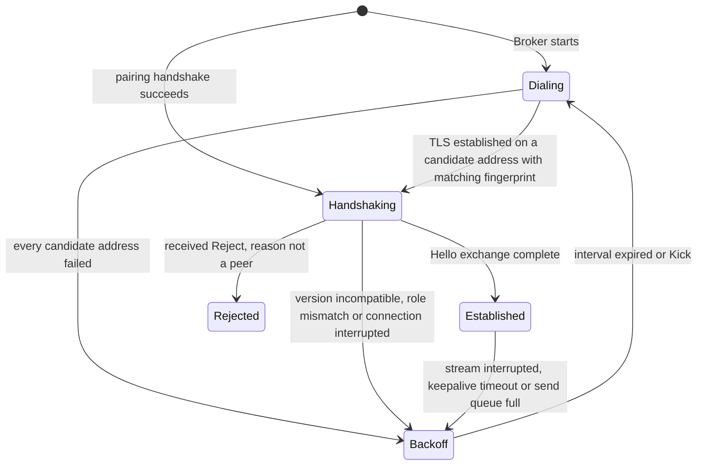
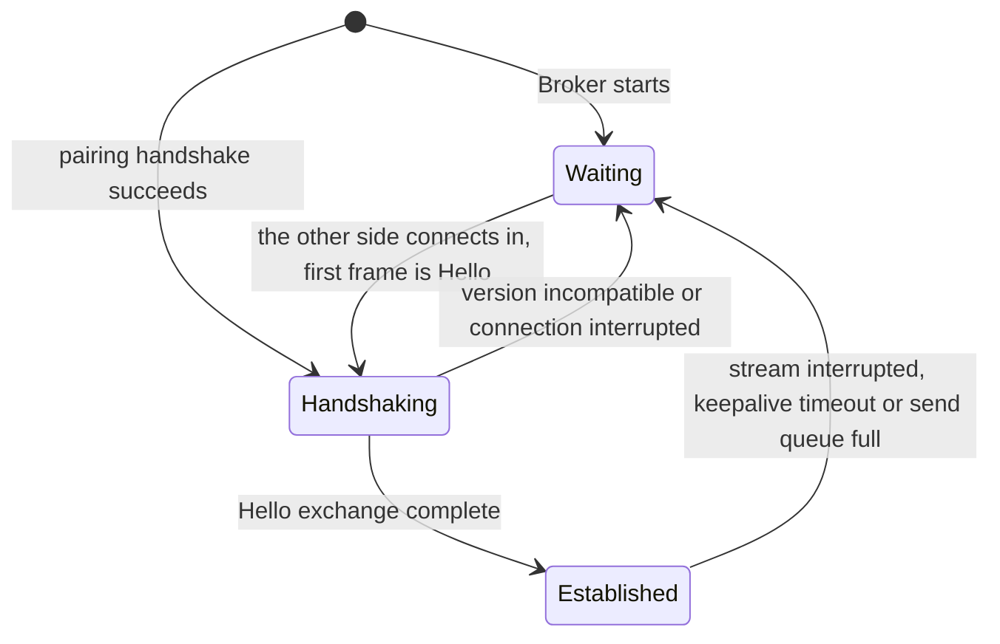

# link

`link` maintains the [link](../../glossary.md) between this Broker and each peer: who dials, how authentication works, who re-establishes it after a disconnect, and how frames are sent and received. It does not parse whether a frame carries a roster, a directory record or a message; it only provides an identity-authenticated bidirectional frame channel and tells the upper layer when a link is established or goes down. A peer pair has only one link, established by the dialer and re-established after a disconnect, while the acceptor only waits for the other side to connect in ([ADR-initiator-redials](../../adr/adr-initiator-redials.md)). It can be thought of as "one pipe per peer, always reconnected from the same end".

On a first read, read Responsibilities, State at a Glance under Core Data Structures, and Core Algorithms and Flows in order; the External Interface Contract is for reference.

## Responsibilities

- Accept inbound connections on this run's listen address, which under the default configuration means listening on every local address ([ADR-listen-by-default](../../adr/adr-listen-by-default.md), `REQ-broker-config-028`), and accept no inbound connection when the listen address is configured empty.
- Bind the listen address and return the bind result to the caller truthfully, not switching to another address or port on a bind failure.
- For a peer on which this side is the dialer, dial to establish a link, dialing at Broker startup and re-establishing at the backoff interval after a disconnect; for a peer on which this side is the acceptor, never dial and only wait for the other side to connect (`REQ-broker-pairing-018`, `REQ-broker-pairing-019`, `REQ-broker-pairing-027`). That the side that initiated pairing can reach the other side means the two have a usable link (`REQ-broker-pairing-020`).
- When dialing, try candidate addresses one by one in order, trying each address with its own deadline; when the peer certificate's fingerprint is not that peer's, abandon the address; a candidate address contains only address items this version recognizes ([ADR-advertised-address](../../adr/adr-advertised-address.md)).
- Authenticate the other side with mutual TLS: a link is established when the other certificate's fingerprint is in the peer table; a connection whose certificate fingerprint is not in the peer table is allowed only to do a pairing handshake, done by [pairing](design-pairing.md) (`REQ-broker-pairing-013`, `REQ-broker-pairing-015`).
- Guarantee at most one established link per peer: when this side is the acceptor, a new connection from the same peer replaces the old one.
- Stop dialing when the other side rejects with "not a peer", until the user pairs again (`REQ-broker-pairing-035`).
- Detect a failed connection with a keepalive probe and close it.
- Send and receive frames for the upper layer: send in order, process state frames serially in arrival order, and process request frames concurrently, matching replies to requests.
- When a link is established, each side contributes half a nonce, concatenated into this link's salt; and hand the other side's self-reported alias to `pairing`.
- When this side is the acceptor, tell the dialer this side's advertised address list in `Hello`, and in `PeerInfo` when the advertised address list changes; when this side is the dialer, hand the received list to `pairing` to update candidate addresses ([ADR-advertised-address](../../adr/adr-advertised-address.md), `REQ-broker-config-030`, `REQ-broker-config-031`, `REQ-broker-pairing-034`).

Changing only the host part of `broker.listen` (for example from `:17443` to `127.0.0.1:17443`) is refused: when validation probes binding with the new value, the old listener still holds the same port, so the probe fails. Changing this item requires changing the port at the same time, or editing the configuration file and restarting the Broker; on a failed change `link` keeps listening on the original address (`REQ-broker-config-034`).

### Non-Responsibilities

- Does not parse an upper-layer frame's content and does no visibility check; the package that registers the frame type, [topic](design-topic.md), [directory](design-directory.md) or [broker](design-broker.md), owns those.
- Does not store the peer table, roles or candidate addresses and does not verify pairing keys; `pairing` owns those.
- Does not consult the directory. The dial target comes only from the peer table's candidate addresses, and an address a card brings is handed by `broker` to `pairing` to record as a candidate address.
- Does not decide which address to listen on, does not compute this side's advertised address list, and does not decide whether the process exits after a bind failure. The address and list are given by [config](design-config.md), and `broker` implements exiting on a bind failure at startup.
- Does not use the other side's address seen on the connection, does not store it, and does not tell it to the other side.
- Does not cache frames that cannot be sent. When the link is not in the established state a send fails immediately, and the caller decides whether to retry or wait.
- Does not forward frames between links; the system has no forwarding ([ADR-direct-links-only](../../adr/adr-direct-links-only.md)).

## External Interface Contract

Called by `broker`, `topic` and `directory`; the signatures are stable. The methods below except `New` are all defined on `*Link`; the other declarations are the types these methods' signatures use, and the `RealClock` and `ConfigSettings` an `Options` depends on.

```go
// New constructs a link that has not started working. It returns an error when Peers
// or Settings is nil. The protocol version is Options.ProtocolVersion, or
// linkpb.ProtocolVersion when 0.
func New(opts Options) (*Link, error)

// Start makes the peers on which this side is the dialer begin dialing; broker calls it
// after writing ok.
func (l *Link) Start()

// Listen binds on address and begins accepting inbound connections; a bind failure
// returns an error and the existing listener is unchanged. When address's host part is
// empty it listens on every local address; an empty address means stop listening.
// broker calls it at startup and when broker.listen changes.
func (l *Link) Listen(address string) error

// Addr returns the current listen address; nil when not listening.
func (l *Link) Addr() net.Addr

// Close stops listening and closes every connection and goroutine. Callable repeatedly,
// with no callbacks after it returns; must not be called from a subscriber's callback or
// a frame handler (Close waits for them to return).
func (l *Link) Close()

// Send puts a frame into the ordered send queue of the link with peer; it returns an
// error immediately when the link is not established, the queue is full, or the encoded
// frame exceeds MaxMessageSize. An over-limit frame is not queued and the link is
// unaffected.
func (l *Link) Send(peer Fingerprint, f Frame) error

// SendLatest is like Send, but when a frame of the same kind put in by SendLatest is
// still not taken by the write goroutine, its content is replaced with f in place
// without taking a new queue position; a replacement after it is taken is enqueued as a
// new frame.
func (l *Link) SendLatest(peer Fingerprint, f Frame) error

// SendLatestKey is like SendLatest, but identifies the position to replace by the
// caller-given key instead of the kind. When a frame with the same key put in by
// SendLatestKey is still not taken by the write goroutine, its content is replaced with
// f in place and replaced reports that a replacement happened; a replacement after it is
// taken is enqueued as a new frame. When the upper layer uses the same key for two kinds
// of frames about one digest, a new frame replaces the old one regardless of kind.
func (l *Link) SendLatestKey(peer Fingerprint, key string, f Frame) (replaced bool, err error)

// Request sends a frame and waits for the other side's reply under the same request id,
// until ctx expires. The returned sent says whether the frame was handed to the
// transport. It returns ErrFrameTooLarge when the frame exceeds MaxMessageSize, with sent
// false.
func (l *Link) Request(ctx context.Context, peer Fingerprint, f Frame) (reply Frame, sent bool, err error)

// HandleState registers a handler for a state frame kind; state frames on the same link
// call it one by one in arrival order.
func (l *Link) HandleState(kind FrameKind, h func(peer Fingerprint, f Frame))

// HandleRequest registers a handler for a request frame kind; requests are called
// concurrently, at most 64 per peer at once, shared by that peer's connections; a handler
// must not wait for a reply on the same link, and its return value is sent back as the
// reply.
func (l *Link) HandleRequest(kind FrameKind, h func(ctx context.Context, peer Fingerprint, f Frame) Frame)

// Subscribe subscribes to link establishment and teardown; the establishment event
// carries this link's salt.
func (l *Link) Subscribe(onUp func(peer Fingerprint, salt []byte), onDown func(peer Fingerprint))

// State returns the current state of the link with peer.
func (l *Link) State(peer Fingerprint) LinkState

// Kick makes the dial to peer happen immediately without waiting for the backoff
// interval; it has no effect when this side is peer's acceptor.
func (l *Link) Kick(peer Fingerprint)

// AnnounceAlias sends PeerInfo on each established link, called by broker when the local
// alias changes.
func (l *Link) AnnounceAlias()

// AnnounceAddresses sends PeerInfo on each established link on which this side is the
// acceptor, called by broker when this side's advertised address list changes.
func (l *Link) AnnounceAddresses()

// Drop closes the link with peer and deletes this link record, called on unpairing; it
// does not wait for the close to complete.
func (l *Link) Drop(peer Fingerprint)

// PairDial connects to address and hands it to run for the pairing handshake; after run
// returns successfully the connection becomes a link. Implements pairing.Transport.
func (l *Link) PairDial(ctx context.Context, address string, run func(pairing.PairConn) error) error

// Frame is one frame on a link; request_id and is_reply are not exposed to the upper layer.
type Frame struct {
    Kind    FrameKind
    Payload []byte
}

// MaxMessageSize is the cap of one sent or received frame message, counted by the encoded length.
const MaxMessageSize = 4 << 20

// Fingerprint is the same type as pairing's fingerprint.
type Fingerprint = pairing.Fingerprint
type FrameKind = uint32

// Phase is the state of a link record; PhaseNone when there is no link record.
type Phase uint8
const (
    PhaseNone Phase = iota
    PhaseDialing
    PhaseWaiting
    PhaseHandshaking
    PhaseEstablished
    PhaseBackoff
    PhaseRejected
)

// FailReason is the reason of the latest failure; reset to FailNone after establishment.
type FailReason uint8
const (
    FailNone FailReason = iota
    FailUnreachable
    FailRoleMismatch
    FailVersionIncompatible
    FailNotAPeer
    FailQueueFull
    FailConnectionLost
    FailProtocol
    FailInboundLimit
)

type LinkState struct {
    Phase       Phase
    Role        pairing.Role
    LastFailure FailReason // the latest failure; reset to FailNone after establishment
    PeerVersion uint32     // the version the other side reported when LastFailure is FailVersionIncompatible, 0 when unknown
    NextDial    time.Time  // PhaseBackoff only
}

var (
    ErrNotEstablished = errors.New("link: not established") // broker maps to peer_unreachable
    ErrQueueFull      = fmt.Errorf("%w: send queue full", ErrNotEstablished)
    ErrLinkDown       = errors.New("link: link went down before the reply arrived")
    ErrClosed         = errors.New("link: closed")
    ErrInvalidKind    = errors.New("link: frame kind is reserved for link and pairing")
    ErrFrameTooLarge  = errors.New("link: frame is larger than the message limit") // not queued, does not wrap ErrNotEstablished
)

// UnsupportedError means the other side answered a request with "unsupported".
type UnsupportedError struct{ Kind FrameKind }
func (e *UnsupportedError) Error() string

// Options holds the dependencies and parameters needed to construct a link.
type Options struct {
    Peers           Peers
    Settings        Settings
    Clock           Clock        // RealClock() when nil
    Logger          *slog.Logger // slog.Default() when nil
    ProtocolVersion uint32       // 0 means linkpb.ProtocolVersion
}

// Peers is the link's narrow interface to pairing; *pairing.Pairing satisfies it.
type Peers interface {
    Fingerprint() pairing.Fingerprint
    TLSConfig() *tls.Config
    Peers() []pairing.Peer
    Role(fp pairing.Fingerprint) pairing.Role
    EffectiveAlias(fp pairing.Fingerprint) string
    Candidates(fp pairing.Fingerprint) (addresses []string, last string)
    ObserveAlias(fp pairing.Fingerprint, alias string)
    ObserveAcceptorAddresses(fp pairing.Fingerprint, addresses []config.AdvertisedAddr)
    ObserveConnected(fp pairing.Fingerprint, address string)
    Accept(conn pairing.PairConn) error
}

// Settings is the link's narrow interface to config; ConfigSettings() satisfies it.
type Settings interface {
    Alias() string
    Advertised() []config.AdvertisedAddr
    DialTimeout() time.Duration
    ReconnectMin() time.Duration
    ReconnectMax() time.Duration
    KeepaliveInterval() time.Duration
    KeepaliveTimeout() time.Duration
    Audit(e config.Event)
}

// Clock provides the current time and timers; RealClock() returns a standard-library implementation.
type Clock interface {
    Now() time.Time
    AfterFunc(d time.Duration, f func()) (stop func() bool)
}

func RealClock() Clock
func ConfigSettings() Settings
```

`*Link` also implements `pairing.Transport`. `pairing.Open` needs this interface at construction, while `link.New` needs an already-opened `*pairing.Pairing`, so the two are assembled through an adapter object: the adapter implements `pairing.Transport`, and `PairDial` and `Drop` forward to a `*Link` filled in later; after `pairing.Open` gets the adapter, `link.New` constructs `*Link` and fills in the adapter. `broker`'s `Run` runs in order the packages registering frame types and subscriptions, the components' `Start`, `Listen`, binding the local socket, writing `ok` and `Start`. `link` does not send an establishment notification for a link already established before `Subscribe`; `Run` orders `Listen` after all components' `Start` and `Start` after writing `ok`. On the production path this is also `Listen` before `Start`, and an incompatible-version inbound failure falling in this window before the acceptor creates its peer record is not recorded this time, but the dialer redials after backoff, by which time the record exists and the failure is recorded, so the window lasts at most one backoff interval and then recovers on its own.

The transport protocol between Brokers is one bidirectional-stream method on gRPC over TLS 1.3 ([ADR-grpc-stream-links](../../adr/adr-grpc-stream-links.md)):

```proto
service Link {
  rpc Connect(stream Frame) returns (stream Frame);
}

message Frame {
  uint32 kind = 1;        // frame type, defined by the package that registers it
  uint64 request_id = 2;  // non-zero means a request or its reply
  bool   is_reply = 3;
  bytes  payload = 4;     // the message determined by the frame type
}
```

The frames this package defines:

| Frame | Class | Content | Use |
|---|---|---|---|
| `Hello` | state frame | The protocol version, the sender's self-reported alias, a 32-byte nonce, and the sender's advertised address list when the sender is the acceptor | Each side sends it once when the link is established |
| `PeerInfo` | state frame | The sender's self-reported alias, and its advertised address list when the sender is the acceptor | Sent on each link when the sender's alias changes during the link's life (`REQ-broker-pairing-002`, `REQ-broker-pairing-003`); sent on the links on which the sender is the acceptor when the sender's advertised address list changes |
| `Reject` | state frame | Reason: protocol version incompatible, not a peer, or role mismatch | Sent when the side accepting a connection rejects it, and when the dialer finds the protocol version incompatible, then the connection is closed |
| `Unsupported` (kind 4) | reply frame | The kind of the request being replied to, only this item | Sent as the reply when an unrecognized request frame is received, with `is_reply` true and `request_id` the request's request id |

The advertised address list comes from [config](design-config.md), at most 8 items, each carrying a kind; the list this side sends contains only direct items, in the form `host:port`. An item of an unrecognized kind in a received list is not used for dialing and does not affect the rest of the frame's content or the recognized items in the list. When the sender is the dialer this item is empty, and the receiver does not read it.

The first frame on the stream is sent by the side that initiates the connection and is `Hello` or the pairing handshake's `PairRequest`. The side accepting the connection sends no frame before verifying the other side. After accepting, it closes the connection after a deadline for not reading the first frame. Connections simultaneously in the unauthenticated state follow source quotas ([ADR-unauthenticated-connection-limits](../../adr/adr-unauthenticated-connection-limits.md)): the source is the network prefix of the other side's address, a /32 for IPv4 and the /64 for IPv6, an IPv4-mapped IPv6 address handled as IPv4, the IPv6 zone removed, and connections whose address has no IP address gathered into one source. When one source exceeds its per-source cap, that source's earliest-established connection is closed; when all sources combined exceed the global cap, the earliest-established connection of the source with the most connections is closed, and on a tie the source whose earliest connection is oldest. The protocol version in `Hello` is an integer, and a link is established only when the two versions are equal; otherwise it replies `Reject` and closes. The pairing handshake uses the same version: `PairConn.ProtocolVersion` returns the version this link actually uses (including a test-injected override), and `pairing` writes it into `PairRequest` and compares it at the acceptor, see [pairing](design-pairing.md). An additive-only change does not change the protocol version: adding a frame type, and adding a field to an existing frame; an unrecognized state frame is dropped, an unrecognized request frame is answered with an "unsupported" reply, and unrecognized fields are ignored. Only a change that alters the meaning of an existing frame or field raises the protocol version. The frame type's number space is divided by package.

The first-frame deadline is 10 seconds, counted from the TCP accept. The per-source cap is 8 and the global cap 64. A connection whose TLS handshake completes and whose certificate fingerprint is in this side's peer table moves into the known-peer pool and is not counted toward these two caps; each fingerprint's known-peer pool has at most 2 connections, and beyond that the fingerprint's earliest-established connection is closed. The bytes read from a connection before authentication (including the TLS handshake, HTTP/2 preface and frames) are capped at 64 KiB, closed on exceeding; the HTTP/2 header list is capped at 16 KiB. The unauthenticated range runs from the TCP accept until the first `Hello` verifies, or until the first `PairRequest` is handed to `pairing` and the handshake succeeds; a connection during the pairing handshake still counts toward its pool's cap: a connection whose fingerprint is not in the peer table counts toward the unknown-source pool's per-source and global caps, and a connection whose fingerprint is already in the peer table counts toward that fingerprint's known-peer pool cap. Each TCP connection carries only one `Connect` stream, and a second stream on the same connection ends with an error. After `Reject` is sent, the connection is kept for at most 1 second more. After authentication the cap on one sent or received message is `MaxMessageSize`, that is 4 MiB. Evicting an over-limit connection, closing a connection for exceeding the known-peer pool cap, and reading over budget before authentication each write one run log at Debug level `link: closed an unauthenticated connection`, with field `source` the source prefix and `cause` the close reason (`source_limit`, `global_limit`, `known_peer_limit` or `byte_budget`); an expired first-frame deadline does not write this log.

## Dependencies

`link` references `pairing` to get the local identity certificate, to query the peers in the peer table, this side's role and candidate addresses, to submit the other side's self-reported alias, the advertised address list the acceptor told and this connection's address, and to hand it a connection whose first frame is `PairRequest` for the handshake; and it references `config` to read the listen address, this side's advertised address list, the dial deadline and the various intervals. It references neither `topic`, `directory` nor `broker`; those packages register frame types on top of it, matching the module dependency graph's direction.

## UML Diagrams

A link's state belongs to "the link with a peer", not to a connection, and the states it can take are decided by this side's role in the pair. The diagram below is the state change when this side is the [dialer](../../glossary.md). One round of dialing tries every candidate address in turn, and enters handshaking as soon as one address establishes TLS with the peer certificate's fingerprint matching.



The diagram below is the state change when this side is the [acceptor](../../glossary.md). The acceptor does not dial and has no dialing, backoff or rejected states; when the link is not established it stays waiting for the other side.



Both diagrams omit `Drop`: calling it in any state closes the connection and deletes this link record. After the pairing handshake succeeds, the connection carrying the handshake enters handshaking directly; when the same pair of Brokers pairs again, the existing link record is rebuilt by the new roles, see "A New Connection from the Same Peer".

## Core Data Structures

One link record per peer, existing only in memory: the other side's fingerprint, this side's role, the current state, the current stream, the salt, the ordered send queue, the time of the next dial, the candidate addresses not yet tried in this round of dialing, the wait table of unanswered requests, and the latest failure reason.

### State at a Glance

| State | What it means | What is happening (link) | Mental image |
|---|---|---|---|
| Dialing | This side is the dialer, connecting the other side's candidate addresses in order | Establish TCP and TLS for each address and check the certificate fingerprint, each address bounded by `link.dial_timeout` | Dialing the numbers in the address book one after another |
| Waiting | This side is the acceptor, the link is not established, only waiting for the other side to connect in | None; the listening port accepts connections as usual | Sitting by the phone waiting for the call |
| Handshaking | The connection is up, confirming identity and version | Check the certificate fingerprint and role, exchange `Hello` | Saying your name first after the call connects |
| Established | The link is usable | Send and receive frames, keepalive on a timer; when this side is the acceptor, a new connection from the same peer switches to the new one | On the call |
| Backoff | This side is the dialer, the last round of dialing failed or the link was interrupted, waiting for the next round | Timing; `Kick` ends it early | Calling again a little while after hanging up |
| Rejected | This side is the dialer, the other side no longer regards this side as a peer | No more dialing, recording the reason to show when listing Brokers | The other side says it does not know you, so stop calling |

## Core Algorithms and Flows

### Worked Example

Broker B sits behind NAT, its listen address configured empty, and has paired using A's address and a pairing key A generated, so B is A's dialer and A is B's acceptor. A's advertised address list is `203.0.113.5:17443` and `10.0.0.5:17443`, the latter being A's intranet address added with `broker.advertise_extra`; B's peer table has exactly these two as A's candidate addresses, and the last connected was `203.0.113.5:17443`. B's local network happens to be `10.0.0.0/24` too, and on its `10.0.0.5` runs another Broker C. A restarts, its address unchanged before and after.

| Step | Event | A's link state to B | B's link state to A |
|---|---|---|---|
| 1 | A's process exits | none | established |
| 2 | B's stream is interrupted | none | backoff, interval 1 second |
| 3 | The interval expires, B first tries the last connected `203.0.113.5:17443`, A has not started and the connection is refused; then tries `10.0.0.5:17443` on its own subnet, connects to C, C's certificate fingerprint is not A's, and B closes the connection | none | backoff, interval 2 seconds |
| 4 | A starts, loads the peer table, this side is B's acceptor | waiting | backoff |
| 5 | The interval expires, B first tries `203.0.113.5:17443`, TLS is established and the fingerprint is A's; B sends `Hello`, A checks that B's fingerprint is in the peer table and that this side is its acceptor | handshaking | handshaking |
| 6 | A replies `Hello` with this side's advertised address list; the salt is B's nonce concatenated with A's nonce | established, salt `s2` | established, salt `s2` |
| 7 | B hands A's list to `pairing` and records this connection's `203.0.113.5:17443`; `link` notifies subscribers the link is established, and `topic` and `directory` begin exchanging | established | established |

A never initiates a connection to B and does not know any of B's addresses. At step 3 B sends C no frame: the same private address points to another Broker in B's network and does not make B connect to the wrong party. The list A gives in `Hello` is the same as before, so B's candidate addresses are unchanged. The salt `s2` differs from before the restart, and every digest exchanged before the restart is void.

### Handling an Inbound Connection

The TLS handshake stage accepts any peer certificate, and immediately after the handshake completes it takes the peer certificate's fingerprint. A connection whose fingerprint is in this side's peer table moves into the known-peer pool and is not pushed out by an unknown-source connection before the first-frame verification; a connection whose fingerprint is not in the peer table stays in the unknown-source pool, subject to the per-source and global caps. It then reads the first frame:

- The first frame is `PairRequest`: hand the connection to `pairing` for the handshake, whether or not the fingerprint is already in the peer table. After the handshake succeeds the initiator then sends `Hello` on the same connection; `pairing` commits this side's acceptor role when it receives that `Hello`, and the connection then becomes a link.
- The first frame is `Hello`, the fingerprint is in the peer table and this side is that peer's acceptor: reply `Hello` and the link is established. When there is already an established link, handle it as "A New Connection from the Same Peer".
- The first frame is `Hello`, the fingerprint is in the peer table but this side is that peer's dialer: reply `Reject` with reason "role mismatch" and close, recording it in the run log.
- The first frame is `Hello` but the fingerprint is not in the peer table: reply `Reject` with reason "not a peer" and close, writing audit `connection_rejected` with `Peer` carrying only the fingerprint, merged by source (`REQ-broker-pairing-015`, `REQ-broker-pairing-022`, `REQ-broker-config-069`).
- The first frame is neither `Hello` nor `PairRequest`: when the fingerprint is not in the peer table, reply `Reject` with reason "not a peer" and close, writing audit `connection_rejected`, likewise merged by source; when the fingerprint is in the peer table, close directly.

Before reading and verifying the first frame, this side sends nothing on the stream, so information such as the other side's self-reported alias or this side's advertised address list is not handed to an unverified connection.

### Dialing and Re-Establishing

For a peer on which this side is the dialer, this side dials while the link is not established. Each round takes that peer's candidate addresses from `pairing`, keeping only the address items this version recognizes, and tries them one by one in the following order, the round ending as soon as one address establishes TCP and TLS and the peer certificate's fingerprint is that peer's:

1. The last connected address.
2. Addresses whose host is an IP address in the same subnet as one of this host's interface addresses.
3. The remaining addresses, in the order `pairing` gives.

Each address's TCP connection and TLS handshake are bounded by `link.dial_timeout`, so one round of dialing takes no longer than the number of candidate addresses times this deadline. An address that cannot connect, times out, or has a certificate fingerprint that is not that peer's is abandoned and the next tried; on a fingerprint mismatch this side sends no frame on the connection, but the other side has already seen this side's certificate and fingerprint in the TLS handshake; a private address duplicated in different networks therefore does not make this side connect to another Broker ([ADR-advertised-address](../../adr/adr-advertised-address.md)). When one candidate address matches the fingerprint, the round ends and `Hello` is exchanged on the same connection; when the `Hello` exchange fails it enters backoff or rejected by the failure reason.

When every address in a round fails, or after the link is interrupted, it enters backoff, the interval starting at `link.reconnect_min` and doubling each time up to `link.reconnect_max`; after the link is established the interval resets, and this connection's address is handed to `pairing` to record as the last connected address. `Kick` ends the backoff immediately. The two boundary values of backoff are read from the configuration at the start of each round, and modifying `link.reconnect_min` or `link.reconnect_max` takes effect on the next round. After receiving a `Reject` with reason "not a peer" it enters the rejected state, no longer dials and writes audit `rejected_by_peer` (`REQ-broker-pairing-035`); with reason "role mismatch" or protocol version incompatible it enters backoff and records the reason to show when listing Brokers. When both sides regard themselves as the dialer, "role mismatch" persists, and the result of listing Brokers hints that pairing again is needed ([ADR-initiator-redials](../../adr/adr-initiator-redials.md)).

`PairDial` is `pairing.Transport`'s dial entry point. When `run` returns successfully the pairing has been committed by `pairing`, and `PairDial` always returns nil; it then completes the `Hello` exchange on the same connection with `Link`'s root context and a 10-second deadline, and on success installs the link, while on failure it enters backoff or rejected by the ordinary dialer's result and leaves it to the dial loop to continue.

### The Acceptor's Wait

For a peer on which this side is the acceptor, this side never dials and stays waiting for the other side while the link is not established; `Kick` has no effect on it, and the handling after the dialer connects in is in "Handling an Inbound Connection". While the link is up, this side tells the dialer its list in `Hello` and in the `PeerInfo` sent when the advertised address list changes, so the dialer holds this side's latest advertised addresses. When this side changes its address after the link goes down and before it is re-established, and the dialer has not obtained the new address from a card, the link cannot recover on its own and pairing again is required ([ADR-initiator-redials](../../adr/adr-initiator-redials.md)).

### Telling the Advertised Address List

When this side is the acceptor, the advertised address list in `Hello` and `PeerInfo` is this side's list from `config`; when this side is the dialer this item is empty, and the dialer does not report its own address to the acceptor. `broker` calls `AnnounceAddresses` when this side's advertised address list changes, making each established link on which this side is the acceptor receive `PeerInfo`.

When this side is the dialer, on receiving the list in the other side's `Hello` or `PeerInfo` it hands it to `pairing` as candidate addresses from the acceptor source, replacing that source's previous list, and dialing after the link goes down follows the new list (`REQ-broker-pairing-034`); an item of an unrecognized kind in the list is skipped by `pairing` when recording, while the rest of `Hello` and `PeerInfo` such as the alias and nonce are handled as usual; the list in `Hello` is delivered before the link-establishment notification. When this side is the acceptor, it ignores this item in the other side's frame. This package does not verify whether the addresses in the list are reachable; the fingerprint check after connecting makes a wrong address only fail to connect.

### A New Connection from the Same Peer

When this side is the acceptor, a new connection from the same peer completes the `Hello` exchange while there is already an established link, and the new one is adopted and the old one closed. This situation arises after the dialer restarts and reconnects while this side has not yet found the old connection stale. The dialer dials only while the link is not established and does not create a second connection by itself.

When the pairing handshake succeeds and the connection carrying the handshake becomes a link, if the same peer already has a link record, the record is rebuilt by the new role in the peer table and the original connection is closed.

A closed connection does not trigger a teardown notification; when the kept connection is not the same one as before, the teardown notification comes first and then the establishment notification, so the upper layer re-exchanges with the new salt.

### Salt

The salt is the dialer's `Hello` nonce concatenated with the acceptor's `Hello` nonce. Both ends concatenate in the same order.

### Sending and Handling Frames

`Send` checks the encoded frame size before queueing and returns `ErrFrameTooLarge` when it exceeds `MaxMessageSize` (4 MiB), in which case the frame is not queued and the link sends and receives as usual. Otherwise it puts the frame into that link's ordered send queue and returns, and the write goroutine sends it in queue order. The queue is bounded at 1024 frames; being full means the other side has not read for a long time, so it closes the connection and enters backoff.

`SendLatest` does the same check and queueing as `Send`, but when a frame of the same kind put in by `SendLatest` is still not taken by the write goroutine, its content is replaced with the new one in place without taking a new queue position; a replacement after the write goroutine takes it is enqueued as a new frame. `SendLatestKey` is the general form with the same semantics: the replacement position is identified by the caller-given key, and `SendLatest` is equivalent to using the kind as the key. A key has at most one pending send position in the queue regardless of its kind, so the upper layer can let a full snapshot of a digest replace an increment queued before it. A replaced frame keeps the position of its first queueing, and the relative order of the other frames is unchanged. Calling `SendLatestKey` repeatedly on one key does not fill the queue, and the peer receives only the last content. `Request` checks the frame size after filling in the request id and before registering the wait table and queueing, returning `ErrFrameTooLarge` with `sent` false when over-limit, and leaving no entry in the wait table.

When a reply frame exceeds `MaxMessageSize` it is not queued, and one Warn run log `link: dropping a reply` is recorded with fields the peer fingerprint, the kind and the reason `frame_too_large`; the requester handles it by the existing timeout.

The read side is split into a read goroutine and a routing goroutine. The read goroutine reads frames in arrival order, and the routing goroutine hands a reply to the caller waiting on its request id, a request frame to a handler goroutine (first waiting for a slot when that peer's 64 handler slots are used up, shared by its connections), and a state frame into that link's state-frame queue. State frames are processed one by one by one handler goroutine, handling the next only after the previous handler returns; requests and replies do not pass through this goroutine, so a state-frame handler can send a `Request` on the same link and wait for the reply without deadlocking.

The state-frame queue is bounded: each connection's frames in the queue plus the frame being handled number at most 4096 frames, with a payload total of at most 64 MiB, and exceeding either cap closes this connection with `FailInboundLimit`. On exceeding it does not stop reading: stopping would stall the replies queued behind, deadlocking a state-frame handler's wait for a reply; instead only the over-limit peer's connection is closed, and peers within limits are unaffected. The cap's basis is that a normal peer's burst when a link is established (the roster and directory reconciliation) is far below it, and the overall decision is in [ADR-peer-resource-limits](../../adr/adr-peer-resource-limits.md); an authenticated peer gains no right to unlimited resource use by being authenticated ("Authentication and Authorization Boundaries" of [architecture](../architecture.md)).

A connection's `onDown` is delivered only after that connection's state-frame handler goroutine exits, and request handlers may still be running then, with their replies dropped.

### Keepalive

A gRPC keepalive probe is sent every `link.keepalive_interval`, and a connection with no reply within `link.keepalive_timeout` is judged failed and closed, entering backoff. A connection through NAT keeps its address mapping alive by the probes.

The server's keepalive enforcement policy is a probe interval of at least 5 seconds, allowing probes with no active stream; this floor is below the gRPC client's 10-second minimum probe interval, so the peer does not trigger `too_many_pings` however it configures `link.keepalive_interval`. The gRPC client sends a probe interval under 10 seconds at 10 seconds. The acceptor side's keepalive parameters are read when first listening and creating the gRPC server, so modifying `link.keepalive_interval` or `link.keepalive_timeout` takes effect on the acceptor side after a restart; the dialer side's parameters are read on each new outgoing connection, taking effect on the next connection.

### Requests and Replies

`Request` assigns a frame a request id incrementing within this link, registers it in the wait table and queues it, returning on receiving a reply with the same id, on the link being interrupted, or on the context expiring, and deletes the entry from the wait table. `sent` says whether the frame was handed to the transport: once the write goroutine starts calling gRPC `Send` on the frame, it is handed to the transport. When the context expires while the request waits in the queue, the request is cancelled and the write goroutine skips it, returning `(Frame{}, false, ctx.Err())`; when the write goroutine took the frame first, the returned `sent` is true. A link that goes down before the write returns `(Frame{}, false, a wrapping of ErrNotEstablished)`; a link that goes down after the write returns `(Frame{}, true, ErrLinkDown)`. When the other side answers the request with "unsupported" it returns `(Frame{}, true, *UnsupportedError)`, whose `Kind` is the rejected request kind; the caller retrieves it with `errors.As`.

## Error and Failure Semantics

| Situation | Behaviour |
|---|---|
| `Send`, `SendLatest`, `SendLatestKey` or `Request` called while the link is not established | Return `peer_unreachable` immediately, `sent` false, not queued |
| The encoded frame exceeds `MaxMessageSize` (`Send`, `SendLatest`, `SendLatestKey` or `Request`) | Return `ErrFrameTooLarge`, the frame not queued, the link not broken; `Request`'s `sent` false |
| A reply frame exceeds `MaxMessageSize` | Drop the reply, record Warn run log `link: dropping a reply` (reason `frame_too_large`), the requester handling it by timeout |
| The link is interrupted or the context expires while waiting for a reply | Return an error, `sent` true; whether the other side processed the request is unknown, which [broker](design-broker.md) reduces to an unknown result and makes resend-safe with the message identifier |
| A candidate address cannot connect, times out, or its certificate fingerprint is not that peer's | Abandon the address and try the next; after all fail in one round, enter backoff |
| The certificate fingerprint is not in the peer table and the first frame is not `PairRequest` | Reply `Reject` with reason "not a peer", close the connection, write audit |
| A peer on which this side is the dialer connects in | Reply `Reject` with reason "role mismatch", close the connection, record in the run log; the other side enters backoff on receiving it, and listing Brokers shows this reason |
| The other side's protocol version is incompatible | Reply `Reject`, close the stream; when this side is the dialer enter backoff, when the acceptor return to waiting; the run log records both versions |
| An unpaired party connects in again | Its fingerprint is not in the peer table, handled as the unknown fingerprint above; the other side stops dialing after receiving `Reject` |
| The send queue is full | Close the connection; when this side is the dialer enter backoff, when the acceptor return to waiting |
| `Send` called while the send queue is full | Return `ErrQueueFull`, which is a `peer_unreachable` |
| The state-frame queue exceeds 4096 frames or the 64 MiB payload cap | Close the connection; audit `link_down`'s `detail` is `inbound_limit`, run log `link_inbound_limit` with `peer` and `limit` (`state_frames` or `state_bytes`); when this side is the dialer enter backoff, when the acceptor return to waiting |
| A second `Connect` stream opened on the same TCP connection | The second stream ends with an error, and the link already established on the connection is unaffected |

`link` itself writes four kinds of audit events: `link_up`, `link_down`, `connection_rejected` and `rejected_by_peer`. `link_up` and `link_down` are each written once per delivery of an establishment or teardown notification, `Peer` carrying the peer fingerprint and effective alias, and `link_down`'s `detail` being the name of the teardown reason; these two kinds do not fill in `MergeKey` and are not merged. `connection_rejected` is written when a connection with an unknown fingerprint is rejected, `Peer` carrying only the fingerprint, merged by source, with `detail` written `not a peer from <source prefix>` (`REQ-broker-pairing-015`, `REQ-broker-config-069`); `rejected_by_peer` is written on receiving a `Reject` with reason "not a peer" (`REQ-broker-pairing-035`).

The link protocol and frames are unchanged, and the link protocol version is not raised. The `broker_offline` in a delivery reply is interpreted by [broker](design-broker.md); this package only forwards the reply frame and is not changed by the new error code; an unupgraded sender treats an unrecognized numeric error code as `internal`, and the message still carries the receiver's explanation. Degradation appears only in the local interface, and link frames gain no new error code. Going offline does not change the link state, and a peer's status in `list_brokers` does not reflect whether the peer is offline. In local-only degraded run this package does not listen, a peer on which this side is the acceptor stays waiting, and a peer on which this side is the dialer dials as usual.

## Concurrency and Transaction Boundaries

Each link has one read goroutine, one write goroutine, one routing goroutine and one state-frame handler goroutine. The write goroutine takes frames from the ordered send queue, guaranteeing that frames on the same link are sent in queue order. `Send` does not block: when the queue is full it closes the connection and returns `ErrQueueFull`.

`SendLatest`'s and `SendLatestKey`'s in-place replacement and the write goroutine taking the frame exclude each other: the write goroutine first takes the frame off the queue and unregisters its replacement position, then reads its content to send; a replacement arriving after that is enqueued as a new frame. A frame is therefore never rewritten mid-send, one key has at most one pending send position in the queue (`SendLatest`'s key is the kind), and the relative order of the other frames is unchanged.

All of one peer's connections together run at most 64 request handler goroutines at once; when the slots run out the routing goroutine stops at taking a slot and no longer reads frames, and the pressure is passed back to the peer through HTTP/2 flow control. When replacing a connection the old connection's handlers may still be running, so the new connection first waits for these slots, and reconnecting cannot stack a second concurrency. A connection closing makes a routing goroutine waiting for a slot exit immediately, so `Close` does not hang because of it. A handler must not wait for a reply on the same link, or when all slots are taken the routing goroutine stops reading frames and the reply can never arrive.

The establishment and teardown notifications are delivered serially by one notification goroutine, the events first-in-first-out, and subscribers are called in `Subscribe` order. A connection's state frames begin to be processed only after all of its `onUp` have returned; a connection's `onDown` is enqueued only after that connection's state-frame handler goroutine exits, so the upper layer never receives this connection's state frames after `onDown`. `onDown` never runs on the caller's stack of `Send`, `Drop`, `Kick` or a queue overflow. When the acceptor replaces an old connection with a new one, it sends exactly one `onDown` then the new connection's `onUp`.

Link state transitions are protected by a lock on the link record. While holding the lock it calls no `Peers`, `Settings`, subscriber callback or frame handler, and does no blocking network operation; closing is always asynchronous. `Drop` does not wait: it deletes the record and closes the connection asynchronously, sending `onDown` after that connection's state-frame handler goroutine exits; the same peer cannot install a new connection before this `onDown` is enqueued, so the upper layer always sees `onDown` before `onUp`. After `Close` returns there are no callbacks; a subscriber's callback must not call `Close`, and a frame handler must not call `Close` either (`Close` waits for it to return).

## Extension Points

How the connection underlying a link is established is an extension point, reserved for relaying through a third party at the connection layer. The current way is only one: the dialer connects directly to the acceptor's listen address, corresponding to a direct address item; the address item's kind leaves room for other establishment ways, and an unrecognized kind is skipped ([ADR-advertised-address](../../adr/adr-advertised-address.md)). A link's authentication, frame sending and receiving, and who is responsible for re-establishing it do not depend on how the connection is established: on a connection established in any way it does the same mutual TLS and fingerprint check, a peer pair still has only one link, and it is still established and re-established only by the dialer.

## Implementation Status

| Capability | Status | Code |
|---|---|---|
| Binding the listen address and handling inbound connections | Implemented | `internal/link/listen.go`, `internal/link/handshake.go`, `internal/link/unauth.go`, `internal/link/source.go` (`Listen`, `acceptStream`, `serveInbound`, `unauthRegistry`, `sourcePrefix`) |
| Dialing candidate addresses, backoff and re-establishing | Implemented | `internal/link/dial.go`, `internal/link/order.go`, `internal/link/transport.go` (`startDialLoop`, `orderCandidates`, `backoffDelay`, `dialTLS`) |
| The acceptor's wait and replacement by a new connection from the same peer | Implemented | `internal/link/record.go`, `internal/link/handshake.go` (`install`, `teardown`, `serveInbound`) |
| Keepalive | Implemented | `internal/link/transport.go` (`serverOptions`, `newGRPCServer`, `clientKeepalive`) |
| Ordered sending, serial state-frame handling and request/reply | Implemented | `internal/link/conn.go`, `internal/link/dispatch.go`, `internal/link/api.go` (`conn`, `runConn`, `Send`, `SendLatest`, `SendLatestKey`, `Request`, `enqueueLatest`) |
| Frame size cap and merging sends by key | Implemented | `internal/link/transport.go` (`MaxMessageSize`, `frameExceedsLimit`), `internal/link/api.go` (`Send`, `SendLatest`, `SendLatestKey`, `Request`), `internal/link/conn.go` (`latestSlot`, `writeLoop`, `enqueueLatest`, `enqueueRequest`) |
| Salt negotiation | Implemented | `internal/link/handshake.go`, `internal/link/frames.go` (`dialerHandshake`, `serveInbound`, `encodeHello`) |
| The rejected state | Implemented | `internal/link/record.go`, `internal/link/handshake.go` (`record`, `failFromReject`) |
| Telling the advertised address list | Implemented | `internal/link/api.go`, `internal/link/handshake.go` (`AnnounceAlias`, `AnnounceAddresses`, `dialerHandshake`) |
