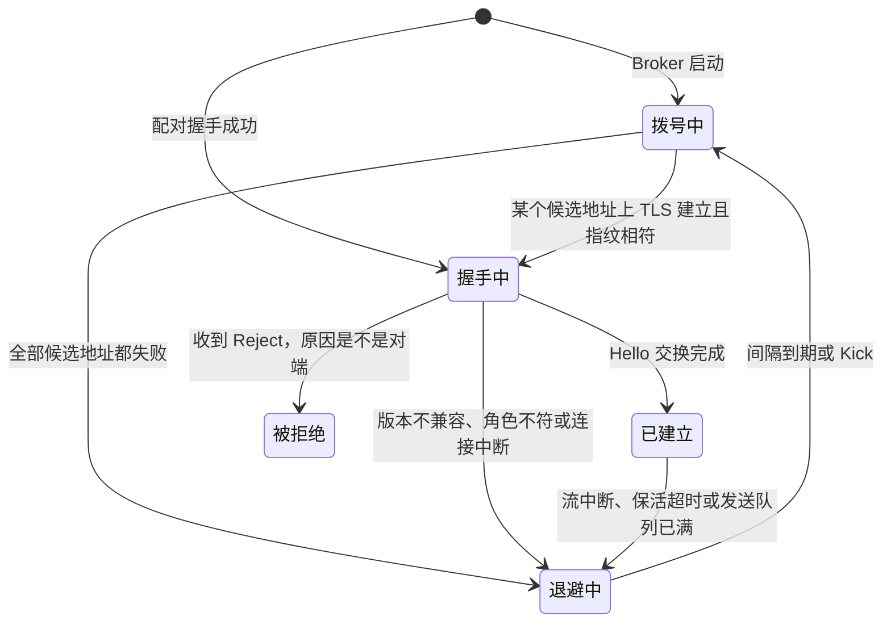
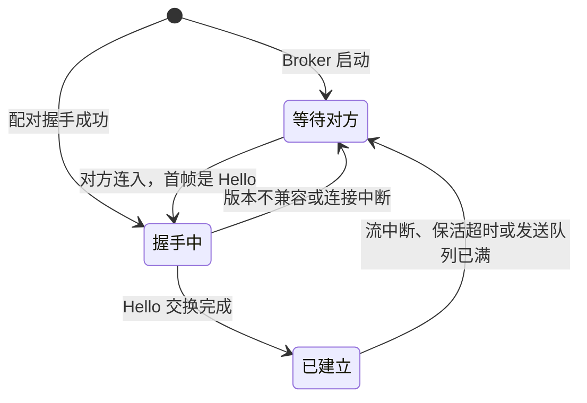

# link

`link` 维护本 Broker 与每个对端之间的[链路](../../glossary.md)：谁来拨号、如何认证、断了由谁重新建立、帧怎么收发。它不解析帧里装的是成员名单、名录记录还是消息，只提供一条经过身份认证的双向帧通道，并把链路的建立与断开告知上层。一对对端之间只有一条链路，由拨号方建立并在断开后重新建立，接受方只等待对方连入（[ADR-initiator-redials](../../adr/adr-initiator-redials.md)）。可以把它看作“每个对端一条管道，断了总由同一头接回去”。

首次阅读按顺序读职责、核心数据结构里的状态一览和核心算法与流程；外部接口契约供查阅。

## 职责

- 在本次运行的监听地址上接受入站连接，默认配置下即在本机的全部地址上监听（[ADR-listen-by-default](../../adr/adr-listen-by-default.md)，`REQ-broker-config-028`），监听地址配置为空时不接受入站连接。
- 绑定监听地址并把绑定的成败如实返回给调用方，不在绑定失败时改用其他地址或端口。
- 对本方是拨号方的对端拨号建立链路，Broker 启动时即拨号，链路断开后按退避间隔重新建立；对本方是接受方的对端从不拨号，只等待对方连入（`REQ-broker-pairing-018`、`REQ-broker-pairing-019`、`REQ-broker-pairing-027`）。发起配对的一方能连到对方，双方就有链路可用（`REQ-broker-pairing-020`）。
- 拨号时按候选地址的顺序逐个尝试，每个地址有单独的期限，对方证书的指纹不是该对端的，放弃该地址；候选地址只含本版本认识的地址项（[ADR-advertised-address](../../adr/adr-advertised-address.md)）。
- 以双向 TLS 认证对方：对方证书的指纹在对端表中则建立链路；证书指纹不在对端表中的连接只允许做配对握手，握手由 [pairing](design-pairing.md) 完成（`REQ-broker-pairing-013`、`REQ-broker-pairing-015`）。
- 保证每个对端至多有一条已建立的链路：本方是接受方时，同一对端的新连接取代旧的。
- 对方以“不是对端”拒绝时停止拨号，直到用户重新配对（`REQ-broker-pairing-035`）。
- 以保活探测发现失效的连接并关闭它。
- 为上层收发帧：按序发送，状态帧按到达顺序串行处理，请求帧并发处理并与应答对应。
- 链路建立时与对方各提供一半随机数，拼成本次链路的盐值；把对方自报的别名交给 `pairing`。
- 本方是接受方时，在 `Hello` 中，以及对外地址列表变化时在 `PeerInfo` 中，把本方的对外地址列表告诉拨号方；本方是拨号方时，把收到的列表交给 `pairing` 更新候选地址（[ADR-advertised-address](../../adr/adr-advertised-address.md)，`REQ-broker-config-030`、`REQ-broker-config-031`、`REQ-broker-pairing-034`）。

只修改 `broker.listen` 的主机部分（例如把 `:17443` 改为 `127.0.0.1:17443`）会被拒绝：校验以新值探测绑定时，旧监听仍占着同一端口，探测因此失败。修改这一项需要同时改端口，或改配置文件后重启 Broker；修改失败时 `link` 继续在原地址监听（`REQ-broker-config-034`）。

### 非职责

- 不解析上层帧的内容，不做可见性检查，分别由注册该帧类型的 [topic](design-topic.md)、[directory](design-directory.md) 与 [broker](design-broker.md) 负责。
- 不保存对端表、角色与候选地址，不验证配对密钥，由 `pairing` 负责。
- 不查名录。拨号的目标只取自对端表中的候选地址，名片带来的地址由 `broker` 交给 `pairing` 记入候选地址。
- 不决定监听哪个地址，不计算本方的对外地址列表，也不决定绑定失败之后进程是否退出。地址与列表由 [config](design-config.md) 给出，启动时绑定失败即退出由 `broker` 执行。
- 不使用连接上看到的对方地址，不保存它，也不把它告诉对方。
- 不缓存发不出去的帧。链路不在已建立状态时，发送立即失败，是否重试或等待由调用方决定。
- 不在链路之间转发帧，系统中没有转发（[ADR-direct-links-only](../../adr/adr-direct-links-only.md)）。

## 外部接口契约

供 `broker`、`topic`、`directory` 调用，签名稳定。以下方法除 `New` 外都定义在 `*Link` 上；其余声明是这些方法的签名所用的类型，以及构造 `Options` 依赖的 `RealClock` 与 `ConfigSettings`。

```go
// New 构造一条尚未开始工作的链路。Peers 与 Settings 为 nil 时返回错误。
// 协议版本取 Options.ProtocolVersion，为 0 时取 linkpb.ProtocolVersion。
func New(opts Options) (*Link, error)

// Start 让本方是拨号方的对端开始拨号；由 broker 在写出 ok 之后调用。
func (l *Link) Start()

// Listen 在 address 上绑定并开始接受入站连接；绑定失败时返回错误，原有的监听不变。
// address 的主机部分为空时在本机的全部地址上监听；address 为空表示停止监听。
// 启动时与 broker.listen 变更时由 broker 调用。
func (l *Link) Listen(address string) error

// Addr 返回当前的监听地址；没有监听时返回 nil。
func (l *Link) Addr() net.Addr

// Close 停止监听，关闭全部连接与协程。可重复调用，返回后不再有回调；订阅者的回调与帧处理函数内不得调用（Close 会等待它们返回）。
func (l *Link) Close()

// Send 把一帧放入与 peer 的链路的有序发送队列；链路未建立、队列已满，或编码后的帧超过
// MaxMessageSize 时立即返回错误。超过上限的帧不入队，链路不受影响。
func (l *Link) Send(peer Fingerprint, f Frame) error

// SendLatest 与 Send 相同，但同一 kind 的帧若仍有一帧由 SendLatest 放入、尚未被写协程
// 取走，就地把它的内容换成 f，不占新的队列位置；取走之后的替换按新帧入队。
func (l *Link) SendLatest(peer Fingerprint, f Frame) error

// SendLatestKey 与 SendLatest 相同，但用调用方给定的 key 而不是 kind 标识待替换的位置。
// 同一 key 的帧若仍有一帧由 SendLatestKey 放入、尚未被写协程取走，就地把内容换成 f，
// 并以 replaced 报告发生了替换；取走之后的替换按新帧入队。上层为一个摘要的两种帧
// 使用同一个 key 时，新帧不论 kind 都替换旧帧。
func (l *Link) SendLatestKey(peer Fingerprint, key string, f Frame) (replaced bool, err error)

// Request 发出一帧并等待对方以同一请求号应答，直到 ctx 到期。
// 返回的 sent 表示该帧是否已交给传输层。帧超过 MaxMessageSize 时返回 ErrFrameTooLarge，
// sent 为假。
func (l *Link) Request(ctx context.Context, peer Fingerprint, f Frame) (reply Frame, sent bool, err error)

// HandleState 注册一种状态帧的处理函数；同一链路上的状态帧按到达顺序逐个调用。
func (l *Link) HandleState(kind FrameKind, h func(peer Fingerprint, f Frame))

// HandleRequest 注册一种请求帧的处理函数；各请求并发调用，返回值作为应答发回。
func (l *Link) HandleRequest(kind FrameKind, h func(ctx context.Context, peer Fingerprint, f Frame) Frame)

// Subscribe 订阅链路的建立与断开；建立事件带有本次链路的盐值。
func (l *Link) Subscribe(onUp func(peer Fingerprint, salt []byte), onDown func(peer Fingerprint))

// State 返回与 peer 的链路的当前状态。
func (l *Link) State(peer Fingerprint) LinkState

// Kick 促使对 peer 的拨号立即进行，不等待退避间隔；本方是 peer 的接受方时不起作用。
func (l *Link) Kick(peer Fingerprint)

// AnnounceAlias 在每条已建立的链路上发送 PeerInfo，由 broker 在本机别名变化时调用。
func (l *Link) AnnounceAlias()

// AnnounceAddresses 在本方是接受方的每条已建立的链路上发送 PeerInfo，
// 由 broker 在本方的对外地址列表变化时调用。
func (l *Link) AnnounceAddresses()

// Drop 关闭与 peer 的链路并删除这条链路记录，在解除配对时调用；不等待关闭完成。
func (l *Link) Drop(peer Fingerprint)

// PairDial 向 address 建立连接并把它交给 run 做配对握手；run 成功返回后该连接转为链路。
// 实现 pairing.Transport。
func (l *Link) PairDial(ctx context.Context, address string, run func(pairing.PairConn) error) error

// Frame 是链路上的一帧；request_id 与 is_reply 不暴露给上层。
type Frame struct {
    Kind    FrameKind
    Payload []byte
}

// MaxMessageSize 是一次收发的帧消息上限，按编码后的长度计。
const MaxMessageSize = 4 << 20

// Fingerprint 与 pairing 的指纹是同一类型。
type Fingerprint = pairing.Fingerprint
type FrameKind = uint32

// Phase 是链路记录的状态；没有链路记录时是 PhaseNone。
type Phase uint8
const (
    PhaseNone Phase = iota
    PhaseDialing
    PhaseWaiting
    PhaseHandshaking
    PhaseEstablished
    PhaseBackoff
    PhaseRejected
)

// FailReason 是最近一次失败的原因；建立后复位为 FailNone。
type FailReason uint8
const (
    FailNone FailReason = iota
    FailUnreachable
    FailRoleMismatch
    FailVersionIncompatible
    FailNotAPeer
    FailQueueFull
    FailConnectionLost
    FailProtocol
)

type LinkState struct {
    Phase       Phase
    Role        pairing.Role
    LastFailure FailReason // 最近一次失败；建立后复位为 FailNone
    PeerVersion uint32     // LastFailure 为 FailVersionIncompatible 时对方报的版本，未知为 0
    NextDial    time.Time  // 仅 PhaseBackoff
}

var (
    ErrNotEstablished = errors.New("link: not established") // broker 映射为 peer_unreachable
    ErrQueueFull      = fmt.Errorf("%w: send queue full", ErrNotEstablished)
    ErrLinkDown       = errors.New("link: link went down before the reply arrived")
    ErrClosed         = errors.New("link: closed")
    ErrInvalidKind    = errors.New("link: frame kind is reserved for link and pairing")
    ErrFrameTooLarge  = errors.New("link: frame is larger than the message limit") // 不入队，不包装 ErrNotEstablished
)

// UnsupportedError 表示对方以“不支持”应答了请求。
type UnsupportedError struct{ Kind FrameKind }
func (e *UnsupportedError) Error() string

// Options 是构造链路所需的依赖与参数。
type Options struct {
    Peers           Peers
    Settings        Settings
    Clock           Clock        // nil 时用 RealClock()
    Logger          *slog.Logger // nil 时用 slog.Default()
    ProtocolVersion uint32       // 0 表示 linkpb.ProtocolVersion
}

// Peers 是链路对 pairing 的窄接口；*pairing.Pairing 满足它。
type Peers interface {
    Fingerprint() pairing.Fingerprint
    TLSConfig() *tls.Config
    Peers() []pairing.Peer
    Role(fp pairing.Fingerprint) pairing.Role
    EffectiveAlias(fp pairing.Fingerprint) string
    Candidates(fp pairing.Fingerprint) (addresses []string, last string)
    ObserveAlias(fp pairing.Fingerprint, alias string)
    ObserveAcceptorAddresses(fp pairing.Fingerprint, addresses []config.AdvertisedAddr)
    ObserveConnected(fp pairing.Fingerprint, address string)
    Accept(conn pairing.PairConn) error
}

// Settings 是链路对 config 的窄接口；ConfigSettings() 满足它。
type Settings interface {
    Alias() string
    Advertised() []config.AdvertisedAddr
    DialTimeout() time.Duration
    ReconnectMin() time.Duration
    ReconnectMax() time.Duration
    KeepaliveInterval() time.Duration
    KeepaliveTimeout() time.Duration
    Audit(e config.Event)
}

// Clock 提供当前时间与定时器；RealClock() 返回基于标准库的实现。
type Clock interface {
    Now() time.Time
    AfterFunc(d time.Duration, f func()) (stop func() bool)
}

func RealClock() Clock
func ConfigSettings() Settings
```

`*Link` 同时实现 `pairing.Transport`。`pairing.Open` 构造时就要这个接口，而 `link.New` 要一个已经打开的 `*pairing.Pairing`，两者因此经一个转接对象装配：转接对象实现 `pairing.Transport`，`PairDial`、`Drop` 转发给稍后填入的 `*Link`；`pairing.Open` 拿到转接对象后，`link.New` 构造 `*Link` 并填入转接对象。`broker` 的 `Run` 依次执行各包注册帧类型与订阅、各组件 `Start`、`Listen`、绑定本机 socket、写出 `ok`、`Start`。`link` 不为 `Subscribe` 之前已经建立的链路补发建立通知，`Run` 让 `Listen` 排在全部组件的 `Start` 之后，`Start` 排在写出 `ok` 之后。

Broker 之间的传输协议是 gRPC 上的一个双向流方法，承载在 TLS 1.3 之上（[ADR-grpc-stream-links](../../adr/adr-grpc-stream-links.md)）：

```proto
service Link {
  rpc Connect(stream Frame) returns (stream Frame);
}

message Frame {
  uint32 kind = 1;        // 帧类型，由注册它的包定义
  uint64 request_id = 2;  // 非零表示请求或其应答
  bool   is_reply = 3;
  bytes  payload = 4;     // 由帧类型决定的消息
}
```

本包自己定义的帧：

| 帧 | 类别 | 内容 | 用途 |
|---|---|---|---|
| `Hello` | 状态帧 | 协议版本、发送方自报的别名、一段 32 字节的随机数，以及发送方是接受方时它的对外地址列表 | 链路建立时双方各发一次 |
| `PeerInfo` | 状态帧 | 发送方自报的别名，以及发送方是接受方时它的对外地址列表 | 发送方的别名在链路存续期间变化时在每条链路上发送（`REQ-broker-pairing-002`、`REQ-broker-pairing-003`）；发送方的对外地址列表变化时，在发送方是接受方的链路上发送 |
| `Reject` | 状态帧 | 原因：协议版本不兼容、不是对端或角色不符 | 接受连接的一方拒绝一个连接时，以及拨号方发现协议版本不兼容时发送，随后关闭 |
| `Unsupported`（kind 4） | 应答帧 | 被应答的请求的 kind，只有这一项 | 收到不认识的请求帧时作为它的应答发出，`is_reply` 为真，`request_id` 沿用该请求的请求号 |

对外地址列表取自 [config](design-config.md)，至多 8 项，每项带有种类；本方发出的列表只含直连的项，形如 `主机:端口`。收到的列表中种类不认识的项不用于拨号，不影响帧中其余的内容，也不影响列表中认识的项。发送方是拨号方时这一项为空，收到的一方也不读取它。

流上的首帧由发起连接的一方发送，是 `Hello` 或配对握手的 `PairRequest`。接受连接的一方在核实对方之前不发送任何帧。接受连接后，在未读到首帧的期限之后关闭连接。同时处于未认证状态的连接按来源限额（[ADR-unauthenticated-connection-limits](../../adr/adr-unauthenticated-connection-limits.md)）：来源取对方地址的网络前缀，IPv4 取该地址的 /32，IPv6 取所在的 /64，IPv4 映射的 IPv6 地址按 IPv4 处理，去掉 IPv6 的 zone，地址中没有 IP 地址的连接共同归入一个来源。同一来源超过每来源上限时，关闭该来源最早建立的一条；全部来源合计超过全局上限时，关闭连接数最多的来源中最早建立的一条，连接数并列时取最早连接最早建立的那个来源。`Hello` 中的协议版本是一个整数，双方的版本相等才建立链路，不相等时回 `Reject` 并关闭。只增不改的变化不改变协议版本：新增帧类型，以及给已有的帧增加字段；收到不认识的状态帧时丢弃，收到不认识的请求帧时回以“不支持”的应答，不认识的字段被忽略。改变已有帧或已有字段含义的变化，才提升协议版本。帧类型的编号空间按包划分。

首帧期限 10 秒，自 TCP 接受起计。每来源上限 8，全局上限 64。TLS 握手完成、证书指纹在本方对端表中的连接转入已知对端池，不计入这两个上限；每个指纹的已知对端池至多 2 条，超过时关闭该指纹最早建立的一条。认证前从一条连接读入的字节数（含 TLS 握手、HTTP/2 前言与帧）上限 64 KiB，超过即关闭；HTTP/2 头部列表上限 16 KiB。未认证的范围从 TCP 接受到首帧 `Hello` 核实通过、或首帧 `PairRequest` 交给 `pairing` 且握手成功为止，配对握手期间的连接仍计入其所在池的上限：指纹不在对端表中的连接计入陌生来源池的每来源上限与全局上限，指纹已在对端表中的连接计入该指纹的已知对端池上限。每条 TCP 连接只承载一个 `Connect` 流，同一连接上的第二个流以错误结束。`Reject` 发出后，连接最多再保留 1 秒。认证后一次收发的消息上限是 `MaxMessageSize`，即 4 MiB。驱逐超限的连接、因已知对端池超限关闭连接，以及认证前读取超过预算时，各写一条 Debug 级运行日志 `link: closed an unauthenticated connection`，字段 `source` 为来源前缀，`cause` 为关闭原因（`source_limit`、`global_limit`、`known_peer_limit` 或 `byte_budget`）；首帧期限到期不写这条日志。

## 依赖

`link` 引用 `pairing`，用来取得本机身份证书，查询对端表中的对端、本方的角色与候选地址，提交对方自报的别名、接受方告知的对外地址列表和这次连通的地址，并把首帧为 `PairRequest` 的连接交给它握手；引用 `config` 读取监听地址、本方的对外地址列表、拨号期限与各项间隔。它不引用 `topic`、`directory` 与 `broker`，这些包在它上面注册帧类型，符合模块依赖图的方向。

## UML 图

链路的状态属于“与某个对端的链路”，不属于某一条连接，可取的状态由本方在这对对端中的角色决定。下图是本方是[拨号方](../../glossary.md)时的状态变化。拨号中的一轮依次尝试全部候选地址，只要有一个地址建立了 TLS 且对方证书的指纹相符就进入握手中。



下图是本方是[接受方](../../glossary.md)时的状态变化。接受方不拨号，没有拨号中、退避中和被拒绝，链路不在已建立状态时一律停在等待对方。



两图都省略了 `Drop`：任一状态下调用它都关闭连接并删除这条链路记录。配对握手成功后，握手所在的连接直接进入握手中；同一对 Broker 重新配对时，原有的链路记录按新的角色重建，见“同一对端的新连接”。

## 核心数据结构

每个对端一条链路记录，只存在于内存：对方指纹、本方的角色、当前状态、当前的流、盐值、有序发送队列、下一次拨号的时间、本轮拨号尚未尝试的候选地址、未应答请求的等待表、最近一次失败的原因。

### 状态一览

| 状态 | 一句话含义 | 当前动作（link） | 直觉画面 |
|---|---|---|---|
| 拨号中 | 本方是拨号方，正在按顺序连接对方的候选地址 | 对每个地址建立 TCP 与 TLS 并核对证书指纹，每个地址以 `link.dial_timeout` 为限 | 照着通讯录上的号码一个个拨过去 |
| 等待对方 | 本方是接受方，链路未建立，只等对方连入 | 无；监听端口照常接受连接 | 守着电话等对方打来 |
| 握手中 | 连接已通，正在确认身份与版本 | 核对证书指纹与角色，交换 `Hello` | 接通后先报姓名 |
| 已建立 | 链路可用 | 收发帧，定时保活；本方是接受方时，同一对端的新连接到来即改用新的 | 通话中 |
| 退避中 | 本方是拨号方，上一轮拨号失败或链路中断，等待下一轮 | 计时；`Kick` 时提前结束 | 挂断后过一会儿再拨 |
| 被拒绝 | 本方是拨号方，对方已不把本方当作对端 | 不再拨号，记下原因供列出 Broker 时展示 | 对方说不认识，不再打过去 |

## 核心算法与流程

### 走查

Broker B 位于 NAT 之后，监听地址配置为空，凭 A 的地址和 A 生成的配对密钥发起过配对，因此 B 是 A 的拨号方，A 是 B 的接受方。A 的对外地址列表是 `203.0.113.5:17443` 与 `10.0.0.5:17443`，后者是用 `broker.advertise_extra` 追加的 A 所在内网的地址；B 的对端表中 A 的候选地址就是这两项，上一次连通的是 `203.0.113.5:17443`。B 所在的局域网恰好也是 `10.0.0.0/24`，其中的 `10.0.0.5` 上运行着另一个 Broker C。A 重启，重启前后地址不变。

| 步骤 | 事件 | A 对 B 的链路状态 | B 对 A 的链路状态 |
|---|---|---|---|
| 1 | A 进程退出 | 无 | 已建立 |
| 2 | B 的流中断 | 无 | 退避中，间隔 1 秒 |
| 3 | 间隔到期，B 先试上一次连通的 `203.0.113.5:17443`，A 尚未启动，连接被拒；再试与本机同网段的 `10.0.0.5:17443`，连到 C，C 的证书指纹不是 A 的，B 关闭连接 | 无 | 退避中，间隔 2 秒 |
| 4 | A 启动，加载对端表，本方是 B 的接受方 | 等待对方 | 退避中 |
| 5 | 间隔到期，B 先试 `203.0.113.5:17443`，TLS 建立，指纹是 A 的；B 发 `Hello`，A 核对 B 的指纹在对端表中，且本方是它的接受方 | 握手中 | 握手中 |
| 6 | A 回 `Hello`，带本方的对外地址列表；盐值由 B 的随机数接 A 的随机数拼成 | 已建立，盐值 `s2` | 已建立，盐值 `s2` |
| 7 | B 把 A 的列表交给 `pairing`，记下这次连通的 `203.0.113.5:17443`；`link` 通知订阅者链路建立，`topic` 与 `directory` 开始交换 | 已建立 | 已建立 |

A 自始至终没有向 B 发起连接，也不知道 B 的任何地址。B 在第 3 步没有向 C 发送任何帧：同一个私有地址在 B 所在的网络里指向其他 Broker，不会使 B 连错对象。A 在 `Hello` 中给出的列表与此前相同，B 的候选地址不变。盐值 `s2` 与重启前的不同，重启前交换的摘要全部作废。

### 入站连接的处理

TLS 握手阶段接受任意的对方证书，握手完成后立即取出对方证书的指纹。指纹在本方对端表中的连接转入已知对端池，不在首帧核实前被陌生来源的连接挤掉；指纹不在对端表中的连接留在陌生来源池，受每来源上限与全局上限约束。之后读首帧：

- 首帧是 `PairRequest`：把连接交给 `pairing` 握手，不论指纹是否已在对端表中。握手成功后发起方接着在同一连接上发 `Hello`；`pairing` 收到这个 `Hello` 时才提交本方的接受方角色，连接随即转为链路。
- 首帧是 `Hello`，指纹在对端表中且本方是该对端的接受方：回 `Hello`，链路建立。已有一条已建立的链路时，按“同一对端的新连接”处理。
- 首帧是 `Hello`，指纹在对端表中而本方是该对端的拨号方：回原因为“角色不符”的 `Reject` 并关闭，运行日志记录。
- 首帧是 `Hello` 而指纹不在对端表中：回原因为“不是对端”的 `Reject` 并关闭，写审计 `connection_rejected`，`Peer` 只填指纹，按来源合并（`REQ-broker-pairing-015`、`REQ-broker-pairing-022`、`REQ-broker-config-069`）。
- 首帧既不是 `Hello` 也不是 `PairRequest`：指纹不在对端表中时回原因为“不是对端”的 `Reject` 并关闭，写审计 `connection_rejected`，同样按来源合并；指纹在对端表中时直接关闭。

在读到并核实首帧之前，本方不在流上发送任何内容，对方自报的别名、本方的对外地址列表之类的信息不会交给未经核实的连接。

### 拨号与重新建立

本方是拨号方的对端，链路不在已建立状态时由本方拨号。每一轮拨号从 `pairing` 取该对端的候选地址，其中只有本版本认识的地址项，按下列顺序逐个尝试，有一个地址建立了 TCP 与 TLS、且对方证书的指纹就是该对端时，这一轮结束：

1. 上一次连通的地址。
2. 主机是 IP 地址、且与本机某个接口的地址处于同一网段的地址。
3. 其余地址，按 `pairing` 给出的顺序。

每个地址的 TCP 连接与 TLS 握手以 `link.dial_timeout` 为限，一轮拨号的耗时因此不超过候选地址数乘以这个期限。连不上、超时或对方证书的指纹不是该对端的，放弃这个地址，尝试下一个；指纹不符时本方不在连接上发送任何帧，但对方在 TLS 握手中已经看到本方的证书与指纹；不同网络中重复的私有地址因此不会使本方连到其他 Broker（[ADR-advertised-address](../../adr/adr-advertised-address.md)）。候选地址中有一个指纹相符的，本轮即结束，随后在同一连接上交换 `Hello`；`Hello` 交换失败时按失败原因进入退避或被拒绝。

一轮中的全部地址都失败，或链路中断后，进入退避，间隔从 `link.reconnect_min` 起每次翻倍，上限 `link.reconnect_max`；链路建立后间隔复位，并把这次连通的地址交给 `pairing` 记为上一次连通的地址。`Kick` 使退避立即结束。退避的两个边界值在每一轮开始时从配置读取，修改 `link.reconnect_min`、`link.reconnect_max` 对下一轮生效。收到原因为“不是对端”的 `Reject` 后进入被拒绝状态，不再拨号，并写审计 `rejected_by_peer`（`REQ-broker-pairing-035`）；原因为“角色不符”或协议版本不兼容的，进入退避，并记下原因供列出 Broker 时展示。双方都自认是拨号方时，“角色不符”会一直持续，列出 Broker 的结果提示需要重新配对（[ADR-initiator-redials](../../adr/adr-initiator-redials.md)）。

`PairDial` 是 `pairing.Transport` 的拨号入口。`run` 成功返回时配对已由 `pairing` 提交，`PairDial` 总是返回 nil；随后在同一连接上用 `Link` 的根上下文与 10 秒期限完成 `Hello` 交换，交换成功即安装链路，失败时按普通拨号方的结果进入退避或被拒绝，交由拨号循环继续。

### 接受方的等待

本方是接受方的对端，本方从不拨号，链路不在已建立状态时停在等待对方，`Kick` 对它不起作用，拨号方连入后的处理见“入站连接的处理”。链路连着的期间，本方在 `Hello` 中和对外地址列表变化时的 `PeerInfo` 中把列表告诉拨号方，拨号方因此持有本方最新的对外地址。本方在链路断开之后、重新建立之前更换了地址，而拨号方又没有从名片得到新地址时，链路不能自行恢复，要重新配对（[ADR-initiator-redials](../../adr/adr-initiator-redials.md)）。

### 对外地址列表的告知

本方是接受方时，`Hello` 与 `PeerInfo` 中的对外地址列表取 `config` 给出的本方列表；本方是拨号方时这一项为空，拨号方不向接受方报告自己的地址。`broker` 在本方的对外地址列表变化时调用 `AnnounceAddresses`，使本方是接受方的每条已建立的链路收到 `PeerInfo`。

本方是拨号方时，收到对方 `Hello` 或 `PeerInfo` 中的列表即交给 `pairing`，作为来源为接受方告知的候选地址，取代该来源此前的列表，链路断开后的拨号即按新的列表进行（`REQ-broker-pairing-034`）；列表中种类不认识的项由 `pairing` 在记入时跳过，`Hello` 与 `PeerInfo` 中的别名、随机数等其余内容照常处理；`Hello` 中的列表在链路建立通知之前交付。本方是接受方时，忽略对方帧中的这一项。本包不验证列表中的地址能否连通，连上之后的指纹核对使错误的地址只会连不上。

### 同一对端的新连接

本方是接受方时，同一对端的一条新连接完成 `Hello` 交换，而已有一条已建立的链路的，采用新的，关闭旧的。这种情形出现在拨号方重启后重新连入、而本方尚未发现旧连接已失效时。拨号方只在链路不在已建立状态时拨号，不会自己造出第二条连接。

配对握手成功、握手所在的连接转为链路时，同一对端已有链路记录的，按对端表中新的角色重建这条记录，原有的连接被关闭。

被关闭的连接不触发断开通知；保留的连接与此前的不是同一条时，先通知断开、再通知建立，使上层按新的盐值重新交换。

### 盐值

盐值是拨号方 `Hello` 中的随机数接上接受方 `Hello` 中的随机数。两端按同一顺序拼接。

### 帧的发送与处理

`Send` 在入队前检查编码后的帧大小，超过 `MaxMessageSize`（4 MiB）时返回 `ErrFrameTooLarge`，帧不入队，链路照常收发。其余情况下把帧放入该链路的有序发送队列后返回，写协程按入队顺序发出。队列有界，上限 1024 帧；满了说明对方长时间不读，此时关闭连接并进入退避。

`SendLatest` 与 `Send` 做同样的检查与入队，但同一 kind 的帧若仍有一帧由 `SendLatest` 放入、尚未被写协程取走，就地把它的内容换成新的，不占新的队列位置；写协程取走之后的替换按新帧入队。`SendLatestKey` 是同样语义的通用形式：替换位置由调用方给的 key 标识，`SendLatest` 相当于以 kind 为 key。同一 key 的帧在队列中至多有一个待发位置，不论它的 kind；上层因此可以让一个摘要的全量快照替换排在其前的增量。被替换的帧保持第一次入队时的位置，其余帧的相对顺序不变。对一个 key 连续调用 `SendLatestKey` 不会把队列填满，对端只收到最后一次的内容。`Request` 在填入请求号之后、登记等待表与入队之前检查帧大小，超限时返回 `ErrFrameTooLarge`，`sent` 为假，等待表不留下条目。

应答帧超过 `MaxMessageSize` 时不入队，记一条 Warn 运行日志 `link: dropping a reply`，字段为对端指纹、kind 与原因 `frame_too_large`；请求方按现有的超时处理。

读侧分成读协程与路由协程。读协程按到达顺序读帧，路由协程把应答按请求号交给等待它的调用方，把请求帧各起一个协程处理，把状态帧放入该链路的无界队列。状态帧由一个处理协程逐帧处理，前一帧的处理函数返回才处理后一帧；请求与应答都不经过这个协程，因此状态帧的处理函数里可以对同一链路发 `Request` 并等待应答而不死锁。状态帧队列无界：有界队列满时只能阻塞路由协程，使应答停住、进而造成同样的死锁，或无故断开链路；对端已经过身份认证，属于受信任范围（[architecture](../architecture.md) 的“认证与授权边界”）。

一条连接的 `onDown` 在该连接的状态帧处理协程退出之后才投递，请求处理函数这时可能仍在运行，它们的应答被丢弃。

### 保活

链路上每隔 `link.keepalive_interval` 发送一次 gRPC 保活探测，`link.keepalive_timeout` 内没有回应即判定连接失效并关闭，进入退避。穿过 NAT 的连接靠探测维持其地址映射。

服务端的保活执行策略是探测间隔至少 5 秒，且允许在没有活动流时探测；这一下限低于 gRPC 客户端的 10 秒最小探测间隔，对端无论怎样配置 `link.keepalive_interval` 都不会触发 `too_many_pings`。gRPC 客户端把小于 10 秒的探测间隔按 10 秒发送。接受方一侧的保活参数在第一次监听、创建 gRPC 服务端时读取，之后修改 `link.keepalive_interval` 或 `link.keepalive_timeout`，在接受方一侧重启后生效；拨号方一侧的参数在每条新拨出的连接上读取，对下一条连接生效。

### 请求与应答

`Request` 为帧分配一个本链路内递增的请求号，登记到等待表后入队，在收到同号应答、链路中断或上下文到期时返回，并从等待表中删除该条目。`sent` 表示该帧是否已交给传输层：写协程开始对该帧调用 gRPC `Send` 即为已交给传输层。请求在队列里等待时上下文到期，该请求被取消，写协程跳过它，返回 `(Frame{}, false, ctx.Err())`；写协程先取到该帧的，返回的 `sent` 为真。链路在写出之前断开返回 `(Frame{}, false, ErrNotEstablished 的包装)`；写出之后断开返回 `(Frame{}, true, ErrLinkDown)`。对方以“不支持”应答该请求时返回 `(Frame{}, true, *UnsupportedError)`，其 `Kind` 是被拒绝的请求 kind；调用方用 `errors.As` 取回它。

## 错误与失败语义

| 情形 | 行为 |
|---|---|
| 链路不在已建立状态时调用 `Send`、`SendLatest`、`SendLatestKey` 或 `Request` | 立即返回 `peer_unreachable`，`sent` 为假，不排队 |
| 编码后的帧超过 `MaxMessageSize`（`Send`、`SendLatest`、`SendLatestKey` 或 `Request`） | 返回 `ErrFrameTooLarge`，帧不入队，链路不断；`Request` 的 `sent` 为假 |
| 应答帧超过 `MaxMessageSize` | 丢弃该应答，记 Warn 运行日志 `link: dropping a reply`（原因 `frame_too_large`），请求方按超时处理 |
| 等待应答期间链路中断或上下文到期 | 返回错误，`sent` 为真；对方是否已处理该请求不确定，由 [broker](design-broker.md) 归结为结果未知并以消息标识保证重发安全 |
| 候选地址连不上、超时，或对方证书的指纹不是该对端 | 放弃该地址，尝试下一个；一轮中全部失败后进入退避 |
| 证书指纹不在对端表中，且首帧不是 `PairRequest` | 回原因为“不是对端”的 `Reject`，关闭连接，写审计 |
| 本方是拨号方的对端连入 | 回原因为“角色不符”的 `Reject`，关闭连接，运行日志记录；对方收到后进入退避，列出 Broker 时展示这一原因 |
| 对方的协议版本不兼容 | 回 `Reject`，关闭流；本方是拨号方时进入退避，是接受方时回到等待对方；运行日志记录双方版本 |
| 已被解除配对的一方再次连入 | 指纹不在对端表中，按上面的未知指纹处理；对方收到 `Reject` 后停止拨号 |
| 发送队列已满 | 关闭连接；本方是拨号方时进入退避，是接受方时回到等待对方 |
| 发送队列已满时调用 `Send` | 返回 `ErrQueueFull`，属于 `peer_unreachable` |
| 同一 TCP 连接上打开第二个 `Connect` 流 | 第二个流以错误结束，同一连接上已建立的链路不受影响 |

`link` 自己写四类审计事件：`link_up`、`link_down`、`connection_rejected` 与 `rejected_by_peer`。`link_up` 与 `link_down` 在每次投递建立与断开通知时各写一条，`Peer` 填对端指纹与生效别名，`link_down` 的 `detail` 是断开原因的名字；这两类事件不填 `MergeKey`，v0.1.0 不合并。`connection_rejected` 在未知指纹的连接被拒时写，`Peer` 只填指纹，按来源合并，`detail` 写作 `not a peer from <来源前缀>`（`REQ-broker-pairing-015`、`REQ-broker-config-069`）；`rejected_by_peer` 在收到原因为“不是对端”的 `Reject` 时写（`REQ-broker-pairing-035`）。

链路协议与帧不变，链路协议版本不提升。投递应答中的 `broker_offline` 由 [broker](design-broker.md) 解读，本包只转交应答帧，不因新增错误码而改动；未升级的发送方把不认识的数值错误码按 `internal` 处理，提示文字仍带接收方给出的说明。降级只在本机接口体现，链路帧不新增错误码。下线不改变链路状态，`list_brokers` 中对端的状态不反映对端是否下线。降级运行仅本机时，本包没有监听，本方是接受方的对端停在等待对方；本方是拨号方的对端照常拨号。

## 并发与事务边界

每条链路有一个读协程、一个写协程、一个路由协程和一个状态帧处理协程。写协程从有序发送队列取帧，保证同一链路上的帧按入队顺序发出。`Send` 不阻塞：队列已满时关闭连接并返回 `ErrQueueFull`。

`SendLatest` 与 `SendLatestKey` 的就地替换与写协程取走该帧互斥：写协程先从队列取下该帧并注销它的替换位置，再读取它的内容发送；在这之后到达的替换按新帧入队。因此一帧不会在发送途中被改写，同一 key 在队列中至多有一个待发位置（`SendLatest` 的 key 是 kind），其余帧的相对顺序不变。

建立与断开的通知由一个通知协程串行投递，各事件先进先出，订阅者按 `Subscribe` 的先后被调用。一条连接的状态帧在它的 `onUp` 全部返回之后才开始处理；一条连接的 `onDown` 在该连接的状态帧处理协程退出之后才入队，因此上层不会在 `onDown` 之后再收到这条连接的状态帧。`onDown` 从不在 `Send`、`Drop`、`Kick` 或队列溢出的调用者栈上执行。接受方用新连接取代旧连接时，只发一次 `onDown` 再发一次新连接的 `onUp`。

链路状态的转换由链路记录上的锁保护。持锁期间不调用 `Peers`、`Settings`、订阅者回调与帧处理函数，也不做阻塞的网络操作；关闭一律异步进行。`Drop` 不等待：它删除记录并异步关闭连接，在该连接的状态帧处理协程退出后补发 `onDown`；同一对端在这次 `onDown` 入队之前不能安装新连接，因此上层一定先见 `onDown` 再见 `onUp`。`Close` 返回后不再有回调；订阅者的回调内不得调用 `Close`，帧处理函数内也不得调用 `Close`（`Close` 会等待它返回）。

## 扩展点

链路所依托的连接怎样建立是一个扩展点，为经第三方在连接层中转而预留。现有的方式只有一种：拨号方直接连到接受方的监听地址，对应直连的地址项；地址项的种类为其他建立方式留有位置，不认识的种类被跳过（[ADR-advertised-address](../../adr/adr-advertised-address.md)）。链路的认证、帧的收发、谁负责重新建立都不依赖连接是怎样建立的：任何方式建立的连接上都做同样的双向 TLS 与指纹核对，一对对端之间仍只有一条链路，仍只由拨号方建立并重新建立。

## 实现状态

| 能力 | 状态 | 代码 |
|---|---|---|
| 监听地址的绑定与入站连接的处理 | 已实现 | `internal/link/listen.go`、`internal/link/handshake.go`、`internal/link/unauth.go`、`internal/link/source.go`（`Listen`、`acceptStream`、`serveInbound`、`unauthRegistry`、`sourcePrefix`） |
| 按候选地址拨号、退避与重新建立 | 已实现 | `internal/link/dial.go`、`internal/link/order.go`、`internal/link/transport.go`（`startDialLoop`、`orderCandidates`、`backoffDelay`、`dialTLS`） |
| 接受方的等待与同一对端新连接的取代 | 已实现 | `internal/link/record.go`、`internal/link/handshake.go`（`install`、`teardown`、`serveInbound`） |
| 保活 | 已实现 | `internal/link/transport.go`（`serverOptions`、`newGRPCServer`、`clientKeepalive`） |
| 有序发送、状态帧串行处理与请求应答 | 已实现 | `internal/link/conn.go`、`internal/link/dispatch.go`、`internal/link/api.go`（`conn`、`runConn`、`Send`、`SendLatest`、`SendLatestKey`、`Request`、`enqueueLatest`） |
| 帧大小上限与按 key 合并发送 | 已实现 | `internal/link/transport.go`（`MaxMessageSize`、`frameExceedsLimit`）、`internal/link/api.go`（`Send`、`SendLatest`、`SendLatestKey`、`Request`）、`internal/link/conn.go`（`latestSlot`、`writeLoop`、`enqueueLatest`、`enqueueRequest`） |
| 盐值协商 | 已实现 | `internal/link/handshake.go`、`internal/link/frames.go`（`dialerHandshake`、`serveInbound`、`encodeHello`） |
| 被拒绝状态 | 已实现 | `internal/link/record.go`、`internal/link/handshake.go`（`record`、`failFromReject`） |
| 对外地址列表的告知 | 已实现 | `internal/link/api.go`、`internal/link/handshake.go`（`AnnounceAlias`、`AnnounceAddresses`、`dialerHandshake`） |
