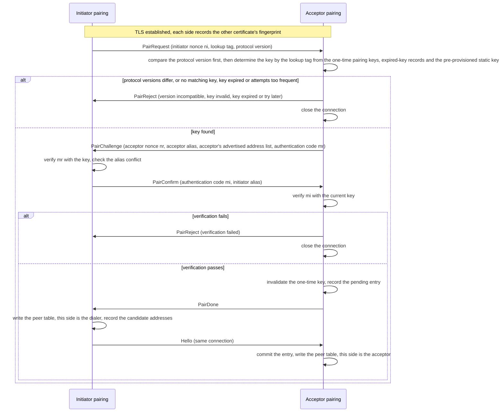

# pairing

`pairing` confirms another [Broker](../../glossary.md)'s identity and decides whether to treat it as a peer. It holds this Broker's identity key and certificate, stores the peer table, creates and verifies pairing keys, runs the handshake that turns a stranger Broker into a peer, records this side's role in each peer pair, and manages each peer's alias and candidate addresses. After the handshake, every connection only checks the fingerprint and involves no key. It can be thought of as a fingerprint list to which only the user can add entries by hand.

## Core Concepts

The system has no certificate authority; every Broker's certificate is self-signed. TLS itself guarantees only that "the other end of the connection holds the private key of this certificate", not that this end is the Broker the user wants to connect to. The pairing handshake adds that step ([ADR-pairing-key-trust](../../adr/adr-pairing-key-trust.md)): both sides compute a message authentication code over "their own fingerprint plus the other side's fingerprint they saw in this TLS connection" with the pairing key, and show it to each other. If a man in the middle splits the connection into two segments and shows its own certificate to each, the other side's fingerprint the two sides see differs from the one each used in its authentication code, and the codes do not match; the man in the middle does not know the key and cannot recompute them.

After the handshake succeeds, trust moves to the fingerprint, and whether the key is later invalidated does not affect the existing peer.

A fingerprint is identity, an alias is only a display name, and an agent address uses the alias. If the same alias could point to two Brokers, the address would point to the wrong party. This package therefore maintains an effective alias for each peer and guarantees that the local alias and every peer's effective alias are all different: when the other side's self-reported alias conflicts with an existing one, it is told apart with a local alias.

Pairing also decides which side connects the pair from now on. Below, the side that initiates pairing by address and pairing key in the pairing handshake is called the initiator, and the side that holds the key and accepts pairing is called the acceptor; after pairing completes, the initiator is the dialer and the acceptor is still the acceptor ([ADR-initiator-redials](../../adr/adr-initiator-redials.md)). This package records the role in the peer table and keeps candidate addresses only for peers on which this side is the dialer, that is the addresses tried in turn when dialing, for [link](design-link.md) to dial; the acceptor tells the initiator its own advertised address list in the handshake reply, and the initiator does not report its own address.

## Responsibilities

- On the first startup, generate the identity key and self-signed certificate and save them, and load the same pair on every later startup so the fingerprint stays the same (`REQ-broker-pairing-001`).
- Generate a one-time pairing key and additionally attach the local address for display in the result; invalidate the key when it expires, has been used successfully once or has reached the verification-failure cap, and a key expired by time is still recognizable by its lookup tag for 24 hours after expiry, so that the reply can say the key has expired (`REQ-broker-pairing-005` to `REQ-broker-pairing-007`, `REQ-broker-pairing-028`).
- When a pre-provisioned static key is configured, accept pairing done with it; neither generates nor stores the pre-provisioned static key ([ADR-static-pairing-key](../../adr/adr-static-pairing-key.md), `REQ-broker-pairing-008`, `REQ-broker-pairing-009`, `REQ-broker-pairing-025`).
- Run the pairing handshake as initiator or acceptor, and on success write the other side into the peer table and record this side's role: the initiator is the dialer and the acceptor is the acceptor; when the same pair of Brokers pairs again, the roles are redetermined by the new initiator ([ADR-initiator-redials](../../adr/adr-initiator-redials.md), `REQ-broker-pairing-010` to `REQ-broker-pairing-012`, `REQ-broker-pairing-027`).
- Persist the peer table, so that a connection after pairing authenticates by fingerprint alone and the pairing relation survives a Broker restart (`REQ-broker-pairing-016`, `REQ-broker-pairing-017`).
- For peers on which this side is the dialer, store candidate addresses with their source and the last connected address, updating them by the address given when pairing was initiated, the advertised address list the acceptor told and the list in that peer's card ([ADR-advertised-address](../../adr/adr-advertised-address.md)).
- Maintain aliases: on alias conflict when initiating pairing, require the caller to provide a local alias; on conflict when accepting pairing, and on conflict when the other side's self-reported alias changes later, generate a local alias itself (`REQ-broker-pairing-004`, `REQ-broker-pairing-024`, `REQ-broker-pairing-026`).
- Limit the rate of pairing attempts so that pairing keys cannot be tried out one by one.
- On unpairing, delete the entry from the peer table and close the link through the injected interface (`REQ-broker-pairing-021`).
- Provide `link` with the TLS configuration, the queries "is this fingerprint a peer" and "what role is this side", and candidate addresses, and provide [directory](design-directory.md) with signing and verification.

### Non-Responsibilities

- Does not establish or maintain links; `link` owns those. The connection the handshake uses is established by `link` and handed over.
- Does not decide whether to initiate pairing. Every pairing is triggered by an explicit call (`REQ-broker-pairing-014`), coming from [broker](design-broker.md).
- Does not consult the directory. Comparing the handshake's fingerprint with the fingerprint a card carries is done by `broker`.
- Does not pass pairing keys and addresses. They are handed to the other side by the user outside the system.
- Does not decide whether the caller may create a pairing key, initiate pairing or unpair; `broker` decides by the caller's account's write permission on the configuration file before calling this package ([ADR-management-by-config-file-permission](../../adr/adr-management-by-config-file-permission.md), `REQ-broker-config-021`).
- Does not decide how the local default alias is derived, does not compute the local advertised address list, and does not validate, read or write the pre-provisioned static key's configuration key; [config](design-config.md) owns those, and this package only uses the pre-provisioned static key's value at handshake time.

## External Interface Contract

Called by `broker`, `link` and `directory`; the signatures are stable. The methods below are all on the main type `*Pairing`; `Verify` and `FingerprintOf` are stateless package-level functions, and `Fingerprint` is a type name, not conflicting with the method `(*Pairing).Fingerprint()` despite the same name.

```go
// Open is called after config.Load, one instance per data directory.
func Open(t Transport) (*Pairing, error)

func (p *Pairing) Fingerprint() Fingerprint
func (p *Pairing) TLSConfig() *tls.Config            // presents the local certificate; in the handshake stage accepts any peer certificate, the fingerprint checked after the handshake
func (p *Pairing) IsPeer(fp Fingerprint) bool
func (p *Pairing) Role(fp Fingerprint) Role          // this side's role in the peer pair: Dialer or Acceptor
func (p *Pairing) Peers() []Peer
func (p *Pairing) EffectiveAlias(fp Fingerprint) string
func (p *Pairing) ResolveAlias(alias string) (Fingerprint, bool) // resolves only committed peers
// SetOwnAlias is called by broker during assembly and on each broker.alias change, caching the local alias.
func (p *Pairing) SetOwnAlias(alias string)
// AliasConflict reports whether alias is already taken by a peer or an in-progress handshake; takes only this package's lock.
func (p *Pairing) AliasConflict(alias string) bool

// CreateOneTimeKey is the only interface that creates a pairing key; shown is the local address for display, empty when there is no showable address.
func (p *Pairing) CreateOneTimeKey() (key string, expires time.Time, shown []string, err error)
// Connect initiates pairing by the other side's address and pairing key; shownHost is the hostname in address, for display only.
func (p *Pairing) Connect(ctx context.Context, address, key, localAlias string) (peer Peer, shownHost string, err error)
func (p *Pairing) Accept(conn PairConn) error        // called by link when the first frame is PairRequest
func (p *Pairing) Unpair(fp Fingerprint) error

func (p *Pairing) ObserveAlias(fp Fingerprint, alias string)                  // called by link on receiving Hello or PeerInfo
func (p *Pairing) ObserveAcceptorAddresses(fp Fingerprint, addresses []config.AdvertisedAddr) // called by link when this side is the dialer and the acceptor's Hello or PeerInfo is received
func (p *Pairing) ObserveConnected(fp Fingerprint, address string)                            // called by link after the dial connects and the link is established
func (p *Pairing) UpdateCardAddresses(fp Fingerprint, addresses []config.AdvertisedAddr)      // called by broker when a peer's card is accepted
func (p *Pairing) Candidates(fp Fingerprint) (addresses []string, last string)                // for link to dial; only direct addresses; empty when this side is the acceptor

func (p *Pairing) PublicKey() []byte              // a copy of the local 32-byte raw Ed25519 public key; nil when there is no identity
func (p *Pairing) Sign(data []byte) []byte
func Verify(pub, data, sig []byte) bool
func FingerprintOf(pub []byte) Fingerprint

// Transport is injected by broker during assembly, implemented in the link package.
type Transport interface {
    PairDial(ctx context.Context, address string, run func(PairConn) error) error
    Drop(fp Fingerprint)
}
```

`PairConn` is a TLS connection `link` hands to the handshake; `pairing` only sends and receives raw frames through it and does not parse link frames:

```go
type PairConn interface {
    PeerFingerprint() Fingerprint
    PeerPublicKey() []byte
    RemoteAddr() string
    // ProtocolVersion is the link protocol version this connection uses; pairing writes it into the request and compares it at the acceptor.
    ProtocolVersion() uint32
    Send(ctx context.Context, kind uint32, payload []byte) error
    Receive(ctx context.Context) (kind uint32, payload []byte, err error)
    Unread(kind uint32, payload []byte)
    Close() error
}
```

When `link` implements `PairConn` and `Transport` it must satisfy the following contract:

- `ProtocolVersion` returns the link protocol version that `Link` actually uses, including a test-injected override. Pairing happens before the link's `Hello`, there is no separate pairing version constant, and pairing frames are covered by the link version.
- Acceptor path: after `link` recognizes the first frame as `PairRequest` (kind 100) it hands the connection to `Accept`. The adapter must make `Accept`'s first `Receive` return this frame, either by pre-seeding the first frame when constructing the adapter or by buffering and replaying it.
- `Send` and `Receive` listen to the given context's `Done()` and return `ctx.Err()` when it is cancelled or expires. A pairing's 10-second deadline relies on this to break a blocked read or write.
- `RemoteAddr` returns the peer's `host:port`. `pairing` uses it to derive the source prefix for rate limiting and audit merging: a /32 for IPv4, the /64 for IPv6, an IPv4-mapped IPv6 address handled as IPv4 with the zone removed; an address from which no IP can be parsed goes into one unknown source, and sets no merge key.
- `PairDial` wraps the error with `ErrDialFailed` when dialing itself fails, and returns `run`'s error as-is. `Connect` maps only an error wrapping `ErrDialFailed` to `ErrPeerUnreachable`, returning the rest as-is or handling them as a `PairingError`.
- After `run` returns nil the connection belongs to `PairDial`: it sends the initiator's link `Hello` on the same connection and then turns the connection into a link. `Connect` does not send `Hello` itself.
- After sending `PairDone`, `Accept` reads the next frame, requires kind 1 (the link's `Hello`), then puts the same frame back with `Unread` before committing the peer, so `link` can read it again. Another kind is treated as a protocol error.
- `Close` is callable repeatedly. When `run` returns an error, `PairDial` closes the connection, and `Connect` also closes it on the error path.

A one-time pairing key is an 80-bit random number the system generates, encoded as 16 characters, grouped in fours separated by `-`, with the alphabet Crockford Base32's `0123456789ABCDEFGHJKMNPQRSTVWXYZ` ([REF-crockford-base32](../../references.md)), for example `K7QF-2M9X-HT4C-PWZ3`. A pre-provisioned static key is the value of the configuration key `pairing.static_key`, 16 to 128 characters. Both keys are used as-is in the handshake, case-sensitively; the pre-provisioned static key does not follow the one-time pairing key's grouping format and alphabet.

`CreateOneTimeKey`'s `shown` is the display spelling of each item of the local advertised address list, the first item first, in the form `buildbox(192.168.1.10:17443)` or `buildbox([2001:db8::1]:17443)`: outside the parentheses is the system hostname `config` gives, inside is the spelling of this item's `Addr`, that is `host:port` for a direct item. The display is not part of the key and is not bound to it (`REQ-broker-pairing-028`).

`Connect`'s `address` has two spellings: `address:port`, or the `hostname(address:port)` shown by the acceptor when creating a key. In the latter, only the part inside the parentheses is used for dialing; the hostname part, once read, is returned to the caller as `shownHost` for display only, and is not used for dialing, does not take part in identity, and is not recorded as a candidate address. The address is an IP address or domain name, an IPv6 address in brackets, and the port cannot be omitted.

An alias consists of letters, digits, `.`, `-`, `_`, length 1 to 24, and a local alias likewise (`REQ-broker-pairing-037`). The local self-reported alias comes from `config`: it takes the configured `broker.alias`, otherwise the default alias derived from the hostname and account, in the form `buildbox` for the system form and `buildbox.alice` for the user form (`REQ-broker-pairing-002`).

## Dependencies

`pairing` references `config` to read the alias, the system hostname, this side's advertised address list, the pre-provisioned static key, the data directory's location and the various limits, and to hand it pairing and alias events to write into the audit log. It does not reference `link`: dialing for the handshake and closing the link for unpairing are injected by `broker` through the `Transport` interface; `link` references this package, the direction matching the module dependency graph.

## UML Diagrams

The diagram below is one pairing handshake. `PairRequest` carries the initiator's nonce, the lookup tag and the protocol version the initiator uses; the lookup tag is computed from the pairing key, this nonce and the initiator's fingerprint, and the acceptor uses it to find which key the initiator used, the formula being in Core Data Structures. The initiator writes the peer table after receiving `PairDone`; the acceptor, after verification passes, first records the other side as a pending entry, writing the peer table only when it receives the initiator's first `Hello` on the same connection. Only the acceptor's reply carries the advertised address list, and the initiator does not report its own address. The initiator carries its own alias in `PairConfirm` only after verifying `mr`.

The acceptor compares the protocol version first and replies `PairReject` when they differ; it also replies `PairReject` and closes the connection when no matching key is found, the key has expired, the attempt count exceeds the limit, or verifying `mi` fails. When the handshake exceeds the deadline it only closes the connection without sending a frame. The initiator gets `pairing_rejected` on receiving `PairReject` or on the connection being closed before `PairDone`, the explanation beginning with `Not connected`; the initiator's own local handshake timeout is likewise mapped to `pairing_rejected`.



## Core Data Structures

The pairing handshake frames:

| Frame | kind | Class | Content |
|---|---|---|---|
| `PairRequest` | 100 | state frame | Initiator nonce ni, lookup tag, protocol version |
| `PairChallenge` | 101 | state frame | Acceptor nonce nr, acceptor alias, acceptor's advertised address list, authentication code mr |
| `PairConfirm` | 102 | state frame | Authentication code mi, initiator alias |
| `PairDone` | 103 | state frame | No payload |
| `PairReject` | 104 | state frame | Rejection reason: key invalid, key expired, verification failed, try later or version incompatible |

The pairing handshake frames are all state frames, carrying no request id and producing no reply. The on-wire rejection reasons are only key invalid, key expired, verification failed, try later and version incompatible; a handshake timeout is not an on-wire reason, judged by the initiator locally.

| Structure | Content | Storage |
|---|---|---|
| Identity | Ed25519 private key and self-signed certificate, the certificate carrying no hostname | `identity.key`, `identity.crt` in the data directory |
| Peer table | Each peer's fingerprint, public key, self-reported alias, local alias, effective aliases the other side has abandoned in the current peer relation (at most 8), this side's role, pairing time; for a peer on which this side is the dialer, also the candidate addresses with their source and the last connected address | `peers.json` in the data directory |
| One-time pairing key table | Key, creation time, verification-failure count | Memory only |
| Expired-key records | Time-expired one-time pairing keys and their retention deadline (the expiry instant plus 24 hours); used only to compute the lookup tag, not for verification, at most 64, dropping the earliest deadline first when exceeded | Memory only |
| Pairing attempt counter | The number of requests in the current minute that matched neither a one-time pairing key nor an expired-key record nor the pre-provisioned static key, counted separately by source with an additional total across all sources; the source is IPv4 /32 or IPv6 /64, an address from which no IP can be parsed going into one unknown source; the whole table is cleared when the minute changes | Memory only |
| Pending entry | The other side's information that the acceptor has verified and not yet received the initiator's `Hello` for | Memory only, lasting as long as the connection carrying the handshake |

The data directory's location is given by `config` by deployment form. Each Broker instance on one host has its own data directory and thus its own identity and peer table. A fingerprint is the SHA-256 of the certificate's public key information, shown as hex; neither the listen address nor the advertised address takes part in identity. A peer's effective alias is its local alias, or, without a local alias, its self-reported alias. When the other side's self-reported alias does not meet the alias rules, the peer table stores a normalized value, not the original: characters outside the alias character set are replaced by `-`, then the result is truncated to 24 characters and may be empty; whether the alias can be an effective alias is still judged by the original value. The pre-provisioned static key is not in the data directory, only in the configuration file.

Candidate addresses are stored separately by source, each source keeping only the most recently given list, each list at most 8 items: `acceptor` is the advertised address list the acceptor told in `PairChallenge`, `Hello` or `PeerInfo`, of type `[]config.AdvertisedAddr`; `card` is the list the peer's card carries, of the same type; `pairing` is the address dialed when pairing was initiated. A candidate address contains only address items this version recognizes and can dial: an item of an unrecognized kind in the `acceptor` and `card` sources, and an item whose `Addr` is not a legal `host:port`, are skipped when recording, not stored and not used for dialing, while the rest of the list is recorded as usual ([ADR-advertised-address](../../adr/adr-advertised-address.md)). `Addr`'s spelling follows the same rules as the address used for dialing when initiating pairing: the host is an IP address or domain name, an IPv6 address in brackets, the port a decimal number from 1 to 65535; the display spelling `hostname(address:port)` is not accepted. A domain name is split by `.` into labels, each 1 to 63 ASCII letters, digits, `-` or `_`, not starting or ending with `-`, the whole name at most 253 bytes; a fully qualified name may carry one trailing `.`, dropped during validation, and two trailing dots leave an empty label, rejected as invalid. `config` judges `broker.advertise` and `broker.advertise_extra` by the same rule, so a configuration that does not meet it is rejected when loading and does not wait to be dropped when recording into the peer table. `Candidates` returns the direct addresses (`host:port`), merged and deduplicated in the order `acceptor`, `card`, `pairing` and with unrecognized-kind items skipped, and the last connected address. A peer on which this side is the acceptor keeps no candidate addresses; when pairing again makes this side the acceptor, the existing candidate addresses are deleted with it.

Computing the authentication code and lookup tag, `‖` meaning concatenation:

```
lookup tag = the first 8 bytes of HMAC-SHA256(key, "peers pair hint" ‖ ni ‖ initiator fingerprint)
mr = HMAC-SHA256(key, "peers pair responder" ‖ ni ‖ nr ‖ acceptor fingerprint ‖ initiator fingerprint as seen by the acceptor)
mi = HMAC-SHA256(key, "peers pair initiator" ‖ ni ‖ nr ‖ initiator fingerprint ‖ acceptor fingerprint as seen by the initiator)
```

`ni`, `nr` and the nonce in the link `Hello` are each 32 bytes. The initiator fingerprint in the lookup tag is the initiator's own; the acceptor recomputes the tag with the initiator fingerprint it saw in this TLS connection, for one-time pairing keys, expired-key records and the pre-provisioned static key alike. A relay forwarding another's tag presents its own certificate, the recomputation does not match, no key matches, and it only counts as key invalid against its own source's attempt counter.

When each side verifies, it replaces the two fingerprints in the other's formula with the values from its own view: the other's fingerprint it sees, and its own fingerprint. When the connection is split midway into two segments presenting different certificates, the two views are inconsistent and verification fails. The two authentication codes have different labels, so one side's code cannot serve as the other's.

## Core Algorithms and Flows

### Worked Example

Broker A listens on every address under the default configuration, its system hostname is `hostA`, the default-route interface address is `192.0.2.10`, and its advertised address list is only `192.0.2.10:17443`; Broker B sits behind NAT and A cannot reach B. A's user creates a one-time pairing key and gives the shown address and key to B's user, and B's user initiates pairing with them.

| Step | Event | A's key table | A's peer table | B's peer table |
|---|---|---|---|---|
| 1 | A calls `CreateOneTimeKey`, gets key `K7QF-2M9X-HT4C-PWZ3` and shows `hostA(192.0.2.10:17443)` | `K7QF…`, 0 failures | empty | empty |
| 2 | B calls `Connect` with `address` `hostA(192.0.2.10:17443)`, takes the address inside the parentheses and establishes TLS through the injected `PairDial` | unchanged | empty | empty |
| 3 | B sends `PairRequest`; A finds `K7QF…` by the lookup tag, computes `mr` and replies `PairChallenge` with advertised address list `192.0.2.10:17443` | unchanged | empty | empty |
| 4 | B verifies `mr` and passes, the alias has no conflict, B sends `PairConfirm` | unchanged | empty | empty |
| 5 | A verifies `mi` and passes, deletes the key, records B as pending | empty | empty, B pending | empty |
| 6 | A replies `PairDone`, B writes A | empty | empty, B pending | A, this side is the dialer; candidate addresses `192.0.2.10:17443` from sources `acceptor` and `pairing`; the last connected is the same |
| 7 | B sends `Hello` on the same connection; A commits B on receiving it and the connection becomes a link | empty | B, this side is the acceptor | A |

`hostA` appears only as `shownHost` in B's pairing result for B's user to check, and does not enter B's peer table. A records none of B's addresses, and after the link goes down only B reconnects in; B does not report its own address in `Hello`. A again gives the advertised address list in the `Hello` at step 7, the same as in `PairChallenge`, so B's candidate addresses are unchanged.

Any failure at A before it receives B's `Hello` leaves A's peer table unchanged. When `PairDone` is lost, B has not written A, A discards the pending B when the connection closes, and neither side has the other; B's user sees the failure, A's key has been invalidated, and A's user creating a new key lets B initiate again. When `PairDone` arrives but B's `Hello` does not, B has A but A does not have B; when B's `Hello` arrives and A's commit fails the result is the same, B has A and A does not have B. Both cases make the two sides inconsistent: B's later dialing is rejected by A, and B's user pairing again recovers. On a commit failure A keeps no pending entry and the existing link is unchanged.

### Creating a Pairing Key

`CreateOneTimeKey` creates only a one-time pairing key, and this package creates no other key (`REQ-broker-pairing-025`). A Broker whose listen address is configured empty cannot be dialed by the other side, creates no key and returns `invalid_argument`, and [mcpserver](design-mcpserver.md) adds a hint after the error, requiring the user to obtain the key from the other host's user outside peers and then initiate pairing with `connect_broker`, not requesting a key from another agent (`REQ-broker-pairing-036`).

A one-time pairing key expires 10 minutes after creation, a duration not configurable; an expired key is moved out of the key table into the expired-key records and kept for 24 hours then deleted. A key invalidated by one successful use or by reaching the verification-failure cap is deleted directly with no record kept. Several unexpired keys can coexist at one time.

The display in the result comes from the advertised address list and system hostname `config` gives, see External Interface Contract. When the advertised address list is empty while the Broker is listening, that is neither an advertised address containing a host is configured nor a default route exists, the key is created as usual with `shown` empty, and [mcpserver](design-mcpserver.md) says there is no showable address and the user must tell the other side the connection address (`REQ-broker-pairing-028`).

### The Pre-Provisioned Static Key

The configuration key `pairing.static_key` takes effect once it has a value and is not enabled when empty ([ADR-static-pairing-key](../../adr/adr-static-pairing-key.md), `REQ-broker-pairing-008`, `REQ-broker-pairing-009`). Its value is read from `config`'s current value only after a request passes two frequency checks: a request that matches a one-time pairing key, hits an expired-key record or is rejected by frequency reads it not at all. This package keeps no separate copy; the next handshake after a configuration reload judges by the new value, with no restart; deleting or replacing it affects only later handshakes, the peer table is unchanged, and a peer already paired with it is still a peer (`REQ-broker-pairing-032`, `REQ-broker-pairing-033`). It can be used for any number of pairings and does not expire; verification failures are not counted, only limited by the pairing attempt rate. Verifying `mi` still rereads the current value. Its length validation, its not being modifiable through a tool and its value not returned on read are `config`'s responsibility (`REQ-broker-pairing-029` to `REQ-broker-pairing-031`).

### Initiator

1. Parse `address` to get the dialing address and, possibly, a hostname. When the spelling is invalid, or the caller-provided local alias does not meet the alias rules, return `invalid_argument`.
2. Establish a connection to that address through `PairDial`.
3. Send `PairRequest`; receive `PairChallenge`, verify `mr`.
4. Check the alias: when the other side's self-reported alias equals the local alias or a peer's effective alias, or does not meet the alias rules, and the caller provided no local alias, abort and return `needs_local_alias`; when one is provided, check that it does not duplicate an existing alias.
5. Send `PairConfirm`, and after receiving `PairDone` write the peer table: this side is the dialer; the candidate addresses from source `pairing` are this connection's address, and those from source `acceptor` are the advertised address list in `PairChallenge`; the last connected address is this connection's address. When the other side's fingerprint is already in the table it is overwritten, the role redetermined by this pairing; candidate addresses from source `card` keep the existing list, and the local alias keeps its old value when the caller provided none and is replaced when one is provided.

The initiator does not skip the handshake because the other side's fingerprint is already in the peer table.

### Acceptor

0. Compare the protocol version in `PairRequest` with the link protocol version this connection uses; when unequal, including an unfilled 0, reply `PairReject` (reason version incompatible) and close, not counting toward the pairing attempt counter, and write audit `version incompatible`, using the source prefix as the merge key like a rate-limit failure (see "The Audit Writer" below). The version comparison precedes looking up any key, so two sides of different versions do not misreport an incompatible version as an invalid key.
1. Compute the lookup tag for each unexpired one-time pairing key in the key table, and use it when one matches the request; such a request does not count toward the pairing attempt counter.
2. When no one-time pairing key matches, compute the lookup tag for the expired-key records, and on a match reply `PairReject` (reason key expired) and close; such a request neither counts toward the pairing attempt counter nor is limited by it.
3. When no expired-key record matches either, check the two-level pairing attempt counter: when this source this minute has reached `pairing.max_attempts_per_minute`, or all sources this minute combined have reached ten times it, reply `PairReject` (reason try later) and close, not counting; when neither level is full, compute the lookup tag for the configured pre-provisioned static key, and if it matches use it without counting, otherwise add one to this source's and the total's count and reply `PairReject` (reason key invalid), then close. The count happens before reading the pre-provisioned static key, and a successful match cancels this one count: when a source is exactly one short of the cap, a concurrent static-key request may be temporarily judged try later, recovering on the next request.
4. Compute `mr` and reply `PairChallenge` carrying this side's advertised address list from `config`; receive `PairConfirm` and verify `mi`. Verification rereads the current key: a one-time pairing key must still be in the key table, and the pre-provisioned static key must still be `config`'s current value. A one-time pairing key that has expired at verification time replies `PairReject` (reason key expired) and closes, not counting a failure. A verification failure replies `PairReject` (reason verification failed) and closes; if the match was a one-time pairing key, its failure count is incremented and it is invalidated after reaching `pairing.max_failures`.
5. Verification passes: the one-time pairing key is invalidated immediately; the alias is taken from the initiator's self-reported alias in `PairConfirm`, and a local alias is prepared for it when there is a conflict or it does not meet the alias rules; the other side is recorded as a pending entry and `PairDone` is replied.
6. On receiving the initiator's first `Hello` on the same connection, commit: write the peer table, this side being the acceptor, recording no address; when the other side's fingerprint is already in the table it is overwritten, the role redetermined by this pairing, every candidate address and the last connected address deleted, and the same peer's existing link closed. When the connection closes before that or the handshake exceeds the deadline, the pending entry is discarded and the peer table and the existing link are unchanged.

One pairing handshake, from sending or receiving `PairRequest` until the acceptor commits, is bounded at 10 seconds overall. The acceptor past the deadline only closes the connection without sending a frame; the initiator's timeout is judged locally and mapped to `pairing_rejected`.

The lookup tag is computed from the key, this handshake's nonce and the initiator's fingerprint. A party guessing keys against the acceptor gets no authentication code on a wrong guess and can only stop at "no matching key"; this kind of guessing against the pre-provisioned static key is limited by the per-minute attempt count, while a one-time pairing key has 80 bits of randomness and needs no such limit. The lookup tag is sent by the initiator before verifying the other side: if the initiator connects to a party that is not the intended acceptor, for example because the address is wrong or the domain is hijacked, that party can take the lookup tag to brute-force the pre-provisioned static key offline, not limited by the attempt count ([ADR-static-pairing-key](../../adr/adr-static-pairing-key.md)); a one-time pairing key's randomness makes such brute force infeasible. The tag is bound to the initiator's fingerprint, so a party forwarding another's tag gets a recomputation that does not match, receives no `PairChallenge`, and does not consume another's one-time pairing key.

### Unpairing

`Unpair` first deletes that fingerprint's entry from the peer table under the lock and persists it, then rechecks under the lock whether that fingerprint has been superseded by a new pairing commit (`entrySuperseded`): when superseded, it keeps the new entry and its link and skips closing; when not superseded, after the recheck releases the lock it calls `Transport.Drop` to close that fingerprint's link. The recheck and the close are separate, so closing the link does not run under the peer table's lock.

After the recheck judges "not superseded" and before `Drop` is sent, if a re-pairing of the same fingerprint happens to commit successfully, this new link is closed by this `Drop`. The new entry is already written to the peer table, the pairing relation unaffected; the dialer reconnecting restores the link. This package neither takes the lock again before `Drop` for this nor extends the critical section.

This window is the cost accepted for `Unpair` releasing the lock before closing the link: it covers only one check and one call between the recheck returning and `Drop` being sent. Putting `Drop` under the peer table's lock would call the injected `link` while holding the lock, violating the constraint that `pairing` calls no external component while holding its lock, and conflicting with the design purpose of `Unpair` releasing the lock before closing the link.

### Alias Maintenance

The local alias generation rule is "the other side's self-reported alias, `-`, the first 4 hex digits of the fingerprint", adding more fingerprint digits while still duplicated. Characters in the other side's self-reported alias outside the alias character set are replaced by `-`, and when the result exceeds 24 characters this part is truncated from the end, so the whole local alias does not exceed 24 characters.

`ObserveAlias` is called every time the other side's current self-reported alias is learned: the `Hello` at link establishment, and `PeerInfo` during the link's life. When the new self-reported alias equals the local alias or another peer's effective alias, or does not meet the alias rules, and that peer has no local alias, a local alias is generated for it and audit `local_alias_assigned` is written. A peer with a local alias is unaffected by a change of self-reported alias. During one peer relation, an alias resolves to at most one Broker, so an agent address already handed to the model does not point to another Broker because that peer changed its alias; after unpairing, its local alias can be assigned to another peer.

An effective alias a peer has abandoned in the current peer relation is recorded as its tombstone. When the effective alias changes, the old effective alias becomes that peer's tombstone: `ObserveAlias` adopting the new self-reported alias, generating a local alias for it, or pairing again changing the local alias all count as this change; when the peer changes back to an alias in its tombstones, that alias is moved out of the tombstones and takes effect again. Another peer's tombstone counts as an effective alias when judging whether an alias is taken: `aliasAvailableLocked`, `reserveAliasLocked`, `ensureReservationLocked` and `putLocked`'s conflict checks and the set `takenAliasesLocked` a local alias generation avoids all count it as taken. So when another peer self-reports a tombstone alias it is treated as a conflict: on a link report a local alias is generated for it and audit `local_alias_assigned` written, when initiating pairing `needs_local_alias` is returned, and when accepting pairing a local alias is generated. A tombstone resolves to no peer itself, and sending a message to it still fails as an unknown Broker.

Each peer keeps at most 8 tombstones. When the tombstones are full and the effective alias would change again, the change instead sets the current effective alias as that peer's local alias, after which a change of self-reported alias no longer affects it and no new tombstone is added, and this assignment writes audit `local_alias_assigned` with the alias in the event being the actually committed effective alias. Freezing takes precedence over the local alias this pairing would otherwise use: a local alias the initiator provided or one the acceptor generated both give way to the frozen current effective alias, and `Peer.LocalAlias` returns the one actually committed. Freezing changes only the local peer table, `PairDone` carries no payload, and the frozen alias is not reported back to the initiator; the two sides still exchange only their self-reported aliases in the later link `Hello` and `PeerInfo`. Tombstones are kept with the entry in `peers.json`'s `retired_aliases`, the field omitted when empty; loading validates that each tombstone meets the alias rules, that each peer has no more than 8, and that none duplicates any peer's effective alias or another peer's tombstone, returning `ErrStore` otherwise. Deleting the entry on unpairing deletes the tombstones too; overwriting the entry on re-pairing keeps the existing tombstones.

When the local alias changes through configuration, if the new alias equals a committed peer's effective alias, equals a peer's tombstone, or equals an alias reserved by an in-progress handshake, the change is refused with `invalid_argument`. The check is registered by `broker`, which calls `AliasConflict`, taking only this package's lock and reading no configuration.

`ResolveAlias` resolves only committed peers: an alias reserved by a handshake is not an agent address before commit, and resolution returns false; after commit it returns that peer's fingerprint.

### The Audit Writer

Audit events are divided by trigger source into writers. The management call's `pairing_key_created`, the initiator's `pairing_succeeded`, the initiator's `pairing_failed` and `unpaired` are written by `broker` after the call returns, with the caller's `agent_id`; the events triggered by a peer and a link, that is the acceptor's `pairing_succeeded`, the acceptor's `pairing_failed` and `local_alias_assigned`, are written by `pairing`, with `Actor` and `Account` empty. A rate-limit failure and a protocol-version incompatibility, two kinds of `pairing_failed` that a stranger source can trigger repeatedly and that are not counted toward the attempt count, use the source prefix as the merge key, written `source:<prefix>`: the source is the host of `PairConn.RemoteAddr()`, a /32 for IPv4, the /64 for IPv6, an IPv4-mapped IPv6 address handled as IPv4 with the zone removed, and no merge key when no IP can be parsed. Beyond the merge key the audit log also groups by failure reason, events of the same source and same reason merging into one, with the two classes of failure of one source each recorded separately and keeping their own reason. A failure audit by the acceptor before the initiator's `mi` verification passes records only the fingerprint, not the other side's alias; verification failure, and an interrupted connection or a timeout while waiting for `PairConfirm`, all belong to this class.

## Error and Failure Semantics

| Situation | What the initiator gets | The acceptor's handling |
|---|---|---|
| No key matches the lookup tag: wrong key, used key, a key invalidated by verification failure, an expired record squeezed out by the 64 cap, or expired more than 24 hours ago | `pairing_rejected`: key invalid | Reply `PairReject` (reason: key invalid), close the connection; increment the attempt counter, write audit |
| The lookup tag matches a one-time pairing key expired less than 24 hours ago, or the key has expired at verification time | `pairing_rejected`: key expired, the explanation beginning with `key expired` | Reply `PairReject` (reason: key expired), close the connection; not counted toward the attempt counter, write audit |
| The acceptor fails to verify `mi` | `pairing_rejected`: verification failed | Reply `PairReject` (reason: verification failed), close the connection; if the match was a one-time pairing key, increment its failure count; write audit |
| The initiator fails to verify `mr` | `pairing_rejected`: verification failed | None, the initiator closes the connection |
| Attempts too frequent | `pairing_rejected`: try later | Reply `PairReject` (reason: try later), close the connection; write audit, with repeated records of the same source merged by `config` |
| The initiator's protocol version differs from this side's or is unfilled | `pairing_rejected`: version incompatible, the explanation `link protocol version incompatible with the other Broker; upgrade the older Broker` | Reply `PairReject` (reason: version incompatible), close the connection; not counted toward the attempt counter, write audit `version incompatible` with the source prefix as the merge key, repeated records of the same source merged by `config` |
| `address` spelling invalid, or the provided local alias does not meet the alias rules | `invalid_argument` | None |
| The address cannot connect | `peer_unreachable` | None |
| Alias conflict and no local alias provided | `needs_local_alias` | None, the handshake not completed |
| The other side is already a peer | Success, the entry overwritten, the role redetermined by this pairing | After receiving the initiator's `Hello`, overwrite the existing entry, the role redetermined by this pairing |
| The handshake exceeds the deadline: the initiator's own 10-second deadline elapses with no `PairReject` received | `pairing_rejected`: handshake timed out | Only close the connection without sending a frame; discard the pending entry |
| The connection closes before `PairDone` with no `PairReject` received, and the initiator's own 10-second deadline has not elapsed | `pairing_rejected`: not connected | None |

The initiator judges failure in the following order: having received a `PairReject`, it maps the frame's reason to `pairing_rejected`; having received none, on the connection closing before `PairDone` it decides the explanation by its own 10-second deadline, using "handshake timed out" when elapsed and "not connected" when not.

Raising the protocol version from 1 to 2 is the first meaning-changing raise and has one unavoidable asymmetry. When an old initiator connects to a new acceptor, the new acceptor replies "version incompatible", but the old initiator does not recognize reason 5 and reports a protocol error, so the user sees `protocol error: unknown PairReject reason 5`; conversely, when a new initiator connects to an old acceptor, the old acceptor does not recognize `PairRequest`'s field 4 and looks up the key in the old way, so it replies "key invalid" and the user sees `Not connected: pairing key is invalid`. After this, both sides do the comparison above for a version raise, reporting version incompatibility at the pairing stage and no longer having "pairing succeeds but the link cannot be established".

`Connect` is not idempotent for the same one-time pairing key: the key is invalidated after the first success. `Unpair` is idempotent. Except when the initiator has received `PairDone`, on pairing failure neither side saves the other's identity (`REQ-broker-pairing-011`). The initiator saves the acceptor right after receiving `PairDone`, while the acceptor saves the initiator in neither the case where `Hello` does not arrive nor the case where the later commit fails. The initiator's later redial is rejected by the acceptor as a non-peer and can only pair again.

`PairingError` is the only error type carrying a reason; the other errors are package-level sentinels, and a caller judges them all with `errors.Is` or `errors.As`:

| Error | Return situation |
|---|---|
| `*PairingError` (`errors.Is(err, ErrPairingRejected)`) | The other side rejects, or the handshake aborts before `PairDone`. `Reason` is key invalid, key expired, verification failed, try later, handshake timed out or not connected; `Error()` begins with `Not connected`. |
| `ErrPeerUnreachable` | `Connect`'s dial through `PairDial` failed and the error wraps `ErrDialFailed`. |
| `ErrDialFailed` | The dial-failure marker of a `Transport` implementation, wrapped by `link`; `pairing`'s methods do not return it directly. |
| `ErrProtocol` | A frame's kind, order, length or rejection reason does not meet the protocol, and the connection is then closed. |
| `ErrIdentity` | `Open` fails to load or generate the identity, including file permission, owner, PEM parsing and key-certificate mismatch. |
| `ErrStore` | `Open` fails to read `peers.json`, or writing the peer table's temporary file or renaming fails. |
| `ErrNoTransport` | `Open` receives a nil `Transport`. |
| `ErrNotOpen` | A method with an error return that needs the identity or transport is called before the instance has completed `Open`. |
| `ErrInvalidAddress`, `ErrInvalidAlias`, `ErrNeedsLocalAlias`, `ErrNotListening` | Invalid call parameters: the address spelling, the local alias, an alias conflict with no caller-provided local alias, or creating a key with an empty listen address. |

## Concurrency and Transaction Boundaries

Every modification of the peer table first writes a temporary file then atomically replaces `peers.json`, and then updates memory; candidate addresses and the last connected address are updated the same way. When the observed self-reported alias, candidate address list or last connected address equals the existing entry, the peer table's content is unchanged and `peers.json` is not written. A one-time pairing key's "verified and invalidated" is done under the key table's lock, so when two simultaneous handshakes use the same key only one succeeds. Alias conflict checks and local alias writes are done under the peer table's lock.

The effective alias a handshake uses (the other side's self-reported or generated one) is reserved under the peer table's lock before `PairDone` is sent: the initiator reserves before sending `PairConfirm`, and the acceptor reserves before sending `PairDone`; each handshake holds its own reservation token, and concurrent handshakes of the same fingerprint each hold their own. A reservation exists only in memory and is not written to `peers.json`. On commit it rechecks under the same lock that this handshake still holds the effective alias's reservation and that the alias does not conflict with the cached local alias or another peer's effective alias; when the effective alias changed after the reservation because of `ObserveAlias`, the reservation moves to the new effective alias and the commit continues, returning `needs_local_alias` when the new effective alias is already taken. On a failed recheck it releases the reservation and writes no entry. On handshake failure, timeout, connection close, `PairDone` loss or persistence failure it releases only this handshake's reservation, other concurrent handshakes' reservations are unaffected, and a later handshake can reuse the alias.

While holding the peer table's lock `pairing` must call no function of `config`, including `config.Get`. The local alias is pushed by `broker` through `SetOwnAlias` during assembly and on each `broker.alias` change, the subscriber running outside `config`'s lock; `pairing` caches it under its own lock, and the commit recheck and `ResolveAlias` both read this cache. `broker.alias`'s validation function calls `AliasConflict` and `ResolveAlias` under `config`'s lock, and these two methods take only the peer table's lock. The lock order between the two packages is: take `config`'s lock first, then `pairing`'s; the reverse is forbidden.

Between validation passing and the subscriber pushing `SetOwnAlias` there is a narrow window: `config` has committed the new local alias while `pairing`'s cache is still the old value. A handshake committed within the window may take an effective alias equal to the new local alias. After the window closes the cache updates, and a later commit recheck rejects this alias. This window is the cost accepted for eliminating the lock-order inversion: `config`'s notification queue is asynchronous and delivered in commit order, and the window's length depends on the queue's backlog.

Between deleting or replacing the pre-provisioned static key and an in-progress handshake, the instant of verifying `mi` is authoritative: verification rereads the current key, and a key deleted or replaced earlier cannot complete the handshake (`REQ-broker-pairing-032`, `REQ-broker-pairing-033`). A one-time pairing key is the same: one expired at verification time cannot complete the handshake and replies key expired, and an invalidated one replies key invalid.

## Implementation Status

| Capability | Status | Code |
|---|---|---|
| Identity generation and loading | Implemented | `internal/pairing/identity.go` (`loadIdentity`, `generateIdentity`) |
| Creating, showing and invalidating a one-time pairing key | Implemented | `internal/pairing/pairkey.go` (`CreateOneTimeKey`, `keyTable`, `expireLocked`, `expiredKey`) |
| Enabling, replacing and disabling the pre-provisioned static key | Implemented | `internal/pairing/pairkey.go` (`lookupAtRequest`, `verifyAtConfirm`) |
| Pairing handshake | Implemented | `internal/pairing/handshake.go` (`Connect`, `Accept`, `rejectReasonFromPB`) |
| Limiting pairing attempts | Implemented | `internal/pairing/pairkey.go` (`attemptCounter`, `lookupAtRequest`) |
| Persisting the peer table and roles | Implemented | `internal/pairing/peers.go`, `internal/pairing/store.go` (`peerTable`, `atomicWrite`) |
| Recording candidate addresses | Implemented | `internal/pairing/addresses.go` (`filterKnown`, `mergeCandidates`) |
| Alias resolution, conflict checking and local aliases | Implemented | `internal/pairing/alias.go`, `internal/pairing/peers.go` (`assignLocalAlias`, `peerTable.resolveAlias`, `SetOwnAlias`, `AliasConflict`, `applyAliasChange`, `retiresAlias`) |
| Unpairing | Implemented | `internal/pairing/peers.go` (`Unpair`) |
| Signing and verification | Implemented | `internal/pairing/queries.go`, `internal/pairing/api.go` (`PublicKey`, `Sign`, `Verify`, `FingerprintOf`) |
