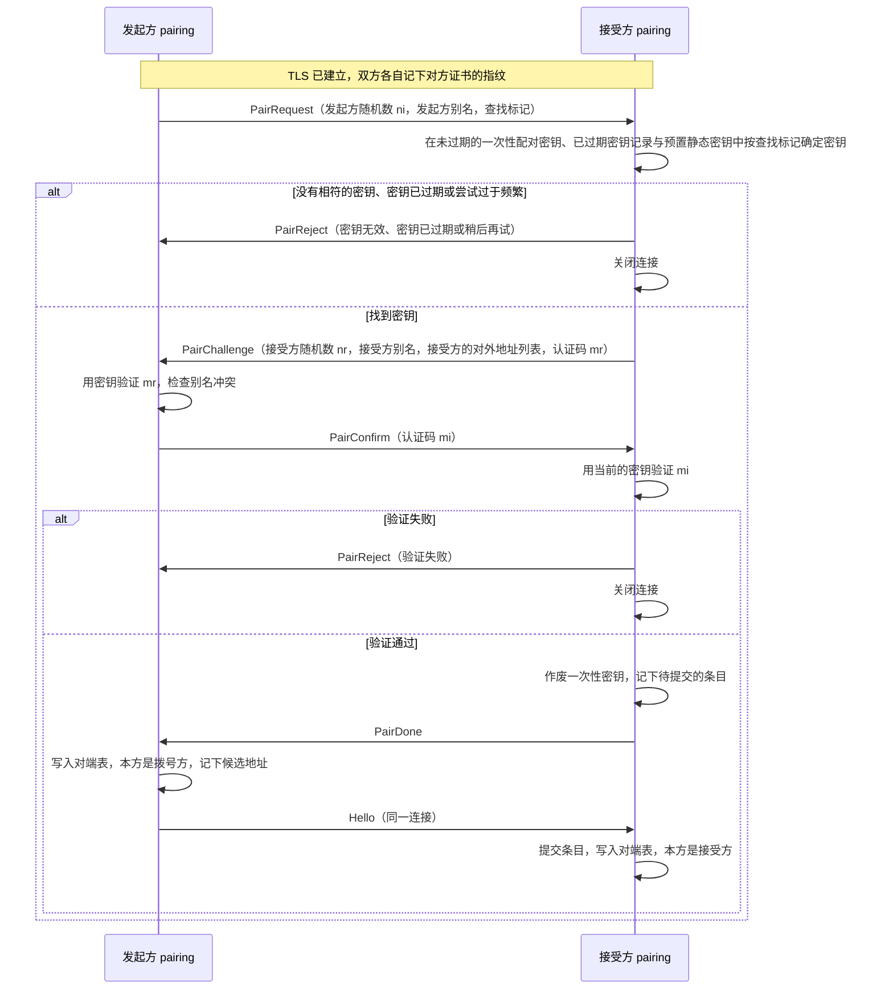

# pairing

`pairing` 负责确认另一个 [Broker](../../glossary.md) 的身份并决定是否把它当作对端。它持有本 Broker 的身份密钥与证书，保存对端表，生成和核验配对密钥，执行把一个陌生 Broker 变成对端的握手，记下本方在每对对端中的角色，并管理每个对端的别名与候选地址。握手之后的每次连接只核对指纹，不再涉及密钥。可以把它看作一份只能由用户亲手添加条目的指纹名单。

## 核心概念

系统里没有证书颁发机构，每个 Broker 的证书都是自签的。TLS 本身只能保证“连接的另一端持有这张证书的私钥”，不能说明那一端是不是用户想连的 Broker。配对握手补上这一步（[ADR-pairing-key-trust](../../adr/adr-pairing-key-trust.md)）：双方用配对密钥各自对“自己的指纹加上自己在本次 TLS 连接中看到的对方指纹”求消息认证码并互相出示。中间人若把连接拆成两段并分别出示自己的证书，双方看到的对方指纹就与本方在认证码中使用的对方指纹不同，认证码对不上；中间人不知道密钥，也无法重算。

握手成功后信任转移到指纹上，密钥此后是否作废都不影响已有的对端。

指纹是身份，别名只是显示名，而 Agent 地址用的是别名。同一个别名若能指向两个 Broker，地址就会指错对象。本包因此为每个对端维护一个生效别名，并保证本机别名与全部对端的生效别名互不相同：对方自报的别名与已有的冲突时，用本地别名把它区分开。

配对还决定这对对端今后由谁来连。下文把配对握手中凭地址和配对密钥发起配对的一方称为发起方，持有该密钥、接受配对的一方称为接受方；配对完成后，发起方是拨号方，接受方仍是接受方（[ADR-initiator-redials](../../adr/adr-initiator-redials.md)）。本包把角色记在对端表中，只为本方是拨号方的对端保存候选地址，即拨号时依次尝试的地址，供 [link](design-link.md) 拨号；接受方在握手应答中把自己的对外地址列表告诉发起方，发起方不报告自己的地址。

## 职责

- 首次启动时生成身份密钥与自签证书并保存，此后每次启动加载同一份，使指纹保持不变（`REQ-broker-pairing-001`）。
- 生成一次性配对密钥，并在结果中另附供展示的本机地址；在密钥过期、成功使用一次或验证失败次数达到上限时作废密钥，按时间过期的密钥在过期后 24 小时内仍能凭查找标记认出，以便回复密钥已过期（`REQ-broker-pairing-005` 至 `REQ-broker-pairing-007`、`REQ-broker-pairing-028`）。
- 配置了预置静态密钥时，接受凭它进行的配对；不生成、不保存预置静态密钥（[ADR-static-pairing-key](../../adr/adr-static-pairing-key.md)，`REQ-broker-pairing-008`、`REQ-broker-pairing-009`、`REQ-broker-pairing-025`）。
- 作为发起方或接受方执行配对握手，成功后把对方写入对端表并记下本方的角色：发起方是拨号方，接受方是接受方；同一对 Broker 重新配对时，角色按新的发起方重新确定（[ADR-initiator-redials](../../adr/adr-initiator-redials.md)，`REQ-broker-pairing-010` 至 `REQ-broker-pairing-012`、`REQ-broker-pairing-027`）。
- 持久保存对端表，使配对之后的连接只凭指纹认证，Broker 重启后配对关系仍在（`REQ-broker-pairing-016`、`REQ-broker-pairing-017`）。
- 为本方是拨号方的对端保存候选地址及其来源和上一次连通的地址，按发起配对时给出的地址、接受方告知的对外地址列表和该对端名片中的列表更新（[ADR-advertised-address](../../adr/adr-advertised-address.md)）。
- 维护别名：发起配对时别名冲突的要求调用方提供本地别名；接受配对时发生冲突的，以及对方自报的别名日后变更而发生冲突的，自行生成本地别名（`REQ-broker-pairing-004`、`REQ-broker-pairing-024`、`REQ-broker-pairing-026`）。
- 限制配对尝试的频率，使配对密钥不能被逐个试出。
- 解除配对时从对端表删除条目，并经注入的接口关闭链路（`REQ-broker-pairing-021`）。
- 为 `link` 提供 TLS 配置、“指纹是否为对端”与“本方是什么角色”的查询以及候选地址，为 [directory](design-directory.md) 提供签名与验签。

### 非职责

- 不建立和维护链路，由 `link` 负责。握手所用的连接由 `link` 建立后交来。
- 不决定是否发起配对。每次配对由一次明确的调用触发（`REQ-broker-pairing-014`），调用来自 [broker](design-broker.md)。
- 不查名录。握手得到的指纹与名片所载指纹的比对由 `broker` 完成。
- 不传递配对密钥与地址。它们由用户经系统之外的途径交给对方。
- 不判定调用方有没有权限生成配对密钥、发起配对或解除配对，由 `broker` 在调用本包之前按调用方账户对配置文件的写权限判定（[ADR-management-by-config-file-permission](../../adr/adr-management-by-config-file-permission.md)，`REQ-broker-config-021`）。
- 不决定本机默认别名的取法，不计算本机的对外地址列表，不校验、不读写预置静态密钥的配置项，由 [config](design-config.md) 负责；本包只在握手时取用预置静态密钥的取值。

## 外部接口契约

供 `broker`、`link`、`directory` 调用，签名稳定。下列方法都在主类型 `*Pairing` 上；`Verify` 与 `FingerprintOf` 是无状态的包级函数，`Fingerprint` 是类型名，与方法 `(*Pairing).Fingerprint()` 同名不冲突。

```go
// Open 在 config.Load 之后调用，每个数据目录一个实例。
func Open(t Transport) (*Pairing, error)

func (p *Pairing) Fingerprint() Fingerprint
func (p *Pairing) TLSConfig() *tls.Config            // 出示本机证书；握手阶段接受任意对方证书，指纹在握手后核对
func (p *Pairing) IsPeer(fp Fingerprint) bool
func (p *Pairing) Role(fp Fingerprint) Role          // 本方在这对对端中的角色：Dialer 或 Acceptor
func (p *Pairing) Peers() []Peer
func (p *Pairing) EffectiveAlias(fp Fingerprint) string
func (p *Pairing) ResolveAlias(alias string) (Fingerprint, bool) // 只解析已提交的对端
// SetOwnAlias 由 broker 在装配时以及 broker.alias 每次变更时调用，缓存本机别名。
func (p *Pairing) SetOwnAlias(alias string)
// AliasConflict 报告 alias 是否已被某个对端或进行中的握手占用；只取本包的锁。
func (p *Pairing) AliasConflict(alias string) bool

// CreateOneTimeKey 是唯一生成配对密钥的接口；shown 是供展示的本机地址，没有可展示的地址时为空。
func (p *Pairing) CreateOneTimeKey() (key string, expires time.Time, shown []string, err error)
// Connect 凭对方的地址与配对密钥发起配对；shownHost 是 address 中的主机名，只供展示。
func (p *Pairing) Connect(ctx context.Context, address, key, localAlias string) (peer Peer, shownHost string, err error)
func (p *Pairing) Accept(conn PairConn) error        // 由 link 在首帧为 PairRequest 时调用
func (p *Pairing) Unpair(fp Fingerprint) error

func (p *Pairing) ObserveAlias(fp Fingerprint, alias string)                  // 由 link 在收到 Hello 或 PeerInfo 时调用
func (p *Pairing) ObserveAcceptorAddresses(fp Fingerprint, addresses []config.AdvertisedAddr) // 由 link 在本方是拨号方、收到接受方的 Hello 或 PeerInfo 时调用
func (p *Pairing) ObserveConnected(fp Fingerprint, address string)                            // 由 link 在拨号连通、链路建立后调用
func (p *Pairing) UpdateCardAddresses(fp Fingerprint, addresses []config.AdvertisedAddr)      // 由 broker 在接受对端的名片时调用
func (p *Pairing) Candidates(fp Fingerprint) (addresses []string, last string)                // 供 link 拨号；只含直连地址；本方是接受方时为空

func (p *Pairing) PublicKey() []byte              // 本机 32 字节裸 Ed25519 公钥的副本；没有身份时为 nil
func (p *Pairing) Sign(data []byte) []byte
func Verify(pub, data, sig []byte) bool
func FingerprintOf(pub []byte) Fingerprint

// Transport 由 broker 在装配时注入，其实现在 link 包。
type Transport interface {
    PairDial(ctx context.Context, address string, run func(PairConn) error) error
    Drop(fp Fingerprint)
}
```

`PairConn` 是 `link` 交给握手的一条 TLS 连接，`pairing` 只经它收发原始帧，不解析链路帧：

```go
type PairConn interface {
    PeerFingerprint() Fingerprint
    PeerPublicKey() []byte
    RemoteAddr() string
    Send(ctx context.Context, kind uint32, payload []byte) error
    Receive(ctx context.Context) (kind uint32, payload []byte, err error)
    Unread(kind uint32, payload []byte)
    Close() error
}
```

`link` 实现 `PairConn` 与 `Transport` 时必须满足下列契约：

- 接受方路径：`link` 识别出首帧为 `PairRequest`（kind 100）后把连接交给 `Accept`。适配层必须让 `Accept` 的第一次 `Receive` 返回这一帧，做法可以是在构造适配器时预置首帧，或缓冲后重放。
- `Send` 与 `Receive` 监听传入 context 的 `Done()`，在它取消或到期时返回 `ctx.Err()`。一次配对的 10 秒期限依靠这一点打断阻塞的读写。
- `RemoteAddr` 返回对端的 `host:port`。`pairing` 只取主机部分作为限流失败的审计合并键，解析不出主机时用整串。
- `PairDial` 在拨号本身失败时用 `ErrDialFailed` 包装错误，`run` 返回的错误原样返回。`Connect` 只把包装了 `ErrDialFailed` 的错误映射为 `ErrPeerUnreachable`，其余错误按原值返回或按 `PairingError` 处理。
- `run` 返回 nil 后连接归 `PairDial` 所有：它在同一连接上发送发起方的链路 `Hello`，再把连接转为链路。`Connect` 自己不发送 `Hello`。
- `Accept` 在发出 `PairDone` 后读取下一帧，要求 kind 为 1（链路的 `Hello`），再用 `Unread` 放回同一帧后提交对端，`link` 随后能再次读到它。其他 kind 按协议错误处理。
- `Close` 可以重复调用。`run` 返回错误时由 `PairDial` 关闭连接，`Connect` 在出错路径上也会关闭。

一次性配对密钥是系统生成的 80 位随机数，编码为 16 个字符，每 4 个一组以 `-` 分隔，字母表取 Crockford Base32 的 `0123456789ABCDEFGHJKMNPQRSTVWXYZ`（[REF-crockford-base32](../../references.md)），例如 `K7QF-2M9X-HT4C-PWZ3`。预置静态密钥是配置项 `pairing.static_key` 的取值，长度 16 至 128 个字符。两种密钥在握手中都按原样使用，区分大小写；预置静态密钥不套用一次性配对密钥的分组格式与字母表。

`CreateOneTimeKey` 的 `shown` 是本机对外地址列表中每一项的展示写法，首项在前，形如 `buildbox(192.168.1.10:17443)` 或 `buildbox([2001:db8::1]:17443)`：括号外是 `config` 给出的系统主机名，括号里是这一项 `Addr` 的写法，直连项即 `主机:端口`。展示不是密钥的一部分，也不与密钥绑定（`REQ-broker-pairing-028`）。

`Connect` 的 `address` 有两种写法：`地址:端口`，或接受方生成密钥时展示的 `主机名(地址:端口)`。后一种写法只取括号里的部分用于拨号；主机名部分被读取后只作为 `shownHost` 交回调用方展示，不用于拨号，不参与身份的判定，也不记入候选地址。地址是 IP 地址或域名，IPv6 地址带方括号，端口不可省略。

别名由字母、数字、`.`、`-`、`_` 组成，长度 1 至 24，本地别名同样如此（`REQ-broker-pairing-037`）。本机自报的别名取自 `config`：配置了 `broker.alias` 时取它，否则是按主机名与账户得出的默认别名，系统级形如 `buildbox`，用户级形如 `buildbox.alice`（`REQ-broker-pairing-002`）。

## 依赖

`pairing` 引用 `config`，用来读取别名、系统主机名、本方的对外地址列表、预置静态密钥、数据目录的位置和各项限制，并把配对与别名事件交给它写入审计日志。它不引用 `link`：发起握手所需的拨号和解除配对所需的关闭链路，经 `Transport` 接口由 `broker` 注入；`link` 引用本包，方向与模块依赖图一致。

## UML 图

下图是一次配对握手。`PairRequest` 中的查找标记是由配对密钥与本次随机数算出的短值，接受方据此找出发起方用的是哪个密钥，算式见核心数据结构。发起方在收到 `PairDone` 后写入对端表；接受方验证通过后先把对方记为待提交的条目，在同一连接上收到发起方的首个 `Hello` 时才写入对端表。只有接受方的应答带对外地址列表，发起方不报告自己的地址。

接受方在找不到相符的密钥、密钥已过期、尝试次数超过限制或验证 `mi` 失败时回 `PairReject` 并关闭连接。握手超过期限时只关闭连接，不发帧。发起方收到 `PairReject`，或在 `PairDone` 之前连接被关闭，都得到 `pairing_rejected`，说明以 `Not connected` 开头；发起方本地的握手超时同样映射为 `pairing_rejected`。



## 核心数据结构

配对握手的帧：

| 帧 | kind | 类别 | 内容 |
|---|---|---|---|
| `PairRequest` | 100 | 状态帧 | 发起方随机数 ni、发起方别名、查找标记 |
| `PairChallenge` | 101 | 状态帧 | 接受方随机数 nr、接受方别名、接受方的对外地址列表、认证码 mr |
| `PairConfirm` | 102 | 状态帧 | 认证码 mi |
| `PairDone` | 103 | 状态帧 | 无载荷 |
| `PairReject` | 104 | 状态帧 | 拒绝原因：密钥无效、密钥已过期、验证失败或稍后再试 |

配对握手的帧都是状态帧，不带请求号，也不产生应答。线上的拒绝原因只有密钥无效、密钥已过期、验证失败与稍后再试；握手超时不是线上原因，由发起方在本地判定。

| 结构 | 内容 | 存放 |
|---|---|---|
| 身份 | Ed25519 私钥与自签证书，证书不含主机名 | 数据目录内的 `identity.key`、`identity.crt` |
| 对端表 | 每个对端的指纹、公钥、对方自报的别名、本地别名、对方在本次对端关系中放弃过的生效别名（至多 8 个）、本方的角色、配对时间；本方是拨号方的，另有候选地址及其来源和上一次连通的地址 | 数据目录内的 `peers.json` |
| 一次性配对密钥表 | 密钥、生成时间、验证失败次数 | 仅内存 |
| 已过期密钥的记录 | 按时间过期的一次性配对密钥及其保留截止时间（过期时刻加 24 小时）；只用于计算查找标记，不用于验证，至多 64 条，超出时先丢弃截止时间最早的 | 仅内存 |
| 配对尝试计数 | 当前这一分钟内既没有匹配上一次性配对密钥、已过期密钥记录，也没有匹配上预置静态密钥的请求数 | 仅内存 |
| 待提交的条目 | 接受方已验证、尚未收到发起方 `Hello` 的对方信息 | 仅内存，随握手所在的连接存续 |

数据目录的位置由 `config` 按部署形态给出。同一主机上的每个 Broker 实例各有自己的数据目录，因而各有自己的身份与对端表。指纹是证书公钥信息的 SHA-256，显示时取十六进制；监听地址与对外地址都不参与身份的判定。对端的生效别名是它的本地别名，没有本地别名时是它自报的别名。对方自报的别名不符合别名规则时，对端表保存规整值，不保存原值：把不属于别名字符集的字符换成 `-`，再截短到 24 个字符，结果可以为空；该别名能否作为生效别名仍按原值判定。预置静态密钥不在数据目录中，只在配置文件里。

候选地址按来源分别保存，每个来源只保留最近一次给出的列表，每个列表至多 8 项：`acceptor` 是接受方在 `PairChallenge`、`Hello` 或 `PeerInfo` 中告知的对外地址列表，类型是 `[]config.AdvertisedAddr`；`card` 是该对端名片所载的列表，类型相同；`pairing` 是发起配对时拨通的地址。候选地址只含本版本认识且可拨号的地址项：`acceptor` 与 `card` 两个来源的列表中种类不认识的项，以及 `Addr` 不是合法 `主机:端口` 的项，都在记入时跳过，不保存，也不用于拨号，列表中其余的项照常记入（[ADR-advertised-address](../../adr/adr-advertised-address.md)）。`Addr` 的写法与发起配对时用于拨号的地址遵循同一规则：主机是 IP 地址或域名，IPv6 地址带方括号，端口是 1 到 65535 的十进制数；`主机名(地址:端口)` 的展示写法不接受。域名以 `.` 分隔成标签，每个标签是 1 至 63 个 ASCII 字母、数字、`-` 或 `_`，不以 `-` 开头或结尾，整个域名至多 253 字节；完全限定名可以带一个末尾的 `.`，校验时去掉这个点，末尾带两个点则剩下一个空标签，按不合法拒绝。`config` 校验 `broker.advertise` 与 `broker.advertise_extra` 时按同一规则判断，因此不符合这条规则的配置在加载时就被拒绝，不会留到记入对端表时才被丢掉。`Candidates` 返回按 `acceptor`、`card`、`pairing` 的顺序合并去重并跳过种类不认识的项后的直连地址（`主机:端口`），以及上一次连通的地址。本方是接受方的对端不保存候选地址；重新配对使本方成为接受方时，原有的候选地址随之删除。

认证码与查找标记的计算，`‖` 表示拼接：

```
标记 = HMAC-SHA256(密钥, "peers pair hint" ‖ ni) 的前 8 个字节
mr   = HMAC-SHA256(密钥, "peers pair responder" ‖ ni ‖ nr ‖ 接受方指纹 ‖ 接受方看到的发起方指纹)
mi   = HMAC-SHA256(密钥, "peers pair initiator" ‖ ni ‖ nr ‖ 发起方指纹 ‖ 发起方看到的接受方指纹)
```

`ni`、`nr` 与链路 `Hello` 中的随机数各是 32 字节。

每一方验证时，把对方算式里的两个指纹换成自己视角下的值：自己看到的对方指纹，以及自己的指纹。连接在中途被拆成出示不同证书的两段时，两个视角不一致，验证失败。两个认证码的标签不同，一方的认证码不能充当另一方的。

## 核心算法与流程

### 走查

Broker A 按默认配置监听全部地址，系统主机名是 `hostA`，默认路由所在接口的地址是 `192.0.2.10`，对外地址列表只有 `192.0.2.10:17443`；Broker B 位于 NAT 之后，A 连不到 B。A 的用户生成一次性配对密钥，把展示的地址和密钥交给 B 的用户，B 的用户凭它们发起配对。

| 步骤 | 事件 | A 的密钥表 | A 的对端表 | B 的对端表 |
|---|---|---|---|---|
| 1 | A 调用 `CreateOneTimeKey`，得到密钥 `K7QF-2M9X-HT4C-PWZ3`，展示 `hostA(192.0.2.10:17443)` | `K7QF…`，失败 0 次 | 空 | 空 |
| 2 | B 调用 `Connect`，`address` 为 `hostA(192.0.2.10:17443)`，取括号里的地址经注入的 `PairDial` 建立 TLS | 不变 | 空 | 空 |
| 3 | B 发 `PairRequest`；A 按查找标记找到 `K7QF…`，计算 `mr`，回 `PairChallenge`，带对外地址列表 `192.0.2.10:17443` | 不变 | 空 | 空 |
| 4 | B 验证 `mr` 通过，别名无冲突，发 `PairConfirm` | 不变 | 空 | 空 |
| 5 | A 验证 `mi` 通过，删除密钥，把 B 记为待提交 | 空 | 空，B 待提交 | 空 |
| 6 | A 回 `PairDone`，B 写入 A | 空 | 空，B 待提交 | A，本方是拨号方；候选地址 `192.0.2.10:17443`，来源 `acceptor` 与 `pairing`；上一次连通的也是它 |
| 7 | B 在同一连接上发 `Hello`；A 收到后提交 B，连接转为链路 | 空 | B，本方是接受方 | A |

`hostA` 只作为 `shownHost` 出现在 B 的配对结果中，供 B 的用户核对，不进入 B 的对端表。A 没有记下 B 的任何地址，链路断开后只由 B 重新连入；B 在 `Hello` 中不报告自己的地址。A 在第 7 步的 `Hello` 中再次给出对外地址列表，与 `PairChallenge` 中的相同，B 的候选地址不变。

A 收到 B 的 `Hello` 之前的任何一处失败，A 的对端表都保持不变。`PairDone` 丢失时，B 没有写入 A，A 在连接关闭时丢弃待提交的 B，两边都没有对方；B 的用户看到失败，A 的密钥已作废，A 的用户重新生成密钥后 B 再次发起即可。`PairDone` 到达而 B 的 `Hello` 没有到达时，B 已有 A 而 A 没有 B；B 的 `Hello` 到达后 A 提交失败时结果相同，B 已有 A 而 A 没有 B。两种情形都会造成双方状态不一致：B 此后的拨号遭 A 拒绝，B 的用户重新配对即可恢复。提交失败时 A 不保留待提交的条目，原有的链路也不变。

### 生成配对密钥

`CreateOneTimeKey` 只生成一次性配对密钥，本包不生成其他密钥（`REQ-broker-pairing-025`）。监听地址配置为空的 Broker 无法由对方拨到，不生成密钥，返回 `invalid_argument`，[mcpserver](design-mcpserver.md) 在错误后补上提示，要求用户经 peers 之外的途径向对方主机的用户取得密钥、再用 `connect_broker` 发起配对，不向其他 Agent 索取密钥（`REQ-broker-pairing-036`）。

一次性配对密钥在生成 10 分钟后过期，这个时长不可配置；过期的密钥移出密钥表，转入已过期密钥的记录，保留 24 小时后删除。成功使用一次或验证失败次数达到上限而作废的密钥直接删除，不留记录。同一时刻可以有多个未过期的密钥并存。

结果中的展示取自 `config` 给出的对外地址列表与系统主机名，见外部接口契约。对外地址列表为空而 Broker 在监听时，即没有配置含主机的对外地址、也没有默认路由，照常生成密钥，`shown` 为空，由 [mcpserver](design-mcpserver.md) 说明没有可展示的地址、需要用户自行告知对方连接地址（`REQ-broker-pairing-028`）。

### 预置静态密钥

配置项 `pairing.static_key` 有值即生效，没有值即不启用（[ADR-static-pairing-key](../../adr/adr-static-pairing-key.md)，`REQ-broker-pairing-008`、`REQ-broker-pairing-009`）。它的取值在每次握手查找密钥时从 `config` 读取当前值，本包不另存副本，配置重载后的下一次握手即按新值判定，不需要重启；删除或更换只影响之后的握手，对端表不变，已凭它配对的对端仍是对端（`REQ-broker-pairing-032`、`REQ-broker-pairing-033`）。它可以用于任意多次配对，不过期；验证失败不计次数，只受配对尝试频率的限制。它的长度校验、不经工具修改与读取时不返回取值由 `config` 负责（`REQ-broker-pairing-029` 至 `REQ-broker-pairing-031`）。

### 发起方

1. 解析 `address`，得到拨号用的地址，以及可能有的主机名。写法不合法，或调用方提供的本地别名不符合别名的规则时，返回 `invalid_argument`。
2. 经 `PairDial` 向该地址建立连接。
3. 发 `PairRequest`；收 `PairChallenge`，验证 `mr`。
4. 检查别名：对方自报的别名与本机别名或某个对端的生效别名相同，或不符合别名的规则，而调用方没有提供本地别名的，中止并返回 `needs_local_alias`；提供了的，核对它不与已有的别名重复。
5. 发 `PairConfirm`，收到 `PairDone` 后写入对端表：本方是拨号方；候选地址中来源 `pairing` 的是本次拨通的地址，来源 `acceptor` 的是 `PairChallenge` 中的对外地址列表；上一次连通的地址是本次拨通的地址。对方指纹已在表中时覆盖，角色按本次重新确定；来源 `card` 的候选地址保留原有列表，本地别名在调用方没有提供时保留原值、提供时替换。

发起方不因对方的指纹已在对端表中而省略握手。

### 接受方

1. 对密钥表中每个未过期的一次性配对密钥计算查找标记，有与请求相符的即用它，这样的请求不计入配对尝试计数。
2. 没有相符的一次性配对密钥时，对已过期密钥的记录计算查找标记，相符的回 `PairReject`（原因为密钥已过期）并关闭，这样的请求不计入配对尝试计数，也不受它限制。
3. 也没有相符的已过期密钥记录时，检查配对尝试计数，超过 `pairing.max_attempts_per_minute` 时回 `PairReject`（原因为稍后再试）并关闭；未超过的，对已配置的预置静态密钥计算查找标记，相符即用它且不计入计数，不相符的计数加一并回 `PairReject`（原因为密钥无效），随后关闭。
4. 计算 `mr`，回 `PairChallenge`，其中带 `config` 给出的本方对外地址列表；收 `PairConfirm`，验证 `mi`。验证时重新取当前的密钥：一次性配对密钥必须仍在密钥表中，预置静态密钥必须仍是 `config` 给出的当前值。一次性配对密钥在验证时已过期的，回 `PairReject`（原因为密钥已过期）并关闭，不计失败次数。验证失败的，回 `PairReject`（原因为验证失败）并关闭；相符的是一次性配对密钥的，其失败次数加一，达到 `pairing.max_failures` 后作废。
5. 验证通过：一次性配对密钥立即作废；对方自报的别名有冲突或不符合别名的规则时为它准备本地别名；把对方记为待提交的条目，回 `PairDone`。
6. 在同一连接上收到发起方的首个 `Hello` 后提交：写入对端表，本方是接受方，不记任何地址；对方指纹已在表中时覆盖，角色按本次重新确定，全部候选地址与上一次连通的地址删除，同一对端原有的链路被关闭。连接在此之前关闭或握手超过期限的，丢弃待提交的条目，对端表与原有的链路都不变。

一次配对握手从发出或收到 `PairRequest` 起，到接受方提交为止，整体以 10 秒为限。接受方超过期限时只关闭连接，不发帧；发起方超时在本地判定，映射为 `pairing_rejected`。

查找标记由密钥与本次握手的随机数算出。向接受方猜测密钥的一方，猜错时得不到任何认证码，只能止步于“没有相符的密钥”；对预置静态密钥的这种猜测受每分钟尝试次数的限制，一次性配对密钥有 80 位随机性，不需要这一限制。查找标记是发起方在核实对方之前发出的：发起方连到的若不是预期的接受方，例如地址写错或域名被劫持，对方可以拿查找标记离线穷举预置静态密钥，不受尝试次数的限制（[ADR-static-pairing-key](../../adr/adr-static-pairing-key.md)）；一次性配对密钥的随机性使这种穷举不可行。

### 解除配对

`Unpair` 先在对端表的锁内删除该指纹的条目并持久化，随后在锁内复核该指纹是否已被一次新的配对提交取代（`entrySuperseded`）：已被取代的，保留新条目及其链路，跳过关闭；未被取代的，在复核释放锁后调用 `Transport.Drop` 关闭该指纹的链路。复核与关闭分开，使关闭链路不在对端表的锁内执行。

在复核判定为未被取代之后、`Drop` 发出之前，同一指纹的重新配对若恰好提交成功，这条新链路会被这次 `Drop` 关闭。新条目已经写入对端表，配对关系不受影响；拨号方重连后链路恢复。本包不为此在 `Drop` 前再取一次锁，也不延长临界区。

这个窗口是 `Unpair` 先释放锁再关闭链路所接受的代价：它只覆盖复核返回与 `Drop` 发出之间的一次检查与一次调用。把 `Drop` 放进对端表的锁内，会让注入的 `link` 在持锁时被调用，违反 `pairing` 持锁不调用外部组件的约束，也与 `Unpair` 先释放锁再关闭链路的设计目的冲突。

### 别名的维护

本地别名的生成规则是“对方自报的别名、`-`、指纹的前 4 位十六进制”，仍然重复时增加指纹的位数。对方自报的别名中不属于别名字符集的字符换成 `-`，结果超过 24 个字符时从末尾截短这一部分，使整个本地别名不超过 24 个字符。

`ObserveAlias` 在每次得知对方当前自报的别名时调用：链路建立时的 `Hello`，以及链路存续期间的 `PeerInfo`。新的自报别名与本机别名或其他对端的生效别名相同，或不符合别名的规则，而该对端没有本地别名时，为它生成本地别名并写审计 `local_alias_assigned`。已有本地别名的对端不受自报别名变化的影响。在同一条对端关系存续期间，一个别名至多解析到一个 Broker，已经交到模型手里的 Agent 地址不会因为该对端改了别名而指向另一个 Broker；解除配对之后，它的本地别名可以分配给别的对端。

对端在本次对端关系中放弃过的生效别名记录为它的墓碑。生效别名变化时，旧的生效别名成为该对端的墓碑：`ObserveAlias` 采用新的自报别名、为它生成本地别名，或重新配对更换本地别名，都属于这种变化；对端改回自己墓碑中的别名时，该别名移出墓碑，重新生效。其他对端的墓碑在判断别名是否被占用时视同生效别名：`aliasAvailableLocked`、`reserveAliasLocked`、`ensureReservationLocked`、`putLocked` 的冲突检查和生成本地别名时避开的集合 `takenAliasesLocked` 都把它算作已占用。因此另一对端自报某个墓碑别名时按冲突处理：链路上报时生成它的本地别名并写审计 `local_alias_assigned`，发起配对时返回 `needs_local_alias`，接受配对时生成本地别名。墓碑本身不解析到任何对端，向它发消息仍按未知 Broker 失败。

每个对端最多保留 8 个墓碑。墓碑已满时生效别名再要变化，改为把当前生效别名设为该对端的本地别名，此后自报别名的变化不再影响它，也不再新增墓碑，这次赋值写审计 `local_alias_assigned`，事件里的别名是实际提交的生效别名。冻结优先于本次配对原本要采用的本地别名：发起方提供的本地别名或接受方生成的本地别名都让位给冻结的当前生效别名，`Peer.LocalAlias` 返回实际提交的这一个。冻结只改变本机对端表，`PairDone` 不带载荷，冻结的别名不回报发起方；双方在之后的链路 `Hello` 与 `PeerInfo` 中照常只交换各自的自报别名。墓碑随条目保存在 `peers.json` 的 `retired_aliases` 中，为空时省略该字段；加载时校验每个墓碑符合别名规则、每个对端不超过 8 个、且不与任何对端的生效别名或其他对端的墓碑重复，不符合的返回 `ErrStore`。解除配对删除条目时墓碑一并删除；重新配对覆盖条目时保留原有墓碑。

本机别名经配置修改时，若新别名与某个已提交对端的生效别名相同，与某个对端的墓碑相同，或与一次进行中的握手预占的别名相同，修改以 `invalid_argument` 拒绝。校验由 `broker` 注册，它调用只取本包锁的 `AliasConflict`，不读配置。

`ResolveAlias` 只解析已提交的对端：握手预占的别名在提交之前不是 Agent 地址，解析返回 false；提交之后返回该对端的指纹。

### 审计的写入方

审计事件按触发来源划分写入方。管理调用触发的 `pairing_key_created`、发起方的 `pairing_succeeded`、发起方的 `pairing_failed` 与 `unpaired` 由 `broker` 在调用返回后带调用方的 `agent_id` 写入；对端与链路触发的事件，即接受方的 `pairing_succeeded`、接受方的 `pairing_failed` 与 `local_alias_assigned`，由 `pairing` 写，`Actor` 与 `Account` 留空。限流失败的 `pairing_failed` 以来源主机为合并键，写作 `source:<host>`：主机取自 `PairConn.RemoteAddr()` 的主机部分，解析失败时用整串，地址为空时不设合并键。

## 错误与失败语义

| 情形 | 发起方得到 | 接受方的处理 |
|---|---|---|
| 没有与查找标记相符的密钥：密钥错误、已使用、因验证失败作废、因 64 条上限被挤掉的过期记录，或过期已超过 24 小时 | `pairing_rejected`：密钥无效 | 回 `PairReject`（原因：密钥无效），关闭连接；尝试计数加一，写审计 |
| 查找标记与过期不满 24 小时的一次性配对密钥相符，或密钥在验证时已过期 | `pairing_rejected`：密钥已过期，说明以 `key expired` 开头 | 回 `PairReject`（原因：密钥已过期），关闭连接；不计入尝试计数，写审计 |
| 接受方验证 `mi` 失败 | `pairing_rejected`：验证失败 | 回 `PairReject`（原因：验证失败），关闭连接；相符的是一次性配对密钥的，其失败次数加一；写审计 |
| 发起方验证 `mr` 失败 | `pairing_rejected`：验证失败 | 无，连接由发起方关闭 |
| 尝试过于频繁 | `pairing_rejected`：稍后再试 | 回 `PairReject`（原因：稍后再试），关闭连接；写审计，同一来源的重复记录由 `config` 合并 |
| `address` 写法不合法，或提供的本地别名不符合别名的规则 | `invalid_argument` | 无 |
| 地址无法连接 | `peer_unreachable` | 无 |
| 别名冲突且未提供本地别名 | `needs_local_alias` | 无，握手未完成 |
| 对方已是对端 | 成功，条目被覆盖，角色按本次重新确定 | 收到发起方的 `Hello` 后覆盖已有条目，角色按本次重新确定 |
| 握手超过期限：发起方自己的 10 秒期限届满，且没有收到 `PairReject` | `pairing_rejected`：握手超时 | 只关闭连接，不发帧；丢弃待提交的条目 |
| `PairDone` 之前连接被关闭，没有收到 `PairReject`，且发起方自己的 10 秒期限未届满 | `pairing_rejected`：未连接 | 无 |

发起方按下列先后判定失败：收到过 `PairReject` 的，把帧上的原因映射为 `pairing_rejected`；没有收到的，`PairDone` 之前连接关闭时按自己的 10 秒期限决定说明，期限已届满的用“握手超时”，未届满的用“未连接”。

`Connect` 对同一个一次性配对密钥不是幂等的：密钥在首次成功后作废。`Unpair` 是幂等的。除发起方已收到 `PairDone` 的情形外，配对失败时双方都不保存对方的身份（`REQ-broker-pairing-011`）。发起方收到 `PairDone` 后即保存接受方，而接受方在 `Hello` 没有到达或随后提交失败时都不保存发起方。发起方此后的重拨会被接受方当作非对端拒绝，只能重新配对。

`PairingError` 是唯一带原因的错误类型，其余错误是包级哨兵，调用方一律用 `errors.Is` 或 `errors.As` 判定：

| 错误 | 返回情形 |
|---|---|
| `*PairingError`（`errors.Is(err, ErrPairingRejected)`） | 对方拒绝，或握手在 `PairDone` 之前中止。`Reason` 为密钥无效、密钥已过期、验证失败、稍后再试、握手超时或未连接；`Error()` 以 `Not connected` 开头。 |
| `ErrPeerUnreachable` | `Connect` 经 `PairDial` 拨号失败，且该错误包装了 `ErrDialFailed`。 |
| `ErrDialFailed` | `Transport` 实现的拨号失败标记，由 `link` 包装；`pairing` 的方法不直接返回它。 |
| `ErrProtocol` | 帧的 kind、顺序、长度或拒绝原因不符合协议，连接随后关闭。 |
| `ErrIdentity` | `Open` 加载或生成身份失败，包括文件权限、属主、PEM 解析与密钥证书不匹配。 |
| `ErrStore` | `Open` 读取 `peers.json` 失败，或对端表写入临时文件、改名失败。 |
| `ErrNoTransport` | `Open` 收到的 `Transport` 为 nil。 |
| `ErrNotOpen` | 有错误返回值的、需要身份或 transport 的方法在实例未完成 `Open` 时被调用。 |
| `ErrInvalidAddress`、`ErrInvalidAlias`、`ErrNeedsLocalAlias`、`ErrNotListening` | 调用参数不合法：地址写法、本地别名、别名冲突而调用方未提供本地别名、监听地址为空时生成密钥。 |

## 并发与事务边界

对端表的每次修改先写入临时文件再原子替换 `peers.json`，然后更新内存；候选地址与上一次连通的地址的更新同样如此。观察到的自报别名、候选地址列表或上一次连通的地址与已有条目相同时，对端表的内容不变，不写 `peers.json`。一次性配对密钥的“验证通过并作废”在密钥表的锁内完成，两个同时到达的握手使用同一个密钥时只有一个成功。别名的冲突检查与本地别名的写入在对端表的锁内完成。

握手使用的生效别名（对方自报的或生成的）在发出 `PairDone` 之前于对端表的锁内预占：发起方在发出 `PairConfirm` 前预占，接受方在发出 `PairDone` 前预占；每次握手持有自己的预占令牌，同一指纹的并发握手各自持有令牌。预占只存在于内存，不写入 `peers.json`。提交时在同一把锁内复核该握手仍持有生效别名的预占、别名不与缓存的本机别名或其他对端的生效别名冲突；生效别名在预占之后因 `ObserveAlias` 改变时，预占移到新的生效别名后继续提交，新的生效别名已被占用时返回 `needs_local_alias`。复核失败时释放预占，不写条目。握手失败、超时、连接关闭、`PairDone` 丢失或持久化失败时都只释放本次握手的预占，其他并发握手的预占不受影响，后续握手可以复用该别名。

`pairing` 持有对端表的锁时不得调用 `config` 的任何函数，包括 `config.Get`。本机别名由 `broker` 在装配时以及 `broker.alias` 每次变更时调用 `SetOwnAlias` 推入，订阅者在 `config` 的锁外执行；`pairing` 在自己的锁内缓存它，提交复核与 `ResolveAlias` 都读这份缓存。`broker.alias` 的校验函数在 `config` 的锁内调用 `AliasConflict` 与 `ResolveAlias`，这两个方法只取对端表的锁。两包之间的锁序是：先取 `config` 锁，再取 `pairing` 锁；反向禁止。

校验通过到订阅推入 `SetOwnAlias` 之间存在窄窗口：`config` 已提交新的本机别名，而 `pairing` 的缓存仍是旧值。窗口内提交的握手可能拿到与新本机别名相同的生效别名。窗口结束后缓存更新，之后的提交复核会拒绝这个别名。这个窗口是消除锁序反转所接受的代价：`config` 的通知队列异步、按提交顺序送达，窗口的长度取决于队列的排队情况。

预置静态密钥的删除或更换与进行中的握手之间，以验证 `mi` 的时刻为准：验证时重新取当前的密钥，此前已删除或已更换的密钥不能完成握手（`REQ-broker-pairing-032`、`REQ-broker-pairing-033`）。一次性配对密钥同理，验证时已过期的不能完成握手，回密钥已过期；已作废的回密钥无效。

## 实现状态

| 能力 | 状态 | 代码 |
|---|---|---|
| 身份生成与加载 | 已实现 | `internal/pairing/identity.go`（`loadIdentity`、`generateIdentity`） |
| 一次性配对密钥的生成、展示与作废 | 已实现 | `internal/pairing/pairkey.go`（`CreateOneTimeKey`、`keyTable`、`expireLocked`、`expiredKey`） |
| 预置静态密钥的启用、更换与禁用 | 已实现 | `internal/pairing/pairkey.go`（`lookupAtRequest`、`verifyAtConfirm`） |
| 配对握手 | 已实现 | `internal/pairing/handshake.go`（`Connect`、`Accept`、`rejectReasonFromPB`） |
| 配对尝试的限制 | 已实现 | `internal/pairing/pairkey.go`（`attemptCounter`、`lookupAtRequest`） |
| 对端表与角色的持久化 | 已实现 | `internal/pairing/peers.go`、`internal/pairing/store.go`（`peerTable`、`atomicWrite`） |
| 候选地址的记录 | 已实现 | `internal/pairing/addresses.go`（`filterKnown`、`mergeCandidates`） |
| 别名的解析、冲突检查与本地别名 | 已实现 | `internal/pairing/alias.go`、`internal/pairing/peers.go`（`assignLocalAlias`、`peerTable.resolveAlias`、`SetOwnAlias`、`AliasConflict`、`applyAliasChange`、`retiresAlias`） |
| 解除配对 | 已实现 | `internal/pairing/peers.go`（`Unpair`） |
| 签名与验签 | 已实现 | `internal/pairing/queries.go`、`internal/pairing/api.go`（`PublicKey`、`Sign`、`Verify`、`FingerprintOf`） |
