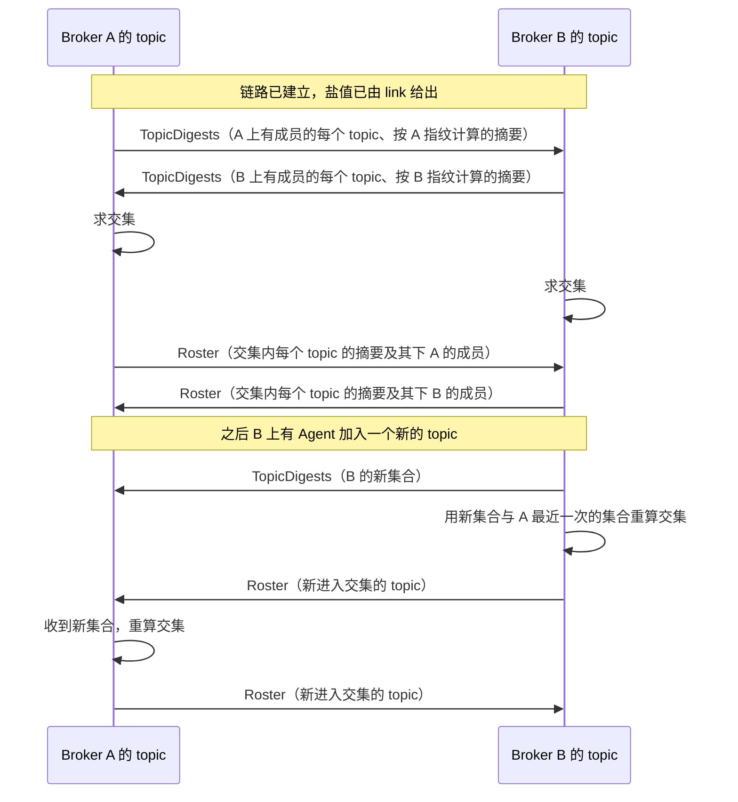

# topic

`topic` 记录哪个 Agent 在哪个 [topic](../../glossary.md) 里，并据此判定两个 Agent 是否可见。本机的成员关系来自 Agent 的加入与退出，对端的成员关系经链路交换得到，交换时只涉及双方都有成员的 topic。可以把它看作一张本机成员名单，加上每条链路各一张的对端成员名单。

## 核心概念

链路两端需要找出共同的 topic，又不能把自己独有的 topic 名字告诉对方。做法是各自对 topic 名、盐值和发送方指纹求摘要，只交换摘要（[ADR-salted-topic-digest](../../adr/adr-salted-topic-digest.md)）：同一个 topic 在两个方向上的摘要不同，本机发出时按本机指纹计算，比对收到的摘要时按对端指纹计算；摘要相同说明名字相同，摘要不同则对方无从得知名字，把收到的摘要集合原样回送也得不到交集。盐值由链路建立时双方各提供一半随机数拼成，每条链路、每次建立都不同；指纹是本机证书指纹，即对端在链路上看到的同一个值。

每一方发出的是按本机指纹计算的、本机当前有成员的 topic 的摘要集合；收到对端最近一次发来的集合后，用按对端指纹计算的本机同名 topic 摘要与之求交，得到共同的 topic。交集不由某一方算好后通知另一方，而是双方各算各的；任何一个集合变化，持有它的一方都重算，并把新进入交集的 topic 的成员名单发给对方。双方依据的是同样的一对集合，算出的交集最终相同。

## 职责

- 记录本机每个 Agent 所在的 topic，处理加入与退出，在 Agent 注销时清除其全部成员关系（`REQ-topics-001` 至 `REQ-topics-004`、`REQ-topics-022`）。
- 在每条链路上与对端交换加盐摘要，算出共同的 topic，只就这些 topic 发送本机的成员名单；两边对同一个名字按同一个发送方指纹与盐值算出的摘要相同，因而是同一个 topic（`REQ-topics-007`、`REQ-topics-009`、`REQ-topics-014`）。
- 保存每条链路对端发来的成员名单，在链路断开时整体丢弃。
- 判定两个 Agent 是否可见（[ADR-topic-scoped-visibility](../../adr/adr-topic-scoped-visibility.md)，`REQ-topics-005`、`REQ-topics-006`）。
- 在本机成员关系或 Agent 的名字、曾用名、消歧标识、状态变化时，向相关链路推送变化（`REQ-agent-messaging-031`、`REQ-agent-messaging-032`）。

### 非职责

- 不决定默认 topic，由 [mcpserver](design-mcpserver.md) 计算后经 `broker` 调用加入。
- 不发布也不传播公开 topic 的声明，由 [directory](design-directory.md) 负责；加入时的公开声明由 [broker](design-broker.md) 先转交 `directory`，成功后再调用本包加入。本包中的 topic 都按不公开对待（`REQ-topics-008`）。
- 不把成员名单发往产生它的链路之外，系统中没有这样的转发（[ADR-direct-links-only](../../adr/adr-direct-links-only.md)）。
- 不读取配置，不拼 Agent 地址。别名与地址由 `broker` 处理。

## 外部接口契约

供 `broker` 调用，签名稳定。除 `New` 与 `ValidateName` 外，下列函数是主类型 `*Registry` 的方法，由 `New(t Transport, opts Options)` 创建。`Transport` 是本包对 `link` 的依赖面，只含 `Send`、`HandleState`、`Subscribe`；broker 的 topic 装配器传入 link 实例，`New` 在 link 开始监听与拨号之前调用。`Options` 带日志记录器与 `Self`：日志记录器为 nil 时用 `slog.Default()`；`Self` 是本机证书指纹，即对端在链路上看到的同一个值，`New` 在它为零值时 panic。

```go
func New(t Transport, opts Options) *Registry
func ValidateName(name string) error

func (r *Registry) Join(agent AgentID, name string) error
func (r *Registry) Leave(agent AgentID, name string) error
func (r *Registry) LeaveAll(agent AgentID)
func (r *Registry) TopicsOf(agent AgentID) []string

// AgentChanged 在本机 Agent 的名字、曾用名、消歧标识或状态变化时由 broker 调用；
// 曾用名为空表示没有，或已过保留期。
func (r *Registry) AgentChanged(agent AgentID, name, prevName, ref, status string)

// Visible 判定本机 Agent 与另一个 Agent 是否可见，并返回共同的 topic。
// other 可以是本机 Agent，也可以是某条链路上的远端 Agent。
func (r *Registry) Visible(local AgentID, other AgentRef) (shared []string, ok bool)

// VisibleAgents 返回对 local 可见的全部 Agent 及各自的共同 topic。
func (r *Registry) VisibleAgents(local AgentID) []VisibleAgent

// RemoteMembers 返回 peer 发来的、处在当前交集内的成员条目，供解析地址与核对发送方。
func (r *Registry) RemoteMembers(peer Fingerprint) []Member
```

`AgentID` 是 broker 内部的 Agent 标识，是 `"session:" + socket 路径` 的 SHA-256 小写十六进制。`AgentRef` 指明一个 Agent：`Peer` 为零值时是本机 Agent，由 `ID` 指明；`Peer` 非零时是这条链路上的远端 Agent，`Ref` 是它在对端成员名单里的消歧标识，`ID` 忽略。

`Member` 是一个成员条目，字段是名字、消歧标识、状态和曾用名。`Status` 取 `idle`、`busy`、`waiting`、`shell` 之一，空串表示未知；`PrevName` 为空表示没有曾用名。

`VisibleAgent` 是一个可见的 Agent 及其共同 topic。`Agent` 指本机 Agent 时 `Peer` 为零值、`ID` 已填，指远端 Agent 时 `Peer` 与 `Ref` 已填；`Member` 是该 Agent 当前的条目；`Shared` 是共同 topic 的名字，升序。

`ValidateName` 校验 topic 名：合法返回 nil，否则返回 `ErrInvalidTopic`。`Join`、`Leave` 用它校验；broker 与公开 topic 的声明也用它。topic 名是长度不超过 256 字节的非空 UTF-8 字符串，不含控制字符，区分大小写。

`ErrInvalidTopic` 表示 topic 名不合法，`broker` 把它映射为 `invalid_argument`。`ErrUnknownAgent` 表示 `Join` 的 Agent 尚未经 `AgentChanged` 引入，或已由 `LeaveAll` 删除，这是 broker 的缺陷，映射为 `internal`。

`AgentChanged` 同时用于引入 Agent：broker 在 Agent 登记后、第一次 `Join` 之前调用一次。对没有引入过的 Agent，`Join` 返回 `ErrUnknownAgent`，`Leave` 返回成功，`LeaveAll` 无操作；`LeaveAll` 同时删除该 Agent 的信息。

`Visible` 判定本机 Agent 与另一个 Agent 是否可见。`other` 是本机 Agent 时按成员名单的字面条件判定，允许 `other.ID` 等于 `local`，是否允许发给自己由 broker 决定。`VisibleAgents` 不含调用者自己，本机 Agent 按标识升序在前，远端 Agent 按对端指纹、再按消歧标识升序在后；同一个远端 Agent 出现在多个共同 topic 时合并为一项，`Shared` 给出全部共同 topic。

## 依赖

`topic` 引用 `link`，用来收发自己的帧类型并订阅链路的建立与断开，不引用其他包，符合模块依赖图的方向。

## UML 图

下图是链路建立后的交换顺序。成员名单在摘要比对之后才发送，每一方只发送自己算出的交集内的 topic 的成员。图的后半段是一方的成员关系变化后的情形：变化的一方重发摘要并重算，另一方收到后也重算，双方各自补发新进入交集的 topic 的成员名单。



## 核心数据结构

| 结构 | 键 | 值 | 存续 |
|---|---|---|---|
| 本机成员名单 | topic 名 | 该 topic 下的本机 Agent 集合 | 随 Agent 存续 |
| 链路摘要表，每条链路一张 | 本机 topic 名 | 发出用摘要（按本机指纹计算）与比对用摘要（按对端指纹计算） | 随链路存续 |
| 对端摘要集合，每条链路一个 | — | 对端最近一次发来的全部摘要 | 随链路存续 |
| 对端成员名单，每条链路一张 | 比对用摘要，消歧标识 | 对端在该 topic 下的成员条目 | 随链路存续 |

成员条目的字段是名字、消歧标识、状态和曾用名，不含别名、工作目录或其他信息。曾用名由 Agent 所在的 Broker 在保留期满后清除，清除也作为一次变化推送，其他 Broker 因此能对以曾用名为目标的发送给出同样的提示。对端成员名单在比对用摘要下按消歧标识保存条目，依据是同一 Broker 上各 Agent 的消歧标识两两不同，对端的一个条目由消歧标识唯一确定。只有摘要处在当前交集内时才保存对端成员名单；判定可见性和回答查询时也只使用这些条目。

链路上的帧：

| 帧 | 类别 | 内容 | 语义 |
|---|---|---|---|
| `TopicDigests` | 状态帧 | 摘要的完整集合，按发送方指纹计算 | 发送方当前有成员的全部 topic，覆盖此前发送的集合 |
| `Roster` | 状态帧 | 发送方的发出用摘要，成员条目的完整列表 | 该 topic 下发送方的全部成员，覆盖此前的列表 |
| `RosterDelta` | 状态帧 | 发送方的发出用摘要，新增、移除与变更的成员条目 | 增量 |

`RosterDelta` 的组成规则是：成员加入放进新增，退出放进移除；名字或消歧标识变化，以移除旧键、新增新条目表示，因为消歧标识会随本机 Agent 增减而变长变短；只有状态或曾用名变化时放进变更；名字、消歧标识、状态、曾用名都不变时不发帧。接收方按移除、新增、变更的顺序应用：移除要求名字与消歧标识都相符才删除，不相符的忽略；新增与变更都按消歧标识写入，已有则覆盖，没有则新增；消歧标识为空的条目跳过。

链路建立时总是发送一帧 `TopicDigests`，本机没有任何 topic 时也发送，内容为空集合，对端据此得到确定的初始集合。

摘要的计算是 `SHA-256(盐值 ‖ 发送方指纹 ‖ topic 名)`，`‖` 表示拼接。发送方指纹是本机证书指纹，即对端在链路上看到的同一个值；盐值固定 64 字节，指纹固定 32 字节，拼接没有歧义。本机发出的每一帧用本机指纹计算，收到对端摘要时用对端指纹计算本机同名的 topic。

## 核心算法与流程

### 走查

Broker A 上 `api-worker` 在 topic `github.com/org/repo` 与 `secret-x`，Broker B 上 `frontend` 在 `github.com/org/repo`。链路建立。

| 步骤 | 事件 | A 持有的 B 成员名单 | B 持有的 A 成员名单 |
|---|---|---|---|
| 1 | A 发出自己的摘要集合，含 `github.com/org/repo` 与 `secret-x` 的摘要；B 发出的集合只含 `github.com/org/repo` 的摘要 | 空 | 空 |
| 2 | 双方求交集，都得到 `github.com/org/repo`；B 无法从另一个摘要得知 `secret-x`，把收到的摘要集合原样回送也不会产生交集，因为两个方向的摘要不同 | 空 | 空 |
| 3 | A 发 `Roster`：`api-worker`；B 发 `Roster`：`frontend` | `github.com/org/repo`：`frontend` | `github.com/org/repo`：`api-worker` |
| 4 | `api-worker` 调用列出 Agent，看到 B 上的 `frontend` | 不变 | 不变 |
| 5 | B 上新 Agent `db-worker` 加入 `secret-x`。B 重发摘要集合，并用它与 A 此前发来的集合重算，`secret-x` 进入交集，B 发 `Roster(secret-x)`：`db-worker` | 增加 `secret-x`：`db-worker` | 不变 |
| 6 | A 收到 B 的新集合，重算，`secret-x` 进入交集，A 发 `Roster(secret-x)`：`api-worker` | 不变 | 增加 `secret-x`：`api-worker` |
| 7 | 链路断开 | 清空 | 清空 |

`db-worker` 加入之前，B 的任何输出中都没有 `secret-x` 这个名字。`db-worker` 加入时 A 并没有新的变化，A 的成员名单之所以能到达 B，是因为 A 在收到对端的新集合时重算了交集。

### 交集的重算

下列任一事件发生时，本 Broker 对相关的链路重算交集：

- 本机某个 topic 从无成员变为有成员，或从有成员变为无成员。此时先向每条已建立的链路重发 `TopicDigests`。
- 收到对端的 `TopicDigests`。

重算后，对新进入交集的 topic 发送 `Roster`；离开交集的 topic 不再用于判定，其条目随即从对端成员名单中删除，重新进入交集后须等对端发来新的 `Roster` 才再次可见。交集内的 topic 下成员增减，或成员条目的任何字段变化时发送 `RosterDelta`。

一次事件产生的帧在同一次持锁内入队。对端按指纹字节升序处理；每个对端内依次是 `TopicDigests`、进入交集的各 topic 的 `Roster`、各 `RosterDelta`，`Roster` 与 `RosterDelta` 各自按摘要字节升序。`TopicDigests` 只在本机 topic 集合变化时发送，至多一帧。`RosterDelta` 只发给事件前后本机都有成员、且摘要在该链路交集内的 topic；topic 变空或由空变为非空，都只通过 `TopicDigests` 与 `Roster` 体现。

链路上的这些帧由 `link` 按到达顺序串行交给本包处理。本包在持有的锁内取快照并交给 `link` 的发送队列，因此在同一条链路上，后取的快照后发出，`Roster` 不会被更早取得的内容覆盖。

### 可见性判定

本机 Agent `x` 与另一个 Agent `y` 可见，当且仅当存在一个 topic，`x` 在本机成员名单的该 topic 下，且 `y` 也在该 topic 下：`y` 是本机 Agent 时查本机成员名单，`y` 是远端 Agent 时查其所在链路的对端成员名单中处在交集内的条目。判定的开销与 `x` 所在的 topic 数成正比。

## 错误与失败语义

加入一个已加入的 topic、退出一个未加入的 topic 都返回成功，结果是幂等的。topic 名不合法时返回 `ErrInvalidTopic`，由 broker 映射为 `invalid_argument`。

入站帧在下列情形下丢弃，并记录日志：

- 该对端没有链路状态，即未收到建立通知或已经断开。
- 帧的载荷无法解码。
- `TopicDigests` 中有任何一项不是 32 字节，此时整帧丢弃，保留此前的对端集合。其中重复的摘要按集合去重。
- `Roster` 或 `RosterDelta` 的摘要不是 32 字节，或不在对端最近一次的摘要集合中；摘要不在该集合中表示对端发来了本机未与其协商的摘要，可能来自回送本机摘要集合的尝试，也可能是对端实现有误。
- `Roster` 或 `RosterDelta` 的摘要在对端最近一次的摘要集合中，但不在当前交集内；此时不保存其中的名单。
- 成员条目不合规：消歧标识不是 6 至 12 位小写十六进制，或名字为空、含空白、`@`、`*` 或控制字符，或曾用名不为空却含空白、`@`、`*` 或控制字符。不合规的条目整条丢弃，其余条目照常应用；每帧记一条日志，带该帧丢弃的条数，日志不写成员名与曾用名。
- 单个 `TopicDigests` 帧的摘要超过 4096 项，或 `Roster`、`RosterDelta` 的任一成员列表超过 4096 条：整帧丢弃，不改变此前的状态。

`Send` 失败时不改状态、不重试，只记一条 debug 日志；链路随后会收到断开通知，重建后从 `TopicDigests` 全量重来。

本包的日志只记对端指纹、kind、原因、摘要的前 8 字节与计数，不记任何 topic 名、成员名字、曾用名或消歧标识（`REQ-topics-009`、`REQ-topics-014`）。

链路断开时该链路的摘要表、对端摘要集合与对端成员名单全部丢弃，远端 Agent 随之不可见；链路重建后盐值不同，从 `TopicDigests` 重新开始。

## 并发与事务边界

本包只有一把读写锁 `Registry.mu`，保护本机成员名单与全部链路状态表。

- `Join`、`Leave`、`LeaveAll`、`AgentChanged`、链路的建立与断开回调、`TopicDigests`、`Roster`、`RosterDelta` 的处理函数，在整个函数体内持写锁。
- `TopicsOf`、`Visible`、`VisibleAgents`、`RemoteMembers` 持读锁，返回新分配的副本，不暴露内部的 map 与切片。
- 一次事件产生的全部帧在同一次持写锁期间调用 `Transport.Send`，不先收集再解锁发送。
- 持锁时除 `Transport.Send` 与日志外不调用任何外部代码；本包不起协程，不用计时器，不用 channel。
- `New` 内注册帧处理函数与订阅链路事件时不持锁。
- 链路的断开通知与本包自身的操作并发时，谁先拿到锁谁先执行，两种顺序都正确：断开通知先执行，本包的操作看不到这条链路；本包的操作先执行，它发出的帧在 link 那里失败或随连接丢弃，重建后从 `TopicDigests` 全量重来。

本包依赖 link 的下列性质：`Send` 不阻塞，不等网络，也不同步回调本包；link 调用本包的回调与状态帧处理函数时不持有 `Send` 需要的锁；同一对端的建立通知、断开通知与该对端的状态帧串行处理，断开通知送达之后不再交付旧连接的帧。这些性质见 [design-link.md](design-link.md) 的并发与事务边界一节。

`TopicDigests` 与 `Roster` 的覆盖语义加上帧的有序处理，使任意时刻的并发变化最终收敛到双方的当前状态。

## 扩展点

对端成员名单的来源是一个扩展点，为与使用其他协议的 Agent 互通而预留。现有的来源只有一种：链路上以 `TopicDigests`、`Roster` 与 `RosterDelta` 交换的成员名单。可见性判定只依赖对端成员名单的内容，不依赖它的来源。

## 实现状态

| 能力 | 状态 | 代码 |
|---|---|---|
| 加入、退出与注销清理 | 已实现 | `internal/topic/local.go`（`localTable`）、`internal/topic/publish.go`（`Registry.Join`、`Registry.Leave`、`Registry.LeaveAll`） |
| 摘要交换与交集的重算 | 已实现 | `internal/topic/peer.go`（`peerState`、`recompute`）、`internal/topic/registry.go`（`Registry.onUp`、`Registry.handleDigests`） |
| 成员名单的全量与增量同步 | 已实现 | `internal/topic/wire.go`（`memberToWire`、`rosterMsg`、`deltaMsg`）、`internal/topic/registry.go`（`Registry.handleRoster`、`Registry.handleDelta`）、`internal/topic/publish.go`（`Registry.AgentChanged`） |
| 可见性判定 | 已实现 | `internal/topic/query.go`（`visible`、`visibleAgents`、`remoteMembers`） |
