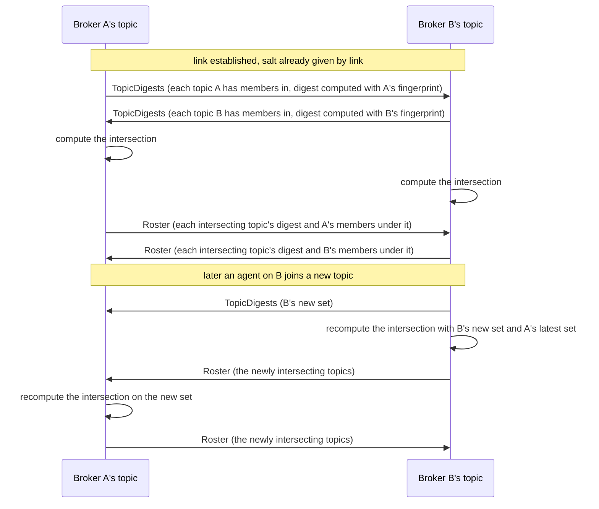

# topic

`topic` records which agent is in which [topic](../../glossary.md) and decides from that whether two agents are visible to each other. The local memberships come from an agent's joining and leaving, and a peer's memberships are obtained by exchanging over a link, the exchange covering only the topics both sides have members in. It can be thought of as one local roster plus, for each link, one peer roster.

## Core Concepts

The two ends of a link need to find the topics they share, yet must not tell each other the names of topics they alone have. The approach is for each to compute a digest over the topic name, the salt and the sender's fingerprint and exchange only digests ([ADR-salted-topic-digest](../../adr/adr-salted-topic-digest.md)): the same topic's digest differs in the two directions, computed with the local fingerprint when this side sends and with the peer's fingerprint when comparing a received digest; an equal digest means an equal name, while a different digest leaves the other side unable to learn the name, and sending the received digest set back verbatim yields no intersection. The salt is formed by each side contributing half a nonce when the link is established, different for each link and each establishment; the fingerprint is the local certificate's fingerprint, the very value the peer sees on the link.

What each side sends is the digest set of the topics it currently has members in, computed with the local fingerprint; after receiving the peer's latest set, it intersects that with the digests of its own same-named topics computed with the peer's fingerprint, giving the shared topics. The intersection is not computed by one side and then announced to the other, but computed by each side itself; whenever a set changes, the side holding it recomputes and sends the newly intersecting topics' rosters to the other side. Both sides rely on the same pair of sets, so the intersections they compute end up the same.

## Responsibilities

- Record each local agent's topics, handle joining and leaving, and clear all of an agent's memberships when it unregisters (`REQ-topics-001` to `REQ-topics-004`, `REQ-topics-022`).
- Exchange salted digests with the peer on each link, compute the shared topics, and send this side's rosters only for those topics; two sides computing the same digest for the same name by the same sender fingerprint and salt means the same topic (`REQ-topics-007`, `REQ-topics-009`, `REQ-topics-014`).
- Store the roster each link's peer sends, discarding it whole when the link goes down.
- Decide whether two agents are visible ([ADR-topic-scoped-visibility](../../adr/adr-topic-scoped-visibility.md), `REQ-topics-005`, `REQ-topics-006`).
- On a change of local membership or of an agent's name, previous name, disambiguator or status, push the change to the relevant links (`REQ-agent-messaging-031`, `REQ-agent-messaging-032`).

### Non-Responsibilities

- Does not decide the default topic; [mcpserver](design-mcpserver.md) computes it and joins through a `broker` call.
- Does not publish or propagate public topic declarations; [directory](design-directory.md) owns those. A public declaration at join time is handed by [broker](design-broker.md) to `directory` first, and only after success does it call this package to join. All topics in this package are treated as not public (`REQ-topics-008`).
- Does not send a roster beyond the link that produced it; the system has no such forwarding ([ADR-direct-links-only](../../adr/adr-direct-links-only.md)).
- Does not read the configuration and does not assemble agent addresses. Aliases and addresses are handled by `broker`.

## External Interface Contract

Called by `broker`; the signatures are stable. Except `New` and `ValidateName`, the functions below are methods of the main type `*Registry`, created by `New(t Transport, opts Options)`. `Transport` is this package's dependency surface on `link`, containing only `SendLatest`, `SendLatestKey`, `HandleState` and `Subscribe`; broker's topic assembler passes a link instance, and `New` is called before link begins listening and dialing. `Options` carries a logger and `Self`: the logger uses `slog.Default()` when nil; `Self` is the local certificate's fingerprint, the very value the peer sees on the link, and `New` panics when it is the zero value.

```go
// MaxMemberNameBytes is the longest byte count allowed for a member entry's name or
// previous name. It equals inbox.MaxNameBytes; topic cannot reference inbox, so a test in
// internal/broker guarantees the two are equal.
const MaxMemberNameBytes = 128

func New(t Transport, opts Options) *Registry
func ValidateName(name string) error

// Join adds agent to name. It returns ErrTopicLimit when the topics with local members
// have reached the cap, or the topic's local members have reached the cap.
func (r *Registry) Join(agent AgentID, name string) error
func (r *Registry) Leave(agent AgentID, name string) error
func (r *Registry) LeaveAll(agent AgentID)
func (r *Registry) TopicsOf(agent AgentID) []string

// AgentChanged is called by broker when a local agent's name, previous name,
// disambiguator, status, account name or "must carry the disambiguator" changes; an
// empty previous name means none, or the retention period has passed.
func (r *Registry) AgentChanged(agent AgentID, m Member)

// Visible decides whether a local agent and another agent are visible, and returns the
// shared topics. other may be a local agent or a remote agent on some link.
func (r *Registry) Visible(local AgentID, other AgentRef) (shared []string, ok bool)

// VisibleAgents returns every agent visible to local and their shared topics.
func (r *Registry) VisibleAgents(local AgentID) []VisibleAgent

// RemoteMembers returns the member entries peer sent that are in the current
// intersection, for resolving addresses and checking the sender.
func (r *Registry) RemoteMembers(peer Fingerprint) []Member

// Transport is this package's dependency surface on link; *link.Link satisfies it.
type Transport interface {
	SendLatest(peer link.Fingerprint, f link.Frame) error
	SendLatestKey(peer link.Fingerprint, key string, f link.Frame) (replaced bool, err error)
	HandleState(kind link.FrameKind, h func(peer link.Fingerprint, f link.Frame))
	Subscribe(onUp func(peer link.Fingerprint, salt []byte), onDown func(peer link.Fingerprint))
}
```

`AgentID` is broker's internal agent identifier, the lowercase hex SHA-256 of `"session:" + socket path`. `AgentRef` names an agent: when `Peer` is the zero value it is a local agent identified by `ID`; when `Peer` is non-zero it is a remote agent on this link, `Ref` being its disambiguator in the peer roster and `ID` ignored.

`Member` is a member entry whose fields are the name, the disambiguator, the status, the previous name, the publisher account name (`Account`, for display only) and `RefRequired` (the publisher requires that this member be addressed by its disambiguator, so name resolution must not select it). `Status` is one of `idle`, `busy`, `waiting`, `shell`, an empty string meaning unknown; an empty `PrevName` means no previous name.

`VisibleAgent` is a visible agent and its shared topics. When `Agent` names a local agent, `Peer` is the zero value and `ID` is filled; when it names a remote agent, `Peer` and `Ref` are filled; `Member` is the agent's current entry; `Shared` is the shared topics' names, ascending.

`ValidateName` validates a topic name: nil when legal, otherwise `ErrInvalidTopic`. `Join` and `Leave` use it; broker and public topic declarations use it too. A topic name is a non-empty UTF-8 string no longer than 256 bytes, containing no control characters, case-sensitive.

`ErrInvalidTopic` means the topic name is invalid, which `broker` maps to `invalid_argument`. `ErrUnknownAgent` means `Join`'s agent has not been introduced by `AgentChanged`, or has been deleted by `LeaveAll`, a broker defect mapped to `internal`.

`ErrTopicLimit` means `Join` would make the topics with local members exceed 512, or the topic's local members exceed 4096; an agent already in the topic joining again is still an idempotent success. The cap of 512 makes the local `TopicDigests` far smaller than the 4096 items a peer accepts, and the frames one membership change fans out to one link are bounded; the member cap uses the same constant as the receive side's `maxInboundMembers`. A system Broker subdivides the budget of these 512 topics by account, at most 128 per account, see [design-broker.md](design-broker.md). `broker` maps `ErrTopicLimit` to `quota_exceeded`.

`AgentChanged` also introduces an agent: broker calls it once after an agent registers and before its first `Join`. For an agent not introduced, `Join` returns `ErrUnknownAgent`, `Leave` returns success, and `LeaveAll` does nothing; `LeaveAll` also deletes that agent's information.

`Visible` decides whether a local agent and another agent are visible. When `other` is a local agent it is decided by the literal roster conditions, and `other.ID` equal to `local` is allowed; whether sending to oneself is allowed is decided by broker. `VisibleAgents` excludes the caller itself, local agents first in ascending identifier order and then remote agents in ascending order of peer fingerprint and then disambiguator; the same remote agent appearing in several shared topics is merged into one entry, with `Shared` giving every shared topic.

## Dependencies

`topic` references `link` to send and receive its own frame types and to subscribe to link establishment and teardown, and references no other package, matching the module dependency graph's direction.

## UML Diagrams

The diagram below is the exchange order after a link is established. A roster is sent only after the digest comparison, and each side sends the members of only the topics in the intersection it computed. The latter part of the diagram is the situation after one side's membership changes: the side that changed resends its digests and recomputes, the other side recomputes on receiving them, and each side sends the rosters of the newly intersecting topics.



## Core Data Structures

| Structure | Key | Value | Lifetime |
|---|---|---|---|
| Local roster | topic name | The set of local agents in that topic | As long as the agent |
| Link digest table, one per link | local topic name | The send digest (computed with the local fingerprint) and the compare digest (computed with the peer's fingerprint) | As long as the link |
| Peer digest set, one per link | — | Every digest the peer most recently sent | As long as the link |
| Peer roster, one per link | compare digest, disambiguator | The peer's member entries in that topic | As long as the link |

A member entry's fields are the name, the disambiguator, the status, the previous name, the publisher account name (`Account`) and `RefRequired`, without the alias, working directory or other information. `Account` is for display only; `RefRequired` lets the publisher tell the peer that this member can be addressed only by its disambiguator, even if its name is unique at the peer. A previous name is cleared by the Broker the agent is on after the retention period, and the clearing is pushed as a change, so other Brokers can give the same hint for a send targeting a previous name. The peer roster keeps entries under the compare digest by disambiguator, because the disambiguators of the agents on one Broker are all different, so one peer entry is uniquely determined by its disambiguator. The peer roster is stored only when the digest is in the current intersection; deciding visibility and answering queries use only these entries.

The link frames:

| Frame | Class | Content | Meaning |
|---|---|---|---|
| `TopicDigests` | state frame | The complete digest set, computed with the sender's fingerprint | Every topic the sender currently has members in, replacing the previously sent set |
| `Roster` | state frame | The sender's send digest, the complete member entry list | All the sender's members in that topic, replacing the previous list |
| `RosterDelta` | state frame | The sender's send digest, the added, removed and changed member entries | An increment |

`RosterDelta`'s composition rule is: a member joining goes into the additions and leaving into the removals; a name or disambiguator change is represented by removing the old key and adding the new entry, because a disambiguator lengthens and shortens with the local agents' additions and removals; only a change of status, previous name, account name or `RefRequired` goes into the changes; when nothing among the name, disambiguator, status, previous name, account name and `RefRequired` changes, no frame is sent. The receiver applies removals, additions and changes in that order: a removal deletes only when both the name and the disambiguator match, ignoring a mismatch; an addition and a change both write by disambiguator, overwriting an existing entry and adding when absent; an entry with an empty disambiguator is skipped.

A `TopicDigests` frame is always sent when a link is established, even when this side has no topic at all, with an empty set, so the peer gets a definite initial set.

A digest is `SHA-256(salt ‖ sender fingerprint ‖ topic name)`, `‖` meaning concatenation. The sender fingerprint is the local certificate's fingerprint, the very value the peer sees on the link; the salt is fixed at 64 bytes and the fingerprint at 32 bytes, so the concatenation is unambiguous. Every frame this side sends is computed with the local fingerprint, and a received peer digest is compared with this side's same-named topic computed with the peer's fingerprint.

## Core Algorithms and Flows

### Worked Example

On Broker A, `api-worker` is in topics `github.com/org/repo` and `secret-x`; on Broker B, `frontend` is in `github.com/org/repo`. A link is established.

| Step | Event | B's roster held by A | A's roster held by B |
|---|---|---|---|
| 1 | A sends its own digest set, containing `github.com/org/repo` and `secret-x`'s digests; B's sent set contains only `github.com/org/repo`'s digest | empty | empty |
| 2 | Both sides compute the intersection and both get `github.com/org/repo`; B cannot learn `secret-x` from the other digest, and sending back the received digest set verbatim produces no intersection, because the digests differ in the two directions | empty | empty |
| 3 | A sends `Roster`: `api-worker`; B sends `Roster`: `frontend` | `github.com/org/repo`: `frontend` | `github.com/org/repo`: `api-worker` |
| 4 | `api-worker` calls list agents and sees `frontend` on B | unchanged | unchanged |
| 5 | On B a new agent `db-worker` joins `secret-x`. B resends its digest set and recomputes with it and A's previously sent set, `secret-x` enters the intersection, and B sends `Roster(secret-x)`: `db-worker` | adds `secret-x`: `db-worker` | unchanged |
| 6 | A receives B's new set, recomputes, `secret-x` enters the intersection, and A sends `Roster(secret-x)`: `api-worker` | unchanged | adds `secret-x`: `api-worker` |
| 7 | The link goes down | cleared | cleared |

Before `db-worker` joins, none of B's output contains the name `secret-x`. When `db-worker` joins, A has no new change; A's roster reaches B because A recomputed the intersection on receiving the peer's new set.

### Recomputing the Intersection

When any of the following events happens, this Broker recomputes the intersection for the relevant links:

- Some local topic changes from no members to having members, or from having members to no members. It first resends `TopicDigests` on each established link.
- The peer's `TopicDigests` is received.

After recomputing, it sends a `Roster` for each newly intersecting topic; a topic that leaves the intersection is no longer used for decisions, its entries are immediately deleted from the peer roster, and after re-entering the intersection it becomes visible again only when the peer sends a new `Roster`. When the members under an intersecting topic are added or removed, or any field of a member entry changes, it sends `RosterDelta`.

The frames one event produces are enqueued within one lock hold. Peers are processed in ascending fingerprint bytes; within each peer come `TopicDigests`, then the `Roster` of each newly intersecting topic, then the `RosterDelta`s, with `Roster` and `RosterDelta` each in ascending digest bytes. `TopicDigests` is sent only when the local topic set changes, at most one frame. `RosterDelta` is sent only for a topic this side has members in before and after the event and whose digest is in that link's intersection; a topic becoming empty or non-empty is reflected only through `TopicDigests` and `Roster`.

`TopicDigests` is always sent through `Transport.SendLatest`: when the send queue already holds a `TopicDigests` put in by it and not yet taken by the write goroutine, it is replaced in place with the new set without taking a new position; when not, it is enqueued normally. `Roster` and `RosterDelta` are sent through `Transport.SendLatestKey`, the key being that topic's digest in this direction: under the same digest at most one frame is not yet taken by the write goroutine, and a new frame replaces the old in place without taking a new position. An in-place replacement lets a newer `TopicDigests` go out before a previously queued roster, so the peer may receive a roster frame whose digest is no longer in its latest set; this is a legal situation, ignored by the receiver per "Error and Failure Semantics".

When a frame of the same digest is replaced by an update, a `Roster` replaces the `Roster` or `RosterDelta` before it directly: a `Roster` covers all the entries of that digest, so the replacement is safe. A `RosterDelta` cannot directly replace the frame before it, or it would lose the other agents' changes that frame carries or a full snapshot not yet delivered, so on finding a pending frame under the same digest this package instead sends a full `Roster` generated from the local current members, folding the unsent increments into the complete snapshot. The rewrite is in two steps: first put a `RosterDelta` under the same key, replacing the old frame in the queue; then, when an old frame was indeed replaced, put a full `Roster` under the same key, replacing that `RosterDelta`. Between the two steps the write goroutine may have taken the `RosterDelta` and sent it; the frame it replaced was never sent, so the peer briefly receives an increment missing the previous frame, and the state under that digest may be incomplete. The full `Roster` immediately after covers all the entries of that digest and corrects it. This is intended eventual consistency. In this way the number of pending roster frames on one link does not exceed the number of shared topics, a burst of changes no longer fills the send queue (capped at 1024 frames), and the link does not go down because the queue is full.

These link frames are handed to this package by `link` serially in arrival order. This package takes the snapshot under its lock and hands it to `link`'s send queue, so on the same link a later-taken `Roster` snapshot is sent later and is not overwritten by an earlier-taken `Roster`; an in-place replacement changes only the pending frames of the same digest, and the relative order of `TopicDigests` and the digests is unchanged.

### Visibility Decision

A local agent `x` and another agent `y` are visible if and only if there is a topic in which `x` is in the local roster and `y` is also in that topic: when `y` is a local agent, look in the local roster; when `y` is a remote agent, look in its link's peer roster for the entries in the intersection. The decision's cost is proportional to the number of topics `x` is in.

## Error and Failure Semantics

Joining a topic already joined and leaving a topic not joined both return success, the result being idempotent. An invalid topic name returns `ErrInvalidTopic`, mapped by broker to `invalid_argument`.

An inbound frame is dropped in the following situations, and logged:

- The peer has no link state, that is no establishment notification was received or it has already disconnected.
- The frame's payload cannot be decoded.
- Any item of `TopicDigests` is not 32 bytes, in which case the whole frame is dropped and the previous peer set kept; duplicate digests within it are deduplicated as a set.
- A `Roster` or `RosterDelta`'s digest is not 32 bytes: the whole frame is dropped, recording Warn.
- A `Roster` or `RosterDelta`'s digest is not in the peer's latest digest set, or is in the peer's latest digest set but not in the current intersection: ignored, recording debug `topic.frame_ignored`, storing none of its roster. Merged sends make a newer `TopicDigests` arrive before an old roster frame, so the first situation is a legal arrival order.
- A member entry does not conform: its disambiguator is not 6 to 12 lowercase hex digits, or its name is empty, exceeds `MaxMemberNameBytes` bytes, or contains whitespace, `@`, `*` or control characters, or its previous name is non-empty but exceeds `MaxMemberNameBytes` bytes or contains the above characters. A non-conforming entry is dropped whole and the rest are applied as usual; one `topic.member_dropped` is recorded per frame, carrying the number dropped in that frame, and the log writes no member name or previous name. When the account name does not conform (non-empty but exceeding `MaxMemberNameBytes` bytes or containing a character `validMemberName` does not allow) only that entry's account name is cleared and the entry is applied as usual: the account name is for display only, and the whole member must not be dropped because of it.
- A single `TopicDigests` frame has more than 4096 digests, or any of a `Roster` or `RosterDelta`'s member lists has more than 4096 entries: the whole frame is dropped, the previous state unchanged, recording `topic.frame_dropped` with reason `too_many_digests` or `too_many_members` respectively.
- After applying a `Roster` or `RosterDelta` frame, the entries under that digest exceed 4096: the whole frame is dropped, the previous state unchanged, recording `topic.frame_dropped` with reason `roster_full`.
- After applying a `Roster` or `RosterDelta` frame, the peer's entries under all shared digests together exceed 16384: the whole frame is dropped, the previous state unchanged, recording `topic.frame_dropped` with reason `peer_roster_full`.

The 16384-per-link cumulative cap is a known limitation of fail-closed: once a frame would push the peer above the cap and is dropped, the members in that frame do not appear before the link is rebuilt, and unsubscribing and re-entering the intersection does not restore them; the link itself stays connected, the peer's other rosters and delivery are unaffected, and after rebuilding it restarts from `TopicDigests` and a new `Roster`.

Whether to modify is decided after computing the resulting count, so a dropped frame leaves no change. When `SendLatest` or `SendLatestKey` fails, the state is not changed and it is not retried: `ErrFrameTooLarge` records Warn `topic.frame_too_large` with fields the peer fingerprint, the kind and the frame size; another failure records debug. The link then receives a teardown notification, and after rebuilding it starts over from `TopicDigests`.

This package's log records only the peer fingerprint, the kind, the reason, the first 8 bytes of the digest and counts, no topic name, member name, previous name or disambiguator (`REQ-topics-009`, `REQ-topics-014`).

When a link goes down, that link's digest table, peer digest set and peer roster are all discarded, and the remote agents become invisible with it; after the link is rebuilt the salt differs, and it starts over from `TopicDigests`.

## Concurrency and Transaction Boundaries

This package has only one read-write lock, `Registry.mu`, protecting the local roster and all link state tables.

- `Join`, `Leave`, `LeaveAll`, `AgentChanged`, the link establishment and teardown callbacks, and the `TopicDigests`, `Roster` and `RosterDelta` handlers hold the write lock for the whole function body.
- `TopicsOf`, `Visible`, `VisibleAgents` and `RemoteMembers` hold the read lock and return newly allocated copies, exposing neither the internal maps nor slices.
- All the frames one event produces call `Transport.SendLatest` or `Transport.SendLatestKey` during the same write-lock hold, not collected first and sent after unlocking.
- While holding the lock it calls no external code other than `Transport.SendLatest`, `Transport.SendLatestKey` and logging; this package starts no goroutine, uses no timer and uses no channel.
- `New` does not hold the lock while registering frame handlers and subscribing to link events.
- When a link's teardown notification races this package's own operation, whichever gets the lock first runs first, and both orders are correct: the teardown notification running first means this package's operation sees no such link; this package's operation running first means its frames fail at link or are dropped with the connection, and after rebuilding it starts over from `TopicDigests`.

This package relies on the following properties of link: `SendLatest` and `SendLatestKey` do not block, do not wait for the network, and do not synchronously call back into this package; `SendLatest`'s and `SendLatestKey`'s in-place replacement and the write goroutine taking the frame exclude each other, and a replacement after it is taken is enqueued as a new frame; when link calls this package's callbacks and state-frame handlers it does not hold the locks `SendLatest` and `SendLatestKey` need; the same peer's establishment notification, teardown notification and state frames are processed serially, and after the teardown notification is delivered no more frames from the old connection are delivered. These properties are in the Concurrency and Transaction Boundaries section of [design-link.md](design-link.md).

`TopicDigests`'s and `Roster`'s overwrite semantics plus ordered frame handling make concurrent changes at any instant finally converge to both sides' current state.

## Extension Points

The source of the peer roster is an extension point, reserved for interoperation with agents using another protocol. The current source is only one: the roster exchanged on a link with `TopicDigests`, `Roster` and `RosterDelta`. The visibility decision depends only on the peer roster's content, not on its source.

## Implementation Status

| Capability | Status | Code |
|---|---|---|
| Joining, leaving and unregistration cleanup | Implemented | `internal/topic/local.go` (`localTable`), `internal/topic/publish.go` (`Registry.Join`, `Registry.Leave`, `Registry.LeaveAll`) |
| Digest exchange and intersection recomputation | Implemented | `internal/topic/peer.go` (`peerState`, `recompute`), `internal/topic/registry.go` (`Registry.onUp`, `Registry.handleDigests`) |
| Full and incremental roster synchronization | Implemented | `internal/topic/wire.go` (`memberToWire`, `rosterMsg`, `deltaMsg`), `internal/topic/registry.go` (`Registry.handleRoster`, `Registry.handleDelta`), `internal/topic/publish.go` (`Registry.AgentChanged`) |
| Receive-side roster caps and name length | Implemented | `internal/topic/registry.go` (`maxInboundMembers`, `maxPeerMembers`, `Registry.handleRoster`, `Registry.handleDelta`), `internal/topic/wire.go` (`MaxMemberNameBytes`, `validMemberEntry`) |
| Local topic count and member count caps | Implemented | `internal/topic/local.go` (`maxLocalTopics`, `maxLocalTopicMembers`, `localTable.join`), `internal/topic/api.go` (`ErrTopicLimit`) |
| Merged sending of digests and rosters, and send-failure logging | Implemented | `internal/topic/state.go` (`sendLatestLocked`, `sendRosterLocked`, `sendDeltaLocked`, `deliverLatestKeyLocked`, `logSendError`), `internal/topic/publish.go` (`Registry.Join`, `Registry.Leave`, `Registry.LeaveAll`, `Registry.AgentChanged`), `internal/topic/registry.go` (`Registry.handleDigests`) |
| Visibility decision | Implemented | `internal/topic/query.go` (`visible`, `visibleAgents`, `remoteMembers`) |
