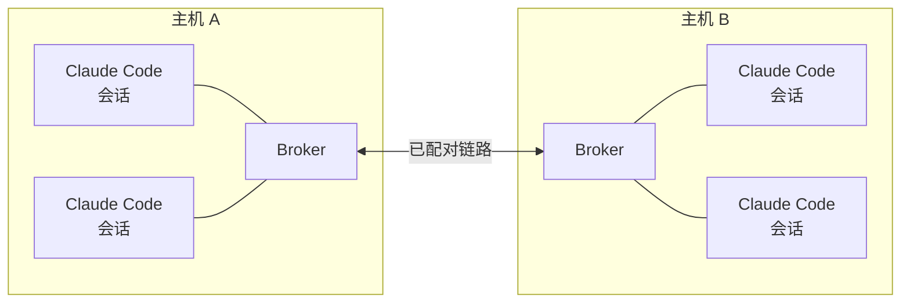

## 解决什么问题

Claude Code 自带的[跨会话消息](https://code.claude.com/docs/en/cross-session-messaging)直接覆盖同一台主机上的其他会话；会话连着 Remote Control 时，还能经 Anthropic 的服务器到达同一用户在其他机器上和云端的会话，而 Remote Control 需要用 claude.ai 账号登录。peers 让配对的两台主机直接连接：两台主机可以属于不同的人，消息在两个 Broker 之间直接传递，不经第三方服务器。不同主机上的会话可以互相发现，并交换纯文本消息。

## 怎么工作

每台主机上运行一个 Broker。Broker 登记本机的 Agent 会话，维护与其他 Broker 的链路。会话启用 peers 的工具后登记到本机的一个 Broker，成为 Agent。两位用户用配对密钥让两个 Broker 配对。配对之后，两边至少同在一个 topic 的 Agent 就能互相看见、互发消息。发给某个会话的消息写入该会话的 inbox socket。空闲的会话无需用户输入就会开始处理。

同一台主机上的会话也可以登记在同一个 Broker 上。对方会话出现在 Claude Code 内置的会话列表里时（同一账户的另一个会话就是这样），模型改用 Claude Code 内置的会话工具与它发起对话，而不经过 peers，除非你用它的 Agent 地址指定它，或要求经 peers 发送；来自 Agent 地址的消息仍然通过 peers 回复。系统级 Broker 上另一个账户的会话不在这个列表里，需要通过 peers 联系。

## 平台要求

peers 运行在 macOS 与 Linux 上，支持 amd64 和 arm64。不支持原生 Windows。

需要 Claude Code v2.1.224 或更高版本。peers 怎样依赖 Claude Code，见[已知限制]()。

## 下一步

想先熟悉术语，接着看[概念]()；要在一台主机上装好并跑起来，看[使用指南]()；[参考]()列出了工具、命令与配置键。
